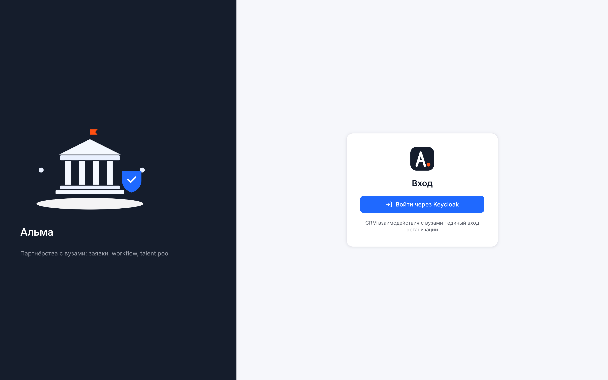
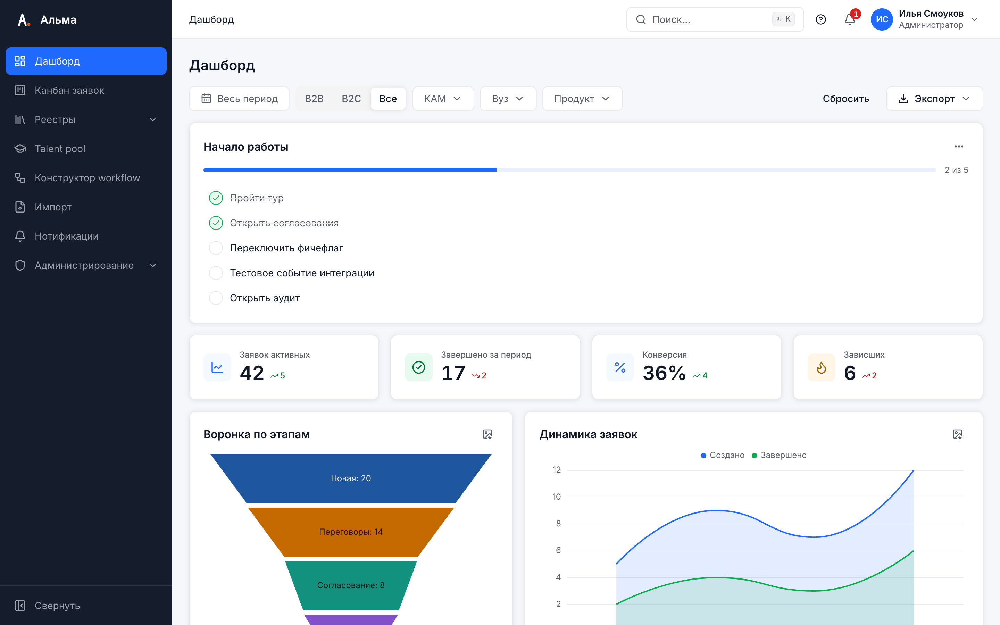
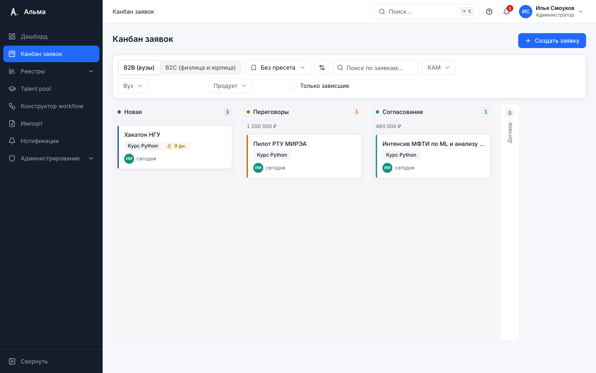
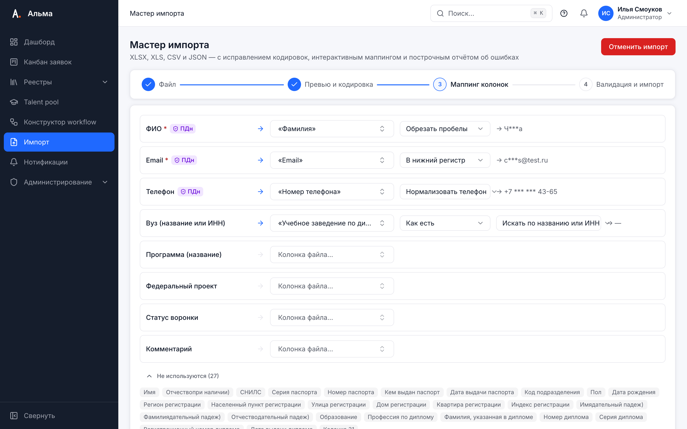
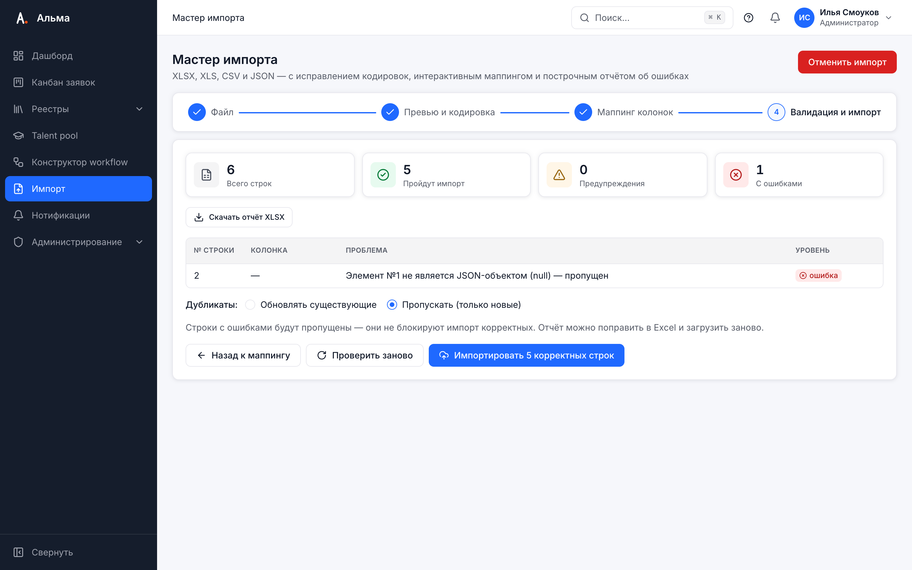
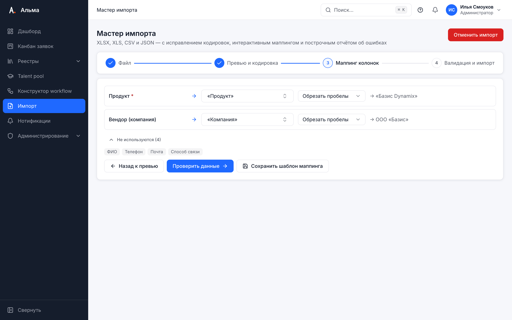
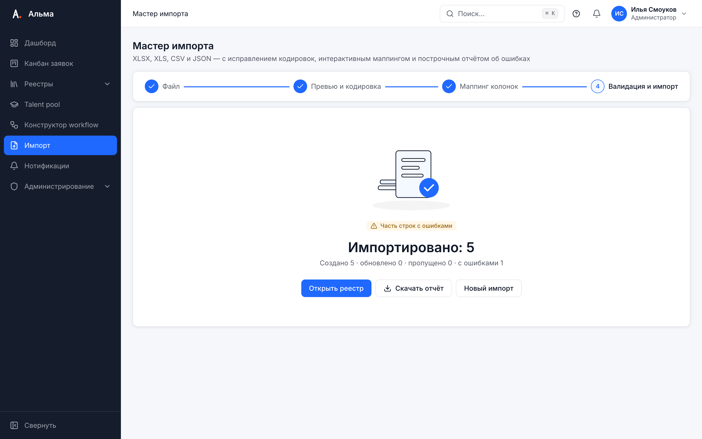
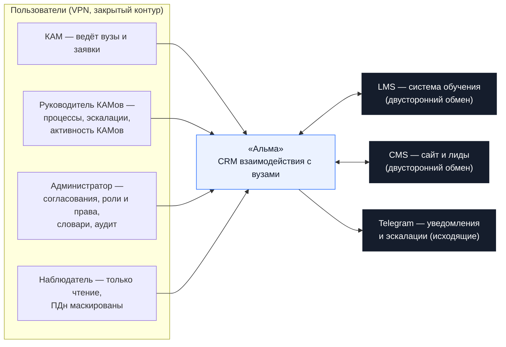
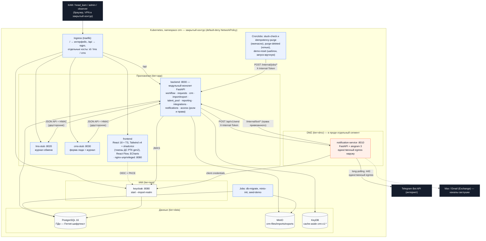
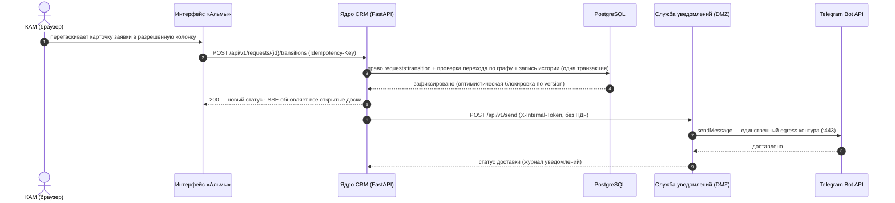

# «Альма» — CRM взаимодействия с вузами

**Живой конструктор процессов, который переводит заявки на новую схему «на лету»,
не останавливая работу людей.** Решение кейса «Ростелекома» (ЛЦТ 2026):
CRM закрытого контура для работы КАМов с вузами (B2B) и физическими/юридическими лицами (B2C).

[](../../actions/workflows/ci.yml)


> **🔗 Живой стенд**
> Приложение: **https://crm.168-113-158-10.nip.io** · вход: `kam1@demo` / `Demo2026!` (все роли — в разделе «Как пользоваться»)
> Заглушка LMS: https://lms.crm.168-113-158-10.nip.io · Заглушка CMS: https://cms.crm.168-113-158-10.nip.io
> Telegram-бот: [@collabse_alma_crm_bot](https://t.me/collabse_alma_crm_bot) · Keycloak: https://id.crm.168-113-158-10.nip.io
> Документация API (Swagger): https://crm.168-113-158-10.nip.io/api/v1/docs


## Оглавление

- [О системе](#о-системе)
- [Возможности](#возможности)
- [Архитектура](#архитектура)
- [Обоснование решений](#обоснование-решений)
- [Как пользоваться](#как-пользоваться)
- [Запуск](#запуск)
- [Консоль Keycloak](#консоль-keycloak)
- [Документация](#документация)
- [Тесты](#тесты)
- [Технологии](#технологии)
- [Структура репозитория](#структура-репозитория)
- [План развития](#план-развития)
- [Лицензия и команда](#лицензия-и-команда)

## О системе

«Альма» — ядро ежедневной работы КАМов с вузами: договоры и лицензии, программы,
ИТ-продукты и ИТ-направления, заявки B2B и B2C с комментариями и файлами в
статусах, пул талантов
студентов с воронкой «кандидат → пул талантов». Центральная идея — **живые
процессы**: руководитель меняет граф этапов в визуальном конструкторе, опасные
правки уходят на согласование администратору, а после применения все открытые
заявки переводятся на новую схему одной транзакцией — 10 000 заявок за 0,6 с,
работа не встаёт. Роли и права администратор настраивает сам, без программиста,
а отчёт «Активность КАМов» показывает, кто с какими вузами работал и на каких
этапах остановился, и выгружает взаимодействия за период в XLSX и PDF по
выбранным колонкам: вуз, ИТ-направление, ИТ-продукт, статус работы с вузом,
ответственный.

Система спроектирована для **закрытого контура**: default-deny NetworkPolicy,
у ядра нет выхода в интернет ни по коду, ни по сети; единственный под с egress
наружу — служба уведомлений (прообраз DMZ), и только она видит токен
Telegram-бота. Персональные данные студентов зашифрованы на уровне приложения
(Fernet + HMAC blind index), маскируются по умолчанию и раскрываются только
с записью в аудит — меры 152-ФЗ встроены в схему данных, а не наложены сверху.

Технически это модульный монолит FastAPI с тремя сервисами-сателлитами
(служба уведомлений, заглушки LMS и CMS), PostgreSQL 16, MinIO, KeyDB и
self-hosted Keycloak 26 — всё разворачивается в Kubernetes одной командой,
локально (k3d/minikube) или на VPS. Интерфейс — React 18 + TypeScript на
собственной токен-системе, ретемированной под дизайн-систему «Ростелекома»
gen2 («Атомаро»).

## Возможности

- 🧩 **Конструктор процессов** — визуальный редактор графа этапов (ветвления,
  возвраты с обязательным комментарием, порог «зависания» этапа от 1 до 365 дней);
  опасные правки уходят на согласование администратору, а заявки **переводятся на
  новую схему «на лету»** одной транзакцией — работа не встаёт. Как 14 шагов
  базового процесса ложатся на этапы и механизмы —
  [docs/design/tz-14-steps.md](docs/design/tz-14-steps.md).
- ⚡ **Пакетный перевод заявок** — один SQL-оператор на удаляемый этап вместо
  цикла по заявкам: 10 000 заявок переносятся за 0,59 с под блокировкой вместо
  25 с, 50 000 — за 2,9 с вместо 130 с. Параллельные переходы КАМов дожидаются
  применения и проходят, без deadlock и потерь. Каждый КАМ получает одно сводное
  уведомление вместо сотен. Замер —
  [docs/evidence/migration-benchmark.md](docs/evidence/migration-benchmark.md).
- 📋 **Доска заявок B2B/B2C** — перетаскивание карточек по разрешённым
  переходам, комментарий на любом переходе (до 4 000 символов; для возвратов и
  отказов — обязательный), обновление всех открытых досок в реальном времени по
  SSE при публикации новой схемы. Мультифильтр с аналитики переносится на доску.
- 📎 **Файлы в статусах** — к переходу прикладывается до 10 файлов, файл виден в
  истории заявки под своим переходом. Принимаются PNG, JPEG, PDF, ZIP, GZIP, RAR,
  DOC, DOCX, XLS и XLSX: сервер сверяет расширение с сигнатурой содержимого.
- 📈 **Отчёт «Активность КАМов»** — кто, когда, с какими вузами
  взаимодействовал и на каком этапе остановился. Три вкладки: детализация
  «КАМ → вузы → заявки» для руководителя; сводка для заказчика (KPI с дельтами к
  прошлому периоду, вузы по этапам, конверсия, «где застревают», риски);
  **«Взаимодействия за период»** — таблица с выбором колонок (вуз, ИТ-направление,
  ИТ-продукт, статус работы с вузом, ответственный и др.) и выгрузкой XLSX, PDF и
  CSV. Фильтры — по нескольким КАМам, вузам, ИТ-направлениям, продуктам и
  программам. Дни на этапе считаются от входа в этап: перевод схемы их не
  обнуляет, отчёт совпадает с доской. PDF — серверный (fpdf2, кириллица), XLSX —
  многолистовой; КАМ видит свою активность.
- 📊 **Аналитика** — ECharts с мультифильтрами (несколько КАМов, вузов,
  продуктов, программ и ИТ-направлений — во всех виджетах сразу), детализацией и
  экспортом: PNG графика с шапкой (период и фильтры), PNG и PDF всей панели,
  XLSX/CSV данных. «Завершено» считается по входу в терминальный этап, а не по
  дате правки карточки. Востребованность программ — заявки на обучение,
  обучающиеся и параллельные потоки. Таблицы-реестры — с личными пресетами.
- 🗂️ **ИТ-направления** — справочник (DevOps, QA, анализ данных…): у программы
  одно направление, у продукта несколько. Фильтр и колонка «ИТ-направление» — в
  реестрах, аналитике, отчёте КАМов и выгрузках.
- 📥 **Диалоговый импорт XLSX/XLS/CSV/JSON** — старый BIFF-Excel по магическим
  байтам, автоопределение битых кодировок (cp1251/koi8-r/cp866…), интерактивное
  сопоставление колонок с шаблонами и построчным отчётом ошибок. Отдельный тип
  **«Таблица КАМов»**: в одной строке вуз, ИТ-направление, ИТ-продукт и вендор,
  договор (поиск по номеру), лицензия (дата подписания, срок, окончание), статус
  передачи лицензии, ответственный КАМ и контакты вуза; ошибочные строки не
  мешают корректным.
- 🎓 **Пул талантов студентов + 152-ФЗ** — воронка «кандидат → пул талантов»,
  ПДн в БД зашифрованы (Fernet + blind index), маскирование по умолчанию,
  раскрытие только с аудитом.
- 🤖 **Telegram-бот** — уведомления и эскалация «зависших» заявок
  (порог настраивается, каскад ответственный → руководитель); авторизация через
  тот же Keycloak, команды строго по ролевой модели.
- 🔗 **Двусторонние интеграции LMS/CMS** — единый JSON-конверт с HMAC-подписью,
  outbox в PostgreSQL, повторные попытки, очередь недоставленных (DLQ); заглушки —
  отдельные поды с журналом обмена, проверяемые по сети.
- 🔐 **Роли и права без программиста** — 4 системные роли и свои роли из
  каталога 61 права: администратор собирает роль на экране «Роли и права»,
  ограничивает её процессом (B2B, B2C) и областью записей («все» или «только
  свои») и назначает пользователям. Изменения действуют сразу, без перезахода.
  Сменить ответственного КАМа за вуз и передать портфель уходящего КАМа
  (заявки и вузы, с предпросмотром и аудитом) может руководитель или
  администратор, а не сам КАМ.
  Вход — self-hosted Keycloak, каждая проверка права — на backend.
- 🛡️ **Без дублей** — заголовок `Idempotency-Key` у 86 мутирующих методов API
  (у вебхуков LMS/CMS своя защита по `event_id`): повтор после обрыва связи или
  двойной клик возвращает сохранённый ответ, а не вторую запись. Интерфейс сам
  выдаёт ключ каждому действию и безопасно повторяет запрос.
- 📱 **Мобильный веб от 375 px** — адаптивный интерфейс: меню — выдвижная панель,
  доска со scroll-snap и перетаскиванием пальцем, карточка заявки, аналитика и
  отчёт КАМов на телефоне. Отдельного мобильного приложения нет.
- 📖 **Встроенная справка** — руководство пользователя (`/help`) и
  администратора (`/help/admin`) внутри приложения, с поиском и печатью в PDF;
  PDF в `docs/manual` собираются из того же текста.
- 🧭 **Адаптация сотрудников** — экран приветствия, интерактивные туры по
  ролям, контрольный список «Начало работы»; принцип «ноль тупиков».
- 🔄 **Сброс демо-стенда** — `make demo-reset ANCHOR=ГГГГ-ММ-ДД` одной
  транзакцией пересевает данные от даты показа и возвращает роли к исходным:
  стенд не «стареет» между прогонами.

Мастер импорта проверен на реальных выгрузках «как в жизни»: имена файлов в
битой кодировке cp866, таблица с 30+ «грязными» колонками («Отчествопри
наличии)», паспорт, СНИЛС) — сопоставление предлагается автоматически, ПДн в
предпросмотре маскируются ещё до записи в БД, а паспортные колонки просто не
имеют целевых полей и в CRM не попадают; null-элементы в JSON становятся
построчными ошибками отчёта, а не отказом всего файла. Подробная аттестация —
[docs/evidence/import-export-test.md](docs/evidence/import-export-test.md).

| | |
|---|---|
|  |  |



| | |
|---|---|
|  |  |
|  |  |

<sub>Снимки сделаны до доработок октября 2026 года: названия разделов меню, цифры и состав
фильтров на стенде отличаются (например, «Аналитика» вместо «Дашборд», «Доска заявок»
вместо «Канбан заявок», отчёта «Активность КАМов» на снимках нет).</sub>

## Архитектура

Контекст системы: пользователи четырёх системных ролей (и своих ролей, которые
собирает администратор) работают с CRM внутри закрытого контура, внешние
системы — LMS, CMS (двусторонний обмен) и Telegram (только исходящие уведомления):



Контейнерный уровень — что именно работает в кластере и кто с кем говорит:



Сквозной сценарий «переход заявки → уведомление в Telegram» — как бизнес-событие
покидает закрытый контур через единственную разрешённую точку:



Ключевое о закрытом контуре: **у ядра CRM нет выхода в интернет ни по коду, ни
по сети** (default-deny NetworkPolicy, разрешения точка-точка между подами);
служба уведомлений — единственный под с egress наружу (только 443 и только не
в кластерные сети), токен Telegram-бота видит только она. В целевой архитектуре
она выносится в DMZ без изменения кода — общение с ядром уже идёт только по
HTTP точка-точка.

### Архитектурные диаграммы

- [docs/design/OVERVIEW.md](docs/design/OVERVIEW.md) — C4: контекст и контейнеры, сводная архитектура
- [docs/design/data-model.md](docs/design/data-model.md) — ERD: 37 таблиц PostgreSQL, шифрование ПДн, ключи KeyDB
- [docs/design/deployment.md](docs/design/deployment.md) — программно-аппаратная схема: топология k8s, DMZ, NetworkPolicy, расчёт ёмкости
- [docs/design/workflow-engine.md](docs/design/workflow-engine.md) — диаграммы процессов: графы, миграции, блокировки, SLA
- [docs/architecture/archi/](docs/architecture/archi/README.md) — функциональная и компонентная архитектура в Archi (ArchiMate 3.1): модель `alma.archimate` с двумя видами и CSV для импорта

Соответствие техническому заданию (полная трассировка «требование → где реализовано») — [docs/evidence/compliance.md](docs/evidence/compliance.md).

## Обоснование решений

- **Модульный монолит + сервисы-сателлиты.** Перевод заявок на новую схему
  «на лету» — это ACID-транзакция; в микросервисах она превращается в сагу с
  компенсациями — риск без выгоды. Границы сервисов проведены только там, где
  они настоящие: служба уведомлений — другой контур безопасности, заглушки
  LMS/CMS — внешние системы по определению. При этом Kubernetes даёт примитивы
  ровно под требования: HPA (300+ пользователей), CronJob («зависшие» заявки),
  NetworkPolicy (закрытый контур), Jobs (миграции и наполнение данными).
- **Массовый перевод заявок — одна транзакция, один оператор на этап.** CTE
  `UPDATE deal … RETURNING` сразу пишет историю этапов, поэтому число обращений к
  БД не зависит от числа заявок. Переходы и применение схемы упорядочены
  advisory-локом воронки: переходы берут shared и друг другу не мешают,
  применение — exclusive. Ожидание ограничено (переход — 10 с, затем
  `409 workflow_busy` с `Retry-After`), чтение не блокируется вовсе (MVCC).
  Уведомления — одна сводка на получателя по тем же правилам и личным настройкам.
- **Outbox — источник истины для интеграций.** События CRM→LMS/CMS фиксируются
  в БД в той же транзакции, что и бизнес-операция, и доставляются фоновым
  обработчиком: единый JSON-конверт, HMAC-подпись, повторные попытки, очередь
  недоставленных (DLQ). Падение внешней системы не теряет события и не откатывает
  работу пользователя. Транспорт — сменный адаптер `IntegrationTransport` (сейчас
  HTTP). KeyDB Streams убраны осознанно: KeyDB у нас эфемерный, а вторая очередь
  рядом с outbox — это dual-write. Корпоративная шина заказчика подключается новой
  реализацией адаптера без смены конверта, ретраев и DLQ.
- **Идемпотентность API — в PostgreSQL, а не в кэше.** `Idempotency-Key` по
  черновику IETF: ключ привязан к пользователю, сохраняются только успешные ответы
  (тела — Fernet-шифртекстом, 24 ч, затем ежечасная очистка CronJob). Гарантия «не
  выполнить дважды» не может жить в KeyDB без персистентности; при недоступном
  хранилище — честный 503, а не риск дубля.
- **Права — код, роли — данные.** Каталог из 61 права определяет только код: право
  без проверки в коде ничего не значит. Роли — строки в БД Альмы, их собирает
  администратор. Keycloak отвечает за вход, назначения ролей хранятся в Альме и
  применяются сразу на всех репликах (SSE `access.changed`, кэш каталога 5 с).
- **Шифрование ПДн: Fernet + HMAC.** ПДн студентов лежат в БД только
  шифртекстом (Fernet, MultiFernet-ротация ключей); поиск — через blind index
  HMAC-SHA256 с отдельным ключом, без раскрытия значений; для списков —
  псевдонимизация «Фамилия И.О.». Маскирование по умолчанию для всех ролей,
  раскрытие — только явное действие с записью в аудит. Ключи живут в k8s Secret,
  генерируются при установке и в git не попадают. ПДн не просачиваются в KeyDB,
  логи приложения, отчёты об ошибках импорта и интеграционные события; в Telegram — только псевдоним «Фамилия И.О.».
- **DMZ для внешних каналов.** Единственный egress закрытого контура — служба
  уведомлений (порт 443, запрет на кластерные сети); пустой токен бота — штатный
  режим console-заглушки, то есть решение работает и в контуре вовсе без выхода
  в интернет. Каналы абстрагированы: Telegram активен, Max/Email — подключаемые
  адаптеры.
- **Дизайн-система на токенах.** Tailwind v4 `@theme` в OKLCH + `tokens.ts` +
  тема ECharts, ретеминг под дизайн-систему «Ростелекома» gen2 («Атомаро»):
  синий `base-info #1F69FF`, оранжевый акцент `status-01 #FF4F12`, графитовый
  сайдбар, проверенные AA-контрасты. Шрифтовой стек `'Rostelecom Basis' → Inter`
  (файлы фирменного шрифта в репозиторий не входят — лицензия РТК). Детали —
  [docs/design/redesign.md](docs/design/redesign.md) и
  [docs/design/brand-rt.md](docs/design/brand-rt.md).

Полная аргументация выбора стека — [docs/design/OVERVIEW.md](docs/design/OVERVIEW.md) §7.

## Как пользоваться

Роли и их сценарии:

- **Администратор** — согласует опасные правки процессов (`/admin/approvals`),
  настраивает роли и права (`/admin/roles`) и назначает их пользователям, ведёт
  справочники (в том числе ИТ-направления) и функциональные переключатели, смотрит
  аудит и монитор интеграций; руководство администратора — `/help/admin`.
- **Руководитель КАМов** — редактирует графы процессов в конструкторе, получает
  эскалации «зависших» заявок, анализирует воронку на аналитической панели и
  активность всех КАМов (`/reports/kam-activity`), назначает ответственных КАМов
  за вузы и передаёт портфель уходящего КАМа («Администрирование → Пользователи»).
- **КАМ** — ведёт вузы, договоры и заявки на доске, прикладывает файлы к
  переходам, импортирует данные (в том числе «Таблицу КАМов»), общается в
  комментариях с @упоминаниями; читает всё, пишет своё, видит свою активность.
  Новый вуз заводит на себя или без ответственного; сменить ответственного за
  вуз не может.
- **Наблюдатель** — только чтение, включая отчёты по всем КАМам; ПДн маскированы
  без права раскрытия.

Роли назначаются в Альме: «Администрирование → Пользователи», состав прав —
«Администрирование → Роли и права». Keycloak отвечает только за вход: роль из
realm становится стартовым назначением при первом входе, дальше её не
перезаписывает. Свои роли собираются из каталога прав и ограничиваются процессом
и областью записей; сид создаёт пример — роли «КАМ B2B» и «КАМ B2C» с правами
КАМа в одном процессе. Замените у `kam2@demo` роль «КАМ» на «КАМ B2C» — процесс
B2B пропадёт у него с доски и из отчётов сразу, без перезахода.

Если в системе не осталось ни одного администратора, роль выдаёт аварийная
команда: `kubectl -n crm exec deploy/backend -- python -m app.tools.rbac grant-admin <логин>`
(`list-admins` — кто может управлять ролями). Назначение пишется в аудит.

Демо-пользователи (Keycloak, realm `crm`, преднастроены при импорте realm; сид
дополнительно заводит историю активности ещё 18 КАМов — они видны в отчётах, но
войти под ними нельзя):

| Логин | Пароль | Роль | Что показывает |
|---|---|---|---|
| `admin@demo` | `Demo2026!` | admin | всё + согласование изменений процессов, роли и права, админка, аудит |
| `head@demo` | `Demo2026!` | head_kam | руководитель КАМов: конструктор процессов, эскалации зависших, активность КАМов |
| `kam1@demo` | `Demo2026!` | kam | КАМ (руководитель — `head@demo`): читает всё, пишет своё |
| `kam2@demo` | `Demo2026!` | kam | второй КАМ — параллельная работа и права на «чужие» заявки |
| `observer@demo` | `Demo2026!` | observer | только чтение; ПДн маскированы без права раскрытия |

Пошаговые сценарии — во встроенной справке (меню «Справка», `/help`) и в
[руководстве пользователя](docs/manual/Альма%20—%20руководство%20пользователя.pdf) (PDF).

Привязка Telegram: CRM → `/settings/notifications` → «Привязать Telegram» →
QR/код → команда `/start <код>` боту. Команды `/my` и `/stuck` отвечают по роли
привязанного пользователя; непривязанный получает отказ.

## Запуск

### Вариант 1 — docker-compose (локальная разработка)

```sh
make dev                      # postgres + keycloak + minio + keydb + backend (hot-reload) + уведомления + заглушки
cd frontend && npm run dev    # vite на :5173, прокси /api → localhost:8000
```

`make dev-env` создаёт `deploy/compose/.env` (генерирует ключи шифрования ПДн;
файл не входит в git и не перетирается повторными запусками). Остановить — `make dev-down`.

### Вариант 2 — локальный Kubernetes (k3d, основной путь)

```sh
make k8s-secrets && make k8s-up   # 1. секреты + кластер + образы + манифесты + ожидание
make demo                         # 2. демо-данные и «зависшие» заявки → открыть http://crm.localhost
```

> `make k8s-up` сам вызывает `k8s-secrets`, поэтому шаг 1 можно сократить до
> одной команды; секреты (включая ключи шифрования ПДн) генерируются локально
> и в git не попадают.

Открывать в Chrome/Chromium/Edge по адресу `crm.localhost` — браузер
резолвит `*.localhost` в `127.0.0.1` сам: без правки `/etc/hosts` и без sudo.
`http://*.localhost` считается безопасным контекстом (Web Crypto доступен), что
обязательно для входа через Keycloak (PKCE S256).

| Адрес | Что это |
|---|---|
| `crm.localhost` | «Альма» (фронтенд `/`, API `/api` — один хост, без CORS) |
| `id.crm.localhost` | Keycloak (realm `crm`) |
| `lms.crm.localhost` | Заглушка LMS — журнал двустороннего обмена + кнопка «событие в CRM» |
| `cms.crm.localhost` | Заглушка CMS — демо-форма лида + журнал |
| `minio.crm.localhost` | Консоль MinIO (S3-хранилище файлов) |

Ingress дополнительно отвечает на алиасах `*.crm.local` для curl/API/k6
(строку для `/etc/hosts` печатает `make hosts`; для curl достаточно
`--resolve crm.local:80:127.0.0.1`). Вход в интерфейс через `http://*.local`
невозможен: это небезопасный контекст браузера, Web Crypto недоступен и
PKCE-вход падает — используйте ``crm.localhost``.

Вариант minikube: `make k8s-up-minikube` (стартует с `--cni=calico` —
принудительное применение NetworkPolicy; на macOS с драйвером docker
дополнительно нужен `minikube tunnel`). Цели, применяющие манифесты
(`demo`, `seed`, `k8s-apply`), на minikube-стенде запускайте с
`OVERLAY=deploy/k8s/overlays/minikube`. Снести кластер — `make k8s-down`.

### Вариант 3 — VPS (публичный стенд)

```sh
VM_IP=<ip> VM_HOST=<ssh-host> make vm-deploy   # amd64-образы → импорт, манифесты overlay vm, cert-manager (TLS), smoke-проверка
```

Хосты — `*.<IP-через-дефисы>.nip.io` (публичный wildcard-DNS, у посетителей
ничего настраивать не нужно), TLS выпускает cert-manager.

> Стенд демонстрационный: nip.io и Let's Encrypt — только для демо (имена хостов
> уходят во внешние резолверы и журналы Certificate Transparency, ACME недоступен
> в закрытом контуре). В продакшене — корпоративная DNS-зона и внутренний УЦ через
> cert-manager, см. [docs/design/deployment.md](docs/design/deployment.md) §4.4.

### Живой стенд

| Адрес | Что это |
|---|---|
| https://crm.168-113-158-10.nip.io | «Альма» — вход под любым демо-пользователем |
| https://id.crm.168-113-158-10.nip.io | Keycloak (realm `crm`) |
| https://lms.crm.168-113-158-10.nip.io | Заглушка LMS — журнал двустороннего обмена |
| https://cms.crm.168-113-158-10.nip.io | Заглушка CMS — демо-форма лида |

Telegram-бот стенда — [@collabse_alma_crm_bot](https://t.me/collabse_alma_crm_bot).
Как выпустить своего бота для собственного развёртывания: получить токен у
[@BotFather](https://t.me/BotFather), вписать его в
`deploy/k8s/overlays/<k3d|minikube>/secrets/crm-telegram.env`
(`TELEGRAM_BOT_TOKEN=…`; для compose — в `deploy/compose/.env`), затем
`make k8s-apply && kubectl -n crm rollout restart deploy/notification`.
Если username бота отличается от стандартного, задайте `TELEGRAM_BOT_USERNAME`
в окружении backend и службы уведомлений. Пустой токен — штатный режим
console-заглушки: сообщения уходят в лог службы уведомлений.

<details>
<summary><b>Частые проблемы и их решения</b></summary>

| Симптом | Решение |
|---|---|
| ``crm.localhost`` не открывается | проверьте, свободен ли порт 80: `sudo lsof -i :80` — балансировщик k3d пробрасывает 80 на localhost; `*.localhost` резолвит сам Chromium/Edge (в Firefox/Safari при необходимости добавьте строку из `make hosts` с `crm.localhost`) |
| Открыли `http://crm.local` — «вход невозможен» | ожидаемо: `http://*.local` — небезопасный контекст, Web Crypto недоступен; для входа используйте ``crm.localhost`` |
| Поды в `Pending`/`OOMKilled` | Docker Desktop: выделите ≥ 4 CPU и ≥ 6–8 GB памяти (сумма requests стенда ≈ 1.7 CPU / 2.5 GiB + сам кластер) |
| minikube на macOS: Ingress недоступен | драйвер docker требует `sudo minikube -p crm tunnel`; либо возьмите IP из `minikube -p crm ip` |
| Keycloak долго не готов | норма: JVM + импорт realm — до 5 минут (startupProbe учитывает); `make k8s-apply` дожидается сам |
| `wait --for=condition=complete job/db-migrate` истёк | `kubectl -n crm logs job/db-migrate` — обычно не готов postgres (PVC/StorageClass overlay-я) |
| Доска заявок не обновилась после публикации схемы | SSE-поток мог оборваться — обновите страницу (F5), у фронтенда есть резервный опрос |
| «Схема процесса сейчас обновляется» при переходе заявки | по воронке применяется пакет изменений (`409 workflow_busy`); интерфейс уже повторял запрос по `Retry-After` — повторите действие через несколько секунд, операция не выполнялась и дубля не будет |
| Сменили роль в Keycloak — в Альме ничего не изменилось | так и задумано: роли назначаются в Альме («Администрирование → Пользователи»), Keycloak задаёт только стартовую роль при первом входе |
| Telegram-уведомления не приходят | токен не задан (режим console-заглушки — `kubectl -n crm logs deploy/notification`) либо в контуре закрыт egress |
| Изменили манифесты — как проверить без кластера | `make k8s-validate` (рендер обоих overlay + kubeconform) |
| Пересоздать демо-данные | `make seed` (идемпотентно) или `make demo` (данные + триггер «зависших»); к показу — `make demo-reset ANCHOR=ГГГГ-ММ-ДД` (сброс и пересев от даты показа, на VPS — `make vm-demo-reset`) |

</details>

<details>
<summary><b>Основные make-цели</b></summary>

| Цель | Действие |
|---|---|
| `dev` / `dev-down` | compose-стек для разработки |
| `k8s-up` / `k8s-up-minikube` / `k8s-down` | стенд Kubernetes под ключ |
| `k8s-apply` | идемпотентный apply манифестов (Jobs пересоздаются) |
| `k8s-secrets` | генерация секретов overlay-я (в git не попадают) |
| `k8s-validate` | рендер обоих overlay + kubeconform |
| `vm-deploy` / `vm-smoke` | развёртывание на VPS и его smoke-проверка |
| `seed` / `demo` | демо-данные; `demo` дополнительно триггерит «зависшие» |
| `demo-reset` / `demo-reset-local` / `vm-demo-reset` | сброс стенда к показу: пересев от `ANCHOR=ГГГГ-ММ-ДД`, роли к исходным (k8s / compose / VPS) |
| `stuck-check` | тот же триггер для compose-стенда (паритет CronJob) |
| `idempotency-purge` | очистка просроченных ключей Idempotency-Key на compose-стенде (паритет CronJob) |
| `demo-idempotency` | демо Idempotency-Key против стенда: повтор, другой запрос с тем же ключом, параллельный дубль |
| `bench-migration` | замер переноса заявок на одноразовой БД `crm_bench` ([отчёт](docs/evidence/migration-benchmark.md)) |
| `docs-arch` | перегенерация модели Archi и перечня библиотек (`docs/architecture`) |
| `realm-sync` | регенерация ConfigMap realm из `deploy/keycloak/realm-crm.json` |
| `hosts` | строка для `/etc/hosts` |
| `load-test` | k6-сценарий 300→400 VU (`deploy/load/`) |
| `load-test-users` / `load-test-reports` / `load-test-nft` | профили НФТ: 50 пользователей под разными учётками, 10 параллельных отчётов с выгрузками, оба сразу |
| `logs`, `clean`, `help` | сервисные |

</details>

## Консоль Keycloak

Консоль администратора Keycloak доступна по пути `/admin/master/console/`:
на живом стенде — https://id.crm.168-113-158-10.nip.io/admin/master/console/,
на локальном — `id.crm.localhost`/admin/master/console/.

Данные для входа генерируются при установке и хранятся только в секрете кластера:

```sh
kubectl -n crm get secret crm-keycloak-admin -o jsonpath='{.data.username}' | base64 -d; echo
kubectl -n crm get secret crm-keycloak-admin -o jsonpath='{.data.password}' | base64 -d; echo
```

> **Внимание: две разные формы входа.** Консоль администратора — это realm
> `master` и служебная учётная запись из секрета `crm-keycloak-admin`;
> вход в саму CRM — realm `crm` и демо-пользователи из таблицы выше.
> Учётные записи не взаимозаменяемы: демо-пользователи в консоль не входят,
> а администратор консоли не имеет ролей CRM. Роли CRM меняются в самой Альме,
> а не в консоли Keycloak.

Сервисные клиенты realm: `crm-frontend` (public + PKCE), `crm-notification` и
`crm-integration` (confidential, роли `svc_notification`/`svc_integration`),
`crm-loadtest` (Direct Access Grants — только для нагрузочного тестирования).
Секреты confidential-клиентов генерируются `make k8s-secrets` и подставляются
Keycloak при импорте realm — в git они не попадают.

## Документация

- **Документация API (OpenAPI 3 / Swagger UI)** — [живой стенд](https://crm.168-113-158-10.nip.io/api/v1/docs); при локальном запуске — тот же путь `/api/v1/docs`, схема — `/api/v1/openapi.json`: 157 методов REST API, у 86 мутирующих — заголовок `Idempotency-Key`; все ответы с ошибкой описаны единым форматом `ErrorEnvelope` (код, сообщение, детали, `trace_id`), ошибка валидации запроса — `400 validation_error`; каталог кодов ошибок — [api-contract.md §1.4](docs/design/api-contract.md).

- **Встроенная справка** — меню «Справка» в приложении (`/help`; руководство администратора — `/help/admin`). PDF: [руководство пользователя](docs/manual/Альма%20—%20руководство%20пользователя.pdf) · [руководство администратора](docs/manual/Альма%20—%20руководство%20администратора.pdf); текст — `frontend/src/pages/help/content`, сборка — `node --experimental-strip-types docs/manual/build-manual.ts --pdf`
- **Презентация** — [docs/presentation/](docs/presentation/)
- **Аттестации и доказательства** — [docs/evidence/](docs/evidence/):
  - [compliance.md](docs/evidence/compliance.md) — соответствие техническому заданию
  - [k8s-evidence.md](docs/evidence/k8s-evidence.md) — доказательства развёртывания в Kubernetes с живого кластера
  - [load-report.md](docs/evidence/load-report.md) — отчёт нагрузочного тестирования (300+ пользователей) и методика профилей НФТ (50 пользователей, 10 параллельных отчётов)
  - [import-export-test.md](docs/evidence/import-export-test.md) — аттестация импорта/экспорта на реальных «грязных» данных
  - [migration-benchmark.md](docs/evidence/migration-benchmark.md) — замер массового переноса заявок: 1 000 / 10 000 / 50 000, «до» и «после»
- **Проектная документация** — [docs/design/](docs/design/):
  - [OVERVIEW.md](docs/design/OVERVIEW.md) — сводная архитектура, C4, трассировка требований
  - [data-model.md](docs/design/data-model.md) — PostgreSQL: DDL 37 таблиц, миграции 0001–0008, шифрование ПДн, ключи KeyDB
  - [api-contract.md](docs/design/api-contract.md) — REST `/api/v1`, права эндпоинтов, Idempotency-Key, интеграционный конверт
  - [workflow-engine.md](docs/design/workflow-engine.md) — семантика движка процессов: графы, миграции, блокировки, SLA
  - [tz-14-steps.md](docs/design/tz-14-steps.md) — 14 шагов базового процесса: какой шаг каким этапом или механизмом закрыт
  - [deployment.md](docs/design/deployment.md) — k8s, секреты, NetworkPolicy, k6, расчёт ёмкости
  - [ux.md](docs/design/ux.md) — экраны, роли в интерфейсе, конструктор процессов, отчёты, мобильная вёрстка, справка
  - [redesign.md](docs/design/redesign.md) — дизайн-система CRM: токены, компоненты, движение, адаптация
  - [brand-rt.md](docs/design/brand-rt.md) — ретеминг под ДС «Ростелекома» gen2: палитра, соответствие токенов, контрасты
- **Архитектура в Archi и перечень библиотек** — [docs/architecture/](docs/architecture/README.md):
  - [archi/](docs/architecture/archi/README.md) — модель `alma.archimate` (виды «Функциональная схема» и «Компонентная схема») и CSV для импорта в Archi
  - [libraries.md](docs/architecture/libraries.md) — полный перечень библиотек и компонентов с версиями и лицензиями

## Тесты

Всего **1 937 тестов pytest**: 1 819 в backend, 82 в службе уведомлений, 36 в
заглушках LMS/CMS. Во фронтенде — 62 юнит-теста `node:test` (клиент
Idempotency-Key, контраст палитры этапов, шаблон импорта), строгая проверка типов,
проверка встроенной справки и сборка. Числа — по `pytest --collect-only -q` (с
параметризациями) и `npm run test:unit`, подсчёт 16.10.2026.

Из тестов backend 1 620 идут без инфраструктуры, а 199 в `backend/tests/db` — на
настоящем PostgreSQL 16 со схемой из миграций Alembic (`upgrade head`, со всеми
индексами и CHECK). Они проверяют обратимость миграций, каталог ролей против кода,
перенос 10 000 заявок и откат при сбое посередине переноса, гонки переходов с
применением схемы на настоящих COMMIT, Idempotency-Key сквозь приложение, отчёт
«Активность КАМов» и «Взаимодействия за период», фильтры аналитики, файлы в
статусах и передачу портфеля, ИТ-направления, импорт «Таблицы КАМов» и сброс
демо-стенда. Модель Archi и перечень библиотек сверяются с кодом: пути API — с
OpenAPI, права — с каталогом, пакеты — с lock-файлами. Полный прогон backend с
PostgreSQL — около 80 секунд, 1 819 passed.

| Сервис | Команды |
|---|---|
| backend (1 819) | `cd backend && uv sync --extra dev && uv run pytest` (линт: `uv run ruff check app tests`) |
| notification (82) | `cd services/notification && uv sync && uv run pytest` |
| lms-stub / cms-stub (20 + 16) | `cd services/lms-stub && uv sync --extra dev && uv run pytest` (аналогично cms-stub) |
| frontend (62) | `cd frontend && npm ci && npm run typecheck && npm run test:unit && npm run docs:help && npm run build` |

Тесты `tests/db` ждут PostgreSQL на `localhost:5432` (пользователь `crm/crm`) и
пересоздают схему базы `crm_test` (своя база — `ALMA_TEST_DB=crm_test_<имя>`).
Без PostgreSQL они пропускаются, а `ALMA_DB_TESTS=required` превращает пропуск в
ошибку — так настроен CI.

Нагрузочное тестирование — k6. Выполненный прогон 16.09.2026: разгон до 300 VU и
пик 400 (`make load-test`), пороги зашиты в сценарий (p95 < 500 мс, p99 < 1000 мс,
ошибок < 1%), параллельно наблюдается работа HPA (`kubectl -n crm get hpa backend
-w`, реплики 2 → 6 → 2). Итог: p95 — 90,7 мс, ошибок 0,28%, а p99 — 1,07 с, порог
превышен на 7%; разбор и исправленный после прогона бюджет соединений PostgreSQL —
в [docs/evidence/load-report.md](docs/evidence/load-report.md). Профили
нефункциональных требований — 50 пользователей под разными учётками
(`make load-test-users`), 10 параллельных отчётов разной сложности с выгрузками
(`make load-test-reports`) и оба сразу (`make load-test-nft`) — подготовлены; их
прогона ещё не было, результаты будут добавлены в тот же отчёт. Скрипт и
docker-вариант запуска — `deploy/load/README.md`.

Аттестация импорта/экспорта на реальных данных —
[docs/evidence/import-export-test.md](docs/evidence/import-export-test.md).

Замер массового переноса заявок (1 000 / 10 000 / 50 000, пакетный и прежний
поштучный режим в одной среде) — `make bench-migration` или
`python -m app.tools.bench_migration` на одноразовой базе, отчёт —
[docs/evidence/migration-benchmark.md](docs/evidence/migration-benchmark.md).

## Технологии

- **Backend:** Python 3.12, FastAPI, SQLAlchemy 2 (async), Pydantic v2, Alembic;
  импорт — `openpyxl`, `xlrd 2.x`, `charset-normalizer`; PDF отчётов — `fpdf2`
  (чистый Python, шрифты DejaVu в пакете); XLSX — `openpyxl`; криптография — `cryptography` (Fernet,
  работает офлайн); aiogram 3 в службе уведомлений.
- **Frontend:** React 18 + TypeScript, Vite, Tailwind CSS v4 + shadcn/ui
  (собственная токен-система), TanStack Table (реестры с личными пресетами),
  @xyflow/react (конструктор процессов), Apache ECharts (аналитические панели;
  PNG графиков и PDF всей панели собираются в браузере, без сторонних библиотек),
  motion (единый язык движения с уважением
  `prefers-reduced-motion`), keycloak-js (OIDC + PKCE). Без CDN: шрифты
  @fontsource, иконки lucide, иллюстрации — встроенный SVG.
- **Данные и инфраструктура:** PostgreSQL 16, MinIO (S3), KeyDB (cache-aside,
  осознанно без персистентности — падение кэша деградирует в чтение из БД),
  Keycloak 26, Kubernetes (k3d / minikube / VPS-k3s), kustomize, cert-manager,
  k6, GitHub Actions.
- **Порты компонентов:** backend 8000 · frontend nginx 8080 (Service 80) ·
  notification 8010 · lms-stub 8020 · cms-stub 8030 · keycloak 8080 ·
  postgres 5432 · minio 9000/9001 · keydb 6379.
- **Полный перечень** библиотек и компонентов с версиями и лицензиями —
  [docs/architecture/libraries.md](docs/architecture/libraries.md) (генерирует
  `backend/app/tools/list_libraries.py`, `make docs-arch`).

## Структура репозитория

```
.
├── backend/                        # ядро CRM — модульный монолит FastAPI
│   ├── app/
│   │   ├── core/                   #   аутентификация Keycloak, каталог прав и доступ, шифрование ПДн,
│   │   │                           #   Idempotency-Key, outbox и транспорт интеграций, кэш
│   │   ├── modules/                #   workflow · requests · crm · import_export · talent_pool ·
│   │   │                           #   reporting · notifications · integrations · access · admin
│   │   └── tools/                  #   наполнение демо-данными, аварийная выдача admin,
│   │                               #   замер переноса заявок, ротация ключей ПДн, перечень библиотек
│   ├── alembic/                    #   миграции схемы БД (0001–0008), 37 таблиц
│   └── tests/                      #   1 819 pytest, из них 199 на PostgreSQL (tests/db)
├── frontend/                       # интерфейс — React 18 + TypeScript + Vite
│   ├── src/
│   │   ├── app/                    #   каркас: маршруты, охрана доступа по правам, меню, макет
│   │   ├── pages/                  #   аналитика · активность КАМов · доска заявок · реестры ·
│   │   │                           #   конструктор процессов · импорт · пул талантов · уведомления ·
│   │   │                           #   администрирование (роли и права, справочники, согласования) ·
│   │   │                           #   встроенная справка (help/content — текст руководств)
│   │   ├── features/onboarding/    #   адаптация сотрудников: туры, контрольный список
│   │   └── shared/                 #   дизайн-система (ui, токены), API-клиент с Idempotency-Key, SSE
│   └── tests/                      #   62 юнит-теста node:test
├── services/
│   ├── notification/               # служба уведомлений + Telegram-бот (aiogram 3, DMZ), 82 pytest
│   ├── lms-stub/                   # заглушка LMS: журнал обмена, кнопки тестовых событий
│   └── cms-stub/                   # заглушка CMS: демо-форма лида, каталог программ
├── deploy/
│   ├── compose/                    # docker-compose.dev.yml — локальная разработка
│   ├── k8s/
│   │   ├── base/                   # kustomize base: Deployments, Jobs, CronJobs, NetworkPolicy
│   │   ├── overlays/               # k3d · minikube · vm (VPS c TLS)
│   │   └── vm-addons/              # cert-manager + ClusterIssuer для публичного стенда
│   ├── keycloak/                   # realm-crm.json — канонический экспорт realm
│   ├── scripts/                    # секреты, realm-ConfigMap, развёртывание на VPS, сброс демо-стенда
│   └── load/                       # k6: сценарий 300+ VU и профили НФТ (50 пользователей, 10 отчётов)
├── docs/
│   ├── design/                     # проект: архитектура, данные, API, процессы, 14 шагов процесса, дизайн
│   ├── architecture/               # модель Archi (ArchiMate) с CSV для импорта, перечень библиотек
│   ├── evidence/                   # аттестации: соответствие ТЗ, k8s, нагрузочное, импорт/экспорт,
│   │                               # замер переноса заявок
│   ├── manual/                     # руководства пользователя и администратора (HTML + PDF,
│   │                               # собираются из встроенной справки)
│   ├── presentation/               # презентация (PPTX + PDF)
│   └── screenshots/                # снимки экрана для README
└── .github/workflows/              # CI: тесты, линтеры, сборка, валидация манифестов
```

## План развития

- **Адаптер корпоративной шины заказчика (Kafka/ESB)** — новая реализация
  `IntegrationTransport` поверх outbox: конверт, ретраи и DLQ не меняются,
  `event_id` конверта — ключ сообщения (`docs/design/api-contract.md` §13.7).
- **Двухфазный фоновый перенос заявок** — для пакетов крупнее ≈170 тыс. заявок,
  где ожидание переходов упрётся в лимит 10 с (`docs/design/workflow-engine.md`
  §6.8, [замер](docs/evidence/migration-benchmark.md)).
- **Прод-DNS и внутренний УЦ** — корпоративная DNS-зона и cert-manager с
  внутренним центром сертификации вместо nip.io и Let's Encrypt
  (`docs/design/deployment.md` §4.4).
- **Каналы уведомлений Max и Email (Exchange)** — включение существующих
  адаптеров-заглушек службы уведомлений.
- **TLS для локального стенда** — заготовка в `docs/design/deployment.md` §3.6
  (на VPS-стенде TLS уже работает через cert-manager).
- **Новые процессы помимо B2B и B2C** — сейчас процессов два (решение
  кейсодержателя), новые варианты взаимодействия добавляются этапами и ветками в
  конструкторе. Дальше — создание процесса клонированием существующего и связь
  «роль — процесс» вместо фиксированного списка `b2b`/`b2c` в схеме БД.
- **Опрос LMS/CMS (pull)** — сейчас внешние системы присылают события вебхуками;
  адаптер опроса с курсором в БД и CronJob дополнит этот путь.
- **Тип контакта в комментарии** (встреча, звонок, письмо) и дата контакта —
  чтобы отчёт по взаимодействиям учитывал записанные встречи, а не только
  действия в заявке.
- **Резервное копирование и метрики** — CronJob `pg_dump` в отдельное хранилище и
  эндпоинт метрик для мониторинга контура.

## Лицензия и команда

Код — под лицензией [MIT](LICENSE). Названия и фирменные цвета «Ростелекома»
использованы в учебно-демонстрационных целях (ЛЦТ 2026) и не являются
продукцией ПАО «Ростелеком»; файлы фирменного шрифта в репозиторий не входят.

Сделано командой **Collabse**. Вопросы и предложения приветствуются в Issues.
