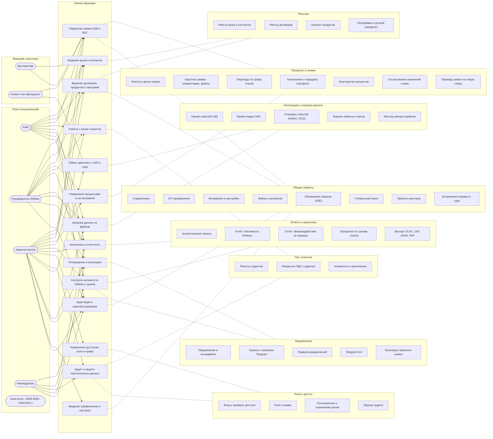

# Архитектура «Альмы» в Archi

Функциональная и компонентная архитектура «Альмы» в нотации ArchiMate 3.1 для
[Archi](https://www.archimatetool.com/) — открытого редактора моделей ArchiMate.
Модель хранится в двух форматах: CSV для импорта и готовый файл Archi с двумя
видами.
Ниже — превью обеих схем в Mermaid, чтобы посмотреть их без Archi.

- **Функциональная схема** — кто что делает. Роли пользователей выполняют
  бизнес-функции, прикладные сервисы эти функции обслуживают. Какая роль
  выполняет какую функцию, генератор вычисляет по каталогу прав
  [`backend/app/core/rbac_catalog.py`](../../../backend/app/core/rbac_catalog.py).
  Роль выполняет функцию, если в её наборе есть хотя бы одно из прав функции.
  У каждого сервиса в свойствах записаны API, права и экран интерфейса.
- **Компонентная схема** — из чего система состоит и где работает: frontend,
  backend и его модули, notification-service, заглушки LMS и CMS, Keycloak,
  PostgreSQL, KeyDB, MinIO. Всё размещено в кластере Kubernetes (namespace `crm`)
  по зонам `tier`, как в манифестах. На схеме также образы контейнеров, задания
  CronJob и Job, внешние системы и ограничения закрытого контура.

Два вида связаны трассировкой: каждый прикладной сервис функциональной схемы
реализуют компоненты компонентной схемы (связь «реализация»). Например, сервис
«Переходы по графу этапов» реализуют модули `workflow` и `requests`.

## Файлы

| Файл | Что это |
|---|---|
| [`alma.archimate`](alma.archimate) | Модель Archi с двумя готовыми видами: «Функциональная схема» и «Компонентная схема» |
| [`elements.csv`](elements.csv) | Элементы модели: роли, функции, сервисы, компоненты, узлы, артефакты, ограничения |
| [`relations.csv`](relations.csv) | Связи ArchiMate между элементами |
| [`properties.csv`](properties.csv) | Свойства: вид, API, права, экран, каталог в репозитории, порт, манифест |
| [`build_archi.py`](build_archi.py) | Генератор всех файлов выше и превью в этом README |

CSV в формате Archi «Import → CSV Data Into Selected Model»: три файла с
заголовками `"ID","Type","Name","Documentation","Specialization"`,
`"ID","Type","Name","Documentation","Source","Target","Specialization"` и
`"ID","Key","Value"`. Поля в кавычках, кодировка UTF-8, типы — имена классов
ArchiMate в Archi (`BusinessRole`, `ApplicationService`, `ServingRelationship`…).
Первая строка `elements.csv` с типом `ArchimateModel` задаёт имя и назначение
модели.

## Как открыть в Archi

Нужен Archi 4.9 или новее.

**Готовая модель с видами.** File → Open… → `docs/architecture/archi/alma.archimate`.
Виды лежат в папке «Виды» дерева модели. Двойной щелчок открывает вид.

**Импорт из CSV.** CSV-импорт Archi переносит элементы, связи и свойства, но не
виды.

1. File → New → Empty Model, выделить новую модель в дереве.
2. File → Import → CSV Data Into Selected Model…, выбрать `elements.csv`.
   Archi сам подхватит `relations.csv` и `properties.csv` из той же папки.
3. Чтобы собрать вид, создайте его (New → ArchiMate View) и перетащите
   элементы из дерева. Свойство «Вид» у каждого элемента («Функциональная
   схема» или «Компонентная схема») подсказывает, к какой схеме он относится.
   Готовые виды с раскладкой есть только в `alma.archimate`.

Идентификаторы элементов и связей постоянные (`alma-svc-board`,
`alma-rel-v-svc-board--fn-requests`). Повторный импорт в ту же модель обновит
имена, описания и свойства и не создаст дублей.

**Командная строка Archi** — собрать модель из CSV без интерфейса:

```sh
# macOS: Archi.app/Contents/MacOS/Archi; Linux: ./Archi; Windows: Archi
Archi -application com.archimatetool.commandline.app -consoleLog -nosplash \
  --createEmptyModel \
  --csv.import docs/architecture/archi/elements.csv \
  --saveModel alma-from-csv.archimate
```

HTML-отчёт с картинками видов (для тех, у кого нет Archi):

```sh
Archi -application com.archimatetool.commandline.app -consoleLog -nosplash \
  --loadModel docs/architecture/archi/alma.archimate \
  --html.createReport alma-report
```

## Как обновить

Модель генерируется, вручную файлы не правятся:

```sh
python3 docs/architecture/archi/build_archi.py          # перегенерировать CSV, .archimate и превью
python3 docs/architecture/archi/build_archi.py --check  # exit 1, если файлы устарели
```

Нужен только Python 3.10+ без сторонних пакетов. Генератор проверяет модель
перед записью:

- каждая связь допустима по таблице связей ArchiMate из Archi
  (`relationships.xml`). CSV-импорт Archi отвергает весь файл, если в нём есть
  хотя бы одна недопустимая связь;
- каждое право в свойствах есть в каталоге `rbac_catalog.py`;
- у каждого элемента вида есть место на схеме, вложенные объекты не выходят
  за родителя, соседние не перекрываются.

Тест `backend/tests/test_architecture_docs.py` проверяет, что файлы актуальны.
Он же сверяет пути API в свойствах сервисов с OpenAPI backend, а каталоги
и манифесты — с репозиторием.

## Состав модели

<!-- archi:stats:begin -->
| Вид | Элементов | Связей на виде | Состав |
|---|---:|---:|---|
| Функциональная схема | 73 | 87 | бизнес-акторы — 2, бизнес-роли — 5, бизнес-функции — 14, прикладные сервисы — 41, группировки — 11 |
| Компонентная схема | 51 | 40 | бизнес-акторы — 1, компоненты приложений — 25, узлы — 1, системное ПО — 4, технологические процессы — 2, артефакты — 5, ограничения — 5, группировки — 8 |

Всего в модели 124 элемента и 298 связей. Связей без линии на видах — 171: вложенность (группировка, композиция модулей в backend, размещение в кластере) и трассировка «компонент реализует прикладной сервис», которая соединяет два вида. Эти связи видны в дереве модели и на вкладке Analysis → Model Relations свойств элемента.

| Тип связи | Связей |
|---|---:|
| агрегация (`AggregationRelationship`) | 94 |
| назначение (`AssignmentRelationship`) | 44 |
| ассоциация (`AssociationRelationship`) | 14 |
| композиция (`CompositionRelationship`) | 19 |
| поток (`FlowRelationship`) | 7 |
| реализация (`RealizationRelationship`) | 56 |
| обслуживание (`ServingRelationship`) | 62 |
| специализация (`SpecializationRelationship`) | 1 |
| запуск (`TriggeringRelationship`) | 1 |
<!-- archi:stats:end -->

## Функциональная схема

Превью слева направо: стрелка ведёт от роли к бизнес-функции, которую роль
выполняет (назначение). Пунктир связывает функцию с группой прикладных
сервисов, которые её обслуживают. В Archi каждый сервис связан со своими
функциями отдельной связью «обслуживание», а у сервиса в свойствах указаны
API, права и экран.

<!-- archi:functional:begin -->

<!-- archi:functional:end -->

## Компонентная схема

Превью: подписи связей — протоколы и маршруты. Сплошная стрелка — обслуживание,
пунктир — поток данных или «образ реализует компонент», двойная — запуск по
расписанию, линия без стрелки — ассоциация.

```mermaid
flowchart TB
    actor_users(["Пользователи CRM (браузер, VPN)"])
    subgraph grp_external["Внешние системы (вне закрытого контура)"]
        ext_lms["LMS заказчика"]
        ext_cms["CMS-сайт заказчика"]
        ext_telegram["Telegram Bot API"]
        ext_channels["Email (Exchange) и Max"]
    end
    subgraph node_k8s["Kubernetes: namespace crm"]
        subgraph grp_tier_app["tier=app — приложения"]
            sw_ingress[("Ingress-контроллер")]
            ac_frontend["frontend — интерфейс"]
            subgraph ac_backend["backend — ядро CRM"]
                mod_auth["auth — вход и профиль"]
                mod_access["access — роли и права"]
                mod_workflow["workflow — движок процессов"]
                mod_requests["requests — заявки"]
                mod_crm["crm — вузы, договоры, каталог"]
                mod_import_export["import_export — импорт и экспорт"]
                mod_talent["talent_pool — пул талантов"]
                mod_reporting["reporting — отчёты"]
                mod_integrations["integrations — LMS и CMS"]
                mod_notifications["notifications — уведомления"]
                mod_files["files — файлы"]
                mod_admin["admin — администрирование"]
                mod_ui["ui — SSE, поиск, пресеты"]
                mod_internal["internal — служебные задания"]
                mod_core["core — сквозные механизмы"]
            end
            ac_lms_stub["lms-stub — заглушка LMS"]
            ac_cms_stub["cms-stub — заглушка CMS"]
        end
        subgraph grp_tier_iam["tier=iam — вход"]
            ac_keycloak["Keycloak 26 — вход"]
        end
        subgraph grp_tier_dmz["tier=dmz — выход наружу"]
            ac_notification["notification-service"]
        end
        subgraph grp_tier_data["tier=data — хранилища"]
            sw_postgres[("PostgreSQL 16")]
            sw_keydb[("KeyDB — кэш и pub/sub")]
            sw_minio[("MinIO — файлы (S3)")]
        end
        subgraph grp_jobs["Задания Kubernetes"]
            tp_cronjobs[["CronJob: stuck-check, idempotency-purge, purge-deleted"]]
            tp_jobs[["Job: db-migrate, minio-init, seed-demo"]]
        end
        subgraph grp_images["Образы контейнеров"]
            art_backend["crm/backend"]
            art_frontend["crm/frontend"]
            art_notification["crm/notification"]
            art_lms_stub["crm/lms-stub"]
            art_cms_stub["crm/cms-stub"]
        end
    end
    subgraph grp_constraints["Условия и ограничения контура"]
        con_no_egress>"Ядро без выхода в интернет"]
        con_single_egress>"Единственный egress — notification-service, порт 443"]
        con_stubs>"LMS и CMS на стенде — заглушки"]
        con_cache>"KeyDB без персистентности"]
        con_pii>"ПДн студентов — шифртекст"]
    end
    art_backend -.->|"образ"| ac_backend
    art_frontend -.->|"образ"| ac_frontend
    art_notification -.->|"образ"| ac_notification
    art_lms_stub -.->|"образ"| ac_lms_stub
    art_cms_stub -.->|"образ"| ac_cms_stub
    con_no_egress --- node_k8s
    con_single_egress --- ac_notification
    con_stubs --- ac_lms_stub
    con_cache --- sw_keydb
    con_pii --- sw_postgres
    con_stubs --- ac_cms_stub
    ac_frontend -->|"SPA в браузере"| actor_users
    sw_ingress -->|"/"| ac_frontend
    sw_ingress -->|"/api"| ac_backend
    sw_ingress -->|"id.*"| ac_keycloak
    sw_ingress -->|"lms.*"| ac_lms_stub
    sw_ingress -->|"cms.*"| ac_cms_stub
    sw_ingress -->|"minio.* (консоль)"| sw_minio
    ac_backend -->|"REST /api/v1, SSE"| ac_frontend
    ac_keycloak -->|"OIDC + PKCE"| ac_frontend
    ac_keycloak -->|"JWKS"| ac_backend
    ac_keycloak -->|"client credentials"| ac_notification
    ac_backend -.->|"POST /api/v1/send, X-Internal-Token"| ac_notification
    ac_backend -->|"/internal/bot/* — права привязанного"| ac_notification
    ac_backend -.->|"события CRM: JSON + HMAC, outbox"| ac_lms_stub
    ac_lms_stub -.->|"вебхук /integrations/lms/webhook"| ac_backend
    ac_lms_stub ---|"заменяет на стенде"| ext_lms
    ac_backend -.->|"события CRM: JSON + HMAC, outbox"| ac_cms_stub
    ac_cms_stub -.->|"вебхук /integrations/cms/webhook"| ac_backend
    ac_cms_stub ---|"заменяет на стенде"| ext_cms
    ac_notification -.->|"443, long-polling"| ext_telegram
    ac_notification -.->|"адаптеры-заглушки"| ext_channels
    sw_postgres -->|"БД crm"| ac_backend
    sw_postgres -->|"БД keycloak"| ac_keycloak
    sw_keydb -->|"кэш, pub/sub SSE"| ac_backend
    sw_keydb -->|"идемпотентность"| ac_notification
    sw_minio -->|"файлы, импорты, выгрузки"| ac_backend
    tp_cronjobs ==>|"POST /internal/jobs/*"| ac_backend
    tp_jobs ---|"миграции, засев"| sw_postgres
    tp_jobs ---|"бакеты"| sw_minio
    mod_auth ~~~ mod_import_export
    mod_access ~~~ mod_talent
    mod_workflow ~~~ mod_reporting
    mod_requests ~~~ mod_integrations
    mod_crm ~~~ mod_notifications
    mod_import_export ~~~ mod_files
    mod_talent ~~~ mod_admin
    mod_reporting ~~~ mod_ui
    mod_integrations ~~~ mod_internal
    mod_notifications ~~~ mod_core
```

<!-- archi:component:begin -->

<!-- archi:component:end -->
