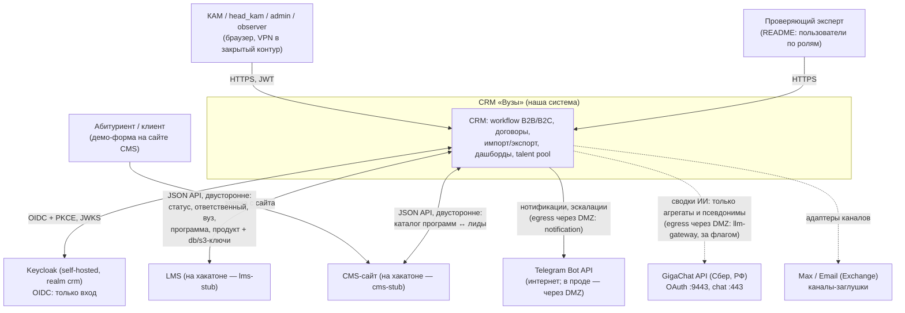
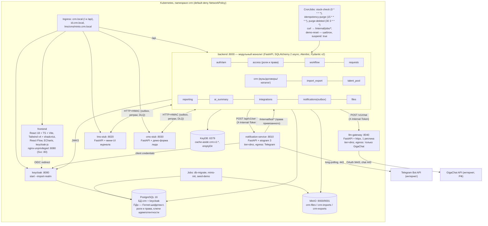

# OVERVIEW — сводная архитектура решения (ЛЦТ 2026, CRM для работы с вузами)

> Документ главного архитектора. Связывает пять проектных документов в одну систему,
> фиксирует сквозные решения и разрешённые противоречия. При любом конфликте между
> документами действует иерархия авторитетности из §2 этого документа.
>
> Источник требований — техническое задание кейса и решения кейсодержателя из протокола
> Q&A 16.09.2026 (протокол в репозиторий не входит). Чек-лист «не прикопаться» — §8:
> **каждое** решение кейсодержателя построчно трассировано на место в системе; сводное
> соответствие пунктам ТЗ — `docs/evidence/compliance.md`.

Состав проектной документации:

| Документ | Зона ответственности |
|---|---|
| `docs/design/data-model.md` | PostgreSQL 16: 38 таблиц, DDL, миграции 0001–0010, роли и права в БД, шифрование ПДн, ключи идемпотентности, KeyDB-ключи, seed и сброс стенда |
| `docs/design/api-contract.md` | REST `/api/v1`, Idempotency-Key, каталог прав и доступ к эндпоинтам, импорт/экспорт, отчёты, интеграционный конверт |
| `docs/design/workflow-engine.md` | Семантика движка: графы, миграции и массовый перенос заявок, локи, SLA, инварианты |
| `docs/design/deployment.md` | k8s (kustomize base + overlays), compose, секреты, NetworkPolicy, k6 |
| `docs/design/ux.md` | Экраны, интерфейс по правам, «Роли и права», отчёт «Активность КАМов», адаптив от 375 px, встроенная справка, конструктор, демо-сценарий (визуальный слой — `redesign.md`: Tailwind CSS v4 + shadcn/ui, токены ДС РТК — `brand-rt.md`) |
| `docs/design/tz-14-steps.md` | 14 шагов базового процесса: какой шаг каким этапом или механизмом закрыт |
| `docs/evidence/` | Замеры и проверки: нагрузка, k8s, импорт/экспорт, соответствие требованиям, массовый перенос заявок |

---

## 1. Система одним абзацем

CRM — ядро работы КАМов с вузами (B2B) и физлицами/юрлицами (B2C). Два редактируемых
workflow-графа с ветвлениями, возвратами и согласованием опасных изменений; заявки мигрируют
на новую схему «на лету» одной транзакцией, перенос заявок удаляемого этапа — один
SQL-оператор на этап. Роли и права настраиваются в интерфейсе без программиста: каталог из
62 прав, область роли — процессы B2B/B2C и записи «все / только свои». Вокруг ядра: договоры
«1 договор — N продуктов» с лицензиями на ИТ-продукты, справочник ИТ-направлений, ручное
ранжирование программ и востребованность по трём показателям, диалоговый импорт
XLSX/XLS/CSV/JSON с интерактивным маппингом и устойчивостью к кодировкам (включая составную
«Таблицу КАМов»), интерактивные дашборды ECharts с мультифильтрами и экспортом PNG/PDF/XLSX,
отчёт «Активность КАМов» с выгрузкой XLSX и PDF, вкладкой «Просрочки», «Сводкой ИИ» (сводка
фактов по команде и по КАМу: по правилам — офлайн, или GigaChat через внутренний шлюз — только
агрегаты и псевдонимы, числа сверяются с отчётом) и «Взаимодействия за период» по выбранным
колонкам, файлы в статусах заявки (10 форматов), Talent Pool студентов с
шифрованием ПДн (152-ФЗ), двусторонние интеграции с LMS/CMS на заглушках через единый
JSON-конверт и outbox, Telegram-бот нотификаций с авторизацией через self-hosted Keycloak и
эскалацией «зависших» заявок по k8s CronJob. Мутации API идемпотентны по заголовку
`Idempotency-Key`. Интерфейс — адаптивный веб от 375 px со встроенной справкой (`/help`).
Всё разворачивается в Kubernetes (minikube/k3d, k3s на VPS) в закрытом контуре:
default-deny NetworkPolicy, у ядра egress наружу нет; выходят только два DMZ-пода —
notification-service (Telegram) и llm-gateway (GigaChat, сводки ИИ).

## 2. Иерархия авторитетности документов (правило разрешения конфликтов)

1. **`data-model.md`** — истина по именам сущностей/таблиц/колонок, DDL, схеме шифрования,
   KeyDB-ключам (префикс `crm:v1:`).
2. **`api-contract.md`** — истина по путям и телам эндпоинтов, ролям API, кодам ошибок,
   интеграционному конверту.
3. Остальные документы следуют первым двум; расхождение = дефект документа, а не выбор кодера.
4. Каталог прав и наборы системных ролей — код `backend/app/core/rbac_catalog.py`; документы
   его пересказывают. Расхождение каталога в БД и в коде ловит тест (data-model §3.6).

### 2.1 Терминологический мост (зафиксирован, менять запрещено)

| Слой БД (data-model) | Слой API (api-contract) | UI (ux) |
|---|---|---|
| таблица `deal` | ресурс `Request`, пути `/requests` | «заявка» |
| `workflow_stage` | `status` (в схеме workflow) | «этап» |
| `workflow_stage.sort_order` | поле `position` | порядок колонки канбана |
| `workflow_transition.is_return` | `kind: "forward" \| "return"` | «↩ возврат» |
| `deal_stage_history.kind = system_migration` | history `kind: "migrated"` | событие миграции в таймлайне |
| `deal.stage_entered_at` | `status_updated_at` | «N дней на этапе» |
| `program.priority_rank` (меньше = выше) | `priority_rank` | колонка «Приоритет» |
| `workflow_change_request` | ресурс `/workflows/{id}/changes` | «пакет на согласовании» |
| `app_role` (+ `app_role_permission`) | `/roles`, `/admin/roles` | «роль» |
| `app_permission.code` | `permissions` в `/auth/me`, `/admin/permissions` | «право» |
| `app_role.workflow_types`, `record_scope` | `access.workflow_types`, `access.records` в `/auth/me` | «Процессы» и «Заявки: все заявки процесса / только где пользователь — ответственный» в редакторе роли |
| `it_direction` (+ `program.direction_id`, `product_direction`) | `/it-directions`, `direction_id`, `direction_ids` | «ИТ-направление» |
| `file_object.stage_history_id` | `files[].stage_history_id`, `file_ids` перехода | «файл в статусе» под переходом в истории |
| `contract_product.license_*`, `transfer_status` | `licenses` в карточке договора | блок «Лицензии» |

### 2.2 Роли и права

**Keycloak отвечает только за вход; роли и права — в БД CRM.** Назначения хранятся в
`app_user.roles`, роли — в `app_role`, их права — в `app_role_permission`; администратор меняет
их в «Администрирование → Роли и права» и «Пользователи», изменения действуют со следующего
запроса, без перезахода (data-model §3, api-contract §10.5, §12).

- **Права** определяет код: каталог из 62 прав в 8 группах (`core/rbac_catalog.py`). Право с
  областью (заявки, конструктор процессов, отчёты) действует только в процессах роли.
- **Роль** = набор прав + область: процессы (`b2b`, `b2c` или оба) и записи (все заявки
  процесса или только те, где пользователь ответственный). Права нескольких ролей
  объединяются по процессу.
- **Системные роли** (засевает миграция): **`admin`** — все права, кроме признака КАМа
  `requests:kam`, заблокирована (права и область не меняются); **`head_kam`** (руководитель КАМов); **`kam`** — видит все заявки,
  правит свои, ведёт портфель (`requests:kam`); **`observer`** — только чтение, ПДн
  маскированы, раскрытие недоступно. Наборы `head_kam`, `kam`, `observer` администратор может
  менять и сбрасывать к стандартным.
- **Свои роли** создаются в интерфейсе без программиста. Демо-сид добавляет «КАМ B2B»
  (`kam_b2b`) и «КАМ B2C» (`kam_b2c`) — права КАМа в одном процессе.
- **Сервисные роли** живут только в Keycloak и ролями CRM не являются: **`svc_notification`**
  (клиент `crm-notification`, Telegram-бот), **`svc_integration`** (клиент `crm-integration`,
  bearer-альтернатива HMAC). Realm-роль `admin` в Keycloak осталась только для служебного
  журнала отправок notification-service (`GET /api/v1/outbox`).
- **Стартовое назначение**: при первом входе пользователь получает системные роли из своих
  realm-ролей; дальше роли из токена не читаются.

Клиенты Keycloak: `crm-frontend` (public + PKCE), `crm-notification`, `crm-integration`,
`crm-backend-admin` (client credentials + `view-users` для синхронизации списка пользователей),
`crm-loadtest` (Direct Access Grants — только нагрузочное).
Эскалации — по `app_user.manager_id`.
Преднастроенные пользователи realm: `admin@demo`, `head@demo`, `kam1@demo`, `kam2@demo`,
`observer@demo` — публикуются в README (решение кейсодержателя).

---

## 3. C4: контекст системы



## 4. C4: контейнеры



### 4.1 Сводка модулей backend (модульный монолит)

| Модуль (`backend/app/modules/…`) | Таблицы (владение) | Ключевые API | Документ |
|---|---|---|---|
| `auth` (iam) | `app_user` (upsert по `keycloak_sub`, роли не перезаписывает) | `/auth/me` (роли, права, область по процессам) | api-contract §2, §12 |
| `access` (роли и права) | `app_role`, `app_permission`, `app_role_permission` | `/roles`, `/admin/permissions`, `/admin/roles*`, `PUT /admin/users/{id}/roles` | data-model §3, api-contract §10.5, §12 |
| `workflow` | `workflow`, `workflow_stage`, `workflow_transition`, `workflow_change_request` | `/workflows*`, `/requests/{id}/transitions`, `/internal/jobs/check-stuck-requests` | workflow-engine.md |
| `requests` | `deal`, `deal_stage_history`, `deal_comment` | `/requests*` (CRUD, board, history, comments, files в статусах, reopen), `/requests/transfer-portfolio` | api-contract §4 |
| `crm` (справочники/договоры) | `university`, `university_contact`, `counterparty`, `interaction_type`, `product`, `program`, `contract`, `contract_product`, `it_direction`, `product_direction` | `/universities*`, `/contracts*`, `/products*`, `/programs*` (+priority), `/it-directions*` | api-contract §3 |
| `import_export` | `import_session`, `import_row_error` | `/import/sessions*` (включая `kam_catalog`), `/export/jobs*` (включая `report:interactions`), `/admin/dictionaries*` | api-contract §6–7, §10.1 |
| `talent_pool` | `student`, `student_status_history`, `federal_project`, `activity`, `activity_schedule`, `student_activity` | `/students*` (+reveal), `/activities*` | api-contract §8 |
| `reporting` | — (читает всё в области зрителя) | `/reports/*` (+ `/reports/dashboard`, `/reports/kam-activity`, `/reports/kam-activity/summary`, `/reports/interactions`); PDF (fpdf2, шрифты DejaVu) и многолистовой XLSX отчёта КАМов, XLSX/PDF взаимодействий — через `/export/jobs` | api-contract §7.2, §7.2.1 |
| `ai_summary` | `ai_summary_job` | `/reports/ai-summaries*`: «Сводка ИИ» поверх отчёта КАМов — факты (allowlist, псевдонимы), кэш и дедупликация задач, вызов llm-gateway, проверка чисел, сводка по правилам | api-contract §7.2.3 |
| `integrations` | `integration_event`, `external_link` | `/integrations/{lms,cms}/webhook`, `/admin/integration/*`, relay | api-contract §13 |
| `notifications` | `notification_rule`, `notification`, `app_setting` | `/notifications*`, `/internal/bot/*`, relay → :8010 | api-contract §9 |
| `files` | `file_object` | `/files/{id}/download`, вложения сущностей | data-model §9.2 |
| `admin` | `audit_log`, фичефлаги (в `app_setting`) | `/admin/*` | api-contract §10 |
| `core` (сквозное) | `idempotency_key` | outbox-emit/relay и транспорт интеграций, SSE-хаб `/events/stream`, KeyDB cache-aside, middleware Idempotency-Key, ядро прав (`rbac_catalog`, `access`, `require_permission`) | data-model §3, §9.6, §10 |

Сателлиты: `services/notification` (aiogram 3 + FastAPI, каналы telegram/email-stub/max-stub),
`services/llm-gateway` (FastAPI + httpx: единственный, кто знает ключ GigaChat; очередь на один
поток, дневной лимит токенов, TLS НУЦ Минцифры), `services/lms-stub`, `services/cms-stub`
(маленькие FastAPI с мини-UI журнала обмена).

---

## 5. Сквозные механизмы (как части соединяются)

1. **Транзакционные outbox'ы в PG** — три, все пишутся в одной транзакции с бизнес-изменением:
   `notification` (→ relay → notification-service `POST /api/v1/send`),
   `integration_event` (→ relay → HTTP+HMAC в заглушки; ретраи 1м → 5м → 30м → 2ч → 6ч, затем
   DLQ), `audit_log` (append-only). Outbox — единственный источник истины интеграций:
   транспорт — сменный адаптер `IntegrationTransport`, шина заказчика (Kafka/ESB) подключается
   новой реализацией без смены конверта. Отдельной «шины событий движка» нет.
2. **Realtime UI — SSE** `GET /api/v1/events/stream` (топики `workflow.changed`,
   `request.transitioned`, `request.comment_added`, `telegram.linked`, `flags.updated`,
   `notification.created`, `access.changed`); fan-out между репликами — KeyDB pub/sub
   `crm:v1:events`; фолбэк — поллинг. WebSocket не используется. `access.changed` заодно
   сбрасывает кэш каталога ролей на каждой реплике, а интерфейс затронутого пользователя
   перечитывает `/auth/me` без перезахода.
3. **Единый реестр событий** (data-model §9.4 = api-contract §9): `request.created/transitioned/
   assigned/stuck/comment_added`, `workflow.change_requested/changed`,
   `student.talent_pool_added`, `import.finished`, `integration.lead_received/delivery_failed`.
4. **Идемпотентность**: мутации API (POST/PUT/PATCH/DELETE) с заголовком `Idempotency-Key` —
   ASGI-middleware и таблица PG `idempotency_key` (data-model §9.6): ключ в пределах
   принципала, сохраняются только 2xx, повтор — сохранённый ответ с `Idempotent-Replayed: true`,
   TTL 24 ч, очистка CronJob `idempotency-purge`; хранилище недоступно — 503 (fail-closed).
   Интеграции — `event_id` (KeyDB `crm:v1:intg:seen:*` + UNIQUE в `integration_event`);
   нотификации — `notification_id` и `dedup_key`; optimistic locking — поле `version`
   (409 `stale_version`).
5. **Конкурентность workflow**: advisory-локи PG — переходы берут shared, применение схемы
   эксклюзивный; переход перечитывает ребро из живой схемы (409). Ожидание ограничено:
   переход — 10 с, применение — 30 с, дальше 409 `workflow_busy` с `Retry-After: 2`. Перенос
   заявок удаляемого этапа — один SQL-оператор на этап, уведомления — одна сводка на
   получателя: на 10 000 заявок лок держится около 0,6 с. «Работа не встаёт».
6. **Кэш** — KeyDB cache-aside, префикс `crm:v1:`, инвалидация `DEL` строго after_commit,
   деградация в PG при недоступности; расшифрованные ПДн в кэш не попадают никогда.
7. **Файлы** — только через backend (`GET /files/{id}/download`, режим proxy по умолчанию,
   presigned TTL 10 мин); ключ `{entity_type}/{entity_id}/{file_id}/{safe_name}`,
   бакеты `crm-files/crm-imports/crm-exports`.
8. **Внутренняя аутентификация контура**: люди — JWT Keycloak; бот → backend — client
   credentials `crm-notification`; backend → notification-service и CronJob → backend —
   `X-Internal-Token`; webhook'и заглушек — HMAC `X-Webhook-Signature`
   (per-system секреты в Secret `crm-internal`).
9. **Права** — каждый эндпоинт объявляет право (`require_permission("<код>")`), обработчик
   проверяет право в процессе конкретной заявки и её область; заявка вне области — 404,
   процесс вне области — 403. Фронт строит меню, маршруты и кнопки по `hasPermission(code, wf)`
   из `/auth/me`, backend дублирует все проверки (data-model §3.4, ux §3).
10. **Сводки ИИ** (api-contract §7.2.3) — не агент и не советчик, а сводка фактов по клику.
    Backend собирает отчёты «Сводка для заказчика» и «Просрочки» (кэш 60 с) → факты по
    allowlist (числа, очищенные названия этапов, метки B2B/B2C, псевдонимы `КАМ-01…`; без ФИО,
    вузов, клиентов, заголовков и комментариев) → sha256 фактов = «версия данных». Кэш на час и
    дедупликация задач в полёте — таблица PG `ai_summary_job` (частичный UNIQUE, общая для
    реплик); задача выполняется фоном: `POST llm-gateway:8040/v1/chat` → JSON по схеме → проверка
    кодом: каждое число и дата ответа сверяются с фактами, советы (`NO_ADVICE_RE`), чужие
    псевдонимы и ссылки вычищаются; при сбое GigaChat интерфейс предлагает сводку по правилам
    (тот же текстовый шаблон из тех же фактов, офлайн). ФИО подставляются вместо псевдонимов при
    чтении на стороне CRM. Аудит `ai.summary_requested` / `ai.summary_generated` — без текста.

---

## 6. Ключевые зафиксированные решения (резолюция открытых вопросов проектировщиков)

| # | Вопрос | Решение |
|---|---|---|
| Р-1 | Список ролей (расходился во всех 5 доках) | Системные роли CRM `admin, head_kam, kam, observer` + свои роли из интерфейса; сервисные `svc_notification, svc_integration` — только в Keycloak (§2.2, Р-21) |
| Р-2 | Имя сущности заявки | БД `deal` ↔ API `/requests` ↔ UI «заявка» — мост §2.1, никто не переименовывает |
| Р-3 | Модель изменения workflow (draft-снапшот vs пакет операций) | **Пакет операций** `POST /workflows/{id}/changes` + таблица `workflow_change_request`; черновик конструктора — клиентский (localStorage); опасные операции (`rename_status`, `delete_status`) — всегда pending + `confirm_name` (посимвольный ввод имени) + approve правом `workflow:approve` (по умолчанию только admin); апрув = атомарное применение (окна «одобрено-не применено» нет). Автор с `workflow:approve` может одобрить свой пакет — approve и есть второй шаг |
| Р-4 | Guard-условия переходов: форсировать или нет | `condition` — **подсказка** (JSON-DSL, backend аннотирует доступные переходы); жёстко форсируются только граф + `allowed_roles` + `requires_comment`. Переходы делают только люди |
| Р-5 | Единица порога зависания (часы vs дни), дефолт (7 vs 14) | **Дни**, дефолт **14** («1–2 недели»); порог процесса и общая настройка — 1–60, порог этапа — 1–365 (миграция 0006: долгие этапы обучения, в сиде у `in_learning` — 120); каскад rule → stage → workflow → app_setting |
| Р-6 | Механика эскалации (роль-иерархия vs manager_id; маркеры на deal vs dedup) | Двухступенчатая: порог → ответственный; **1.5×порога → `manager_id`**; повтор не чаще `repeat_every_days` (3); состояние — в `notification.dedup_key` (+KeyDB-guard), колонок-маркеров на `deal` нет |
| Р-7 | CronJob: имя, расписание, endpoint | `stuck-check`, ежечасно `0 * * * *`, `POST /api/v1/internal/jobs/check-stuck-requests`, `X-Internal-Token`; compose-паритет — `make stuck-check` (ofelia не берём) |
| Р-8 | TG-код: формат/TTL/хранение | 6 цифр, TTL 10 мин, KeyDB `crm:v1:tg:link:{code}`, `GETDEL`; привязка в `app_user` (отдельной таблицы нет); бот бьёт в `POST /internal/bot/bind` |
| Р-9 | Доставка нотификаций (pull vs push) | Push: outbox `notification` в PG → relay backend'а → `POST notification:8010/api/v1/send` (X-Internal-Token, идемпотентность по `notification_id`) |
| Р-10 | Realtime UI (SSE vs WebSocket vs поллинг) | **SSE** `/api/v1/events/stream` + KeyDB pub/sub fan-out; фолбэк поллинг (§5.2) |
| Р-11 | Seed-воронки (3 варианта) | Канон — api-contract §5.1: B2B `new→first_contact→negotiation→contract_prep→contract_signed→in_learning→completed(+rejected)`; B2C `new→consultation→proposal→payment_pending→paid→in_learning→completed(+rejected)`; `in_learning` несёт `triggers_lms_handover` |
| Р-12 | Приоритет программ (больше=выше vs меньше=выше) | `priority_rank`, **меньше = выше** (data-model); API/UX приведены |
| Р-13 | PDF-отчёт | **В объёме**: серверный PDF на `fpdf2` со встроенными шрифтами DejaVu (кириллица без внешних бинарников и CDN). PDF и многолистовой XLSX отчёта «Активность КАМов» — всегда; фичефлаг `report_pdf` (по умолчанию включён) закрывает только общую табличную PDF-выгрузку дашборда. PNG графиков — на клиенте (ECharts) |
| Р-14 | Шифровать ли `university_contact` | **Нет**: деловые контакты представителей юрлиц в договорной работе — не ПДн-скоуп прототипа; механизм (`*_enc` + TypeDecorator) расширяем без изменения архитектуры |
| Р-15 | Quiet hours и канал Max | Вне MVP: `notification_quiet_hours` — зарезервированная настройка; Max/Email — адаптеры-заглушки с реальными настройками в UI (подключаемость показываем) |
| Р-16 | Контракт реальных LMS/CMS «обещан позже» | Конверт `IntegrationEvent` зафиксирован (api-contract §13.1, состав payload — дословно от кейсодержателя); при получении контракта меняется только транспортный адаптер |
| Р-17 | Обезличенные данные организаторов ещё не пришли | Схему не меняют: пополняется словарь синонимов `suggested_mapping` и демо-сид; колонки `deal`/`university` покрывают ожидаемые поля таблиц КАМов |
| Р-18 | Кодировки импорта (chardet vs charset-normalizer) | **charset-normalizer**, цепочка `utf-8-sig→utf-8→cp1251→koi8-r→cp866`; XLS — `xlrd 2.x`, XLSX — `openpyxl`, формат по magic bytes |
| Р-19 | Раскрытие ПДн | Выдачи ПДн студентов маскированы для всех ролей; открытые значения — только `POST /students/{id}/reveal` (право `students:reveal`, 60 с в UI, аудит-событие `student.pii_revealed`); observer — без раскрытия и без файлов студентов. Контакты физлиц B2C в карточке заявки открыты только с правом `clients:pii` (по умолчанию у всех системных ролей, кроме observer) |
| Р-20 | Ключи ПДн | Secret `crm-pii`: `PII_FERNET_KEYS` (MultiFernet, первый активный) + `PII_HMAC_KEY` (blind index); ротация `python -m app.tools.rekey` |
| Р-21 | Где живут роли (в коде — Р-F2-1, Р-F2-2) | **БД CRM**: назначения — массив `app_user.roles`, роли — `app_role`; Keycloak — только вход, роли токена — лишь стартовое назначение при первом входе. Отвергнуто: composite roles и группы Keycloak (консоль Keycloak, права приходят только с новым токеном, область B2B/B2C в claims не выразить), таблица связей `app_user_role` (двойная запись с массивом без выигрыша) |
| Р-22 | Модель прав (Р-F2-3, Р-F2-4) | Права определяет код (62 права, `core/rbac_catalog.py`), миграция засевает копию для внешних ключей, тест сверяет БД с кодом. Роль = права + область: `workflow_types ⊆ {b2b,b2c}` и `record_scope ∈ {all, own}`; права нескольких ролей объединяются по процессу. Отвергнуто: Casbin/OPA (новая зависимость) |
| Р-23 | Кэш прав (Р-F2-8) | Каталог ролей — в памяти процесса, TTL 5 с, сброс на всех репликах по SSE `access.changed`; `app_user` читается на каждом запросе, перезаход не нужен. Не KeyDB: лишний сетевой запрос на каждый HTTP-запрос и ещё одна точка отказа |
| Р-24 | Защита от потери управления (Р-F2-9) | `admin` заблокирована; снять с себя `admin:roles` нельзя; всегда остаётся активный пользователь с `admin:roles` — проверка под advisory-локом `rbac` (409 `access_lockout`); аварийно — `python -m app.tools.rbac grant-admin <username>` с записью в аудит |
| Р-25 | Объект вне области роли (Р-F2-10) | **404**, как несуществующий: карточка, история, комментарии, переходы и файлы заявки. Коллекция с явным процессом вне области — 403 с понятным текстом |
| Р-26 | Хранилище Idempotency-Key | **PostgreSQL** (`idempotency_key`), не KeyDB: KeyDB эфемерный (`emptyDir`), а гарантия «не выполнить дважды» должна переживать рестарты и быть общей для реплик. Тело ответа — Fernet-шифртекст, TTL 24 ч, только 2xx; семантика — черновик IETF `Idempotency-Key` |
| Р-27 | Транспорт интеграций | **Только HTTP + HMAC** поверх outbox `integration_event`; режим KeyDB Streams убран (эфемерная шина теряет события при рестарте, вторая очередь рядом с outbox — dual-write). `integration_mode` принимает только `http`. Шина заказчика — новая реализация `IntegrationTransport`, `event_id` — ключ сообщения |
| Р-28 | Массовый перенос заявок при удалении этапа | Один SQL-оператор на этап (CTE `UPDATE … RETURNING` → `INSERT` истории) под эксклюзивным локом воронки; одно сводное уведомление на получателя вместо уведомления на заявку; переход ждёт не дольше 10 с, применение — 30 с, затем 409 `workflow_busy`. 10 000 заявок: лок ≈0,6 с вместо 25 с; 50 000: ≈2,9 с вместо 130 с (`docs/evidence/migration-benchmark.md`) |
| Р-29 | Отчёт «Активность КАМов»: что считать активностью | Собственные действия ответственного КАМа в периоде: ручной переход, комментарий, файл заявки, мероприятие с вузом; системные переходы (перенос схемы, LMS, импорт) и действия других пользователей не считаются. Этап — на конец периода, восстановленный по `deal_stage_history`. Область — права `reports:read` / `reports:all` (api-contract §7.2.1) |
| Р-30 | Когда заявка «вошла в этап» и «закрылась» | Вход в этап — строка истории со сменой этапа и `kind <> 'system_migration'`: перевод схемы и события LMS вход не сдвигают, отчёт КАМов совпадает с доской. Закрытие — последний вход в терминальный этап по истории, а не `deal.updated_at`; одно определение у KPI дашборда, динамики и отчёта КАМов («Завершено» — `won`, «Отказ» — отдельно) |
| Р-31 | Файлы в статусах | Файл заявки привязан к строке `deal_stage_history` (`file_object.stage_history_id`, 0006): к переходу — в той же транзакции, что переход; при загрузке из вкладки «Файлы» — к указанному прошлому переходу или ко входу в текущий этап. Белый список 10 форматов со сверкой расширения и сигнатуры, тип содержимого задаёт сервер. Отвергнуто: отдельная таблица «файлы этапа» (дублирует историю) |
| Р-32 | ИТ-направления | Справочник `it_direction` (0007): у программы одно направление, у продукта несколько (M:N). Направление записи — программы, без него — продукта; фильтр через `EXISTS` без размножения строк. Отвергнуто: направление как атрибут продукта (у продукта их несколько) и как синоним продукта |
| Р-33 | Смена ответственного за вуз | Отдельное право `universities:assign` (0006) у руководителя и администратора; сравнивается значение `kam_user_id`, а не наличие поля; аудит `university.kam_changed`. Передача портфеля КАМа — одна ручка с `dry_run`, аудит по каждой заявке и вузу |
| Р-34 | «Таблица КАМов» и лицензии | Составной импорт `kam_catalog`: договор ищется по номеру (upsert), строка `contract_product` хранит лицензию (дата подписания, срок, окончание, статус передачи, 0008). Отвергнуто: отдельная таблица лицензий (лицензия — это и есть «договор × продукт») |
| Р-35 | Сброс демо-стенда | `seed --reset` от якорной даты одной транзакцией (Job из приостановленного CronJob-шаблона `demo-reset`); пользователи, роли, настройки и аудит сохраняются. Отвергнуто: `TRUNCATE app_user` (теряются `keycloak_sub` и привязки Telegram) |
| Р-36 | Где живёт ключ GigaChat и кто ходит наружу (сводки ИИ, Р1) | Отдельный сервис `services/llm-gateway` (:8040) — второй и последний под с egress после notification; ключ видит только он, ядро остаётся без egress. Шлюз переносится в DMZ или переключается на on-prem GigaChat (`GIGACHAT_API_URL`/`GIGACHAT_AUTH_URL`) без правки backend |
| Р-37 | SDK или свой клиент (Р2) | Чистый `httpx`: явный контроль OAuth, TLS-бандла НУЦ, ретраев и семафора; тесты на `httpx.MockTransport`. Wire-формат — как у SDK `gigachat` 0.2.3, отлаженного в «Орбите» |
| Р-38 | Где логика сводки (Р3) | Шлюз «глупый»: сообщения → текст и usage. Промпт, разбор JSON, проверка чисел и псевдонимы — в backend (`modules/ai_summary`): ключ и предметная логика в разных подах |
| Р-39 | Хранилище задач (Р4) | Таблица PG `ai_summary_job` (миграция 0010), не KeyDB: POST и опрос попадают в разные реплики и воркеры, KeyDB — `allkeys-lru` без persistence; нужны атомарная дедупликация в полёте (частичный UNIQUE + `ON CONFLICT DO NOTHING`) и кэш, переживающий рестарты |
| Р-40 | Кэш сводок (Р5) | 1 ч по ключу (вид, КАМ, область, параметры, провайдер, версия промпта, sha256 фактов); хеш фактов и есть «версия данных»: изменились цифры — новый ключ. Повторный клик и клик другого руководителя с той же областью — 0 токенов |
| Р-41 | Кому доступно (Р6) | Новое право `reports:ai_summary` (с областью) — по умолчанию у admin и head_kam, у kam и observer нет; своей роли можно выдать с областью «только свои». Причина — один поток GigaChat и совет экспертов «не делать ИИ-агента» |
| Р-42 | Фичефлаг (Р7) | `ai_summaries` (по умолчанию выключен, демо-сид включает) **заменил** пустой заблокированный `llm_features`: иначе в админке рядом были бы заблокированный «LLM-функции» и работающие сводки ИИ |
| Р-43 | Провайдер и офлайн (Р8) | `AI_SUMMARY_PROVIDER = gigachat \| rules \| stub` (stub в контуре запрещён). Сводка по правилам доступна всегда — кнопкой и при сбое GigaChat; это решение Q&A N6 «работает офлайн» |
| Р-44 | Что уходит наружу (Р9) | Только числа, очищенные названия этапов и процессов, подписи метрик и псевдонимы `КАМ-01…`; без ФИО, вузов, клиентов, заголовков заявок, комментариев и денег (152-ФЗ, защита от prompt injection, минимизация) |
| Р-45 | Как не дать модели придумать (Р10) | Ответ — JSON по схеме; каждая фраза проверяется кодом: числа (должны быть во входе с допуском округления), советы (`NO_ADVICE_RE`), псевдонимы, ссылки. Не прошедшие фразы удаляются; удалено много — `failed: llm_bad_output` и предложение сводки по правилам |
| Р-46 | Сертификаты НУЦ Минцифры (Р11) | `deploy/k8s/base/llm-gateway/certs/russian_trusted_bundle.pem` — внутри корня kustomization (`kubectl kustomize` по умолчанию не читает файлы вне него); одна копия для ConfigMap `llm-gateway-ca` и compose; Sub CA действует до 06.03.2027 |
| Р-47 | Порты egress шлюза (Р12) | TCP 443 и 9443 вне приватных сетей: OAuth Сбера — `ngw.devices.sberbank.ru:9443`, без него токен не получить |

---

## 7. Обоснование стека

### 7.1 Python + React — внутри рекомендованного списка

Организаторы допускают Kotlin/Python/Node.js/React; обоснование обязательно только при отходе.
Мы не отходим, но аргументируем по существу:

- **Python 3.12 + FastAPI + SQLAlchemy 2 (async) + Pydantic v2**: асинхронный IO-bound профиль
  CRM (списки, карточки, интеграции); Pydantic v2 даёт строгие контракты и автогенерацию
  OpenAPI → типы TS для фронта; Alembic — воспроизводимые миграции (отдельный k8s Job);
  экосистема импорта (`openpyxl`, `xlrd`, `charset-normalizer`) и криптографии
  (`cryptography`/Fernet — аудитированная библиотека, работает офлайн) закрывает требования
  «XLS + битые кодировки» и 152-ФЗ без экзотики; `fpdf2` — PDF-отчёты на чистом Python со
  встроенными шрифтами DejaVu, без системных бинарников.
- **React 18 + TS + Vite + Tailwind CSS v4 + shadcn/ui (Radix)**: доступные примитивы и
  собственная токен-система под ДС «Ростелекома» (`redesign.md`, `brand-rt.md`), таблицы —
  TanStack Table, формы — react-hook-form + zod; **@xyflow/react** — стандарт де-факто визуальных редакторов
  графов → конструктор workflow (кор №1) без велосипедов; **Apache ECharts** — интерактивные
  дашборды со встроенным PNG-экспортом (`getDataURL`); PDF всей панели собирается в браузере
  из тех же растров, без сторонних библиотек — офлайн, без CDN; **keycloak-js (OIDC + PKCE)** — официальный адаптер
  self-hosted Keycloak (только вход; роли и права интерфейс берёт из `/auth/me`).

### 7.2 Почему модульный монолит + полноценный Kubernetes

Решения кейсодержателя допускают «монолит с feature-флагами или микросервисы (+minikube/k3s)». Мы берём
модульный монолит и **всё равно** полноценный k8s — лучшее из обоих:

1. **Транзакционность кор-требования.** «Изменение workflow на лету: заявки сопоставляются,
   работа не встаёт» — это одна ACID-транзакция над схемой, заявками, историей и outbox'ами.
   В микросервисах это сага с компенсациями — риск без выгоды на хакатоне.
2. **Границы сервисов — только там, где они настоящие**: notification-service (другой контур
   безопасности — egress в интернет только к Telegram, DMZ-стори; long-polling runtime),
   llm-gateway (тот же довод: ключ GigaChat и выход наружу — только у него), lms-stub и
   cms-stub (по определению *внешние* системы — двусторонность проверяется честно, по сети).
3. **k8s даёт операционные примитивы, отвечающие требованиям напрямую**: HPA 2→6 реплик
   (план на 300+ пользователей), CronJob (зависшие заявки, очистка ключей идемпотентности и
   удалённых данных), NetworkPolicy default-deny (закрытый контур), Jobs (миграции/сиды/бакеты),
   probes и самовосстановление. Feature-флаги монолита при этом есть (`/admin/feature-flags`,
   SSE `flags.updated`).
4. **Путь масштабирования не закрыт**: stateless-реплики за балансировщиком (дословно
   предложение кейсодержателя), модули общаются через явные интерфейсы пакетов — вынос модуля
   в сервис механический; расчёт ёмкости и k6-отчёт — deployment.md §8.

### 7.3 Почему KeyDB

Прямая рекомендация кейсодержателя («легковеснее Redis»); redis-протокол → `redis-py` без
изменений. Используем как: cache-aside (карточки/страницы/дашборды — то, что кейсодержатель
называл кэшированием), TTL-хранилище one-time кодов бота, быстрые guard'ы дедупликации
(`intg:seen`, `stuck:guard`), pub/sub для SSE fan-out и сброса кэша прав. Осознанно без
персистентности (emptyDir): потеря кэша ничего не ломает — падение KeyDB деградирует в чтение
из PG, а не роняет CRM. Поэтому в KeyDB нет ничего, что должно пережить рестарт: ключи
идемпотентности — в PG (Р-26), шины интеграций на Streams нет (Р-27), каталог прав — в памяти
процесса (Р-23).

### 7.4 152-ФЗ и закрытый контур — пакет мер

| Мера | Где |
|---|---|
| Шифрование ПДн на уровне приложения: Fernet (AES-128-CBC + HMAC, `cryptography`), MultiFernet-ротация | data-model §8; `student.*_enc`, `counterparty(person).*_enc` |
| Поиск без раскрытия: blind index HMAC-SHA256 (отдельный ключ) от нормализованного значения | data-model §8.2–8.3 |
| Псевдонимизация: `display_name` «Фамилия И.О.» для списков/кэша/сортировки | data-model §8.3 |
| Маскирование по умолчанию + явное раскрытие с аудитом (60 с) | api-contract §8.3, ux §12.2 |
| Ключи только в k8s Secret `crm-pii`, видимы только backend/jobs; генерация при установке, в git не попадают | deployment §3.7 |
| ПДн не попадают: в KeyDB, логи приложения (значения ПДн не пишет ни один вызов логгера; журнал доступа uvicorn пишет query-строку — в контуре заказчика маскировать), `audit_log`/`import_row_error` (маскирование), интеграционные события; в Telegram — только псевдоним «Фамилия И.О.»; дамп БД содержал бы только шифртекст (резервного копирования в прототипе нет — план развития) | data-model §8.5 |
| Сохранённые ответы мутаций (`Idempotency-Key`): Fernet-шифртекст, тело запроса не хранится (только SHA-256), TTL 24 ч и почасовая очистка CronJob `idempotency-purge`; ротация ключей их перешифровывает | data-model §8.5, §9.6 |
| Доступ к ПДн — по правам роли: раскрытие студента (`students:reveal`, с аудитом), контакты физлиц B2C (`clients:pii`), файлы (`files:business`) | data-model §3.3, §8.3 |
| Право на забвение: `DELETE /students/{id}` удаляет студента физически и сразу (аудит `student.deleted`); удалённые файлы и комментарии физически удаляет CronJob `purge-deleted` через 30 дней | api-contract §8.1, §11.2 |
| Закрытый контур: default-deny NetworkPolicy, у ядра нет egress в интернет ни по коду, ни по сети; notification и llm-gateway — прообраз DMZ (выход только к Telegram и GigaChat) | deployment §3.11 |
| Сводки ИИ: в GigaChat уходят только агрегаты отчётов, очищенные названия этапов и псевдонимы `КАМ-01…`; ФИО подставляются на стороне CRM при чтении; клиенты B2C, студенты и свободный текст (комментарии, заголовки заявок) не отправляются. GigaChat — оператор в РФ, трансграничной передачи нет; можно переключить на on-prem GigaChat (`GIGACHAT_*_URL`). Функция за правом и фичефлагом, аудит каждого запроса без текста сводки | api-contract §7.2.3, compliance §8.1 |
| Нет CDN: шрифты/иконки/JS в бандле; файлы — только через backend (proxy) | ux §1.1, api-contract §3.2 |
| Безопасность библиотек: пины версий, `uv.lock`/`npm ci`; автоматическое сканирование уязвимостей в CI не подключено | deployment §9 |

---

## 8. Чек-лист «не прикопаться»: решения кейсодержателя → реализация

### 8.1 Общие решения кейсодержателя (Q&A 16.09.2026) — построчно

| № | Решение кейсодержателя | Где реализовано |
|---|---|---|
| W1 | Два workflow: B2B (вузы) и B2C (физлица + юрлица) — отдельные процессы | 2 строки `workflow` (b2b/b2c), `deal.pipeline` + CHECK клиента (data-model §5–6); переключатель доски B2B/B2C (ux §7.1); seed обоих графов (workflow-engine §4–5) |
| W2 | В B2C — возможность добавлять новые варианты взаимодействия | Редактируемый справочник `interaction_type` (data-model §4.4) + конструктор добавляет этапы/ветки без кода (workflow-engine §5.2, ux §10); демо-шаг 2 |
| W3 | Workflow един для всех внутри типа, версионирование запрещено | Одна живая схема, мутация in-place, никаких version-полей (workflow-engine §2.1, data-model §5.1); «версий нет» в UI (ux §10.4) |
| W4 | Изменения применяются сразу для всех | Approve = атомарное применение одной транзакцией; SSE `workflow.changed` перестраивает все открытые доски (workflow-engine §6.4, ux §7.2) |
| W5 | Ветвления — да | Несколько исходящих переходов; `condition`-подсказка ветвления (workflow-engine §3.2); канбан подсвечивает разрешённые колонки (ux §7.2) |
| W6 | Возвраты на предыдущие шаги — да (бюрократия) | `is_return` + обязательный комментарий (CHECK в БД, data-model §5.1); красный пунктир и модалка причины (ux §7.2, §10.2) |
| W7 | При изменении «на лету» заявки сопоставляются на новую схему, работа не встаёт | Миграция в транзакции применения; advisory-локи shared/exclusive — переходы не блокируются вне окна применения (workflow-engine §6.3–6.5); перенос — один SQL-оператор на этап, 10 000 заявок держат лок ≈0,6 с (Р-28); история `system_migration`; демо-шаг 6 |
| W8 | Переименование/удаление статуса — только с апрувом администратора («защита от дурака») | Опасные операции всегда `pending` + `confirm_name` (посимвольный ввод) + approve правом `workflow:approve`, из системных ролей — только admin (api-contract §5.3, workflow-engine §6.2, ux §10.5, §14.4) |
| W9 | При удалении статуса заявки переносятся на соседний (лучше предыдущий) | `migrate_to_status_id`: обязателен, только сосед по ребру, дефолт — предыдущий по `sort_order` (workflow-engine §6.3, data-model §5.3, ux §10.5) |
| W10 | Один вуз: договор как правило один, продуктов несколько (могут расширяться) | `contract` (владелец вуз XOR контрагент) + `contract_product` M:N с `added_by/added_at`; второй активный договор — UI-warning, не запрет (data-model §4.6, api-contract §3.2, ux §9.1) |
| W11 | Параллельных взаимодействий ≤ 2, разные направления/роли; не переусложнять | Несколько открытых `deal` на вуз без constraint; warning при 3-й активной; kam читает всё/пишет своё (data-model §6.1, workflow-engine §4.1, api-contract §12.2) |
| A1 | Keycloak в своей инфраструктуре (endpoint не дадут) | Self-hosted Keycloak 26, `start --import-realm` из ConfigMap, БД в том же PG (deployment §3.4) |
| A2 | RBAC по ролям из ТЗ; отображение UI строго по ролевой модели — кор | Роли и права §2.2: 4 системные роли + свои роли из интерфейса, каталог из 62 прав, разграничение B2B/B2C и «все / только свои» (data-model §3); доступ к эндпоинтам — api-contract §12; `permissions` и `access` из `/auth/me`; фронт — `hasPermission(code, wf)` в guard'ах/`Can`/menuConfig, backend дублирует все проверки (ux §3) |
| A3 | README: публичное описание пользователей по ролям (без передачи паролей экспертам напрямую) | Преднастроенные пользователи realm-JSON → README (deployment §3.4, ux §3.1); публично, без приватных VPN-конфигов |
| I1 | CRM↔LMS и CRM↔CMS двусторонние, на заглушках; двусторонность проверяется | 4 направления на одном конверте (api-contract §13.2–13.4); заглушки — отдельные процессы с UI журнала на lms/cms.crm.local (deployment §1, §3.6); монитор интеграций с журналом ←/→ и тест-событиями (ux §14.5); демо-шаги 3, 8 |
| I2 | JSON по API; можно асинхронно через шину данных | Конверт `IntegrationEvent`; outbox PostgreSQL + асинхронная фоновая доставка (HTTP + HMAC, ретраи, DLQ); шина заказчика подключается сменным адаптером `IntegrationTransport` без смены конверта (Р-27, api-contract §13.1, §13.7) |
| I3 | Состав JSON: статус, ответственный, вуз, программа, продукт + ключи связи с БД и S3 | Payload ровно из пяти блоков + `links.db_keys`/`links.s3_keys` (api-contract §13.1, data-model §9.3 — пример) |
| I4 | Обезличенные примеры данных пришлют шарой | Р-17: словарь синонимов маппинга и демо-сид пополняются, схема не меняется |
| I5 | Обогащение из открытых источников — только разовая предзагрузка, без runtime-интернета; загрузка через диалоговое окно в админке (JSON/таблицы) | `/admin/dictionaries` + тот же мастер импорта (`dictionary:*`) и JSON-POST (api-contract §10.1, ux §14.2); у ядра нет egress по NetworkPolicy — «двойной ответ» (deployment §3.11) |
| E1 | Поддержка XLSX **и XLS** (старый Excel); устойчивость к битым кодировкам при загрузке/выгрузке | `openpyxl`/`xlrd 2.x` по magic bytes; charset-normalizer с перебором 5 кодировок; экспорт CSV utf-8(BOM)/cp1251, разделитель `;` (api-contract §6.2, §7.1); демо-шаг 4 «чиним кракозябры селектом» (ux §11.2) |
| E2 | Маппинг полей — интерактивный диалоговый менеджер | 5-шаговая сессия импорта, `suggested_mapping` + ручной маппер + шаблоны, построчный отчёт ошибок XLSX (api-contract §6, ux §11) |
| E3 | Отчёты: интерактивные дашборды (фильтры, теги) с экспортом в растровые/файловые форматы; Grafana или своё | Своё: ECharts-дашборд с drill-down по URL и мультифильтрами (ux §6), JSON-агрегаты `/reports/*` (api-contract §7.2), PNG графика с шапкой и PDF всей панели на фронте, XLSX/CSV/PDF через `/export/jobs`; отчёт «Активность КАМов» — детализация, сводка и «Взаимодействия за период» по выбранным колонкам, выгрузка XLSX и PDF (api-contract §7.2.1, ux §6.4, Р-29, Р-30) |
| D1 | PostgreSQL + MinIO S3 — одобренная схема | PG 16 (38 таблиц) + MinIO (3 бакета), `file_object` с ключами связи; StatefulSet+PVC (data-model, deployment §3.4) |
| D2 | Студенты пофамильно: ФИО + email (минимальная персуха); шифрование/обезличивание в БД | `student.full_name_enc/email_enc` (Fernet) + HMAC blind index + `display_name`-псевдонимизация (data-model §7–8); маскирование+reveal (§7.4 выше) |
| D3 | Проверять безопасность библиотек; всё в закрытом контуре | Пины, lock-файлы; без CDN; NetworkPolicy default-deny (§7.4) |
| D4 | ЭЦП тестировать не нужно | В системе отсутствует — осознанно (нет соответствующих API/таблиц) |
| N1 | Монолит с feature-флагами или микросервисы; для микросервисов — minikube/k3s | Модульный монолит + фичефлаги + **полноценный k8s с overlay'ями minikube, k3d (k3s) и vm (k3s на VPS)** — перекрываем требование в обе стороны (§7.2, deployment §1, §4) |
| N2 | Кэш KeyDB (легковеснее Redis): карточки, документы, страницы; оффлайн-режим не делаем | Cache-aside таблица ключей/TTL (data-model §10): `deal:{id}` — карточки, `deal:list/dash` — страницы, presigned-доступ — документы; оффлайн-режима нет |
| N3 | Нагрузка: свой отчёт нагрузочного тестирования; план масштабирования на 300+ (реплики/балансировка) | k6-сценарий 300→400 VU с thresholds (прогон 16.09: p95 90,7 мс, p99 1,07 с — превышение на 7%), HPA 2→6, расчёт ёмкости и бюджет соединений PostgreSQL, `docs/evidence/load-report.md` (deployment §8); профили НФТ «50 пользователей» и «10 отчётов» подготовлены, прогон — впереди |
| N4 | Диаграммы: C4/BPMN, связей, программно-аппаратная, БД | C4 контекст+контейнеры (этот документ §3–4), ERD ×5 (data-model §2), sequence/state/flowchart в api-contract/workflow-engine/ux, топология и DMZ-контур (deployment §3.2, §3.11) |
| N5 | Мобильная версия — адаптивный веб-интерфейс от 375 px; доступ с мобильных через VPN | Адаптивный веб-интерфейс от 375 px, канбан scroll-snap, тач-drag (ux §4.3); мобильного приложения нет |
| N6 | LLM — только если реально дополняет и работает офлайн; не приоритет | «Сводка ИИ» в отчёте КАМов — сводка фактов по клику, не агент и не советчик: по правилам работает офлайн, GigaChat — опция за флагом `ai_summaries` и правом `reports:ai_summary` через DMZ-шлюз `llm-gateway`; числа ответа сверяются с отчётом кодом (§5 п. 10, Р-36…Р-47, api-contract §7.2.3, ux §6.4) |
| N7 | Ранжирование программ: ручное изменение приоритетов КАМами/админами; автоформула — бонус | `priority_rank` + drag/▲▼ + audit (data-model §4.5, api-contract §3.4, ux §9.4); востребованность — три показателя (заявки на обучение, обучающиеся, параллельные потоки), при флаге `auto_ranking` — справочный индекс 0–100 рядом с ручным приоритетом (api-contract §7.2) |
| N8 | Встроенный мессенджер: в идеале да, заглушки допустимы | Комментарии заявки: @упоминания, SSE-realtime; файлы (MinIO) прикладываются к заявке и к переходу, не к комментарию (data-model §6.3, ux §8.1) |
| N9 | Figma — плюс, не обязателен; брендбук — «рюшечки», главное юзерфрендли и гибкость | Токен-система Tailwind v4 + shadcn/ui под ДС «Ростелекома» (redesign.md, brand-rt.md), юзерфрендли-принципы «ноль тупиков», пресеты таблиц, туры и встроенная справка (ux §1–2, §4.2); Figma — по остаточному принципу |

### 8.2 Решения кейсодержателя: Telegram-бот

| Решение | Где реализовано |
|---|---|
| Notification Service с абстракцией каналов: Telegram (реальный), Max/Email — подключаемые (заглушки, но с настройкой) | services/notification: адаптеры каналов; `/notifications/channels` со статусами active/stub; настройки в UI (api-contract §9.1, ux §13.1) |
| Авторизация бота через тот же Keycloak: `/start <one-time code>`, связка chat_id с пользователем и ролями | Код 6 цифр TTL 10 мин (KeyDB GETDEL) → бот под client credentials `crm-notification` → `POST /internal/bot/bind` → `app_user.tg_chat_id` (api-contract §9.2, sequence в ux §13.3) |
| Команды бота отдают данные строго по ролевой модели | `/internal/bot/users/{chat_id}/*`: backend резолвит chat_id → user и применяет его права и область заявок; непривязанный — отказ (api-contract §9.3) |
| События: переходы по этапам; «зависшие» с настраиваемым порогом 1–2 недели; эскалация ответственному и вышестоящей роли (руководителю КАМа) | Реестр событий §5.3; порог 14 дней (процесс — 1–60, этап — 1–365, каскад); ступень 1 — ответственный, ступень 2 (1.5×) — manager_id (workflow-engine §8, Р-5/Р-6) |
| Адресация: по нику ТГ, по email или по роли — настраиваемо | `notification_rule.recipient_type`: responsible / manager_of_responsible / role / user / tg_username / email (data-model §9.4) |
| Закрытый контур: notification-gateway в DMZ (точка-точка), отразить на диаграмме | NetworkPolicy: notification — egress только к Telegram (второй DMZ-под — llm-gateway, только к GigaChat); Mermaid-диаграмма DMZ-контура (deployment §3.11); §4 этого документа |

### 8.3 Решения кейсодержателя: Talent Pool

| Решение | Где реализовано |
|---|---|
| Карточка студента: ФИО, email, вуз, программа/продукт, федпроект/активность, воронка кандидат→обучается→выпускник→talent pool | `student` + `funnel_status` (4 статуса) + `student_status_history` (data-model §7); карточка с табами (ux §12.3) |
| Привязка к сквозному расписанию активностей и к B2C-workflow | `activity` + `activity_schedule` (единый календарь по `starts_at`) + `student_activity`; связь через `counterparty_id` → B2C-заявка (data-model §7.3, §7.1) |
| Загрузка списков XLSX/XLS/JSON через тот же диалоговый импорт | Общий конвейер `entity_type=students`, дедуп upsert по `email_hmac` (api-contract §8.1, §6) |
| Хранение с шифрованием/псевдонимизацией; файлы (резюме, сертификаты) в MinIO | §7.4; `file_object entity_type='student'`; observer — без файлов |
| Выгрузки и фильтры для КАМов/админов; уведомления по talent pool | Фильтры/пресеты/экспорт (ux §12.1); `student.talent_pool_added` → notification (data-model §9.4) |
| Позиционирование: доп. функционал сверх ТЗ | Отдельный шаг демо (№5) + отчёт `talent-pool-funnel` на дашборде |

### 8.4 «Не делаем» (осознанные отсутствия)

Оффлайн-режим, мобильное приложение, ЭЦП, runtime-обогащение из интернета, версионирование
workflow — **отсутствуют в схеме БД, API и UI намеренно**; каждое отсутствие опирается на
решение кейсодержателя.

---

## 9. Инфраструктура: порты, структура репо, демо

### 9.1 Порты (зафиксированы)

backend 8000 · frontend 80 (nginx-unprivileged 8080 внутри) · notification 8010 ·
lms-stub 8020 · cms-stub 8030 · llm-gateway 8040 (только внутри кластера) · keycloak 8080 · postgres 5432 · minio 9000/9001 · keydb 6379.
Ingress-хосты: `crm.local` (`/` — фронт, `/api` — backend, CORS не нужен), `id.crm.local`,
`lms.crm.local`, `cms.crm.local`, `minio.crm.local`.

### 9.2 Структура репозитория (зафиксирована)

```
backend/                  # модульный монолит FastAPI (модули — §4.1)
frontend/                 # React 18 + TS + Vite
services/notification/    # FastAPI + aiogram 3 (Telegram-бот)
services/llm-gateway/     # FastAPI + httpx: шлюз GigaChat для сводок ИИ (ключ видит только он)
services/lms-stub/        # заглушка LMS
services/cms-stub/        # заглушка CMS
deploy/k8s/base/          # kustomize base (Deployments, StatefulSets, Jobs, CronJobs, NetworkPolicy)
deploy/k8s/overlays/{minikube,k3d,vm}/
deploy/compose/           # docker-compose.dev.yml — локальная разработка
deploy/load/              # k6-сценарий нагрузочного
deploy/scripts/           # генерация секретов и .env, синхронизация realm, демо Idempotency-Key
deploy/keycloak/          # realm-crm.json + import-realm.sh
docs/design/              # этот пакет документов
docs/evidence/            # замеры и проверки: нагрузка, k8s, импорт/экспорт, перенос заявок
docs/manual/              # руководства пользователя и администратора (HTML + PDF из текста встроенной справки)
docs/presentation/        # презентация
docs/screenshots/         # снимки экранов
README.md  Makefile  LICENSE
```

### 9.3 Демо-сценарий

Поминутный 5-минутный сценарий (8 шагов, три окна ролей + телефон) — ux §15; демо-данные —
идемпотентный `make seed`/`make demo` (включая заведомо зависшие заявки и XLS-файл в cp1251
с битыми строками), перед показом — `make demo-reset ANCHOR=ГГГГ-ММ-ДД` (Р-35);
3-минутный сценарий движка — workflow-engine §11.

---

## 10. Риски и внешние зависимости (остаются открытыми на стороне организаторов)

1. **Контур организаторов** (заявка до ~25.09): ВМ → k3d + nip.io; managed k8s → третий
   overlay (deployment §10.1). Base не меняется.
2. **Egress в контуре закрыт совсем** → notification в режиме console-заглушки (пустой
   `TELEGRAM_BOT_TOKEN` уже поддержан), демо бота — с ноутбука команды; сводки ИИ — по
   правилам (`AI_SUMMARY_PROVIDER=rules` или пустой ключ шлюза → кнопка «Сводка по правилам»)
   либо on-prem GigaChat заказчика (`GIGACHAT_API_URL`, `GIGACHAT_AUTH_URL`).
3. **Реальный контракт LMS/CMS** → меняется только транспортный адаптер (Р-16).
4. **Обезличенные данные** → пополнение словаря синонимов маппинга и сида (Р-17).
5. Пины образов `minio/minio`, `eqalpha/keydb` — зафиксировать тегами при первом коммите
   манифестов (deployment §10.4).
