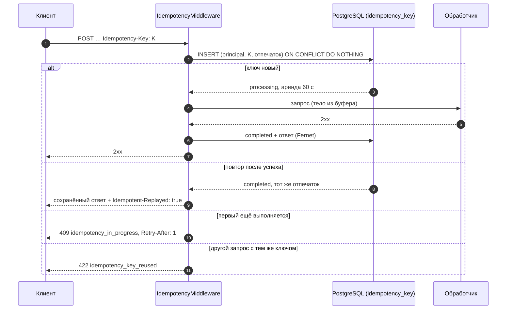
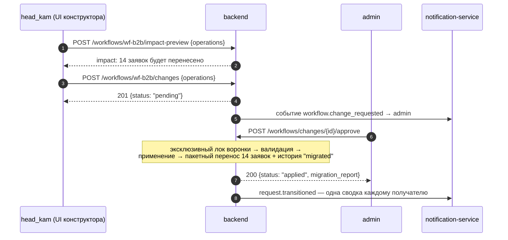
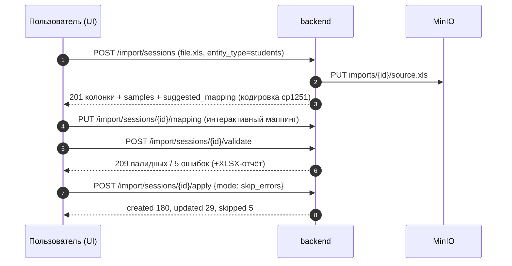
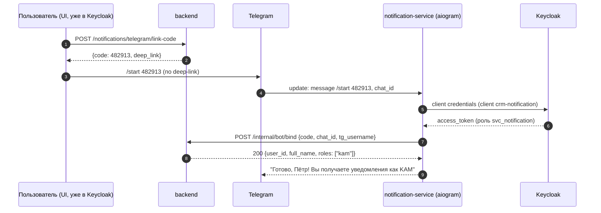
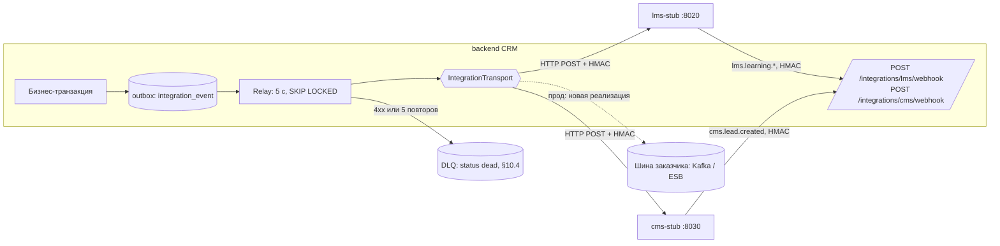
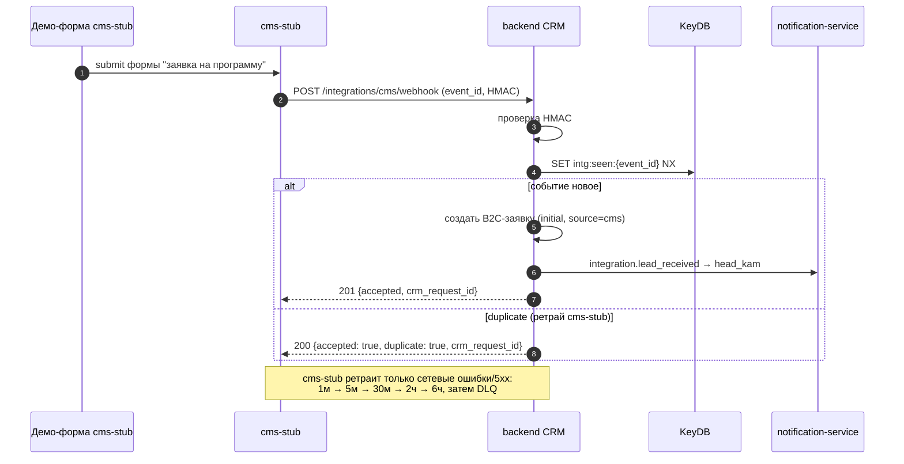

# Контракт REST API бэкенда CRM + интеграционные контракты

Документ — часть проектной документации решения ЛЦТ 2026 «CRM для работы с вузами».
Источник требований: `PLAN.md` (раздел 2 — решения кейсодержателя). В конце документа —
таблица трассировки «решение кейсодержателя → раздел контракта».

Статус: **зафиксирован**. По этому документу пишется код backend (FastAPI), frontend (React),
notification-service, lms-stub, cms-stub без дополнительных вопросов.

---

## 1. Общие соглашения

### 1.1. Базовые URL и порты

| Сервис | Base URL (внутри кластера) | Порт | Префикс API |
|---|---|---|---|
| backend (CRM API) | `http://backend:8000` | 8000 | `/api/v1` |
| notification-service | `http://notification:8010` | 8010 | `/api/v1` |
| lms-stub | `http://lms-stub:8020` | 8020 | `/api/v1` |
| cms-stub | `http://cms-stub:8030` | 8030 | `/api/v1` |
| Keycloak | `http://keycloak:8080` | 8080 | `/realms/crm` |

Снаружи (ingress) фронтенд проксирует `/api/*` на backend, `/auth/*` (realm-эндпоинты) на Keycloak.
Все примеры ниже — относительно `/api/v1` backend, если не указан другой сервис.

### 1.2. Аутентификация и авторизация

- **Люди**: OIDC Authorization Code + PKCE через Keycloak (realm `crm`, public client `crm-frontend`).
  Каждый запрос к API — заголовок `Authorization: Bearer <access_token>` (JWT).
  Backend валидирует подпись по JWKS realm'а (кэш ключей в памяти процесса, TTL 10 мин,
  форс-обновление на неизвестный `kid`), проверяет `iss`, `aud`, `exp`.
- **Keycloak отвечает только за вход; роли и права — в БД CRM** (§12). Назначения хранятся
  в `app_user.roles`, роли — в `app_role`, их права — в `app_role_permission`. Роли из
  `realm_access.roles` токена используются один раз: при создании записи пользователя
  (первый вход) системные роли из токена становятся стартовым назначением. Дальше роли
  назначает администратор в CRM (`PUT /admin/users/{id}/roles`, §10.5); изменение действует
  со следующего запроса, без перелогина.
- **Роли людей** (§12.4):
  - системные — `admin` (администратор, права не редактируются), `head_kam` (руководитель
    КАМов), `kam` (key account manager), `observer` (наблюдатель, read-only, ПДн маскируются);
  - свои роли — создаёт администратор без программиста (§10.5): набор прав из каталога,
    процессы B2B/B2C и область записей (все / только свои).
- **Сервисные роли** (только confidential-клиенты Keycloak, записи `app_user` не создаётся):
  `svc_notification` (клиент `crm-notification`, client credentials — Telegram-бот),
  `svc_integration` (клиент `crm-integration` — заглушки LMS/CMS при вызове webhook-эндпоинтов,
  если вместо HMAC используется bearer; см. §13.6). Сервисный токен без ролей людей к
  интерфейсу CRM не допускается (403).
- **CronJob** аутентифицируется статическим токеном `X-Internal-Token` из K8s Secret
  (см. §11.1) — без Keycloak, чтобы CronJob оставался однострочным `curl`.
- 401 — токен отсутствует/просрочен/невалиден. 403 — нет права (в `message` — название права),
  учётная запись деактивирована или без ролей CRM, процесс B2B/B2C недоступен роли
  (коллекции: доска, создание заявки, отчёт «Активность КАМов»). 404 — объект вне области роли
  (заявка чужого процесса или чужая при области «только свои», её история, комментарии и
  файлы): существование не раскрывается (§12.2).

### 1.3. Формат данных

- `Content-Type: application/json; charset=utf-8` везде, кроме загрузки файлов (`multipart/form-data`)
  и скачивания (`application/octet-stream` / MIME файла).
- Идентификаторы — UUID v4, строкой.
- Даты/время — ISO 8601 в UTC: `2026-09-16T10:30:00Z`. Даты без времени — `2026-09-16`.
- Денежные суммы — строка decimal: `"150000.00"`, поле `currency` (`RUB` по умолчанию).
- Все мутабельные сущности имеют поле `version` (int, optimistic locking): `PATCH`/`PUT`
  обязан передать текущий `version`; при расхождении — `409 stale_version`.
- Заголовок `X-Request-Id` (uuid): если клиент не прислал — генерирует backend; всегда
  возвращается в ответе и пишется в логи (`trace_id` в теле ошибки = `X-Request-Id`).

### 1.4. Формат ошибок (единый)

```json
{
  "error": {
    "code": "validation_error",
    "message": "Ошибка валидации данных",
    "details": [
      {"field": "email", "code": "invalid_format", "message": "Некорректный email"}
    ],
    "trace_id": "6f9a1c2e-6f1b-4e0e-9c1a-2b3c4d5e6f70"
  }
}
```

`message` — человекочитаемый, на русском (показывается в UI как есть).
`code` — машинный, стабильный. `details` — опционален (валидация, построчные ошибки импорта).

| HTTP | `code` | Когда |
|---|---|---|
| 400 | `validation_error` | Ошибка валидации тела/параметров (Pydantic); в `details[].code` — уточнение (`permission_dependency`, `period_too_long`, `workflow_not_allowed` …) |
| 400 | `import_bad_format` | Файл импорта не распознан (не XLSX/XLS/CSV/JSON) |
| 400 | `import_encoding_error` | Не удалось определить кодировку (после перебора, §8.2) |
| 400 | `workflow_invalid_schema` | Схема workflow после операции невалидна (нет initial, недостижимый статус, роль перехода не может выполнять переходы) |
| 400 | `idempotency_key_invalid` | Заголовок `Idempotency-Key` не по формату (§1.6) |
| 401 | `unauthorized` | Нет/просрочен токен |
| 403 | `forbidden` | Нет права, процесс B2B/B2C недоступен роли, действие над чужой заявкой без права (§12) |
| 404 | `not_found` | Объект не найден или вне области роли — существование не раскрываем (§12.2) |
| 409 | `conflict` | Нарушение уникальности (дубль ИНН вуза и т.п.), пакет изменений уже обработан |
| 409 | `stale_version` | Optimistic lock: version устарел |
| 409 | `workflow_invalid_transition` | Переход не разрешён схемой workflow |
| 409 | `workflow_busy` | Схема процесса сейчас применяется: лок воронки не получен за отведённое время (переход — 10 с, применение пакета и удаление роли — 30 с). Операция не выполнена, повтор безопасен; заголовок `Retry-After: 2` (§5.4) |
| 409 | `idempotency_in_progress` | Запрос с этим `Idempotency-Key` ещё выполняется; `Retry-After: 1` (§1.6) |
| 409 | `idempotency_replay_unavailable` | Операция по ключу уже выполнена, но сохранённый ответ недоступен — перечитать данные (§1.6) |
| 409 | `role_exists`, `role_in_use`, `role_locked`, `role_system` | Роли: код/название заняты; роль назначена или указана в переходах; роль `admin` не редактируется; системную роль нельзя удалить (§10.5) |
| 409 | `access_lockout` | Изменение лишает актора права `admin:roles` или не оставляет ни одного активного пользователя с ним (§10.5) |
| 413 | `file_too_large` | Файл > лимита (импорт: 20 МБ; вложения: 50 МБ); тело запроса с `Idempotency-Key` > 60 МБ |
| 422 | `unprocessable` | Семантическая ошибка (например, target-статус миграции = удаляемый; PDF реестра) |
| 422 | `idempotency_key_reused` | `Idempotency-Key` уже использован для другого запроса (§1.6) |
| 429 | `rate_limited` | Превышение лимита (заголовок `Retry-After`) |
| 500 | `internal_error` | Необработанная ошибка (детали только в логах) |
| 502 | `integration_unavailable` | Синхронный вызов внешней системы (MinIO, Keycloak Admin API) не удался |
| 503 | `service_unavailable` | Хранилище ключей идемпотентности недоступно — мутация с ключом не выполнена; `Retry-After: 2` (§1.6) |

Заголовок `Retry-After` (секунды) приходит вместе с `409 workflow_busy`, `409 idempotency_in_progress`
и `503 service_unavailable`; клиент повторяет запрос с тем же `Idempotency-Key` (§1.6).

### 1.5. Пагинация, сортировка, фильтрация

Все списки — limit/offset:

```
GET /api/v1/requests?limit=25&offset=50&sort=-created_at&status_id=<uuid>&search=МФТИ
```

- `limit` (1..200, по умолчанию 25), `offset` (>=0, по умолчанию 0).
- `sort`: имя поля, префикс `-` — по убыванию; несколько через запятую: `sort=-priority,created_at`.
- `search` — подстрочный поиск по «естественным» полям сущности (описано у каждого эндпоинта).
- Фильтры — плоские query-параметры; массив значений — повтором параметра: `status_id=a&status_id=b`.

Ответ-конверт списка (везде одинаковый):

```json
{
  "items": [ { } ],
  "total": 137,
  "limit": 25,
  "offset": 50
}
```

### 1.6. Идемпотентность мутаций (`Idempotency-Key`)

Сквозной механизм для всех мутаций API по черновику IETF
`draft-ietf-httpapi-idempotency-key-header`. Реализация — ASGI-middleware
`backend/app/core/idempotency.py` (внутри `RequestIdMiddleware`), хранилище —
`backend/app/core/idempotency_store.py`.

**Где действует.** `POST`/`PUT`/`PATCH`/`DELETE` под `/api/v1/` с заголовком `Idempotency-Key`.
Без заголовка поведение обычное. Исключены вебхуки `/integrations/lms/webhook` и
`/integrations/cms/webhook`: у них своя идемпотентность по `event_id` и HMAC (§13.5).
Запрос без валидной аутентификации middleware пропускает — приложение само отвечает `401`.

**Ключ.** Ровно один заголовок; 1–255 печатных ASCII-символов без пробелов (одна пара внешних
кавычек снимается); рекомендуется UUID v4. Иначе — `400 idempotency_key_invalid`.

**Область ключа — принципал:** `sub:<keycloak sub>` (проверенный JWT) или `internal`
(`X-Internal-Token`). Один и тот же ключ двух пользователей — два разных ключа: чужой ответ
по ключу не получить.

**Отпечаток запроса** — sha256 от метода, пути, query, media-type (без параметров) и дайджеста
тела. JSON до 1 МиБ канонизируется: порядок ключей не влияет. В `multipart/form-data` граница
(`boundary`) заменяется постоянным маркером — браузер генерирует новую на каждый ретрай
`FormData`, и легитимный повтор загрузки файла иначе получил бы `422`.

| Ситуация | Ответ |
|---|---|
| Первый запрос с ключом | Выполняется; ответ 2xx сохраняется (статус, заголовки, тело) на 24 ч |
| Повтор с тем же отпечатком после успеха | Сохранённые статус, заголовки и тело + заголовок `Idempotent-Replayed: true`; обработчик не вызывается |
| Повтор, пока первый запрос выполняется | `409 idempotency_in_progress`, `Retry-After: 1` |
| Тот же ключ, другой запрос (метод, путь, query или тело) | `422 idempotency_key_reused` |
| Успех сохранён без тела (ответ > 1 МиБ, не UTF-8, файл) или тело не расшифровывается | `409 idempotency_replay_unavailable` — операция выполнена, перечитать данные |
| Первый запрос завершился 4xx/5xx или исключением | Ключ освобождается — повтор выполняется заново |
| Тело запроса > 60 МБ | `413 file_too_large` |
| Хранилище ключей недоступно | `503 service_unavailable`, `Retry-After: 2` — fail-closed: без хранилища мутация с ключом не выполняется |

**Хранилище — таблица PostgreSQL `idempotency_key`** (data-model.md §9.6), UNIQUE
`(principal, idem_key)`. Не KeyDB: KeyDB у нас эфемерный (падение кэша не роняет CRM), а гарантия
«не выполнить дважды» должна переживать рестарт и быть общей для всех реплик. Тело ответа
хранится Fernet-шифртекстом (ответы мутаций содержат ПДн), тело запроса — только хеш.
Не сохраняются и не проигрываются `date`, `server`, `content-length`, `transfer-encoding`,
`connection`, `keep-alive`, `set-cookie` и `X-Request-Id` — повтор получает свой `trace_id`.

**TTL и очистка.** Ключ живёт 24 ч (`IDEMPOTENCY_TTL_HOURS`, 1–168); просроченная запись при
повторе перезаписывается как новая. Физически просроченные ключи удаляет CronJob
`idempotency-purge` ежечасно (`POST /internal/jobs/purge-idempotency-keys`, §11.2) — пачками
по 5 000 строк.

**Протокол — три фазы;** операции хранилища — отдельные короткие транзакции, соединение
во время работы обработчика не удерживается:
1. заявка на ключ — `INSERT … ON CONFLICT` и COMMIT до бизнес-транзакции: запись `processing`
   с арендой `locked_until` = now + 60 с (`IDEMPOTENCY_LEASE_SECONDS`);
2. выполнение обработчика под арендой: продление каждые 15 с (аренда / 4), завершить или
   освободить ключ может только владелец (`lock_token`). Если владелец упал и аренда истекла,
   следующий повтор перехватывает ключ и выполняет запрос;
3. завершение — ответ фиксируется COMMIT'ом до отправки клиенту последнего чанка тела.



**Гарантия и окно.** Протокол не атомарен с бизнес-транзакцией: обработчики коммитят сами.
Если процесс упадёт между COMMIT операции и сохранением ответа (миллисекунды), повтор
выполнится заново. Такой повтор отсекают доменные защиты: `version` (`409 stale_version`),
машина состояний импорта (повторный `apply` возвращает сохранённый результат, §6.4),
UNIQUE-ограничения, `dedup_key` уведомлений, `event_id` интеграций.

**Отступления от черновика IETF:** тело ошибки — единый конверт §1.4 вместо RFC 9457;
заголовок повтора — `Idempotent-Replayed: true` (как у Stripe).

**OpenAPI.** У каждой мутации под `/api/v1/` (кроме вебхуков) в Swagger (`/api/v1/docs`) есть
header-параметр `Idempotency-Key` и описания ответов `409`/`422`.

**Клиент** (`frontend/src/shared/api/idempotency.ts`). Ключ получает каждая мутация
автоматически по правилу «одно действие пользователя — один ключ»: ключ выводится из
отпечатка запроса (метод, URL, тело с отсортированными ключами) и живёт до окончательного
ответа, не дольше 10 мин. Двойной клик, ретрай после таймаута и «Повторить» после обрыва
связи получают сохранённый ответ, а не дубль. Автоповторы с тем же ключом:
- сетевая ошибка и `502`/`503`/`504` — до 3 попыток (паузы около 0,5 и 1,5 с или по `Retry-After`);
- `409 idempotency_in_progress` и `409 workflow_busy` — ожидание по `Retry-After`, суммарно
  не дольше 10 с;
- `422 idempotency_key_reused` — один повтор с новым ключом.

### 1.7. Health-пробы (без аутентификации)

| Метод/путь | Назначение |
|---|---|
| `GET /healthz` | liveness: процесс жив, всегда `200 {"status":"ok"}` |
| `GET /readyz` | readiness: проверка коннекта к PG и KeyDB; `503` если нет |

Есть у всех четырёх сервисов (backend, notification, lms-stub, cms-stub).

---

## 2. Auth / профиль

### 2.1. `GET /auth/me`

Доступ: любой пользователь с хотя бы одной ролью CRM (без ролей — `403`, администратор видит
такого пользователя в списке и назначает роль). Источник данных для отрисовки UI по ролевой
модели (кор-требование «отображение интерфейса строго по ролям»): фронт скрывает разделы и
кнопки по правам, backend всё равно проверяет каждый запрос.

Пример — системная роль `kam` с набором прав по умолчанию:

```json
{
  "id": "u-uuid",
  "username": "kam.ivanov",
  "full_name": "Иванов Пётр Сергеевич",
  "email": "ivanov@corp.local",
  "roles": ["kam"],
  "role_details": [{"code": "kam", "name": "КАМ", "is_system": true}],
  "manager_id": "u-uuid-head",
  "permissions": [
    "activities:participants", "activities:read", "clients:pii", "comments:write",
    "contracts:read", "contracts:write", "export:run", "files:business", "import:run",
    "notifications:self", "products:read", "programs:priority", "programs:read",
    "programs:write", "reports:read", "requests:assign", "requests:files", "requests:kam",
    "requests:read", "requests:transition", "requests:write", "students:files",
    "students:read", "students:reveal", "students:write", "universities:read",
    "universities:write", "workflow:read"
  ],
  "access": {
    "workflow_types": ["b2b", "b2c"],
    "records": {"b2b": "all", "b2c": "all"},
    "by_workflow": {
      "b2b": ["comments:write", "reports:read", "requests:assign", "requests:files", "requests:kam",
              "requests:read", "requests:transition", "requests:write", "workflow:read"],
      "b2c": ["comments:write", "reports:read", "requests:assign", "requests:files", "requests:kam",
              "requests:read", "requests:transition", "requests:write", "workflow:read"]
    },
    "transition_roles": {"b2b": ["kam"], "b2c": ["kam"]},
    "scoped_permissions": [
      "comments:delete_any", "comments:write", "reports:all", "reports:read", "requests:assign",
      "requests:assign_any", "requests:delete", "requests:files", "requests:kam", "requests:read",
      "requests:reopen", "requests:transition", "requests:write", "requests:write_any",
      "workflow:approve", "workflow:change", "workflow:history", "workflow:read"
    ],
    "catalog_version": 1
  },
  "telegram": {"linked": true, "tg_username": "ivanov_p", "linked_at": "2026-09-20T10:00:00Z"}
}
```

| Поле | Смысл |
|---|---|
| `roles`, `role_details` | Роли пользователя, известные каталогу (системные и свои), с названиями |
| `permissions` | Объединение прав всех ролей. Для права с областью — «есть хотя бы в одном процессе» |
| `access.workflow_types` | Процессы, где пользователь видит заявки (`requests:read`) |
| `access.records` | Область записей по процессу: `all` — все заявки, `own` — только где он ответственный |
| `access.by_workflow` | Права с областью, действующие в каждом процессе (объединение по процессу, §12.3) |
| `access.transition_roles` | Роли пользователя, которыми он выполняет переходы в процессе — фронт сверяет их с `allowed_roles` перехода |
| `access.scoped_permissions` | Коды прав с областью: для них фронт проверяет право в процессе конкретной заявки |
| `access.catalog_version` | Номер загрузки каталога ролей в процессе backend |

Права вычисляются на backend из ролей пользователя в БД и каталога ролей (`backend/app/core/access.py`,
каталог прав — `backend/app/core/rbac_catalog.py`); фронт ничего не хардкодит. При изменении
ролей и прав приходит SSE `access.changed` (`{role_codes, user_ids}`); если событие касается
текущего пользователя, фронт перечитывает `/auth/me` и перестраивает меню без перелогина.

### 2.2. Служебные UI-эндпоинты (SSE, пресеты, поиск, фичефлаги)

| Метод/путь | Описание | Роли |
|---|---|---|
| `GET /events/stream` | **SSE**-канал realtime-обновлений UI. События: `workflow.changed` (схема опубликована → доски перечитывают колонки), `request.transitioned`, `request.comment_added` (в data — `request_id`), `telegram.linked` (закрывает модалку привязки), `flags.updated`, `notification.created` (колокольчик), `access.changed` (роли или права изменились: `{role_codes, user_ids}` → фронт перечитывает `/auth/me`, реплики сбрасывают кэш каталога ролей). Формат кадра: `event: <topic>\ndata: <json>`. Fan-out между репликами backend — KeyDB pub/sub `crm:v1:events`. Фолбэк фронта — поллинг | все (JWT) |
| `GET /ui/presets?screen=` | Сохранённые пресеты таблиц/фильтров текущего пользователя | все |
| `POST /ui/presets` / `PATCH /ui/presets/{id}` / `DELETE /ui/presets/{id}` | CRUD пресета | все (только свои) |
| `GET /search?q=` | Глобальный поиск (Cmd+K): вузы, заявки, студенты (по `display_name`), договоры; ответ — группы `{universities:[], requests:[], students:[], contracts:[]}` до 5 записей в группе. Группа отдаётся только при праве чтения сущности, заявки — в области роли (§12.2) | все |
| `GET /flags` | Активные фичефлаги (`{"auto_ranking": false, "report_pdf": true, …}`) | все |
| `GET /admin/feature-flags` / `PATCH /admin/feature-flags/{name}` | Управление флагами (`{"enabled": true}`); изменение публикует SSE `flags.updated` | `admin:flags` |

Контракт пресета (тело POST / ответа; `screen` также используется для шаблонов маппинга импорта —
`screen: "import:students"`):

```json
{
  "id": "b9c1…",
  "screen": "registry.universities",
  "name": "Мои вузы ЦФО",
  "is_default": true,
  "state": {
    "filters": {"region": ["ЦФО"], "kam_user_id": ["me"]},
    "sort": {"field": "updated_at", "order": "desc"},
    "columns": ["name", "region", "contracts_count", "active_requests", "kam"],
    "page_size": 50
  }
}
```

---

## 3. Вузы, контакты, договоры, продукты, программы

### 3.1. Вузы (`/universities`)

| Метод/путь | Описание | Роли (write) |
|---|---|---|
| `GET /universities` | Список. Фильтры: `search` (название/ИНН/город), `region`, `kam_user_id`, `has_active_contract` (bool) | все |
| `POST /universities` | Создать | admin, head_kam, kam |
| `GET /universities/{id}` | Карточка (+агрегаты: счётчики договоров/заявок/студентов) | все |
| `PATCH /universities/{id}` | Изменить (c `version`) | admin, head_kam, kam (свои — см. §12.2) |
| `DELETE /universities/{id}` | Деактивация (`is_active=false`), запрещено при активных заявках → `409 conflict` | admin |
| `GET /universities/{id}/contacts` | Контактные лица вуза | все |
| `POST /universities/{id}/contacts` | Добавить контакт | admin, head_kam, kam |
| `PATCH /universities/{id}/contacts/{contact_id}` | Изменить | admin, head_kam, kam |
| `DELETE /universities/{id}/contacts/{contact_id}` | Удалить | admin, head_kam |

Тело вуза (создание/карточка):

```json
{
  "id": "un-uuid",
  "name": "Московский физико-технический институт",
  "short_name": "МФТИ",
  "inn": "5008006211",
  "kpp": "500801001",
  "region": "Московская область",
  "city": "Долгопрудный",
  "website": "https://mipt.ru",
  "kam_user_id": "u-uuid",
  "notes": "…",
  "is_active": true,
  "version": 3,
  "created_at": "…", "updated_at": "…"
}
```

Уникальность: `inn` (при непустом) → `409 conflict`. Обогащение из открытых источников —
только разовой предзагрузкой через импорт справочников (§10.1), runtime-выхода в интернет нет.

### 3.2. Договоры (`/contracts`)

Правило кейсодержателя: у вуза как правило один договор, продуктов несколько. API не
запрещает второй договор, но UI подсвечивает предупреждением (поле `warning_duplicate` в ответе
создания, если у вуза уже есть договор со статусом `active`).

| Метод/путь | Описание | Роли (write) |
|---|---|---|
| `GET /contracts` | Фильтры: `university_id`, `counterparty_id`, `status` (`draft/negotiation/active/completed/terminated`), `search` (номер) | все |
| `POST /contracts` | Создать | admin, head_kam, kam |
| `GET /contracts/{id}` | Карточка + список файлов | все |
| `PATCH /contracts/{id}` | Изменить | admin, head_kam, kam |
| `DELETE /contracts/{id}` | Мягкое удаление | admin |
| `POST /contracts/{id}/files` | `multipart/form-data`, поле `file`; сохранение в MinIO | admin, head_kam, kam |
| `GET /contracts/{id}/files` | Список файлов | все |
| `DELETE /contracts/{id}/files/{file_id}` | Удалить файл | admin, head_kam |

Тело договора:

```json
{
  "id": "ct-uuid",
  "university_id": "un-uuid",
  "counterparty_id": null,
  "number": "Д-2026/041",
  "status": "active",
  "signed_at": "2026-02-01",
  "valid_from": "2026-02-01",
  "valid_to": "2027-02-01",
  "amount": "1200000.00",
  "currency": "RUB",
  "product_ids": ["pr-uuid-1", "pr-uuid-2"],
  "version": 1
}
```

Владелец договора — вуз **или** контрагент (ровно один из `university_id`/`counterparty_id`,
CHECK в БД).
```json
```

Файл (ответ загрузки; общий формат файлов для всего API — договоры, студенты, отчёты импорта):

```json
{
  "id": "f-uuid",
  "file_name": "contract_D-2026-041.pdf",
  "content_type": "application/pdf",
  "size_bytes": 482133,
  "s3_key": "contract/ct-uuid/f-uuid/contract_D-2026-041.pdf",
  "uploaded_by": "u-uuid",
  "created_at": "…"
}
```

Скачивание любого файла: `GET /files/{file_id}/download` → backend проверяет RBAC и
отдаёт `302 Location: <presigned MinIO URL, TTL 10 мин>` (или проксирует поток, если MinIO не
опубликован наружу — режим `FILE_DELIVERY=proxy|presigned`, по умолчанию `proxy`, т.к. закрытый контур).

RBAC скачивания (§12.2): файл заявки или вложение её комментария вне области роли — `404`,
как и сама заявка; файлы договоров, студентов, заявок и комментариев — только с правом
`files:business` (иначе `403`); исходники и отчёты импорта, результаты выгрузок — автору
или с правом `files:others`.

### 3.3. Продукты (`/products`)

Продукт — направление/услуга компании (ДПО, корпоративное обучение, олимпиады…).

| Метод/путь | Роли (write) |
|---|---|
| `GET /products` (фильтры: `search`, `is_active`) | все |
| `POST /products` | admin, head_kam |
| `GET /products/{id}` | все |
| `PATCH /products/{id}` | admin, head_kam |
| `DELETE /products/{id}` (мягкое; `409` при привязанных программах) | admin |

```json
{"id": "pr-uuid", "name": "ДПО: Data Science", "code": "dpo-ds", "description": "…", "is_active": true, "version": 2}
```

### 3.4. Программы и приоритеты курсов (`/programs`)

Программа — конкретный курс/программа обучения; привязана к продукту, опционально к вузу.
Ранжирование по востребованности — **ручное изменение приоритета КАМами/админами** (решение
кейсодержателя); автоформула — бонус, в контракт не входит.

| Метод/путь | Описание | Роли (write) |
|---|---|---|
| `GET /programs` | Фильтры: `product_id`, `university_id`, `is_active`, `search`; сортировка по умолчанию `priority_rank` (по возрастанию: меньше = выше) | все |
| `POST /programs` | Создать | admin, head_kam, kam |
| `GET /programs/{id}` | Карточка | все |
| `PATCH /programs/{id}` | Изменить | admin, head_kam, kam |
| `DELETE /programs/{id}` | Мягкое удаление | admin |
| `PATCH /programs/{id}/priority` | `{"priority_rank": 80, "version": 4}` — точечное изменение | admin, head_kam, kam |
| `POST /programs/priorities/reorder` | Массовое: `{"items":[{"id":"…","priority_rank":10},{"id":"…","priority_rank":20}]}` (drag&drop в UI) | admin, head_kam, kam |

```json
{
  "id": "pg-uuid",
  "product_id": "pr-uuid",
  "university_id": "un-uuid",
  "name": "Практикум по ML, весна-2027",
  "priority_rank": 80,
  "seats": 30,
  "starts_on": "2027-02-15",
  "is_active": true,
  "published_to_cms": true,
  "cms_external_id": "cms-item-17",
  "lms_course_id": "lms-course-244",
  "version": 4
}
```

`priority_rank` — int, **меньше = выше** в списках и на дашборде (дефолт 1000). История изменений
приоритета пишется в аудит-лог (§10.4). `cms_external_id`/`lms_course_id` — read-only, вычисляются
из `external_link` (data-model.md §9.3).

---

## 4. Заявки B2B/B2C (`/requests`)

Единая сущность `Request` с полем `workflow_type: "b2b" | "b2c"`. B2B — взаимодействие с вузом;
B2C — физлицо или юрлицо (поле `client_kind: "person" | "company"`). Оба живут каждый в своём
workflow (§5).

### 4.1. Эндпоинты

Колонка «Роли» — системные роли с набором прав по умолчанию. Проверка в коде — по правам и
области роли (эндпоинт → право — §12.1): заявка вне области роли — `404`, процесс вне области
для доски и создания — `403`.

| Метод/путь | Описание | Роли (write) |
|---|---|---|
| `GET /requests` | Список. Фильтры: `workflow_type`, `status_id` (multi), `assignee_id`, `university_id`, `product_id`, `program_id`, `stuck` (bool, см. §11), `created_from`, `created_to`, `source` (`manual/import/cms`), `search` (название/клиент) | все |
| `GET /requests/board` | Канбан-агрегат: `?workflow_type=b2b` → колонки по статусам, счётчики, первые N карточек в каждой | все |
| `POST /requests` | Создать (статус = initial статус схемы; менять статус при создании нельзя) | admin, head_kam, kam |
| `GET /requests/{id}` | Карточка: поля + текущий статус + доступные переходы + последние комментарии | все |
| `PATCH /requests/{id}` | Изменить поля (не статус!) | admin, head_kam, kam-ответственный |
| `POST /requests/{id}/assign` | `{"assignee_id":"u-uuid"}` — смена ответственного; новый ответственный обязан видеть процесс заявки (иначе `400`, `details[].code = workflow_not_allowed`) | admin, head_kam (`requests:assign_any`); kam — только взять «свободную» заявку на себя: её ответственный не ведёт портфель как КАМ (нет `requests:kam` в процессе) |
| `GET /requests/{id}/transitions` | Доступные переходы для текущего пользователя (вкл. возвраты) | все |
| `POST /requests/{id}/transitions` | Выполнить переход (§4.3) | admin, head_kam, kam-ответственный |
| `GET /requests/{id}/history` | История: переходы, смены ответственного, изменения полей | все |
| `GET /requests/{id}/comments` / `POST …` / `DELETE …/{comment_id}` | Комментарии (§4.4) | см. §4.4 |
| `GET /requests/{id}/files` / `POST …` / `DELETE …/{file_id}` | Файлы заявки (§4.5) | см. §4.5 |
| `POST /requests/{id}/reopen` | Переоткрыть из терминального статуса: `{"to_status_id": "…", "comment": "…"}` (comment обязателен; запись истории `kind: transition`, `reason: reopen`) | **только admin** (`requests:reopen`) |
| `DELETE /requests/{id}` | Мягкое удаление | admin |

### 4.2. Тело заявки

```json
{
  "id": "rq-uuid",
  "workflow_type": "b2b",
  "title": "МФТИ — ДПО Data Science, поток весна-2027",
  "university_id": "un-uuid",
  "client_kind": null,
  "counterparty_id": null,
  "interaction_type_id": null,
  "client": null,
  "contract_id": "ct-uuid",
  "product_id": "pr-uuid",
  "program_id": "pg-uuid",
  "status": {"id": "st-uuid", "code": "negotiation", "name": "Переговоры", "color": "#1677ff"},
  "assignee": {"id": "u-uuid", "full_name": "Иванов Пётр Сергеевич"},
  "source": "manual",
  "external_refs": {"cms_lead_id": null, "lms_enrollment_id": null},
  "amount": "1200000.00",
  "status_updated_at": "2026-09-10T08:00:00Z",
  "is_stuck": false,
  "stuck_days": 6,
  "description": "…",
  "version": 7,
  "created_at": "…", "updated_at": "…"
}
```

Для B2C: `university_id` = null, `counterparty_id` — обязателен, `client_kind` = `person|company`
(проекция `counterparty.kind`), `interaction_type_id` — тип взаимодействия из редактируемого
справочника, `client` — сериализация контрагента:
`{"full_name": "…", "email": "…", "phone": "…", "company_name": null, "inn": null}`.
ПДн клиента-физлица шифруются на уровне хранения так же, как студенты (см. §9.4);
без права `clients:pii` (по умолчанию его нет у `observer`) поля `client.full_name/email/phone`
отдаются маскированными.

### 4.3. Переход по статусу (вкл. возвраты)

```
POST /api/v1/requests/{id}/transitions
Idempotency-Key: 9d1f…
{
  "to_status_id": "st-uuid-contract-prep",
  "comment": "Согласовали КП, готовим договор",
  "version": 7
}
```

Правила:
- Переход валиден, только если в живой схеме workflow есть транзиция `current → to_status_id`.
  Иначе `409 workflow_invalid_transition` с `details[0].message` = список допустимых переходов.
- Права (§12.2): `requests:transition` в процессе заявки; чужая заявка — ещё
  `requests:write_any`; непустой `allowed_roles` транзиции должен содержать роль пользователя,
  которая может выполнять переходы в этом процессе (`access.transition_roles`, §2.1), пустой —
  достаточно доступа к заявке. Иначе `403 forbidden`.
- Переход берёт shared-лок воронки: пока применяется пакет изменений схемы (§5.4), переход
  ждёт не дольше 10 с, затем `409 workflow_busy` с `Retry-After: 2` — переход не выполнен,
  повтор безопасен.
- **Возвраты** — обычные транзиции с `kind: "return"` (в БД — флаг `is_return`; бюрократия:
  «вернуть на доработку»). Для `kind: "return"` и любых транзиций с `requires_comment: true`
  (например, «Отказ») поле `comment` обязательно (`400 validation_error`, если пусто).
- Переход обновляет `status_updated_at` (сбрасывает счётчик «зависания»).
- Побочные эффекты (в одной транзакции + outbox, §13.7): запись в историю; событие в
  notification-service (§11.3); если целевой статус имеет флаг `triggers_lms_handover` —
  интеграционное событие `crm.request.handed_over` в LMS (§13.2).

Ответ `200` — обновлённая заявка (как §4.2).

История (`GET /requests/{id}/history`) — элементы:

```json
{
  "id": "h-uuid",
  "kind": "transition",
  "from_status": {"id": "…", "code": "negotiation", "name": "Переговоры"},
  "to_status": {"id": "…", "code": "contract_prep", "name": "Подготовка договора"},
  "is_return": false,
  "comment": "…",
  "actor": {"id": "u-uuid", "full_name": "…"},
  "created_at": "…"
}
```

(`kind`: `transition | assign | field_change | created | migrated` — `migrated` пишется при
миграции заявки на новую схему workflow, §5.4.)

### 4.4. Комментарии

`POST /requests/{id}/comments` — `{"text": "…"}` → `201` c объектом комментария
(`id, text, author{id,full_name}, created_at`). Писать может любой видящий заявку с правом
`comments:write` в её процессе (по умолчанию admin, head_kam, kam; observer — нет). Удаление —
автор или право `comments:delete_any` (по умолчанию admin), мягкое
(`deleted_at`, текст в выдаче заменяется на `"(удалено)"`).

### 4.5. Файлы заявки

| Метод/путь | Описание | Право (§12.1) |
|---|---|---|
| `GET /requests/{id}/files` | Вложения заявки `{"items": [файл §3.2], "total": N}` по возрастанию даты | `requests:read`; заявка вне области — `404` |
| `POST /requests/{id}/files` | `multipart/form-data`, поле `file`, до 50 МБ (`413 file_too_large`); `201` — файл §3.2 | `requests:files` в процессе заявки, иначе `403` |
| `DELETE /requests/{id}/files/{file_id}` | Мягкое удаление (`deleted_at`); объект MinIO удаляет `purge-deleted` (§11.2); `204` | `requests:files` в процессе заявки и (автор файла или `requests:write_any` в процессе), иначе `403` |

По умолчанию `requests:files` есть у admin, head_kam и kam; удалить чужой файл могут admin и
head_kam (`requests:write_any`). Файлы лежат в бакете `crm-files` (`entity_type='deal'`,
ключ `deal/{request_id}/{file_id}/{имя}`); скачивание — общий `GET /files/{file_id}/download`
(§3.2). Загрузка и удаление пишут аудит (`request.file_uploaded`, `request.file_deleted`);
загрузка обновляет `last_activity_at` заявки и считается взаимодействием КАМа в отчёте
«Активность КАМов» (§7.2.1).

---

## 5. Workflow: CRUD, изменение схемы с апрувом, миграция заявок

### 5.1. Модель

Два workflow — `b2b` и `b2c`, **единые для всех, без версионирования** (решение кейсодержателя).
Изменения применяются сразу для всех заявок. В `b2c` добавление новых «вариантов
взаимодействия» = операции `add_status` / `add_transition` (§5.3).

Схема (`GET /workflows/{id}`):

```json
{
  "id": "wf-b2b",
  "type": "b2b",
  "name": "Взаимодействие с вузами",
  "updated_at": "…",
  "statuses": [
    {"id": "st-1", "code": "new",            "name": "Новая",                "color": "#8c8c8c", "is_initial": true,  "is_terminal": false, "terminal_outcome": null,   "stuck_threshold_days": 7,    "triggers_lms_handover": false, "position": 0},
    {"id": "st-2", "code": "first_contact",  "name": "Первичный контакт",    "color": "#13c2c2", "is_initial": false, "is_terminal": false, "terminal_outcome": null,   "stuck_threshold_days": 14,   "triggers_lms_handover": false, "position": 1},
    {"id": "st-3", "code": "negotiation",    "name": "Переговоры",           "color": "#1677ff", "is_initial": false, "is_terminal": false, "terminal_outcome": null,   "stuck_threshold_days": 14,   "triggers_lms_handover": false, "position": 2},
    {"id": "st-4", "code": "contract_prep",  "name": "Подготовка договора",  "color": "#722ed1", "is_initial": false, "is_terminal": false, "terminal_outcome": null,   "stuck_threshold_days": 14,   "triggers_lms_handover": false, "position": 3},
    {"id": "st-5", "code": "contract_signed","name": "Договор подписан",     "color": "#52c41a", "is_initial": false, "is_terminal": false, "terminal_outcome": null,   "stuck_threshold_days": 14,   "triggers_lms_handover": false, "position": 4},
    {"id": "st-6", "code": "in_learning",    "name": "Передано в обучение",  "color": "#a0d911", "is_initial": false, "is_terminal": false, "terminal_outcome": null,   "stuck_threshold_days": null, "triggers_lms_handover": true,  "position": 5},
    {"id": "st-7", "code": "completed",      "name": "Завершена",            "color": "#237804", "is_initial": false, "is_terminal": true,  "terminal_outcome": "won",  "stuck_threshold_days": null, "triggers_lms_handover": false, "position": 6},
    {"id": "st-8", "code": "rejected",       "name": "Отказ",                "color": "#f5222d", "is_initial": false, "is_terminal": true,  "terminal_outcome": "lost", "stuck_threshold_days": null, "triggers_lms_handover": false, "position": 7}
  ],
  "transitions": [
    {"id": "tr-1", "from_status_id": "st-1", "to_status_id": "st-2", "kind": "forward", "name": "Взять в работу",     "requires_comment": false, "allowed_roles": ["kam","head_kam","admin"]},
    {"id": "tr-2", "from_status_id": "st-2", "to_status_id": "st-3", "kind": "forward", "name": "Начать переговоры",  "requires_comment": false, "allowed_roles": ["kam","head_kam","admin"]},
    {"id": "tr-3", "from_status_id": "st-3", "to_status_id": "st-4", "kind": "forward", "name": "Готовить договор",   "requires_comment": false, "allowed_roles": ["kam","head_kam","admin"]},
    {"id": "tr-4", "from_status_id": "st-4", "to_status_id": "st-3", "kind": "return",  "name": "Вернуть в переговоры","requires_comment": true, "allowed_roles": ["kam","head_kam","admin"]},
    {"id": "tr-5", "from_status_id": "st-4", "to_status_id": "st-5", "kind": "forward", "name": "Договор подписан",   "requires_comment": false, "allowed_roles": ["head_kam","admin"]},
    {"id": "tr-6", "from_status_id": "st-5", "to_status_id": "st-6", "kind": "forward", "name": "Передать в обучение","requires_comment": false, "allowed_roles": ["kam","head_kam","admin"]},
    {"id": "tr-7", "from_status_id": "st-6", "to_status_id": "st-7", "kind": "forward", "name": "Завершить",          "requires_comment": false, "allowed_roles": ["kam","head_kam","admin"]},
    {"id": "tr-8", "from_status_id": "st-2", "to_status_id": "st-8", "kind": "forward", "name": "Отказ",              "requires_comment": true,  "allowed_roles": ["kam","head_kam","admin"]},
    {"id": "tr-9", "from_status_id": "st-3", "to_status_id": "st-8", "kind": "forward", "name": "Отказ",              "requires_comment": true,  "allowed_roles": ["kam","head_kam","admin"]},
    {"id": "tr-10","from_status_id": "st-4", "to_status_id": "st-8", "kind": "forward", "name": "Отказ",              "requires_comment": true,  "allowed_roles": ["kam","head_kam","admin"]}
  ]
}
```

Инварианты схемы (проверяются на каждой операции, иначе `400 workflow_invalid_schema`):
ровно один `is_initial`; ≥1 `is_terminal`; каждый нетерминальный статус имеет исходящую
транзицию; каждый статус достижим из initial; `code` уникален внутри workflow;
удалять/переименовывать initial нельзя (переименование initial — тоже через апрув, удаление — запрещено, `422`).

Ветвления — несколько исходящих транзиций из одного статуса (`kind: forward`); возвраты —
`kind: return` (в БД — флаг `is_return`; «отказ» — обычный forward в терминальный `lost`-статус с
`requires_comment: true`). API-поле `kind` — проекция флага, поле `position` — проекция колонки
`sort_order`, `stuck_threshold_days: null` = наследовать порог workflow. У транзиции может быть
`condition` (JSON-DSL, workflow-engine.md §3.3) — декларативная подсказка ветвления: backend
аннотирует ею список доступных переходов (`available: true/false` + причина), но при `POST` не
блокирует — жёстко проверяются только существование ребра, `allowed_roles` и `requires_comment`.
Стартовый B2C-workflow: `new → consultation → proposal → payment_pending → paid → in_learning →
completed` + `rejected` + возврат `payment_pending → proposal`; сиды в Alembic-миграции
(файлы `backend/app/modules/workflow/seeds/{b2b,b2c}.json`).

### 5.2. Эндпоинты workflow

| Метод/путь | Описание | Право в процессе воронки (по умолчанию) |
|---|---|---|
| `GET /workflows` | `[{id, type, name, statuses_count, active_requests, updated_at}]` — только процессы, схема которых видна пользователю | вход |
| `GET /workflows/{id}` | Полная схема (§5.1) — для конструктора React Flow и канбана; схема чужого процесса — `404` | `workflow:read` или `requests:read` (все) |
| `POST /workflows/{id}/impact-preview` | Предпросмотр влияния операций до отправки (§5.3) | `workflow:change` (admin, head_kam) |
| `POST /workflows/{id}/changes` | Создать изменение схемы (пакет операций) | `workflow:change` (admin, head_kam) |
| `GET /workflows/{id}/changes` | Список изменений; фильтр `status=pending/applied/rejected/failed` | `workflow:history` (admin, head_kam, observer) |
| `GET /workflows/changes/{change_id}` | Карточка изменения + impact + `migration_report` применённого пакета | `workflow:history` (admin, head_kam, observer) |
| `POST /workflows/changes/{change_id}/approve` | Апрув → применение + перенос заявок (§5.4) | `workflow:approve` (**только admin**) |
| `POST /workflows/changes/{change_id}/reject` | `{"reason":"…"}` | `workflow:approve` (**только admin**) |

Право проверяется в процессе воронки (`b2b`/`b2c`), а не «хоть в одном»: право есть, но не
в этом процессе — `403`; пакет процесса, схема которого пользователю не видна, — `404`.

### 5.3. Операции изменения схемы

`POST /workflows/{id}/changes`:

```json
{
  "comment": "Добавляем этап пилота и убираем 'Первичный контакт'",
  "operations": [
    {"op": "add_status", "status": {"code": "pilot", "name": "Пилотный проект", "color": "#fa8c16", "stuck_threshold_days": 21, "position": 3}},
    {"op": "add_transition", "transition": {"from_code": "negotiation", "to_code": "pilot", "kind": "forward", "name": "Запустить пилот", "allowed_roles": ["kam","head_kam","admin"]}},
    {"op": "rename_status", "status_id": "st-2", "new_name": "Первый контакт", "confirm_name": "Первичный контакт"},
    {"op": "delete_status", "status_id": "st-2", "migrate_to_status_id": "st-1", "confirm_name": "Первичный контакт"},
    {"op": "update_transition", "transition_id": "tr-5", "patch": {"allowed_roles": ["head_kam","admin"], "requires_comment": true}},
    {"op": "delete_transition", "transition_id": "tr-9"}
  ]
}
```

Классификация операций («защита от дурака» — решение кейсодержателя):

| Операция | Класс | Поведение |
|---|---|---|
| `add_status`, `add_transition` | безопасная | автор с `workflow:approve` в процессе (admin) — применяется сразу (`status: "applied"`); без этого права (head_kam) — уходит на апрув |
| `rename_status`, `delete_status` | **опасная** | всегда `status: "pending"`, применение только через `approve`. Если автор сам может согласовывать (admin) — всё равно создаётся pending-change, и он подтверждает его отдельным `approve` (двухшаговое подтверждение) |
| `update_transition`, `delete_transition`, `update_status` (цвет/SLA/position) | нейтральная | как безопасная: с `workflow:approve` — сразу; без — на апрув |

Пакет с хотя бы одной опасной операцией целиком уходит в `pending`. Безопасный пакет,
применяемый сразу, проходит тот же путь, что и `approve` (§5.4); если воронка занята
(`409 workflow_busy`), пакет не создаётся — повтор запроса безопасен.

Роли в `allowed_roles` — коды каталога ролей, включая свои роли (§10.5). Роль, которую пакет
**добавляет** в переход, обязана существовать и иметь `requests:transition` в процессе воронки;
у остальных переходов целевой схемы роль должна просто существовать в каталоге. Иначе —
`400 workflow_invalid_schema`. Окончательная проверка — под эксклюзивным локом воронки,
свежим чтением ролей (гонка с удалением роли исключена, §10.5).
Опасные операции обязаны нести `confirm_name` — точное текущее название статуса, введённое
пользователем посимвольно («защита от дурака», сверка на бэке; несовпадение → `422 unprocessable`).
`delete_status` **обязан** указать `migrate_to_status_id`; UI по умолчанию подставляет
предыдущий **соседний** (связанный ребром) по `position` статус («лучше предыдущий» — цитата
кейсодержателя); нельзя указывать удаляемый или терминальный статус (`422 unprocessable`).
Пакет хранится в таблице `workflow_change_request` (data-model.md §5.2).

Ответ создания:

```json
{
  "id": "wfc-uuid",
  "workflow_id": "wf-b2b",
  "status": "pending",
  "author": {"id": "u-uuid", "full_name": "…"},
  "operations": [ "…как в запросе…" ],
  "impact": {
    "affected_requests_total": 14,
    "by_status": [{"status_id": "st-2", "status_name": "Первичный контакт", "count": 14, "migrate_to": {"id": "st-1", "name": "Новая"}}]
  },
  "created_at": "…"
}
```

Карточка пакета (`GET /workflows/changes/{change_id}`, элементы списка) — те же поля плюс
`decided_by`, `decision_comment`, `decided_at`, `applied_at`; у применённого пакета —
`migration_report` (§5.4): отчёт переноса хранится в самом пакете. Пакет, применённый сразу
при создании, возвращается со `status: "applied"` и `migration_report`.

`POST /workflows/{id}/impact-preview` принимает тот же массив `operations` и возвращает только блок `impact` —
конструктор показывает «будет перенесено 14 заявок» до сохранения.

### 5.4. Апрув и миграция заявок

`POST /workflows/changes/{change_id}/approve` (`workflow:approve` в процессе воронки) —
атомарно, одной транзакцией БД:

1. Строка пакета `FOR UPDATE`: второй `approve` того же пакета ждёт и получает
   `409 conflict` «Пакет уже обработан».
2. **Эксклюзивный advisory-лок воронки** (ключ `hashtextextended('wf:' || workflow_id, 0)`,
   у каждой воронки свой — правка B2B не задевает B2C). Лок дожидается переходов, начатых в
   этой воронке (они держат shared-лок), и ставит новые в очередь до COMMIT. Ожидание —
   не дольше 30 с; дольше — `409 workflow_busy` с `Retry-After: 2`, пакет остаётся `pending`
   (он не виноват), повтор безопасен.
3. Повторная валидация под локом против живой схемы (схема могла измениться после создания
   пакета; роли переходов — свежим чтением каталога, §5.3). Ошибка — `400 workflow_invalid_schema`
   или `422 unprocessable`: транзакция откатывается целиком, заявки не тронуты, пакет
   помечается `failed` (автор пересоздаёт).
4. Применение операций к схеме.
5. **Перенос заявок — пакетно:** один SQL-оператор на удаляемый этап (CTE
   `UPDATE deal … RETURNING` сразу кормит `INSERT INTO deal_stage_history … SELECT`); число
   обращений к БД не зависит от числа заявок. Каждой заявке — запись истории `kind: "migrated"`
   с комментарием `«Статус «Первичный контакт» удалён администратором, заявка перенесена в «Новая»»`.
   `stage_entered_at` не меняется: перестройка схемы не «омолаживает» заявку. Переименование
   переноса не требует (id статуса сохраняется). Работа не останавливается: заявки живут
   по новой схеме сразу после COMMIT.
6. **Уведомления — сводкой:** вместо уведомления на каждую заявку каждый получатель, который
   раньше получил бы хотя бы одно, получает ровно одно уведомление `request.transitioned`
   (`payload.count` — сколько заявок его касается). Работают те же правила уведомлений и
   личные настройки. SSE `request.transitioned` и передача в LMS при переносе не выполняются.
7. Пакет — `applied`, отчёт переноса сохраняется в пакете (`impact.migration_report`), одна
   запись аудита `workflow.change_applied` на пакет (поштучный след — строки истории).
8. После COMMIT: сброс кэша схемы `crm:v1:wf:{id}`, SSE `workflow.changed`
   (`{workflow_id, change_id, migrated_requests}`) — доски перечитывают колонки.

**Что видят остальные пользователи.** Чтение (доски, карточки, отчёты) не блокируется
никогда: до COMMIT видна старая схема, после — новая. Переход заявки этой воронки
(`POST /requests/{id}/transitions`, `reopen`) во время применения ждёт не дольше 10 с, затем
проходит или получает `409` («заявка изменена», «переход не разрешён», `workflow_busy`),
и доска перечитывается.

Ответ:

```json
{
  "id": "wfc-uuid",
  "status": "applied",
  "approved_by": {"id": "u-uuid-admin", "full_name": "…"},
  "applied_at": "…",
  "migration_report": {
    "migrated_requests": 14,
    "by_status": [{"from": "Первичный контакт", "to": "Новая", "count": 14}],
    "digest_notifications": 3,
    "timings": {"lock_wait_ms": …, "apply_ms": …, "migrate_ms": …, "lock_held_ms": …}
  }
}
```

| Поле `migration_report` | Смысл |
|---|---|
| `migrated_requests`, `by_status` | Сколько заявок перенесено и откуда куда |
| `digest_notifications` | Сводных уведомлений (одно на получателя и канал) |
| `timings.lock_wait_ms` | Ожидание эксклюзивного лока воронки (хвост переходов) |
| `timings.apply_ms` | От захвата лока до COMMIT: схема, перенос, история, сводки, аудит |
| `timings.migrate_ms` | Из них — пакетный перенос заявок |
| `timings.lock_held_ms` | Сколько лок удерживался (только в ответе `approve`) |

Замер на PostgreSQL 16 (медиана трёх прогонов, `docs/evidence/migration-benchmark.md`):
перенос 10 000 заявок держит лок воронки 0,59 с, 50 000 — 2,91 с; прежний поштучный перенос
в той же среде — 25,1 с и 130,4 с. Уведомлений в замере (20 КАМов, одно правило с одним
каналом) — 20 сводок вместо одного на каждую перенесённую заявку.



---

## 6. Импорт (XLSX/XLS/CSV/JSON, интерактивный маппинг)

Пятишаговый конвейер: **upload → распознавание → маппинг → валидация → применение**.
Одна сессия импорта (`import_session`) живёт 24 часа, состояние в PG, файл в MinIO
(`imports/{session_id}/source.<ext>`).

### 6.1. Эндпоинты

| Метод/путь | Описание |
|---|---|
| `POST /import/sessions` | `multipart/form-data`: `file`, `entity_type`. Ответ — распознанная структура |
| `GET /import/sessions/{id}` | Текущее состояние сессии (для восстановления диалога) |
| `PUT /import/sessions/{id}/mapping` | Сохранить маппинг колонок и опции |
| `POST /import/sessions/{id}/validate` | Прогнать валидацию без записи |
| `POST /import/sessions/{id}/apply` | Применить. Повтор безопасен: `Idempotency-Key` (§1.6) и машина состояний сессии — повтор после `completed` возвращает сохранённый результат |
| `DELETE /import/sessions/{id}` | Отменить сессию |
| `GET /import/sessions` | Мои сессии (с правом `files:others` — все): фильтр `state` |

Права: `import:run` (admin, head_kam, kam); `entity_type=dictionary:*` — `import:dictionaries`
(admin, §10.1). Чужие сессии импорта видны только с `files:others`.

`entity_type`: `universities | university_contacts | contracts | programs | requests_b2b |
requests_b2c | students | dictionary:<name>`.

### 6.2. Распознавание файла и кодировок

Ответ `POST /import/sessions` (`201`):

```json
{
  "id": "imp-uuid",
  "entity_type": "students",
  "state": "mapping",
  "file": {"file_name": "студенты_мфти.xls", "format": "xls", "size_bytes": 812311},
  "detected": {
    "encoding": "cp1251",
    "encoding_confidence": 0.98,
    "sheets": [{"index": 0, "name": "Лист1", "rows": 214}],
    "active_sheet": 0,
    "header_row": 0,
    "columns": [
      {"index": 0, "name": "ФИО", "samples": ["Иванов Иван Иванович", "Петрова Анна Сергеевна", "Сидоров П.К."]},
      {"index": 1, "name": "Эл. почта", "samples": ["ivanov@example.com", "petrova@example.com", "—"]},
      {"index": 2, "name": "ВУЗ", "samples": ["МФТИ", "МФТИ", "МФТИ"]},
      {"index": 3, "name": "Программа", "samples": ["ML-2027", "ML-2027", "DS-2026"]}
    ]
  },
  "target_fields": [
    {"field": "full_name", "label": "ФИО", "required": true},
    {"field": "email", "label": "Email", "required": true},
    {"field": "university", "label": "Вуз (название или ИНН)", "required": false},
    {"field": "program", "label": "Программа (код или название)", "required": false},
    {"field": "federal_project", "label": "Федеральный проект", "required": false},
    {"field": "funnel_status", "label": "Статус воронки", "required": false}
  ],
  "suggested_mapping": [
    {"source_column": 0, "target_field": "full_name", "confidence": 0.95},
    {"source_column": 1, "target_field": "email", "confidence": 0.9},
    {"source_column": 2, "target_field": "university", "confidence": 0.85},
    {"source_column": 3, "target_field": "program", "confidence": 0.8}
  ]
}
```

Требования устойчивости (решение кейсодержателя — «XLSX **и XLS**, битые кодировки»):

- **XLSX** — `openpyxl` (read-only mode); **XLS** (BIFF, старый Excel) — `xlrd==2.x`
  (поддержка `.xls` в нём осталась); формат определяется по magic bytes, не по расширению.
- **CSV/TSV** — определение кодировки `charset-normalizer` перебором `utf-8-sig → utf-8 →
  cp1251 → koi8-r → cp866`; разделитель — `csv.Sniffer` (`,` `;` `\t`). Если уверенность < 0.5 —
  `400 import_encoding_error`, в `details` — список пробованных кодировок; пользователь может
  передать кодировку явно в опциях маппинга (`options.encoding`).
- **JSON** — массив объектов; ключи объектов становятся «колонками».
- `suggested_mapping` — эвристика по словарю синонимов заголовков (`фио|ф.и.о.|fio →
  full_name`, `почта|e-mail|email|эл. почта → email`, …), реализуется таблицей в коде.
  Пользователь всегда может переопределить — маппинг **интерактивный, не жёсткий**.

### 6.3. Маппинг

`PUT /import/sessions/{id}/mapping`:

```json
{
  "mapping": [
    {"source_column": 0, "target_field": "full_name"},
    {"source_column": 1, "target_field": "email", "transform": "lowercase"},
    {"source_column": 2, "target_field": "university", "lookup": "by_name_or_inn"},
    {"source_column": 3, "target_field": "program", "lookup": "by_code_or_name"}
  ],
  "options": {
    "sheet": 0,
    "header_row": 0,
    "encoding": null,
    "update_strategy": "upsert",
    "match_by": ["email"],
    "skip_empty_rows": true,
    "default_values": {"funnel_status": "candidate"}
  }
}
```

`transform`: `trim | lowercase | uppercase | date_ru (дд.мм.гггг→ISO) | phone_normalize`.
`update_strategy`: `create_only | upsert | update_only`. `match_by` — поля-ключи дедупликации.
Неcмаппленные колонки игнорируются; отсутствие required-поля → `400 validation_error` сразу.

### 6.4. Валидация и применение

`POST /import/sessions/{id}/validate` → `200`:

```json
{
  "state": "validated",
  "total_rows": 214,
  "valid_rows": 209,
  "error_rows": 5,
  "errors": [
    {"row": 17, "column": "email", "code": "invalid_format", "message": "Некорректный email: 'ivanov@'"},
    {"row": 42, "column": "university", "code": "lookup_not_found", "message": "Вуз 'МГТУ им. Баумана' не найден. Создайте вуз или исправьте название"},
    {"row": 58, "column": null, "code": "duplicate_in_file", "message": "Дубликат по email со строкой 31"}
  ],
  "errors_truncated": false,
  "error_report_file_id": "f-uuid"
}
```

В `errors` — первые 200; полный отчёт — XLSX-файл в MinIO (скачать через `GET /files/{id}/download`).
(`state: "validated"` в ответе `validate` соответствует состоянию `preview` машины состояний
`import_session` в data-model.md §9.1 — dry-run выполнен, ждём подтверждения.)

`POST /import/sessions/{id}/apply` — тело `{"mode": "skip_errors"}` (`skip_errors` — грузим
валидные, `all_or_nothing` — 422 если есть ошибки). До 5 000 строк — синхронно; больше —
`202 {"state":"applying"}`, прогресс через `GET /import/sessions/{id}`
(`progress: {"done": 3100, "total": 12000}`; фронт поллит раз в 2 с). Ответ по завершении:

```json
{
  "state": "completed",
  "result": {"created": 180, "updated": 29, "skipped": 5, "failed": 0, "report_file_id": "f-uuid"},
  "applied_at": "…"
}
```

(финальное состояние — `completed`, как в машине состояний `import_session`, data-model.md §9.1)



---

## 7. Экспорт и отчёты

### 7.1. Экспорт данных (XLSX/CSV/JSON)

| Метод/путь | Описание |
|---|---|
| `POST /export/jobs` | Создать выгрузку |
| `GET /export/jobs/{id}` | Статус |
| `GET /export/jobs/{id}/download` | Скачать результат (`302` на presigned / proxy-поток) |
| `GET /export/jobs` | Мои выгрузки |

`POST /export/jobs`:

```json
{
  "entity_type": "requests",
  "format": "xlsx",
  "filters": {"workflow_type": "b2b", "status_id": ["st-3"], "created_from": "2026-01-01"},
  "columns": ["title", "university.name", "status.name", "assignee.full_name", "amount", "created_at"],
  "options": {"encoding": "cp1251", "csv_delimiter": ";"}
}
```

- `format`: `xlsx | csv | json | pdf`. Для CSV: `options.encoding` — `utf-8` (с BOM, чтобы Excel
  не ломал кириллицу) или `cp1251`; разделитель по умолчанию `;` (русский Excel).
  Это ответ на «устойчивость к кодировкам при выгрузке». PDF — только для отчётов
  (`report:<code>`); для реестров — `422`. Табличная PDF-выгрузка отчёта дашборда закрыта
  фичефлагом `report_pdf` (по умолчанию включён); PDF отчёта «Активность КАМов» флагом не
  закрыт.
- `entity_type`: `requests | universities | contracts | programs | students | report:<code>`
  (агрегаты из §7.2 тоже выгружаются файлом). `report:kam-activity` — отдельный рендер
  (§7.2.1): XLSX — книга из пяти листов, PDF — отчёт для заказчика, CSV/JSON — лист «Заявки».
- `columns` — опционально; поддерживают dot-нотацию по связям; без них — полный дефолтный набор.
- Выгрузка синхронная: `201 {"status":"done","file":{…}}`, предохранитель — 50 000 строк.
  Статус для поллинга UI — `GET /export/jobs/{id}` (KeyDB `crm:v1:export:{id}`, 30 мин,
  деградация — чтение из PG).
- Права (§12.1): `export:run` и право чтения сущности (`requests:read`, `universities:read`,
  `contracts:read`, `programs:read`, `students:read`; отчёты — `reports:read`), иначе `403`.
  Выгружается ровно то, что пользователь видит в списках: заявки и отчёты — в области роли
  (§12.2); `students` — ПДн всегда маскированы. Статус и скачивание результата — автору или
  с правом `files:others`.

### 7.2. Отчёты для дашбордов (JSON-агрегаты)

Дашборды рисует фронт (Apache ECharts) по JSON-агрегатам; **растровый экспорт графиков
(PNG) выполняется на фронте** через `echartsInstance.getDataURL({pixelRatio: 2})` — backend
для растра эндпоинта не имеет (зафиксировано как обязанность фронта). Файловый экспорт
таблиц-основ — через §7.1 (`entity_type: "report:<code>"`).

| Метод/путь | Отчёт | Параметры |
|---|---|---|
| `GET /reports/funnel` | Воронка по статусам workflow (counts + суммы) | `workflow_type`, `from`, `to`, `kam_id`, `product_id` |
| `GET /reports/kam-workload` | Нагрузка КАМов: активные заявки/вузы/зависшие по каждому | `workflow_type` |
| `GET /reports/stuck` | Зависшие заявки (детализация §11) | `workflow_type`, `threshold_days` (override) |
| `GET /reports/universities-coverage` | Вузы: с договором / в работе / без контакта, по регионам | `region` |
| `GET /reports/programs-demand` | Программы по приоритету + число заявок | `product_id` |
| `GET /reports/talent-pool-funnel` | Воронка студентов: кандидат→обучается→выпускник→talent pool | `university_id`, `federal_project` |
| `GET /reports/dynamics` | Динамика создания/закрытия заявок по неделям | `workflow_type`, `from`, `to` |
| `GET /reports/dashboard` | Агрегат всех виджетов дашборда одним запросом (KPI + funnel + dynamics + kam-workload + programs-demand + talent-pool-funnel) | все фильтры панели дашборда |
| `GET /reports/kam-activity` | Активность КАМов, детализация: КАМ → вузы → заявки за период (§7.2.1) | `from`, `to`, `workflow_type`, `kam_id[]`, `university_id[]` |
| `GET /reports/kam-activity/summary` | Активность КАМов, сводка для заказчика: KPI с дельтами к прошлому периоду, конверсия по этапам, где застревают (§7.2.1) | те же |

KPI «Завершено за период» дашборда считается по истории: заявки `won`/`lost`, чей последний
вход в терминальный этап попал в период (не по `deal.updated_at`, который меняется любой
правкой карточки). Та же семантика, что «Выиграно / Отказ» в §7.2.1 — цифры дашборда и
отчёта сходятся. КАМы в `kam-workload` и в фильтре КАМа — пользователи с ролью, у которой
есть право `requests:kam` в процессе (в том числе свои роли).

Единый формат ответа отчёта:

```json
{
  "report": "funnel",
  "generated_at": "2026-09-16T12:00:00Z",
  "params": {"workflow_type": "b2b", "from": "2026-01-01", "to": null},
  "series": [
    {"key": "new", "label": "Новая", "color": "#8c8c8c", "value": 12, "amount": "1400000.00"},
    {"key": "negotiation", "label": "Переговоры", "color": "#1677ff", "value": 7, "amount": "5200000.00"}
  ]
}
```

(для `dynamics` — `series: [{key, label, points: [{date, value}]}]`; для табличных отчётов —
`rows: [{…}]` + `columns: [{key,label}]`). Ответы кэшируются в KeyDB 60 секунд
(ключ `crm:v1:dash:{code}:{hash(params+visibility_scope)}`, data-model.md §10).

Права: `reports:read` (все системные роли, включая observer). Область отчётов (§12.2) — процессы
ролей с `reports:read`; «по всем КАМам» — при `reports:all` и области записей `all` в процессе
(admin, head_kam, observer), иначе только заявки, где пользователь ответственный (kam). Любой
запрос по заявкам проходит через фильтр области, ключ кэша включает область
(`b2b:*|b2c:<uuid>`).

#### 7.2.1. Отчёт «Активность КАМов»

Отвечает на вопрос: какой КАМ за какой период с какими вузами взаимодействовал и на каких
этапах с ними остановился. Два представления одного набора данных:

| Метод/путь | `report` | Для кого и что |
|---|---|---|
| `GET /reports/kam-activity` | `kam-activity` | Детализация для руководителя КАМов: дерево КАМ → вузы → заявки, этап остановки, дни на этапе, взаимодействия, закреплённые вузы без контакта |
| `GET /reports/kam-activity/summary` | `kam-activity-summary` | Сводка для заказчика: KPI с дельтами к прошлому периоду той же длины, конверсия по этапам, где застревают, динамика взаимодействий, разрез по КАМам, студенты на программах из пула талантов, текстовые выводы |

Параметры (у обоих эндпоинтов одинаковые):

| Параметр | По умолчанию | Ограничения |
|---|---|---|
| `from` (ГГГГ-ММ-ДД, МСК) | `to` − 29 дней | не позже сегодняшнего дня |
| `to` (включительно) | сегодня (МСК) | `from` ≤ `to`; период не длиннее 731 дня |
| `workflow_type` (`b2b` / `b2c`) | оба процесса области | процесс вне области роли — `403` |
| `kam_id` (повторяемый) | все КАМы области | не больше 50; при области «только свои» — только свой id |
| `university_id` (повторяемый) | все вузы | не больше 50 |

Ошибки: `400 validation_error` с `details[].code` — `period_inverted`, `period_too_long`,
`period_in_future`, `too_many_values`, `invalid_value`; `403 forbidden` — «Процесс B2C недоступен
вашей роли», «КАМ видит отчёт только по своим заявкам», «Отчёты недоступны вашей роли».

Определения метрик — одни и те же в API, UI («Как считается»), XLSX и PDF:
- период — `[from 00:00 МСК; to+1 00:00 МСК)`; `period.as_of` («данные на») = min(конец периода, сейчас);
- **этап остановки** — этап заявки на момент `as_of`, восстановленный по `deal_stage_history`:
  для прошлого периода это этап на его конец, а не сегодняшний; `days_on_stage` — от входа
  в этап до `as_of`;
- **взаимодействие** — собственное действие ответственного КАМа в периоде: ручной переход
  (`transitions`, из них возвраты — `returns`), комментарий (`comments`), файл заявки (`files`),
  мероприятие с вузом — слот расписания в периоде (`activities`);
  `total = transitions + comments + files + activities`. Системные записи (перенос при
  изменении схемы, LMS, импорт) и действия других пользователей в заявке КАМа не считаются;
- заявка числится за текущим ответственным — как во всех отчётах и в области видимости;
- **зависла** — этап нетерминальный и заявка на нём дольше порога (этап → воронка → общая настройка);
- **выиграно / отказ** — этап остановки терминальный и вход в него — в периоде; конверсия =
  выиграно / (выиграно + отказ), %;
- **охват** — закреплённые за КАМом вузы с ≥ 1 взаимодействием в периоде / все закреплённые, %;
- мягко удалённый этап показывается под историческим названием с пометкой «(удалён)»;
- сводка сравнивает с периодом той же длины непосредственно перед текущим
  (`previous_period`); дельта процентов — в п.п.

Область: та же, что у всех отчётов (§7.2), но проверяется явно — `403` вместо тихо пустого
ответа. При области «только свои» без `kam_id` подставляется сам пользователь. Мероприятия
и закреплённые вузы (сущности B2B) учитываются, только если процесс `b2b` в области. Строки
отчёта — пользователи с ролью, у которой есть `requests:kam` в процессе, включая КАМов без
активности в периоде (если не заданы фильтры по людям и вузам). Блок `scope` ответа —
`{own_only, own_user_id, workflow_types}`.

Детализация (сокращено):

```json
{
  "report": "kam-activity",
  "generated_at": "…",
  "params": {"from": "2026-09-17", "to": "2026-10-16", "workflow_type": null, "kam_id": [], "university_id": []},
  "period": {"from": "2026-09-17", "to": "2026-10-16", "as_of": "…", "days": 30},
  "scope": {"own_only": false, "own_user_id": null, "workflow_types": ["b2b", "b2c"]},
  "totals": {"kams": …, "universities_touched": …, "coverage_pct": …, "requests_count": …, "new_requests": …, "won": …, "lost": …, "conversion": …, "stuck": …, "interactions": {…}},
  "rows": [
    {
      "kam_id": "u-uuid", "kam": "Иванов Пётр Сергеевич", "is_active": true, "roles": ["kam"],
      "universities_assigned": …, "assigned_touched": …, "coverage_pct": …,
      "requests_count": …, "won": …, "lost": …, "conversion": …, "stuck": …,
      "interactions": {"transitions": 3, "returns": 1, "comments": 2, "files": 1, "activities": 1, "total": 7},
      "last_contact_at": "…",
      "stages": [{"id": "st-3", "code": "negotiation", "name": "Переговоры", "is_terminal": false, "outcome": null, "workflow_type": "b2b", "count": 1}],
      "universities": [
        {
          "university_id": "un-uuid", "name": "Московский физико-технический институт", "short_name": "МФТИ",
          "assigned": true, "requests_count": 1, "stuck": 1, "requests_truncated": false,
          "requests": [
            {
              "request_id": "rq-uuid", "title": "МФТИ — ДПО Data Science, поток весна-2027",
              "workflow_type": "b2b", "status": "open",
              "stage": {"id": "st-3", "code": "negotiation", "name": "Переговоры", "is_terminal": false, "deleted": false, "workflow_type": "b2b"},
              "stage_since": "…", "days_on_stage": 16, "threshold_days": 14, "is_stuck": true,
              "interactions": {…}, "last_contact_at": "…"
            }
          ]
        }
      ]
    }
  ]
}
```

- B2C-заявки КАМа собраны в узле `university_id: null` — «B2C-клиенты (без вуза)»; в заявке
  поле `client` — псевдоним «Фамилия И.О.», ПДн не раскрываются.
- Предохранитель: если в выборке больше 5 000 заявок, узлы вузов приходят без списка заявок
  (`requests_truncated: true`) — догрузить запросом с `kam_id` и `university_id`. Выгрузка
  отдаёт все заявки.

Сводка — те же `params`, `period` (плюс `granularity` динамики: `day` до 31 дня, `week` до
184 дней, `month` дольше), `previous_period`, `scope` и:

| Ключ | Содержимое |
|---|---|
| `kpi` | По каждому показателю `{value, prev, delta}`: `coverage_pct`, `universities_touched`, `universities_assigned`, `assigned_touched`, `requests_count`, `new_requests`, `new_amount`, `won`, `lost`, `conversion`, `interactions`, `stuck`, `talent_pool_added` |
| `highlights` | До 5 детерминированных фраз-выводов (без ИИ), тот же текст в PDF |
| `stages` | `{b2b: [...], b2c: [...]}` — по этапу: `reached` (дошло по истории), `share_of_first_pct`, `step_conversion_pct`, `on_stage_at_end`, `stuck`, `avg_days`, `threshold_days` |
| `dynamics` | Серии `transitions`, `comments`, `files`, `activities`, `new_requests` по шагу `granularity` |
| `by_kam` | Разрез по КАМам с `interactions` и `interactions_prev` |
| `top_stuck` | До 10 зависших заявок, дольше всех стоящих на этапе; `overdue_days` — сколько дней сверх порога |
| `untouched_assigned` | Закреплённые вузы без взаимодействий в периоде |
| `talent` | Студенты на программах из пула талантов: статусы на конец периода и переходы за период, до 10 программ — только агрегаты, без ПДн |

Кэш — KeyDB `crm:v1:dash:kam-activity:{sha1}` и `crm:v1:dash:kam-activity-summary:{sha1}`
(хеш параметров и области), TTL 60 с; недоступный KeyDB — чтение из PG.

**Выгрузка.** `POST /export/jobs` (§7.1) с `entity_type: "report:kam-activity"`; в `filters` —
те же параметры (`from`, `to`, `workflow_type`, `kam_id`, `university_id`; принимаются и ключи
состояния страницы `wf`, `kam`, `university`). Область и `403` — как у API, `columns` не
применяется, имя файла — `kam-activity_<from>-<to>.<ext>`.

| `format` | Файл |
|---|---|
| `xlsx` | Книга из пяти листов «Сводка / КАМы / Вузы / Заявки / Динамика»: жирная шапка с заливкой, закреплённая первая строка, автофильтр, настоящие даты, нативная диаграмма «Взаимодействия по КАМам»; значения, начинающиеся с `=`, пишутся текстом |
| `pdf` | Отчёт для заказчика (fpdf2): стр. 1 — KPI с дельтами, выводы, конверсия по этапам; стр. 2 — разрез по КАМам, где застревают, студенты на программах; дальше — детализация по КАМам. Образ без fpdf2 — `422` |
| `csv`, `json` | Плоский лист «Заявки» общими писателями выгрузки |

---

## 8. Talent Pool (студенты)

### 8.1. Эндпоинты

| Метод/путь | Описание | Роли (write) |
|---|---|---|
| `GET /students` | Фильтры: `search` (по `display_name` / blind-index точного email), `university_id`, `program_id`, `funnel_status`, `federal_project_id`, `activity_id`. ПДн во всех выдачах маскированы | все |
| `POST /students` | Создать | admin, head_kam, kam |
| `GET /students/{id}` | Карточка + файлы + активности + история статусов (ПДн маскированы) | все |
| `POST /students/{id}/reveal` | Раскрыть ПДн: возвращает открытые `full_name/email/phone`, пишет аудит-событие `student.pii_revealed` (кто, когда, кого); UI прячет значения через 60 с | admin, head_kam, kam (observer — 403) |
| `PATCH /students/{id}` | Изменить | admin, head_kam, kam |
| `DELETE /students/{id}` | Мягкое удаление (право на забвение 152-ФЗ: физически чистится джобой через 30 дней) | admin |
| `POST /students/{id}/status` | Переход по воронке | admin, head_kam, kam |
| `GET /students/{id}/history` | История воронки | все |
| `POST /students/{id}/files` | Резюме/сертификаты → MinIO (`students/{id}/…`) | admin, head_kam, kam |
| `GET /students/{id}/files` / `DELETE …/{file_id}` | Файлы | все / admin, head_kam |
| `GET /activities` | Сквозное расписание активностей: фильтры `from`, `to`, `kind`, `federal_project` | все |
| `POST /activities` / `PATCH /activities/{id}` / `DELETE …` | CRUD активностей | admin, head_kam |
| `POST /activities/{id}/participants` | `{"student_ids": ["…"]}` — записать студентов | admin, head_kam, kam |
| `DELETE /activities/{id}/participants/{student_id}` | Отписать | admin, head_kam, kam |

Импорт списков студентов (XLSX/XLS/JSON) — через общий конвейер §6 с `entity_type=students`
(решение кейсодержателя «предусмотреть подгрузку списков»). Экспорт — §7.1.

### 8.2. Тело студента

```json
{
  "id": "stu-uuid",
  "display_name": "Иванов И.И.",
  "full_name": "И***в И.И.",
  "email": "i***v@example.com",
  "university_id": "un-uuid",
  "program_id": "pg-uuid",
  "federal_project_id": "fp-uuid",
  "counterparty_id": "cp-uuid",
  "b2c_request_id": "rq-uuid",
  "funnel_status": "studying",
  "files_count": 2,
  "version": 3,
  "created_at": "…", "updated_at": "…"
}
```

`full_name`/`email` — **всегда маскированы** в списках/карточках/экспортах; открытые значения —
только `POST /students/{id}/reveal` (с аудитом). `b2c_request_id` — производное: последняя
B2C-заявка контрагента `counterparty_id`.

Воронка: `candidate → studying → graduate → talent_pool` (ровно 4 статуса, data-model.md §7.2).
`POST /students/{id}/status`: `{"to": "talent_pool", "comment": "Приглашён в кадровый резерв", "version": 3}` —
допустимые переходы: соседний вперёд, любой назад (исправление ошибок/отчисление — с `comment`);
иначе `409 conflict`. Переход в `talent_pool` порождает событие `student.talent_pool_added`
в notification-service.

### 8.3. ПДн и маскирование (152-ФЗ)

- `full_name` и `email` хранятся в PG зашифрованными (Fernet; детали — data-model.md §8).
  Поиск по точному ФИО/email — через blind-index (HMAC) колонки; подстрочный — по `display_name`.
- **Маскирование серверное и тотальное**: все роли получают маскированные значения по умолчанию;
  раскрытие — только явный `POST /students/{id}/reveal` с аудитом (admin/head_kam/kam).
- `observer`: раскрытие недоступно (403), экспорт — только маскированные данные, файлы студентов
  недоступны (403).
- В интеграционные события (§13) и в Telegram-бот ПДн студентов не передаются никогда.

---

## 9. Нотификации и Telegram-бот

### 9.1. Настройки пользователя

| Метод/путь | Описание | Роли |
|---|---|---|
| `GET /notifications/settings` | Мои настройки | все |
| `PUT /notifications/settings` | Изменить | все |
| `POST /notifications/test` | `{"channel": "telegram"}` — тестовая отправка «Проверка связи» в выбранный канал | все |
| `GET /notifications/channels` | Справочник каналов и их состояния | все |
| `GET /notifications` | In-app лента уведомлений; фильтр `unread=true` | все |
| `POST /notifications/read` | `{"ids": ["…"]}` или `{"all": true}` | все |
| `GET /notifications/rules` | Правила адресации событий: событие → получатель (`responsible`, `manager_of_responsible`, `role`, `user`, `tg_username`, `email`) → канал (`telegram`, `email`, `max`) | `notification_rules:read` (admin, head_kam) |
| `POST /notifications/rules` / `PATCH …/{rule_id}` / `DELETE …/{rule_id}` | CRUD правила. Получатели правила `role` — активные пользователи с ролью, которые видят заявку события (процесс и область записей, §12.2) | `notification_rules:write` (admin) |

`GET /notifications/settings` → `PUT` тем же телом:

```json
{
  "channels": {
    "in_app": {"enabled": true},
    "telegram": {"enabled": true, "linked": true},
    "email": {"enabled": false, "address": "ivanov@corp.local"},
    "max": {"enabled": false, "address": null}
  },
  "events": {
    "request.transitioned": {"enabled": true, "only_mine": true},
    "request.assigned": {"enabled": true},
    "request.stuck": {"enabled": true},
    "request.comment_added": {"enabled": true, "only_mine": true},
    "workflow.changed": {"enabled": true},
    "student.talent_pool_added": {"enabled": false},
    "integration.lead_received": {"enabled": true}
  },
  "version": 2
}
```

`GET /notifications/channels`:

```json
{"items": [
  {"code": "in_app",  "name": "В приложении", "status": "active"},
  {"code": "telegram","name": "Telegram",     "status": "active"},
  {"code": "email",   "name": "Email (Exchange)", "status": "stub"},
  {"code": "max",     "name": "Max",          "status": "stub"}
]}
```

Каналы `email` и `max` — подключаемые заглушки (настройка видна, отправка логируется
notification-service'ом и видна в его `GET /api/v1/outbox` — этого достаточно по PLAN §3).
Адресация — по привязанному TG, по email или по роли — определяется настройками получателя
и матрицей эскалаций (§9.4).

### 9.2. Привязка Telegram: one-time code

| Метод/путь | Кто вызывает | Описание |
|---|---|---|
| `POST /notifications/telegram/link-code` | пользователь (UI) | Сгенерировать одноразовый код |
| `DELETE /notifications/telegram/link` | пользователь (UI) | Отвязать свой chat_id |
| `POST /internal/bot/bind` | бот (svc_notification) | Обменять код на привязку |
| `GET /internal/bot/bindings/{chat_id}` | бот | Кто привязан + роли |
| `DELETE /internal/bot/bindings/{chat_id}` | бот (команда /unlink) | Отвязка со стороны бота |

`POST /notifications/telegram/link-code` → `201`:

```json
{
  "code": "482913",
  "deep_link": "https://t.me/lct_crm_bot?start=482913",
  "expires_at": "2026-09-16T12:10:00Z"
}
```

Код — 6 цифр, TTL 10 минут, одноразовый, хранится в KeyDB `crm:v1:tg:link:{code}` → `user_id`
(атомарное чтение-удаление `GETDEL`). Повторный запрос инвалидирует предыдущий код пользователя.

`POST /internal/bot/bind` (бот, Bearer от client credentials клиента `crm-notification`):

```json
{"code": "482913", "chat_id": 199401234, "tg_username": "ivanov_p"}
```

Ответы: `200 {"user_id":"u-uuid","full_name":"Иванов Пётр Сергеевич","roles":["kam"]}`;
`404 not_found` — код неверен/просрочен; `409 conflict` — chat_id уже привязан к другому
пользователю (сначала `/unlink`). Привязка хранится в PG **в `app_user`**
(`tg_chat_id` UNIQUE, `tg_username`, `tg_linked_at` — data-model.md §3; отдельной таблицы нет),
успешный bind публикует SSE `telegram.linked` (закрывает модалку в UI) и пишет `audit_log`.



### 9.3. Данные для команд бота (строго по ролям)

Бот **не имеет собственного доступа к данным**: на каждую команду он ходит в backend,
backend резолвит `chat_id → user_id` и применяет обычную RBAC/зону видимости этого
пользователя (§12). Непривязанный chat_id → `404` → бот отвечает «Привяжите аккаунт в CRM».

| Метод/путь (роль `svc_notification`) | Команда бота | Ответ |
|---|---|---|
| `GET /internal/bot/users/{chat_id}/summary` | `/status` | `{"active_requests": 12, "stuck": 2, "waiting_approval": 1, "role_labels": ["KAM"]}` |
| `GET /internal/bot/users/{chat_id}/requests?stuck=true&limit=10` | `/stuck` | items §4.2 (сокращённые карточки: id, title, status, stuck_days) |
| `GET /internal/bot/users/{chat_id}/requests?limit=10` | `/my` | то же без фильтра stuck |
| `GET /internal/bot/users/{chat_id}/notifications?unread=true` | `/inbox` | лента §9.1 |

### 9.4. Контракт backend → notification-service

Backend шлёт события в notification-service `POST http://notification:8010/api/v1/send`
(заголовок `X-Internal-Token` — общий секрет контура; источник — outbox-таблица `notification`
в PG, фоновый relay, ретраи при недоступности; data-model.md §9.4).
Notification-service сам решает, кому и в какие каналы доставить (читает настройки получателей
через `GET /internal/notification-recipients?event=…` backend'а — или получает список получателей
в событии; для хакатона: **получатели вычисляются backend'ом и передаются в событии**):

```json
{
  "notification_id": "ntf-uuid",
  "event": "request.stuck",
  "created_at": "2026-09-16T03:00:12Z",
  "recipients": [
    {"user_id": "u-uuid-kam",  "channels": ["in_app", "telegram"], "telegram_chat_id": 199401234, "email": null},
    {"user_id": "u-uuid-head", "channels": ["in_app", "email"],    "telegram_chat_id": null, "email": "head@corp.local"}
  ],
  "payload": {
    "request_id": "rq-uuid",
    "title": "МФТИ — ДПО Data Science",
    "status": "Переговоры",
    "stuck_days": 15,
    "threshold_days": 14,
    "url": "/requests/rq-uuid"
  },
  "template": "request_stuck"
}
```

Ответ `202 {"accepted": true}`. Идемпотентность — по `notification_id`.
Эскалация зашита в вычисление `recipients`: для `request.stuck` ступень 1 (порог) — ответственный
KAM; ступень 2 (1.5×порога) — его `manager_id` (руководитель КАМа); порог — каскад
`notification_rule.params.threshold_days` → `stuck_threshold_days` статуса (§5.1) → workflow →
глобальная настройка (§10.3).

Шаблоны (`template`): `request_stuck`, `request_transitioned`, `request_assigned`,
`comment_added`, `workflow_change_requested`, `workflow_changed`, `talent_pool_added`,
`lead_received`, `test_message` — тексты в notification-service (Jinja2, русские).

Для отладки/демо у notification-service есть `GET /api/v1/outbox?channel=email&limit=50`
(роль admin через того же Keycloak) — журнал отправок, в т.ч. заглушечных email/max.

---

## 10. Админка

### 10.1. Справочники через диалог (JSON/таблицы)

Требование кейсодержателя: разовая предзагрузка данных «через диалоговое окно в админке
(JSON / таблицы)». Два пути, оба **только admin** (права `admin:dictionaries` и
`import:dictionaries`):

1. **JSON напрямую** — `POST /admin/dictionaries/{name}/import` с телом
   `{"items": [ {…}, {…} ], "update_strategy": "upsert"}` → `200 {"created": 120, "updated": 15, "failed": 0, "errors": []}`.
2. **Таблицы (XLSX/XLS/CSV)** — общий конвейер импорта §6 с `entity_type=dictionary:<name>`
   (тот же диалог маппинга).

| Метод/путь | Описание |
|---|---|
| `GET /admin/dictionaries` | `[{"name": "regions", "label": "Регионы", "items_count": 89}, …]` |
| `GET /admin/dictionaries/{name}/items` | Постранично, `search` |
| `POST /admin/dictionaries/{name}/import` | JSON-загрузка (выше) |
| `POST /admin/dictionaries/{name}/items` / `PATCH …/{id}` / `DELETE …/{id}` | Точечный CRUD |

Справочники: `regions`, `federal_projects`, `universities_registry` (предзагрузка вузов РФ из
открытых источников — офлайн), `request_sources`, `activity_kinds`, `tags`.

### 10.2. Пользователи

Источник учётных записей — Keycloak (realm import с преднастроенными пользователями): он
отвечает только за вход. Backend создаёт зеркало `app_user` при первом входе (по `sub`),
роли токена становятся стартовым назначением; дальше роли назначаются в CRM (§10.5).
Пользователь без ролей CRM виден в списке (`no_roles: true`) и до назначения роли получает `403`.

| Метод/путь | Описание | Право (по умолчанию) |
|---|---|---|
| `GET /admin/users` | Список из PG-зеркала: `id, username, full_name, email, roles, role_names, no_roles, manager_id, telegram_linked, tg_username, is_active, last_login_at, version`. Фильтры: `role` (код роли), `permission` (у кого есть право через роли, например `requests:kam` — выбор КАМа; неизвестный код — `400`), `no_roles=true`, `search` | `admin:users` (admin, head_kam) |
| `PATCH /admin/users/{id}` | `{"manager_id": "u-uuid", "version": N}` — руководитель для эскалаций | `admin:users_write` (admin) |
| `PUT /admin/users/{id}/roles` | Назначить роли в CRM (§10.5) | `admin:roles` (admin) |
| `POST /admin/users/sync` | Синхронизация зеркала из Keycloak Admin API: ФИО, email, активность. Роли существующих пользователей не трогает; новые получают стартовое назначение из системных ролей realm или пустой список. Ответ `{synced, created, updated, without_roles}` | `admin:users_write` (admin) |

### 10.3. Настройки системы

`GET /admin/settings` / `PUT /admin/settings` (право `admin:settings`, по умолчанию admin):

```json
{
  "stuck_threshold_days": 14,
  "stuck_escalate_to_manager": true,
  "integration_mode": "http",
  "file_delivery": "proxy",
  "version": 5
}
```

`stuck_threshold_days` — настраиваемый порог «зависания» (1–2 недели по кейсодержателю;
допустимые значения 1..60). `integration_mode` — только `"http"`: события доставляет outbox
PostgreSQL по HTTP + HMAC (§13.7); любое другое значение — `400 validation_error`. Поле
оставлено в GET/PUT для совместимости. `file_delivery` — `proxy | presigned` (§3.2).

### 10.4. Аудит и DLQ интеграций

| Метод/путь | Описание | Право (по умолчанию) |
|---|---|---|
| `GET /admin/audit-log` | Фильтры: `entity_type`, `entity_id`, `actor_id`, `from`, `to`, `action` | `admin:audit` (admin, observer) |
| `GET /admin/integration/events` | Журнал интеграционных событий (§13): фильтры `direction`, `system`, `status` (`delivered/retrying/dead`) | `admin:audit` (admin, observer) |
| `POST /admin/integration/events/{event_id}/retry` | Повторить доставку события из DLQ | `admin:integrations` (admin) |

### 10.5. Роли и права

Роли и права живут в БД CRM; права определяет код (каталог — §12.4), роли настраивает
администратор без программиста. Все эндпоинты, кроме `GET /roles`, — право `admin:roles`
(по умолчанию только admin).

| Метод/путь | Описание |
|---|---|
| `GET /roles` | Каталог ролей для любого пользователя CRM: `{items: [{code, name, description, is_system, workflow_types, record_scope, transition_workflow_types}]}` — подписи ролей и выбор ролей переходов в конструкторе (`transition_workflow_types` — процессы, где роль может выполнять переходы) |
| `GET /admin/permissions` | Каталог прав по группам: `{groups: [{code, name, permissions: [{code, name, description, scoped, requires}]}]}` |
| `GET /admin/roles` | Роли с правами и числом пользователей; системные — первыми |
| `GET /admin/roles/{role_id}` | Роль + `users` (кому назначена) + `coverage` (по процессу: сколько переходов ограничено ролями и сколько из них разрешено этой роли) + `differs_from_default` (системная роль отличается от набора по умолчанию) |
| `POST /admin/roles` | Создать свою роль → `201` |
| `PATCH /admin/roles/{role_id}` | Изменить название, описание, права, процессы, область записей; `version` обязателен |
| `POST /admin/roles/{role_id}/reset` | Сбросить системную роль к набору по умолчанию: `{"version": N}` |
| `DELETE /admin/roles/{role_id}` | Удалить свою роль → `204` |
| `PUT /admin/users/{user_id}/roles` | Назначить роли пользователю (полная замена списка): `{"roles": ["kam_b2c"], "version": N}` → пользователь как в §10.2 |

Создание роли:

```json
{
  "code": "analyst",
  "name": "Аналитик",
  "description": "Отчёты по всем КАМам без правки заявок",
  "permissions": ["requests:read", "reports:read", "reports:all", "export:run"],
  "workflow_types": ["b2b", "b2c"],
  "record_scope": "all"
}
```

Ответ (роль):

```json
{
  "id": "role-uuid",
  "code": "kam_b2c",
  "name": "КАМ B2C",
  "description": "Права КАМа только в процессе B2C (физлица и юрлица)",
  "is_system": false,
  "is_locked": false,
  "workflow_types": ["b2c"],
  "record_scope": "all",
  "permissions": ["requests:read", "requests:write", "…"],
  "permissions_count": 28,
  "users_count": 1,
  "created_at": "…", "updated_at": "…",
  "version": …
}
```

Правила валидации:
- `code` — `^[a-z][a-z0-9_]{1,39}$`, неизменяем (хранится в `app_user.roles` и `allowed_roles`
  переходов); коды `svc_*`, `offline_access`, `uma_authorization` зарезервированы за Keycloak;
- `name` — 2–60 символов; код и название (без учёта регистра) уникальны — иначе `409 role_exists`;
- `permissions` — только коды каталога (`400`, `details[].code = unknown_permission`) и с
  зависимостями (`permission_dependency`, в `details` — `permission` и `requires`); до 100 кодов;
- `workflow_types` — непустое подмножество `b2b`, `b2c`; `record_scope` — `all` (все заявки
  процессов) или `own` (только где пользователь ответственный), по умолчанию `all`;
- `PUT …/roles` — только существующие коды (`unknown_role`), без повторов (`duplicate_role`),
  не больше 10;
- `version` — optimistic lock (`409 stale_version`).

Защита от потери управления:
- все мутации RBAC — в одной транзакции под advisory-локом `hashtextextended('rbac', 0)`:
  двое администраторов не снимут права друг с друга одновременно;
- `admin` — системная заблокированная роль: её права и область не меняются, сброс тоже
  недоступен (`409 role_locked`); синхронизация каталога с кодом (`seed_rbac_catalog`)
  возвращает ей набор из кода;
- системную роль удалить нельзя (`409 role_system`); свою — только если она никому не
  назначена и не указана в `allowed_roles` переходов (`409 role_in_use`, в `details` — число
  пользователей и список переходов);
- после любого изменения остаётся хотя бы один активный пользователь с `admin:roles`, а
  снять это право с себя нельзя (`409 access_lockout`);
- удаление роли берёт эксклюзивные локи воронок b2b → b2c (после RBAC-лока): применение
  пакета схемы не добавит её код в переходы в момент удаления. Воронка занята дольше 30 с —
  `409 workflow_busy` с `Retry-After`, роль не удалена.

После COMMIT: локальный сброс кэша каталога ролей и SSE `access.changed`
(`{role_codes, user_ids}`): каждая реплика сбрасывает кэш (pub/sub `crm:v1:events`),
открытые интерфейсы перечитывают `/auth/me`. Без KeyDB кэш каталога живёт не дольше TTL —
5 с (`RBAC_CATALOG_TTL_SECONDS`); назначения пользователя читаются из БД на каждом запросе.
Аудит: `role.created`, `role.updated` (`permissions_added`/`permissions_removed`), `role.reset`,
`role.deleted`, `user.roles_changed`.

Аварийный вход, если в CRM не осталось администратора, — CLI в контейнере backend:
`python -m app.tools.rbac grant-admin <username>` (назначить `admin`, аудит с
`after.source = "cli"`) и `python -m app.tools.rbac list-admins`.

---

## 11. Internal: CronJob «зависшие заявки» и служебные эндпоинты

### 11.1. `POST /internal/jobs/check-stuck-requests`

Вызывается **K8s CronJob** `stuck-check` (расписание `0 * * * *` — ежечасно, порог измеряется
днями; образ `curlimages/curl`):

```
POST /api/v1/internal/jobs/check-stuck-requests
X-Internal-Token: <из K8s Secret crm-internal, ключ INTERNAL_API_TOKEN>
```

Защита: сравнение токена (constant-time) со значением из env `INTERNAL_API_TOKEN`
(K8s Secret; в compose — из `.env`). Неверный/отсутствующий токен → `401`. Дополнительно
NetworkPolicy ограничивает источник кластером. Keycloak не используется намеренно —
CronJob остаётся тривиальным `curl`. `Idempotency-Key` CronJob не передаёт: заголовок
необязателен (§1.6), повторный запуск безопасен благодаря `dedup_key` уведомлений.

Логика: выбрать заявки в нетерминальных статусах, где
`now() - status_updated_at > threshold`, `threshold = coalesce(status.stuck_threshold_days,
workflow.stuck_threshold_days, settings.stuck_threshold_days)` → пометить `is_stuck` и отправить
`request.stuck` (§9.4): при пороге — ответственному, при 1.5×порога — эскалация его руководителю
(`manager_id`). Дубли давятся уникальным `notification.dedup_key`
(`stuck:{request_id}:{status_id}:{ступень}:{bucket}` c бакетом `repeat_every_days`, data-model.md §9.4)
+ быстрый guard KeyDB `crm:v1:stuck:guard:{request_id}`.

Ответ `200`:

```json
{
  "checked": 240,
  "stuck_found": 7,
  "newly_stuck": 2,
  "notifications_sent": 4,
  "escalations_sent": 4,
  "duration_ms": 312
}
```

Повторный вызов безопасен (идемпотичен по смыслу: без дублей уведомлений благодаря suppress-ключу).

### 11.2. Прочие internal

| Метод/путь | Auth | Описание |
|---|---|---|
| `POST /internal/jobs/purge-deleted` | `X-Internal-Token` | Физическое удаление soft-deleted старше 30 дней (152-ФЗ), CronJob раз в сутки |
| `POST /internal/jobs/purge-idempotency-keys` | `X-Internal-Token` | Физическое удаление просроченных ключей `Idempotency-Key` (TTL 24 ч, §1.6) пачками по 5 000 по `expires_at`; CronJob `idempotency-purge` ежечасно (`15 * * * *`). Ответ `{"purged": N, "duration_ms": N}`. Сохранённые ответы мутаций — ПДн-шифртекст, дольше срока не храним |
| `POST /internal/jobs/outbox-relay` | `X-Internal-Token` | Принудительный прогон outbox-доставки (§13.7); обычно relay работает фоновой задачей внутри backend, эндпоинт — для отладки |
| `/internal/bot/*` | Bearer, роль `svc_notification` | §9.2–9.3 |

---

## 12. RBAC: роли, права, области B2B/B2C

Доступ определяют права, а не коды ролей: каждый эндпоинт требует право (§12.1), права с
областью действуют только в процессах роли и с её областью записей (§12.2). Роли и их права
хранятся в БД CRM и настраиваются администратором (§12.3, §10.5); наборы четырёх системных
ролей по умолчанию — §12.4.

### 12.1. Эндпоинт → право

«Вход» — любой пользователь с хотя бы одной ролью CRM. Права с областью проверяются в
процессе объекта (§12.2).

| Модуль | Эндпоинты | Право | Дополнительно в обработчике |
|---|---|---|---|
| Профиль, UI | `GET /auth/me`, `GET /roles`, `GET /events/stream`, `/ui/presets*`, `GET /search`, `GET /flags`, `GET /workflows`, `GET /workflows/{id}`, `GET /files/{id}/download` | вход | поиск — группы по праву чтения и области заявок; схема процесса — §12.2; скачивание — §3.2 |
| Заявки | `GET /requests`, `/requests/board`, `/requests/{id}`, `…/history`, `…/transitions`, `…/comments`, `…/files` | `requests:read` | область; заявка вне области — `404`, доска процесса вне области — `403` |
| | `POST /requests` | `requests:write` | в процессе заявки; другой ответственный — `requests:assign_any` |
| | `PATCH /requests/{id}` | `requests:write` | чужая заявка — `requests:write_any` |
| | `POST /requests/{id}/assign` | `requests:assign` | назначить другого — `requests:assign_any` |
| | `POST /requests/{id}/transitions` | `requests:transition` | чужая заявка — `requests:write_any`; `allowed_roles` перехода |
| | `POST /requests/{id}/reopen` | `requests:reopen` | в процессе заявки |
| | `DELETE /requests/{id}` | `requests:delete` | в процессе заявки |
| | `POST /requests/{id}/comments`, `DELETE …/comments/{cid}` | `comments:write` | удалить чужой комментарий — `comments:delete_any` |
| | `POST /requests/{id}/files`, `DELETE …/files/{fid}` | `requests:files` | удалить чужой файл — `requests:write_any` |
| Конструктор | `POST /workflows/{id}/impact-preview`, `POST /workflows/{id}/changes` | `workflow:change` | безопасный пакет автора с `workflow:approve` применяется сразу |
| | `GET /workflows/{id}/changes`, `GET /workflows/changes/{chid}` | `workflow:history` | |
| | `POST /workflows/changes/{chid}/approve`, `…/reject` | `workflow:approve` | |
| Вузы | `GET /universities`, `…/{id}`, `…/{id}/contacts` | `universities:read` | |
| | `POST /universities`, `PATCH …/{id}`, `POST`/`PATCH` контактов | `universities:write` | чужой вуз (КАМ — другой) — `crm:write_any` |
| | `DELETE /universities/{id}` | `universities:delete` | |
| | `DELETE /universities/{id}/contacts/{cid}` | `contacts:delete` | |
| Договоры | `GET /contracts`, `…/{id}`, `…/{id}/files` | `contracts:read` | |
| | `POST /contracts`, `PATCH …/{id}`, `POST …/{id}/files` | `contracts:write` | чужой договор — `crm:write_any` |
| | `DELETE /contracts/{id}` | `contracts:delete` | |
| | `DELETE /contracts/{id}/files/{fid}` | `contracts:files_delete` | |
| Продукты | `GET` / `POST`, `PATCH` / `DELETE` | `products:read` / `products:write` / `products:delete` | |
| Программы | `GET` / `POST`, `PATCH` / `PATCH …/priority`, `POST …/priorities/reorder` / `DELETE` | `programs:read` / `programs:write` / `programs:priority` / `programs:delete` | |
| Студенты | `GET /students`, `…/{id}`, `…/{id}/history` | `students:read` | ПДн всегда маскированы |
| | `POST /students`, `PATCH …/{id}`, `POST …/{id}/status` | `students:write` | |
| | `POST /students/{id}/reveal` | `students:reveal` | аудит `student.pii_revealed` |
| | `GET`, `POST /students/{id}/files` | `students:files` | |
| | `DELETE /students/{id}/files/{fid}` | `students:files_delete` | |
| | `DELETE /students/{id}` | `students:delete` | |
| Активности | `GET /activities` / `POST`, `PATCH`, `DELETE` / участники | `activities:read` / `activities:write` / `activities:participants` | |
| Импорт | `/import/sessions*` | `import:run` | `dictionary:*` — `import:dictionaries`; чужие сессии — `files:others` |
| Экспорт | `/export/jobs*` | `export:run` | плюс право чтения сущности (§7.1); чужие выгрузки — `files:others` |
| Отчёты | `/reports/*`, включая `kam-activity` | `reports:read` | область; «все КАМы» — `reports:all` |
| Уведомления | `GET /notifications`, `POST …/read`, `/notifications/settings`, `…/test`, `…/channels`, `…/telegram/*` | `notifications:self` | |
| | `GET /notifications/rules` | `notification_rules:read` | |
| | `POST`, `PATCH`, `DELETE /notifications/rules*` | `notification_rules:write` | |
| Админка | `GET /admin/users` | `admin:users` | |
| | `PATCH /admin/users/{id}`, `POST /admin/users/sync` | `admin:users_write` | |
| | `PUT /admin/users/{id}/roles`, `/admin/roles*`, `GET /admin/permissions` | `admin:roles` | защита от потери управления (§10.5) |
| | `/admin/settings` | `admin:settings` | |
| | `/admin/feature-flags*` | `admin:flags` | |
| | `/admin/dictionaries*` | `admin:dictionaries` | |
| | `GET /admin/audit-log`, `GET /admin/integration/events` | `admin:audit` | |
| | `POST /admin/integration/events/{eid}/retry` | `admin:integrations` | |

### 12.2. Область B2B/B2C и правила видимости

- **Заявки** — список, доска, поиск, карточка, история, комментарии, файлы — только в области
  `requests:read`: процессы ролей плюс область записей (`all` / `own`). Системные роли по
  умолчанию действуют в обеих воронках со всеми записями: kam читает все заявки, а пишет свои.
- **Объект вне области — `404 not_found`**, а не `403`: карточка, история, переходы,
  комментарии, файлы заявки, скачивание файла заявки и вложения её комментария.
  Существование чужой заявки не раскрывается.
- **Коллекция в процессе вне области — `403`** с текстом «Процесс B2C недоступен вашей роли»:
  доска (`GET /requests/board?workflow_type=…`), создание заявки, отчёт «Активность КАМов» и
  его выгрузка. Список `GET /requests?workflow_type=…` вне области и общие отчёты §7.2
  возвращают пустую выборку.
- **Действие над видимой заявкой без права в её процессе — `403`** («Перевод заявок процесса
  B2B недоступен вашей роли»). Чужая заявка: правка полей и переходы — с `requests:write_any`,
  иначе `403` «Изменять заявку может только её ответственный» / «Переход доступен только
  ответственному по заявке». Переход дополнительно сверяется с `allowed_roles` ребра (§4.3).
- **Назначение ответственного:** без `requests:assign_any` — только взять «свободную» заявку
  на себя; новый ответственный обязан видеть процесс заявки (`400`, `workflow_not_allowed`).
- **Отчёты:** область `reports:read`; «все КАМы» — при `reports:all` и записях `all` в процессе,
  иначе только свои заявки. Ключ кэша отчётов включает область (`b2b:*|b2c:<uuid>`).
- **Схемы процессов** видны при `workflow:read` или `requests:read` в процессе; чужая — `404`.
  Пакет изменений процесса, схема которого не видна, — `404`; право есть, но не в этом
  процессе — `403`.
- **Вузы и договоры** читают все с правом `*:read`; правка чужих (ответственный — другой
  КАМ) — с `crm:write_any`, иначе `403` «Изменять можно только объекты, где вы ответственный».
- **ПДн:** студенты — всегда маскированы, раскрытие — `students:reveal` с аудитом; контакты
  B2C-клиентов без `clients:pii` (observer) — маскированы.
- **Файлы:** договоров, студентов, заявок и вложений комментариев скачиваются с `files:business`;
  исходники импорта и результаты выгрузок — автору или с `files:others`.
- **Telegram-бот** (§9.3): «мои заявки» — только свои в процессах ролей; зависшие — с
  `reports:all` все заявки процессов роли, иначе свои.
- **Уведомления по правилу `role`** получают активные пользователи с ролью, которые видят
  заявку события (процесс и область записей).
- **Фронт** берёт `permissions` и `access` из `/auth/me` и скрывает недоступные разделы и
  кнопки (`hasPermission(code, wf)`); backend дублирует все проверки — «отображение строго по
  ролевой модели» проверяется на обоих уровнях.

### 12.3. Модель: роли, права, объединение по процессу

- **Право** — код `<область>:<действие>` из каталога в коде (`backend/app/core/rbac_catalog.py`):
  60 прав в 8 группах. Права создаёт только программист — право без проверки в коде ничего
  не значит. Миграция 0004 засевает каталог в `app_permission`; после изменений кода БД
  приводит к нему идемпотентная синхронизация (`seed_rbac_catalog`: сид, `tools/rbac.py`).
- **Роль** — набор прав, процессы (`workflow_types`: `b2b`, `b2c`) и область записей
  (`record_scope`: `all` — все заявки процесса, `own` — только где пользователь ответственный).
  Системные роли `admin`, `head_kam`, `kam`, `observer` имеют наборы по умолчанию из кода
  (§12.4), `admin` заблокирована. Свои роли создаёт администратор (§10.5); например, сид
  стенда заводит `kam_b2b` и `kam_b2c` — права КАМа только в одном процессе.
- **Назначение** — `app_user.roles` (массив кодов ролей); источник истины — БД CRM (§1.2).
- **Право с областью** (18 прав: заявки, комментарии, файлы заявок, конструктор процессов,
  отчёты) действует только в процессах роли и с её областью записей. Остальные права —
  общие: справочники, студенты, импорт, экспорт, администрирование.
- **Несколько ролей объединяются по процессу:** в процессе P действуют права с областью тех
  ролей, у которых P входит в `workflow_types`; записи процесса — `all`, если хоть одна такая
  роль даёт `all`, иначе `own`. Общие права — объединение всех ролей.
- **Зависимости** (`requires`): редактор ролей не даст сохранить право без необходимых
  (например, `requests:write_any` требует `requests:read` и `requests:write`); наборы
  системных ролей замкнуты по зависимостям.
- **Проверка.** Каждый эндпоинт закрыт зависимостью `require_permission(<код>)`: для права с
  областью — «есть хотя бы в одном процессе»; право в процессе конкретного объекта проверяет
  обработчик. Опечатка в коде права падает при импорте роутера. Каталог ролей (единицы строк)
  кэшируется в памяти процесса: TTL 5 с, загрузка одним SELECT, сброс по SSE `access.changed`
  на каждой реплике. Назначения пользователя читаются из БД на каждом запросе.
- Наборы системных ролей подобраны так, что доступ четырёх базовых ролей к каждому эндпоинту
  совпадает с прежней матрицей доступа по ролям; регрессия — `tests/test_access_matrix.py`.

### 12.4. Каталог прав и системные роли по умолчанию

«Область» — право с областью B2B/B2C (§12.3); «+» — право в наборе системной роли по
умолчанию. Итого: admin — 59 (все, кроме `requests:kam`: администратор не попадает в отчёт
нагрузки КАМов и в выбор КАМа), head_kam — 40, kam — 28, observer — 14. Полный каталог с
описаниями и зависимостями отдаёт `GET /admin/permissions` (§10.5).

| Право | Название | Область | admin | head_kam | kam | observer |
|---|---|---|---|---|---|---|
| **Заявки** | | | | | | |
| `requests:read` | Просмотр заявок, доски и карточек | да | + | + | + | + |
| `requests:write` | Создание заявок и правка своих | да | + | + | + | — |
| `requests:write_any` | Правка и переходы по чужим заявкам | да | + | + | — | — |
| `requests:transition` | Перевод заявок по этапам | да | + | + | + | — |
| `requests:assign` | Назначение ответственного: взять заявку на себя | да | + | + | + | — |
| `requests:assign_any` | Назначение любого ответственного | да | + | + | — | — |
| `requests:kam` | Ведёт портфель заявок как КАМ (отчёт нагрузки, «свободные» заявки) | да | — | — | + | — |
| `requests:reopen` | Переоткрытие закрытых заявок | да | + | — | — | — |
| `requests:delete` | Удаление заявок (в архив) | да | + | — | — | — |
| `comments:write` | Комментарии к заявкам | да | + | + | + | — |
| `comments:delete_any` | Удаление чужих комментариев | да | + | — | — | — |
| `requests:files` | Файлы заявок: загрузка и удаление своих | да | + | + | + | — |
| `clients:pii` | Контакты клиентов B2C без маскирования | — | + | + | + | — |
| **Конструктор процессов** | | | | | | |
| `workflow:read` | Просмотр схемы процесса | да | + | + | + | + |
| `workflow:history` | История и пакеты изменений схемы | да | + | + | — | + |
| `workflow:change` | Правка схемы: черновик и пакет изменений | да | + | + | — | — |
| `workflow:approve` | Согласование и публикация изменений схемы | да | + | — | — | — |
| **Вузы, договоры, продукты, программы** | | | | | | |
| `universities:read` | Просмотр вузов и контактов | — | + | + | + | + |
| `universities:write` | Создание и правка вузов и контактов | — | + | + | + | — |
| `universities:delete` | Удаление вузов | — | + | — | — | — |
| `contacts:delete` | Удаление контактов вуза | — | + | + | — | — |
| `contracts:read` | Просмотр договоров | — | + | + | + | + |
| `contracts:write` | Создание и правка договоров, загрузка файлов | — | + | + | + | — |
| `contracts:delete` | Удаление договоров | — | + | — | — | — |
| `contracts:files_delete` | Удаление файлов договоров | — | + | + | — | — |
| `crm:write_any` | Правка чужих вузов и договоров (КАМ — другой) | — | + | + | — | — |
| `products:read` | Просмотр продуктов | — | + | + | + | + |
| `products:write` | Создание и правка продуктов | — | + | + | — | — |
| `products:delete` | Удаление продуктов | — | + | — | — | — |
| `programs:read` | Просмотр программ | — | + | + | + | + |
| `programs:write` | Создание и правка программ | — | + | + | + | — |
| `programs:priority` | Ручная приоритизация программ | — | + | + | + | — |
| `programs:delete` | Удаление программ | — | + | — | — | — |
| `files:business` | Скачивание файлов договоров, студентов и заявок | — | + | + | + | — |
| **Пул талантов и активности** | | | | | | |
| `students:read` | Просмотр студентов (ПДн маскированы) | — | + | + | + | + |
| `students:write` | Создание и правка студентов, смена статуса | — | + | + | + | — |
| `students:reveal` | Раскрытие ПДн студента (с записью в аудит) | — | + | + | + | — |
| `students:files` | Файлы студентов: просмотр и загрузка | — | + | + | + | — |
| `students:files_delete` | Удаление файлов студентов | — | + | + | — | — |
| `students:delete` | Удаление студентов | — | + | — | — | — |
| `activities:read` | Просмотр активностей и расписания | — | + | + | + | + |
| `activities:write` | Создание и правка активностей | — | + | + | — | — |
| `activities:participants` | Запись студентов на активности | — | + | + | + | — |
| **Аналитика и экспорт** | | | | | | |
| `reports:read` | Дашборды и отчёты | да | + | + | + | + |
| `reports:all` | Отчёты по всем КАМам (иначе — только по своим заявкам) | да | + | + | — | + |
| `export:run` | Экспорт данных (ПДн маскируются по правам) | — | + | + | + | + |
| **Импорт** | | | | | | |
| `import:run` | Мастер импорта данных | — | + | + | + | — |
| `import:dictionaries` | Импорт справочников через мастер | — | + | — | — | — |
| **Уведомления** | | | | | | |
| `notifications:self` | Личные уведомления и привязка Telegram | — | + | + | + | + |
| `notification_rules:read` | Просмотр правил уведомлений и порогов | — | + | + | — | — |
| `notification_rules:write` | Настройка правил уведомлений | — | + | — | — | — |
| **Администрирование** | | | | | | |
| `admin:users` | Список пользователей | — | + | + | — | — |
| `admin:users_write` | Руководители для эскалаций, синхронизация с Keycloak | — | + | — | — | — |
| `admin:roles` | Роли и права, назначение ролей | — | + | — | — | — |
| `admin:settings` | Системные настройки и пороги | — | + | — | — | — |
| `admin:dictionaries` | Справочники | — | + | — | — | — |
| `admin:flags` | Фичефлаги | — | + | — | — | — |
| `admin:audit` | Журнал аудита и интеграций (чтение) | — | + | — | — | + |
| `admin:integrations` | Повтор доставки интеграций | — | + | — | — | — |
| `files:others` | Импорты, выгрузки и служебные файлы других пользователей | — | + | — | — | — |

### 12.5. Сервисные доступы

| Доступ | Кто | Эндпоинты |
|---|---|---|
| JWT client credentials, роль `svc_notification` (клиент `crm-notification`) | Telegram-бот | `/internal/bot/*` (§9.2–9.3) |
| HMAC `X-Webhook-Signature` или JWT с ролью `svc_integration` (клиент `crm-integration`) | lms-stub, cms-stub | `/integrations/lms/webhook`, `/integrations/cms/webhook` (§13.6) |
| `X-Internal-Token` | K8s CronJob | `/internal/jobs/*` (§11) |

Сервисные роли — только в Keycloak: в каталог ролей CRM они не входят, коды `svc_*`
зарезервированы.

---

## 13. Интеграции CRM↔LMS и CRM↔CMS (двусторонние, на заглушках)

Двусторонность — кор-требование и **будет проверяться**. Все четыре направления
(CRM→LMS, LMS→CRM, CRM→CMS, CMS→CRM) работают на одном конверте событий и одном
механизме идемпотентности/ретраев. Контракт написан так, чтобы при получении реального API
LMS/CMS менялся только транспортный адаптер, не состав данных.

### 13.1. Единый конверт события `IntegrationEvent`

Состав payload — ровно тот, что зафиксировал кейсодержатель: **статус, ответственный, вуз,
программа, продукт + ключи связи с БД и S3**.

```json
{
  "event_id": "e7a1b3c5-0d2f-4a6b-8c9d-1e2f3a4b5c6d",
  "event_type": "crm.request.handed_over",
  "occurred_at": "2026-09-16T12:34:56Z",
  "source": "crm",
  "correlation": {
    "crm_request_id": "rq-uuid",
    "lms_enrollment_id": null,
    "cms_lead_id": null
  },
  "payload": {
    "status":      {"code": "in_learning", "name": "Передано в обучение"},
    "responsible": {"crm_user_id": "u-uuid", "full_name": "Иванов Пётр Сергеевич", "email": "ivanov@corp.local"},
    "university":  {"crm_university_id": "un-uuid", "name": "МФТИ", "inn": "5008006211"},
    "program":     {"crm_program_id": "pg-uuid", "name": "Практикум по ML, весна-2027", "lms_course_id": "lms-course-244", "cms_external_id": null},
    "product":     {"crm_product_id": "pr-uuid", "code": "dpo-ds", "name": "ДПО: Data Science"},
    "links": {
      "db_keys": {
        "request_id": "rq-uuid",
        "contract_id": "ct-uuid",
        "university_id": "un-uuid",
        "program_id": "pg-uuid",
        "product_id": "pr-uuid"
      },
      "s3_keys": [
        "contracts/ct-uuid/f-uuid_contract_D-2026-041.pdf"
      ]
    }
  }
}
```

Правила конверта:

- `event_id` — UUID, генерирует отправитель; **ключ идемпотентности** (§13.5).
- `event_type` — `<source>.<entity>.<action>`, полный реестр в §13.2–13.4.
- `correlation` — ключи связи между системами; получатель обязан вернуть их в ответных
  событиях (так CRM матчит webhook к заявке).
- `payload` всегда содержит пять блоков кейсодержателя (неприменимые — `null`) + `links`.
- Неизвестные поля получатель игнорирует (forward compatibility).

### 13.2. CRM → LMS (push)

Триггер: переход заявки в статус с флагом `triggers_lms_handover` (§4.3); обновление программы.

| Endpoint lms-stub | `event_type` | Когда |
|---|---|---|
| `POST http://lms-stub:8020/api/v1/enrollments` | `crm.request.handed_over` | Заявка передана в обучение |
| `POST http://lms-stub:8020/api/v1/programs/upsert` | `crm.program.upserted` | Создание/изменение программы с `lms_course_id` или флагом синка |

Запрос — конверт §13.1. Ответ lms-stub `200`:

```json
{
  "accepted": true,
  "duplicate": false,
  "lms_enrollment_id": "lms-enr-7781",
  "received_event_id": "e7a1b3c5-0d2f-4a6b-8c9d-1e2f3a4b5c6d"
}
```

CRM сохраняет `lms_enrollment_id` в `requests.external_refs.lms_enrollment_id`.
`duplicate: true` — событие уже обрабатывалось (ответ тот же, побочных эффектов нет).

### 13.3. LMS → CRM (webhook)

lms-stub по своему «жизненному циклу обучения» (кнопки на демо-странице заглушки: «начать»,
«прогресс 50%», «завершить») шлёт:

```
POST http://backend:8000/api/v1/integrations/lms/webhook
X-Webhook-Signature: sha256=<hex HMAC>
```

| `event_type` | Эффект в CRM |
|---|---|
| `lms.learning.started` | Запись в историю заявки + нотификация ответственному |
| `lms.learning.progress` | Обновление `external_refs`-метаданных, история |
| `lms.learning.completed` | История + нотификация; UI подсвечивает доступный переход «Завершить» (автоперехода нет — решение: движение по workflow только людьми, чтобы не нарушать `allowed_roles`) |

Пример тела (тот же конверт):

```json
{
  "event_id": "b2c3d4e5-…",
  "event_type": "lms.learning.completed",
  "occurred_at": "2026-11-20T09:00:00Z",
  "source": "lms",
  "correlation": {"crm_request_id": "rq-uuid", "lms_enrollment_id": "lms-enr-7781", "cms_lead_id": null},
  "payload": {
    "status":      {"code": "completed", "name": "Обучение завершено"},
    "responsible": {"crm_user_id": "u-uuid", "full_name": "Иванов Пётр Сергеевич", "email": "ivanov@corp.local"},
    "university":  {"crm_university_id": "un-uuid", "name": "МФТИ", "inn": "5008006211"},
    "program":     {"crm_program_id": "pg-uuid", "name": "Практикум по ML, весна-2027", "lms_course_id": "lms-course-244", "cms_external_id": null},
    "product":     {"crm_product_id": "pr-uuid", "code": "dpo-ds", "name": "ДПО: Data Science"},
    "links": {
      "db_keys": {"request_id": "rq-uuid", "lms_enrollment_id": "lms-enr-7781"},
      "s3_keys": ["lms-exports/lms-enr-7781/final_report.pdf"]
    }
  }
}
```

Ответ CRM: `200 {"accepted": true, "duplicate": false, "received_event_id": "…"}`.
`404 not_found` — `crm_request_id` неизвестен (заглушка логирует и не ретраит 4xx).

### 13.4. CRM ↔ CMS

**CRM → CMS (push)** — публикация каталога на сайт:

| Endpoint cms-stub | `event_type` | Когда |
|---|---|---|
| `POST http://cms-stub:8030/api/v1/catalog/upsert` | `crm.program.published` | Программа помечена `published_to_cms=true` / изменена |
| `POST http://cms-stub:8030/api/v1/catalog/unpublish` | `crm.program.unpublished` | Снята с публикации |

Ответ cms-stub: `200 {"accepted": true, "duplicate": false, "cms_external_id": "cms-item-17"}` —
CRM сохраняет `cms_external_id` в программе.

**CMS → CRM (webhook)** — заявка с сайта (лид). У cms-stub есть публичная демо-форма
«Оставить заявку на программу»; сабмит порождает:

```
POST http://backend:8000/api/v1/integrations/cms/webhook
X-Webhook-Signature: sha256=<hex HMAC>
```

```json
{
  "event_id": "c9d8e7f6-…",
  "event_type": "cms.lead.created",
  "occurred_at": "2026-09-17T15:41:00Z",
  "source": "cms",
  "correlation": {"crm_request_id": null, "lms_enrollment_id": null, "cms_lead_id": "lead-5031"},
  "payload": {
    "status":      {"code": "new", "name": "Новая заявка с сайта"},
    "responsible": null,
    "university":  null,
    "program":     {"crm_program_id": "pg-uuid", "name": "Практикум по ML, весна-2027", "cms_external_id": "cms-item-17", "lms_course_id": null},
    "product":     {"crm_product_id": "pr-uuid", "code": "dpo-ds", "name": "ДПО: Data Science"},
    "links": {"db_keys": {"program_id": "pg-uuid"}, "s3_keys": []},
    "lead": {
      "client_kind": "person",
      "full_name": "Смирнова Ольга Викторовна",
      "email": "smirnova@example.com",
      "phone": "+7 916 000-00-00",
      "company_name": null,
      "inn": null,
      "comment": "Интересует рассрочка"
    }
  }
}
```

Эффект: CRM создаёт **B2C-заявку** в initial-статусе (`source: "cms"`,
`external_refs.cms_lead_id = "lead-5031"`), без ответственного; событие
`integration.lead_received` уходит в notification-service роли `head_kam` (распределение).
Ответ: `201 {"accepted": true, "duplicate": false, "crm_request_id": "rq-uuid-new"}`.
Блок `lead` — расширение конверта только для `cms.lead.created`; ПДн лида при записи
шифруются как в §4.2/§8.3.

### 13.5. Идемпотентность приёма

Обе стороны (backend и обе заглушки) дедуплицируют по `event_id`:

- Быстрая проверка: KeyDB `SET crm:v1:intg:seen:{event_id} 1 NX EX 604800` (7 суток).
- Надёжная: таблица PG `integration_event` (канонический DDL — data-model.md §9.3:
  `event_id` UNIQUE, `direction` outbound/inbound, статусы
  `pending/retrying/delivered/processed/dead/skipped`, `next_retry_at`, `attempts`, `last_error`).
  У заглушек — SQLite/память, допустимо.

Повтор `event_id` → тот же ответ с `"duplicate": true`, побочные эффекты не выполняются.

### 13.6. Безопасность вызовов

- **Webhook'и в CRM** подписаны: `X-Webhook-Signature: sha256=HEX(HMAC_SHA256(secret, raw_body))`.
  Секреты — per-system (`LMS_WEBHOOK_SECRET`, `CMS_WEBHOOK_SECRET`, K8s Secrets). Неверная
  подпись → `401 unauthorized`. Защита от replay: `occurred_at` не старше 10 минут **или**
  `event_id` уже виден (тогда это корректный duplicate).
- Альтернатива (включается конфигом заглушки): Bearer-токен клиента `crm-integration`
  (client credentials, роль `svc_integration`) — демонстрирует «правильный» enterprise-вариант
  через Keycloak. Для реального контракта заказчика останется выбрать один из двух.
- **Push из CRM** в заглушки подписывается тем же HMAC (симметрично), заглушки проверяют.

### 13.7. Надёжность и транспорт: outbox PostgreSQL → HTTP + HMAC, ретраи, DLQ

**Outbox — источник истины.** Исходящее событие пишется в `integration_event
(direction='outbound', status='pending')` **в той же транзакции**, что и бизнес-изменение
(переход заявки, изменение программы): нет COMMIT — нет события; есть COMMIT — событие не
потеряется при падении процесса. Фоновый relay в backend (asyncio-задача в lifespan, период
5 с) берёт до 50 событий `pending`/`retrying` с `next_retry_at <= now()` под
`FOR UPDATE SKIP LOCKED` — реплики не берут одно событие дважды. Бизнес-транзакция внешнюю
систему не ждёт: доставка асинхронная. Принудительный прогон — `POST /internal/jobs/outbox-relay`
(§11.2).

**Транспорт** — протокол `IntegrationTransport` (`backend/app/core/integration_transport.py`):
доставить одно событие и классифицировать исход. Реализация — `HttpIntegrationTransport`:
`POST` конверта §13.1 по адресу из типа события, заголовок
`X-Webhook-Signature: sha256=HEX(HMAC_SHA256(secret, raw_body))`, секрет — по системе-получателю
(`LMS_WEBHOOK_SECRET`, `CMS_WEBHOOK_SECRET`), таймаут 10 с.

| `event_type` | Адрес |
|---|---|
| `crm.request.handed_over` | `{LMS_BASE_URL}/api/v1/enrollments` |
| `crm.program.upserted` | `{LMS_BASE_URL}/api/v1/programs/upsert` |
| `crm.program.published` | `{CMS_BASE_URL}/api/v1/catalog/upsert` |
| `crm.program.unpublished` | `{CMS_BASE_URL}/api/v1/catalog/unpublish` |

| Исход | Когда | Что происходит |
|---|---|---|
| `delivered` | Ответ 2xx | `status='delivered'`, `processed_at`; внешние id из ответа (`lms_enrollment_id`, `cms_external_id`) сохраняются в `external_link` |
| `retry` | Сетевая ошибка, 5xx | `attempts + 1`, `status='retrying'`, `next_retry_at` по расписанию 1 мин → 5 мин → 30 мин → 2 ч → 6 ч |
| `dead` (DLQ) | 4xx (ошибка контракта), неизвестный тип события, исчерпаны 5 повторов | `status='dead'`, `last_error`; событие `integration.delivery_failed` в outbox уведомлений (получатели — по правилам уведомлений) |

Итого до 6 попыток: первая и 5 повторов. 4xx не ретраится — это ошибка контракта, её чинят
руками. Журнал и ручной повтор из DLQ — §10.4 (`admin:audit`, `admin:integrations`).

**Настройка `integration_mode`** (`/admin/settings`, §10.3) принимает только `"http"`; миграция
0003 привела ранее сохранённое значение к `http`.

**Почему без KeyDB Streams.** Режим `stream` убран осознанно:
- KeyDB в контуре эфемерный (`emptyDir`, падение кэша не роняет CRM) — шина на нём теряет
  события при рестарте;
- вторая очередь рядом с outbox — dual-write: событие может попасть в одну и не попасть в другую;
- гарантию доставки уже даёт outbox в PostgreSQL, а асинхронность — фоновый relay.

**Корпоративная шина в проде.** Kafka или ESB заказчика подключается новой реализацией
`IntegrationTransport` — без смены конверта, outbox, ретраев и DLQ. Ключ сообщения — `event_id`
конверта: получатель дедуплицирует по нему (§13.5). Outbox остаётся источником истины.





---

## 14. Трассировка: решения кейсодержателя → разделы контракта

| Решение кейсодержателя (PLAN.md §2–4) | Где покрыто |
|---|---|
| Два workflow B2B и B2C; в B2C добавляются новые варианты взаимодействия | §4 (`workflow_type`), §5.1, §5.3 (`add_status`/`add_transition`) |
| Workflow един для всех, версионирование запрещено, изменения сразу для всех | §5.1, §5.4 (применение в одной транзакции, без версий) |
| Ветвления и возвраты на предыдущие шаги | §5.1 (`kind: forward/return/reject`), §4.3 |
| Изменение «на лету»: заявки сопоставляются на новую схему, работа не встаёт | §5.4 (пакетный перенос под коротким локом воронки, история `migrated`, сводные уведомления; `409 workflow_busy` вместо долгого ожидания) |
| Переименование/удаление статуса — только с апрувом администратора | §5.3 (классы операций), §5.2 (`approve` — право `workflow:approve`, по умолчанию только admin) |
| При удалении статуса заявки переносятся на соседний (лучше предыдущий) | §5.3 (`migrate_to_status_id`, дефолт — предыдущий по `position`) |
| Один вуз: договор один, продуктов несколько; не переусложнять | §3.2 (`warning_duplicate`), §3.1/§3.3 |
| Keycloak self-hosted, RBAC по ролям; UI строго по ролям | §1.2 (Keycloak — вход, роли и права — в CRM), §2.1 (`permissions`, `access`), §10.5 (роли и права без программиста), §12 (права, области B2B/B2C) |
| Двусторонние интеграции LMS/CMS на заглушках; двусторонность проверяется | §13.2–13.4 (все 4 направления) |
| JSON по API; можно асинхронно через шину; состав: статус, ответственный, вуз, программа, продукт + ключи БД и S3 | §13.1 (конверт), §13.7 (outbox PostgreSQL + асинхронная фоновая доставка; транспорт — сменный адаптер под шину заказчика) |
| Обогащение из открытых источников — разовая предзагрузка; загрузка через диалог в админке (JSON/таблицы) | §10.1 |
| XLSX **и XLS**; устойчивость к битым кодировкам при загрузке/выгрузке | §6.2 (xlrd/openpyxl, charset-normalizer), §7.1 (encoding/BOM) |
| Интерактивный диалоговый маппинг полей | §6.1–6.3 |
| Интерактивные дашборды + экспорт в растровые/файловые форматы | §7.2 (JSON-агрегаты; PNG на фронте через ECharts), §7.2.1 (отчёт «Активность КАМов»: XLSX и PDF), §7.1 |
| PostgreSQL + MinIO S3 | §3.2 (файлы), §6/§7 (файлы импорта/экспорта), `s3_keys` в §13.1 |
| Студенты: ФИО + email, шифрование/псевдонимизация | §8.2–8.3 (blind index, маскирование observer) |
| Закрытый контур, безопасность | §1.2, §1.6 (идемпотентность мутаций), §11.1 (токен+NetworkPolicy), §12.2 (404 вне области), §13.6 (HMAC), `file_delivery: proxy` |
| KeyDB кэш | §5.4 (схема wf), §7.2 (отчёты), §13.5 (дедуп входящих событий), §9.2 (TG-коды), §2.2 (pub/sub SSE, сброс кэша каталога ролей); ключи идемпотентности — в PostgreSQL (§1.6) |
| Ручное изменение приоритетов курсов КАМами/админами | §3.4 (`/priority`, `/reorder`) |
| Telegram-бот, авторизация через Keycloak, one-time code | §9.2–9.3 |
| Зависшие заявки: настраиваемый порог, эскалация руководителю | §10.3, §11.1, §9.4 (recipients с manager_id) |
| Каналы TG/Max/Email — подключаемые (Max/Email — заглушки с настройкой) | §9.1 (`/channels`, `status: stub`), outbox notification-service |
| Talent pool: карточка, воронка, расписание, импорт списков, файлы в MinIO | §8 |
| K8s обязателен; CronJob для зависших | §11.1 |
| Мобильная версия не нужна / оффлайн не делаем / ЭЦП нет / версионирование wf нет | В контракте отсутствуют соответствующие API (осознанно) |

---

## 15. Приложение: сводный реестр эндпоинтов

```
# auth
GET    /api/v1/auth/me

# ui-инфраструктура (§2.2)
GET    /api/v1/events/stream               # SSE
GET    /api/v1/ui/presets                  POST   /api/v1/ui/presets
PATCH  /api/v1/ui/presets/{id}             DELETE /api/v1/ui/presets/{id}
GET    /api/v1/search                      GET    /api/v1/flags

# вузы и контакты
GET    /api/v1/universities                POST   /api/v1/universities
GET    /api/v1/universities/{id}           PATCH  /api/v1/universities/{id}      DELETE /api/v1/universities/{id}
GET    /api/v1/universities/{id}/contacts  POST   /api/v1/universities/{id}/contacts
PATCH  /api/v1/universities/{id}/contacts/{cid}                                  DELETE /api/v1/universities/{id}/contacts/{cid}

# договоры и файлы
GET    /api/v1/contracts                   POST   /api/v1/contracts
GET    /api/v1/contracts/{id}              PATCH  /api/v1/contracts/{id}         DELETE /api/v1/contracts/{id}
GET    /api/v1/contracts/{id}/files        POST   /api/v1/contracts/{id}/files   DELETE /api/v1/contracts/{id}/files/{fid}
GET    /api/v1/files/{file_id}/download

# продукты, программы, приоритеты
GET    /api/v1/products                    POST   /api/v1/products
GET    /api/v1/products/{id}               PATCH  /api/v1/products/{id}          DELETE /api/v1/products/{id}
GET    /api/v1/programs                    POST   /api/v1/programs
GET    /api/v1/programs/{id}               PATCH  /api/v1/programs/{id}          DELETE /api/v1/programs/{id}
PATCH  /api/v1/programs/{id}/priority      POST   /api/v1/programs/priorities/reorder

# заявки
GET    /api/v1/requests                    POST   /api/v1/requests               GET    /api/v1/requests/board
GET    /api/v1/requests/{id}               PATCH  /api/v1/requests/{id}          DELETE /api/v1/requests/{id}
POST   /api/v1/requests/{id}/assign
GET    /api/v1/requests/{id}/transitions   POST   /api/v1/requests/{id}/transitions
GET    /api/v1/requests/{id}/history
GET    /api/v1/requests/{id}/comments      POST   /api/v1/requests/{id}/comments DELETE /api/v1/requests/{id}/comments/{cid}
GET    /api/v1/requests/{id}/files         POST   /api/v1/requests/{id}/files    DELETE /api/v1/requests/{id}/files/{fid}
POST   /api/v1/requests/{id}/reopen

# workflow
GET    /api/v1/workflows                   GET    /api/v1/workflows/{id}
POST   /api/v1/workflows/{id}/impact-preview
POST   /api/v1/workflows/{id}/changes      GET    /api/v1/workflows/{id}/changes
GET    /api/v1/workflows/changes/{chid}
POST   /api/v1/workflows/changes/{chid}/approve
POST   /api/v1/workflows/changes/{chid}/reject

# импорт / экспорт / отчёты
POST   /api/v1/import/sessions             GET    /api/v1/import/sessions        GET    /api/v1/import/sessions/{id}
PUT    /api/v1/import/sessions/{id}/mapping
POST   /api/v1/import/sessions/{id}/validate
POST   /api/v1/import/sessions/{id}/apply  DELETE /api/v1/import/sessions/{id}
POST   /api/v1/export/jobs                 GET    /api/v1/export/jobs            GET    /api/v1/export/jobs/{id}
GET    /api/v1/export/jobs/{id}/download
GET    /api/v1/reports/funnel              GET    /api/v1/reports/kam-workload   GET    /api/v1/reports/stuck
GET    /api/v1/reports/universities-coverage                                     GET    /api/v1/reports/programs-demand
GET    /api/v1/reports/talent-pool-funnel  GET    /api/v1/reports/dynamics       GET    /api/v1/reports/dashboard
GET    /api/v1/reports/kam-activity        GET    /api/v1/reports/kam-activity/summary

# talent pool
GET    /api/v1/students                    POST   /api/v1/students
GET    /api/v1/students/{id}               PATCH  /api/v1/students/{id}          DELETE /api/v1/students/{id}
POST   /api/v1/students/{id}/status        GET    /api/v1/students/{id}/history  POST   /api/v1/students/{id}/reveal
GET    /api/v1/students/{id}/files         POST   /api/v1/students/{id}/files    DELETE /api/v1/students/{id}/files/{fid}
GET    /api/v1/activities                  POST   /api/v1/activities
PATCH  /api/v1/activities/{id}             DELETE /api/v1/activities/{id}
POST   /api/v1/activities/{id}/participants                                      DELETE /api/v1/activities/{id}/participants/{sid}

# нотификации
GET    /api/v1/notifications/settings      PUT    /api/v1/notifications/settings
POST   /api/v1/notifications/test          GET    /api/v1/notifications/channels
GET    /api/v1/notifications               POST   /api/v1/notifications/read
POST   /api/v1/notifications/telegram/link-code                                  DELETE /api/v1/notifications/telegram/link
GET    /api/v1/notifications/rules         POST   /api/v1/notifications/rules
PATCH  /api/v1/notifications/rules/{rid}   DELETE /api/v1/notifications/rules/{rid}

# админ
GET    /api/v1/admin/dictionaries          GET    /api/v1/admin/dictionaries/{name}/items
POST   /api/v1/admin/dictionaries/{name}/import
POST   /api/v1/admin/dictionaries/{name}/items
PATCH  /api/v1/admin/dictionaries/{name}/items/{id}                              DELETE /api/v1/admin/dictionaries/{name}/items/{id}
GET    /api/v1/admin/users                 PATCH  /api/v1/admin/users/{id}       POST   /api/v1/admin/users/sync
GET    /api/v1/admin/settings              PUT    /api/v1/admin/settings
GET    /api/v1/admin/feature-flags         PATCH  /api/v1/admin/feature-flags/{name}
GET    /api/v1/admin/audit-log
GET    /api/v1/admin/integration/events    POST   /api/v1/admin/integration/events/{eid}/retry

# роли и права (§10.5)
GET    /api/v1/roles
GET    /api/v1/admin/permissions           GET    /api/v1/admin/roles            POST   /api/v1/admin/roles
GET    /api/v1/admin/roles/{rid}           PATCH  /api/v1/admin/roles/{rid}      DELETE /api/v1/admin/roles/{rid}
POST   /api/v1/admin/roles/{rid}/reset     PUT    /api/v1/admin/users/{id}/roles

# интеграции (входящие webhook'и)
POST   /api/v1/integrations/lms/webhook    POST   /api/v1/integrations/cms/webhook

# internal
POST   /api/v1/internal/jobs/check-stuck-requests
POST   /api/v1/internal/jobs/purge-deleted POST   /api/v1/internal/jobs/outbox-relay
POST   /api/v1/internal/jobs/purge-idempotency-keys
POST   /api/v1/internal/bot/bind           GET    /api/v1/internal/bot/bindings/{chat_id}
DELETE /api/v1/internal/bot/bindings/{chat_id}
GET    /api/v1/internal/bot/users/{chat_id}/summary
GET    /api/v1/internal/bot/users/{chat_id}/requests
GET    /api/v1/internal/bot/users/{chat_id}/notifications

# health (все сервисы); у backend ещё алиасы /healthz/{live,ready}, /health/{live,ready},
# /api/v1/health/{live,ready}
GET    /healthz                            GET    /readyz

# документация API backend (Swagger, OpenAPI с заголовком Idempotency-Key у мутаций)
GET    /api/v1/docs                        GET    /api/v1/openapi.json

# notification-service :8010
POST   /api/v1/send                        GET    /api/v1/outbox

# lms-stub :8020
POST   /api/v1/enrollments                 POST   /api/v1/programs/upsert        GET    /api/v1/enrollments

# cms-stub :8030
POST   /api/v1/catalog/upsert              POST   /api/v1/catalog/unpublish      GET    /api/v1/catalog
```

Открытые допущения (зафиксированы, менять только через обновление этого документа):

1. Системные роли `admin / head_kam / kam / observer` и их наборы прав по умолчанию задаёт код
   (§12.4), сервисные `svc_notification`, `svc_integration` живут только в Keycloak (PLAN §2
   ролей не перечисляет). Новые роли создаёт администратор в CRM без программиста (§10.5);
   новое право появляется только вместе с кодом его проверки (каталог `rbac_catalog.py`).
2. LMS-события не двигают заявку по workflow автоматически (§13.3) — переходы делают люди;
   при появлении реального контракта LMS это может стать настраиваемым флагом транзиции.
3. Системная роль kam читает все объекты своих процессов, пишет свои (§12.2) — следствие
   «не переусложнять» из PLAN §2. Роль с областью записей `own` видит только заявки, где
   пользователь ответственный.
