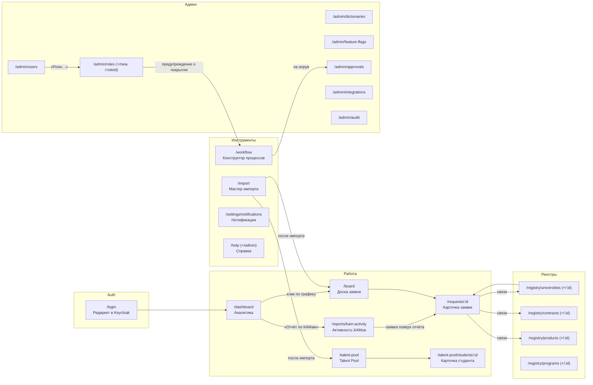
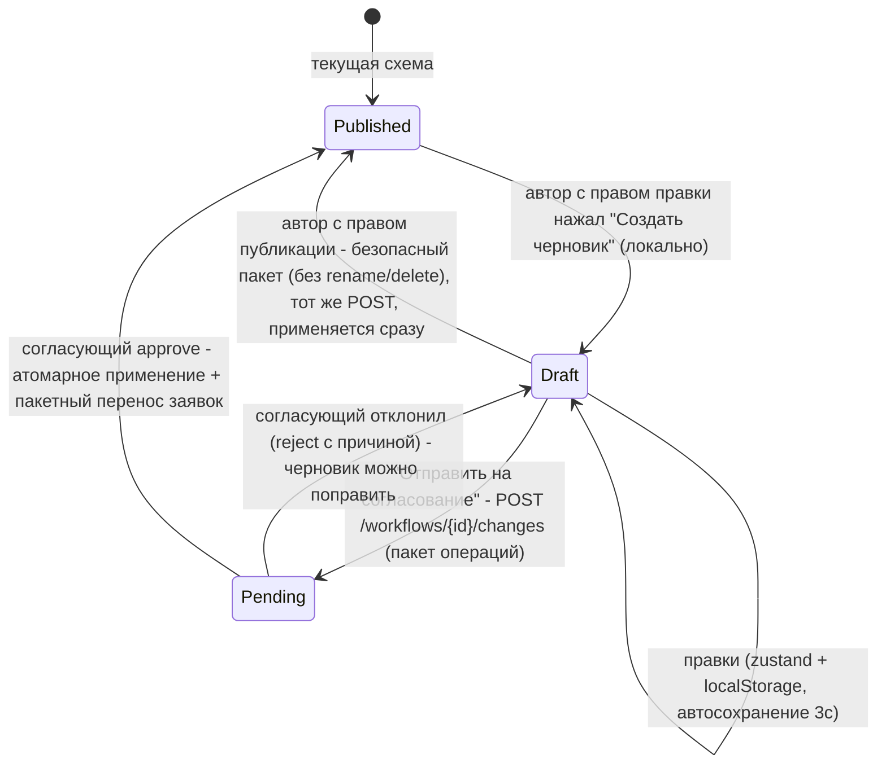
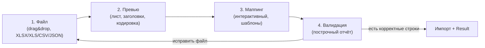
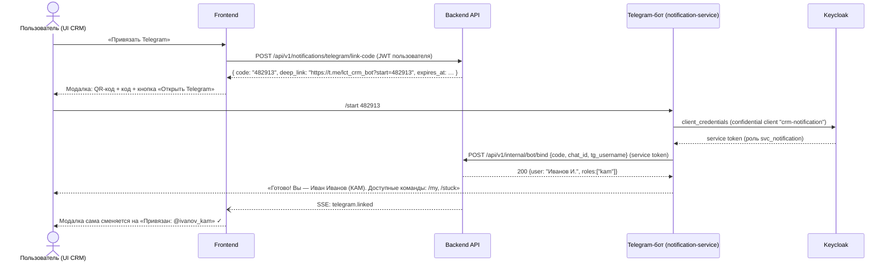

# UX-блюпринт фронтенда CRM «Вузы» — ЛЦТ 2026

> Статус: проектный документ, источник правды по **составу экранов, ролям и правам, состояниям и API-контрактам** UI. Соответствует ТЗ кейса и решениям кейсодержателя (протокол Q&A 16.09.2026, в репозиторий не входит).
> Визуальный слой переопределён `docs/design/redesign.md`: вместо Ant Design 5 — **Tailwind CSS v4 + shadcn/ui** (Radix), иконки lucide, тосты sonner, таблицы TanStack Table в обёртке `DataTable`; токены — ДС «Ростелеком» (`brand-rt.md`). Упоминания компонентов AntD ниже (`Table`, `Drawer`, `Steps`, `Segmented`…) читаются как роль элемента, а не как библиотека.
> Остальной стек: **React 18 + TypeScript + Vite, @xyflow/react (React Flow), Apache ECharts, keycloak-js (OIDC + PKCE), TanStack Query**.
> Роли и права хранятся в БД Альмы и настраиваются в интерфейсе (§3, §14.8); Keycloak отвечает только за вход.
> Главный критерий кейсодержателя: **«юзерфрендли и гибкость»** — брендбук и «рюшечки» вторичны (решение кейсодержателя о дизайне).

Связанные документы: `docs/design/OVERVIEW.md` (сводная архитектура), `docs/design/api-contract.md` (канон API — все пути в этом документе сверены с ним; права — §12), `docs/design/data-model.md` (модель данных), `docs/design/workflow-engine.md` (движок workflow, блокировки, уровни конструктора), `docs/design/redesign.md` (визуальный слой).

---

## 0. Оглавление

1. [Принципы UX и обоснование стека](#1-принципы-ux-и-обоснование-стека)
2. [Визуальный язык: токены, типографика (исторический; актуальный слой — redesign.md)](#2-визуальный-язык)
3. [Роли, карта экранов и навигация](#3-роли-карта-экранов-и-навигация)
4. [Общие паттерны: состояния, таблицы, пресеты, адаптивность](#4-общие-паттерны)
5. [Экран: вход (Keycloak)](#5-экран-входа)
6. [Экран: дашборд и отчёт «Активность КАМов»](#6-дашборд)
7. [Экран: канбан-доска заявок](#7-канбан-доска-заявок)
8. [Экран: карточка заявки](#8-карточка-заявки)
9. [Экраны: реестры (вузы, договоры, продукты, программы)](#9-реестры)
10. [Экран: конструктор workflow (React Flow)](#10-конструктор-workflow)
11. [Экран: мастер импорта](#11-мастер-импорта)
12. [Экран: talent pool](#12-talent-pool)
13. [Экран: настройки нотификаций + привязка Telegram](#13-настройки-нотификаций)
14. [Admin-зона (в т. ч. «Роли и права»)](#14-admin-зона)
15. [Демо-сценарий («wow-путь» за 5 минут)](#15-демо-сценарий)
16. [Трассируемость к решениям кейсодержателя](#16-трассируемость)
17. [Встроенная справка](#17-встроенная-справка)

---

## 1. Принципы UX и обоснование стека

### 1.1 Принципы (в порядке приоритета)

1. **Ролевая честность.** Пользователь никогда не видит кнопку, которую не может нажать: интерфейс собирается из **прав** пользователя (`GET /auth/me`: права, процессы B2B/B2C, область записей), а не «прячет» запрещённое через disabled. Права выводятся из ролей, которые администратор настраивает в самой CRM (§14.8). Единственное исключение — режим просмотра (нет ни одного права на запись), где данные видны, а действия скрыты (см. §3.4).
2. **Гибкость без страха.** Всё, что можно настроить (workflow, маппинг импорта, пресеты таблиц, каналы нотификаций, приоритеты программ) — настраивается интерактивно из UI, с превью и возможностью отката. Опасные действия (удаление статуса workflow) идут через «красный сценарий» с защитой от дурака и апрувом администратора.
3. **Ноль тупиков.** У каждого экрана спроектированы состояния «пусто / загрузка / ошибка», и каждое из них содержит следующий шаг (CTA): пустой канбан предлагает создать заявку или импортировать, ошибка — повторить или написать админу.
4. **Скорость восприятия.** Скелетоны вместо спиннеров на первичной загрузке, optimistic UI на действиях с мгновенной обратной связью (drag на канбане, комментарии), кэш KeyDB на бэкенде + React Query `staleTime` на фронте.
5. **Закрытый контур.** Никаких CDN, внешних шрифтов, карт-тайлов и аналитики. Все ассеты (шрифты, иконки, JS) собираются Vite в бандл и раздаются nginx из образа. Это требование 152-ФЗ/закрытого контура, отражено в сборке фронтенда.

### 1.2 Обоснование стека

| Выбор | Почему |
|---|---|
| React 18 + TS + Vite | React — в списке разрешённых стеков организаторов; TS даёт типобезопасные контракты с Pydantic-схемами (генерация типов из OpenAPI); Vite — быстрая сборка, статический бандл под nginx в закрытом контуре. |
| Ant Design 5 | Готовая дизайн-система энтерпрайз-класса: таблицы с фильтрами/сортировками, формы, Drawer/Modal, Steps, Transfer — ровно те паттерны, что нужны CRM. Темизация через Design Tokens (`ConfigProvider`) — «сдержанный корпоративный синий» задаётся одним объектом. Русская локаль `ru_RU` из коробки. |
| @xyflow/react (React Flow) | Стандарт де-факто для визуальных редакторов графов: кастомные узлы, drag, зум, minimap, валидация соединений — конструктор workflow (кор-функционал №1) без велосипедов. |
| Apache ECharts | Интерактивные дашборды (фильтры-легенды, тултипы, dataZoom) + **экспорт PNG встроенный** (`getDataURL`) — прямое требование «интерактивные дашборды с экспортом в растровые форматы». Работает офлайн, без внешних зависимостей. |
| keycloak-js (OIDC + PKCE) | Официальный адаптер под self-hosted Keycloak; PKCE — безопасный флоу для SPA без client secret. Keycloak — только вход: роли и права фронт берёт из `GET /auth/me` (БД Альмы), а не из `realm_access.roles` токена — так изменение роли действует сразу, без нового токена. |

Библиотеки поддержки (фиксируем, чтобы код писался без вопросов): `@tanstack/react-query` (серверное состояние, кэш, ретраи), `react-router-dom` v6 (маршрутизация, guards), `dayjs` (даты, локаль ru), `zustand` (лёгкое клиентское состояние: UI-настройки, черновик конструктора). Drag&drop канбана — `@dnd-kit/core` (доступность, тач-события для планшета).

---

## 2. Визуальный язык

### 2.1 Палитра и токены AntD

Сдержанный корпоративный синий. Тёмная тема **не делается** (решение зафиксировано). Токены задаются один раз в `ConfigProvider`:

```json
{
  "token": {
    "colorPrimary": "#1E56A0",
    "colorInfo": "#1E56A0",
    "colorSuccess": "#2E9E5B",
    "colorWarning": "#D97E00",
    "colorError": "#C5372B",
    "colorTextBase": "#1F2733",
    "colorTextSecondary": "#5A6B80",
    "colorBgLayout": "#F4F6FA",
    "colorBgContainer": "#FFFFFF",
    "colorBorder": "#DDE4EE",
    "borderRadius": 8,
    "borderRadiusLG": 12,
    "fontFamily": "'Inter', 'Segoe UI', system-ui, sans-serif",
    "fontSize": 14,
    "boxShadow": "0 1px 2px rgba(16,35,61,0.06), 0 4px 12px rgba(16,35,61,0.08)",
    "boxShadowSecondary": "0 6px 20px rgba(16,35,61,0.12)"
  },
  "components": {
    "Layout": { "siderBg": "#0F2547", "headerBg": "#FFFFFF", "headerHeight": 56 },
    "Menu": { "darkItemBg": "#0F2547", "darkItemSelectedBg": "#1E56A0" },
    "Table": { "headerBg": "#F4F6FA", "rowHoverBg": "#EEF3FB" },
    "Card": { "paddingLG": 20 }
  }
}
```

Производные оттенки primary (hover `#2E68B8`, active `#174682`, светлый фон выделения `#EEF3FB`) AntD генерирует сам из `colorPrimary`.

**Семантические цвета статусов** (единые по всему приложению — канбан, теги, таймлайн, дашборд):

| Смысл | Цвет | Где |
|---|---|---|
| Начальный этап / draft | `#5A6B80` (серый) | тег «Новая», draft workflow |
| В работе | `#1E56A0` (primary) | активные этапы |
| Успех / завершено | `#2E9E5B` | «Договор подписан», импорт ок |
| Ожидание / зависшая заявка | `#D97E00` | бейдж «🔥 N дней без движения» |
| Отклонено / ошибка / красный сценарий | `#C5372B` | возвраты, удаление статуса |
| Talent pool | `#7A4FBF` (фиолетовый акцент) | воронка студентов |

Цвет этапа workflow задаётся в конструкторе (панель свойств, пресет из 8 цветов) и хранится в конфиге этапа — канбан и дашборд раскрашиваются из одного источника.

### 2.2 Типографика и сетка

- Шрифт **Inter** (self-hosted, woff2 в бандле; лицензия OFL — безопасно для закрытого контура). Фолбэк — системный.
- Размеры: H1 экрана 20/28 semibold, H2 секции 16/24 semibold, тело 14/22, вторичный текст 12/20, цифры KPI на дашборде 28/36 semibold tabular-nums.
- Сетка: `Layout` AntD — сайдбар 240px (свёрнутый 64px), контент `max-width: 1440px`, отступ контента 24px (16px на планшете), карточки на 8px-сетке.
- Тени только двух уровней (`boxShadow` для карточек, `boxShadowSecondary` для поповеров/drag-превью). Никаких градиентов, кроме заливки area-графиков.
- Иконки — `@ant-design/icons` (в бандле). Эмодзи в UI не используем (только в сообщениях Telegram-бота).

### 2.3 Микро-анимации

- Переходы drag&drop на канбане и в конструкторе — 150ms ease-out; появление Drawer/Modal — стандарт AntD.
- Число на KPI-карточке дашборда анимируется count-up при первой загрузке (это дёшево и «дорого выглядит»).
- `prefers-reduced-motion` отключает count-up и transition канбана.

---

## 3. Роли, карта экранов и навигация

### 3.1 Роли и права

**Источник истины — БД Альмы.** Назначения ролей хранятся в `app_user.roles`, роли и их права — в таблицах `app_role` и `app_role_permission`. Keycloak (реалм `crm`) отвечает только за вход: новый пользователь получает роли из токена один раз, при первом входе, дальше роли меняются только в Альме (§14.1) и действуют на следующем же запросе, без перезахода. Пользователь без ролей видит экран «Нет доступа к CRM» с кнопкой «Проверить снова».

**Права определяет код.** Каталог — 61 право в 8 группах (`backend/app/core/rbac_catalog.py`): заявки, конструктор процессов, вузы и договоры, пул талантов, аналитика и экспорт, импорт, уведомления, администрирование. Создать новое право из интерфейса нельзя — право без проверки в коде ничего не значит. Роль — это набор прав плюс **область данных**:

- **процессы** — B2B, B2C или оба (минимум один). 18 прав «с областью» (заявки, комментарии, файлы заявок, конструктор, отчёты) действуют только в процессах роли; остальные права общие (справочники, студенты, админка);
- **записи** — «все заявки процесса» или «только заявки, где пользователь — ответственный».

Если у пользователя несколько ролей, права объединяются по процессу: в процессе P действуют права тех ролей, у которых P входит в область; записи — «все», если так у хотя бы одной такой роли.

**Системные роли** (наборы по умолчанию; admin заблокирован — его права и область не меняются):

| Роль | Кто это | Прав из 61 | Сводно |
|---|---|:-:|---|
| `admin` | Администратор | 60 | Все права, кроме признака «ведёт портфель как КАМ»: роли и права, апрув изменений схемы, справочники, фичефлаги, пользователи, интеграции |
| `head_kam` | Руководитель КАМов | 41 | Все заявки и справочники, распределение заявок, назначение ответственного КАМа за вуз и передача портфеля КАМа, правка схемы процесса через согласование, отчёты по всем КАМам, список пользователей (чтение) |
| `kam` | КАМ | 28 | Видит все заявки, правит и переводит свои, прикладывает файлы к переходам; вузы (новый — на себя, сменить ответственного не может), договоры, программы, пул талантов, импорт; отчёты — только по своим заявкам |
| `observer` | Наблюдатель | 14 | Только чтение: заявки, справочники, отчёты по всем КАМам, история изменений схемы, аудит и журнал интеграций; ПДн маскированы, экспорт с маскированием |

**Свои роли** создаёт администратор (§14.8): с нуля или «на основе» существующей. Сид демо-стенда добавляет две: «КАМ B2B» (`kam_b2b`) и «КАМ B2C» (`kam_b2c`) — права КАМа в одном процессе; их коды сид дописывает в переходы своего процесса.

Preseeded-пользователи (`admin@demo`, `head@demo`, `kam1@demo`, `kam2@demo`, `observer@demo`) импортируются в Keycloak из JSON реалма и публикуются в README — требование кейсодержателя о проверке ролей. Их стартовые роли пришли из реалма, дальше их можно менять в Альме.

### 3.2 Карта экранов и маршруты



Маршрут и пункт меню открываются по **праву**, а не по коду роли. Столбцы ролей — что получают системные роли с наборами по умолчанию:

| Маршрут | Экран | Право | admin | head_kam | kam | observer |
|---|---|---|:-:|:-:|:-:|:-:|
| `/dashboard` | Аналитика | `reports:read` | ✔ | ✔ | ✔ (свои заявки) | 👁 |
| `/reports/kam-activity` | Активность КАМов (§6.4) | `reports:read` | ✔ | ✔ | ✔ «Моя активность» | 👁 (вкладка «Сводка» по умолчанию) |
| `/board` | Доска заявок | `requests:read` | ✔ | ✔ | ✔ (drag только своих) | 👁 (без drag) |
| `/requests/:id` | Карточка заявки | `requests:read` | ✔ | ✔ | ✔ (редактирование своих) | 👁 |
| `/registry/universities`(`/:id`) | Вузы | `universities:read` | ✔ | ✔ | ✔ (правка своих) | 👁 |
| `/registry/contracts`(`/:id`) | Договоры | `contracts:read` | ✔ | ✔ | ✔ (правка своих) | 👁 |
| `/registry/products`(`/:id`) | Продукты | `products:read` | ✔ | ✔ | 👁 | 👁 |
| `/registry/programs`(`/:id`) | Программы (+приоритеты) | `programs:read` | ✔ | ✔ | ✔ (менять приоритет — да) | 👁 |
| `/workflow` | Конструктор процессов | `workflow:read` | ✔ «Правка и публикация» | ✔ «Правка с согласованием» | 👁 «Просмотр» | 👁 «Просмотр» + история |
| `/import` | Мастер импорта | `import:run` | ✔ | ✔ | ✔ | ✖ (пункт меню скрыт) |
| `/talent-pool`(`+/:id`) | Talent pool | `students:read` | ✔ | ✔ | ✔ | 👁 (ПДн всегда маскированы) |
| `/settings/notifications` | Нотификации | `notifications:self` | ✔ | ✔ (правила — чтение) | ✔ | ✔ (только привязка TG и личные каналы) |
| `/admin/users` | Пользователи (+ «Передать портфель…» — `requests:assign_any`) | `admin:users` | ✔ | 👁 + передача портфеля | ✖ | ✖ |
| `/admin/roles`(`/new`, `/:roleId`) | Роли и права (§14.8) | `admin:roles` | ✔ | ✖ | ✖ | ✖ |
| `/admin/dictionaries` | Справочники (в том числе ИТ-направления) | `admin:dictionaries` | ✔ | ✖ | ✖ | ✖ |
| `/admin/feature-flags` | Фичефлаги | `admin:flags` | ✔ | ✖ | ✖ | ✖ |
| `/admin/approvals` | Согласования | `workflow:approve` | ✔ | ✖ | ✖ | ✖ |
| `/admin/integrations` | Интеграции | `admin:audit` | ✔ | ✖ | ✖ | 👁 (без «Повторить») |
| `/admin/audit` | Аудит | `admin:audit` | ✔ | ✖ | ✖ | 👁 |
| `/help` | Справка: руководство пользователя (§17) | вход | ✔ | ✔ | ✔ | ✔ |
| `/help/admin` | Руководство администратора (§17) | любое из `admin:roles`, `admin:users_write`, `admin:settings`, `admin:flags`, `admin:dictionaries`, `admin:integrations` | ✔ | ✖ | ✖ | ✖ |

Легенда: ✔ — полный доступ, 👁 — read-only, ✖ — скрыт из меню и защищён guard'ом (редирект на `/403`). Для своей роли столбец получается из её прав: например, «КАМ B2C» видит доску и конструктор только процесса B2C.

Отличия от первой версии (бэкенд и раньше разрешал эти чтения): head_kam видит «Пользователи» в режиме чтения, observer — «Интеграции» и «Аудит» в режиме чтения; «Согласования» открываются по праву согласования, а не по роли admin.

### 3.3 Каркас приложения

- **Сайдбар слева**: логотип, пункты меню по правам (см. таблицу), внизу — сворачивание. Меню генерируется из единого конфига `menuConfig: Array<{key, path, icon, label, permission}>` — одна точка правды для навигации и guard'ов; пункт «Администрирование» — группа, видимая, если доступен хотя бы один её пункт.
- **Хедер**: хлебные крошки, глобальный поиск (`Cmd+K`, ищет по вузам/заявкам/студентам через `/api/v1/search?q=`), колокольчик нотификаций (поповер с последними 10 событиями, счётчик непрочитанных), аватар с именем, чип роли (имя первой роли и «+N»; полный список ролей и процессы с областью записей — в подсказке) и пунктами «Настройки нотификаций», «Выйти».
- **Контент**: `PageHeader`-паттерн — заголовок H1 + действия справа (primary-кнопка экрана) + фильтры под заголовком.
- Пользователю без единого права на запись в хедере показывается постоянный тег «Режим просмотра» — ролевое ограничение читается мгновенно (системная роль с таким набором — observer).

### 3.4 Реализация RBAC на фронте

- **Профиль доступа** — `GET /auth/me`: роли (коды и имена), общий список прав, права по процессам (`access.by_workflow`), область записей по процессам, роли, способные выполнять переходы. `AuthContext` даёт:
  - `hasPermission(code, workflowType?)` — для права с областью при заданном процессе смотрит права этого процесса, без процесса — «есть хоть в одном»; `hasAny(...codes)`;
  - `workflowTypes` (процессы с `requests:read`), `workflowTypesWith(code)`, `recordsScope(wf)`, `transitionRoles(wf)`;
  - `roleNames`, `profile` (набор подсказок и онбординга: `admin` / `head_kam` / `kam` / `observer`, выводится из прав, а не из кода роли — своя роль «КАМ B2C» получает профиль kam), `readOnly`.
- Guard маршрутов: `<RequirePermission permission="…">` поверх `react-router`, без права — `/403` (для стартовой страницы — переход на первый доступный раздел).
- Компонент `<Can permission="…" | anyOf={[…]} workflowType={wf}>` для точечных элементов (кнопка «Опубликовать», drag-handle).
- **Изменение прав без перезахода.** После любого изменения ролей сервер рассылает SSE `access.changed` (`role_codes`, `user_ids`). `AccessChangeListener` (в `AppLayout`) проверяет, касается ли событие текущего пользователя; если да — перечитывает `/auth/me` и все запросы, меню и кнопки перестраиваются, тост «Ваши права обновлены администратором — меню и доступные действия перестроены, перезаходить не нужно». Каталог ролей и экраны администрирования ролей обновляются при любом таком событии; администратору, который сам сделал изменение, тост не показывается.
- Фронтовый RBAC — только UX-слой; сервер дублирует все проверки (401/403 API → глобальный интерсептор → экран `/403` или toast). Объект вне области роли сервер отдаёт как 404 (заявка чужого процесса или чужая при «только свои»), коллекцию с явным процессом вне области — как 403 с понятным текстом («Процесс B2B недоступен вашей роли»). На `401` — тихий `keycloak.updateToken()`, при неудаче — редирект на логин.

---

## 4. Общие паттерны

### 4.1 Состояния экрана (обязательны для каждого экрана)

| Состояние | Паттерн | Пример |
|---|---|---|
| Загрузка (первая) | Скелетон, повторяющий каркас экрана (`Skeleton` на карточках KPI, строках таблиц, колонках канбана). Не спиннер. | Канбан: 4 серые колонки с 3 карточками-скелетонами |
| Загрузка (обновление) | Данные остаются, тонкий progress сверху таблицы/`isFetching`-индикатор; никаких «миганий» | Смена фильтра дашборда |
| Пусто | `Empty` AntD + человеческий текст + CTA следующего шага | «Заявок пока нет. Создайте первую или импортируйте из Excel» → 2 кнопки |
| Пусто из-за фильтров | Отдельный текст «Ничего не найдено по текущим фильтрам» + кнопка «Сбросить фильтры» | Реестры |
| Ошибка загрузки | `Result status="error"` + текст без стектрейса + «Повторить»; requestId для обращения к админу | Любой экран |
| Ошибка действия | `message.error` (toast, 5с) с конкретикой из `detail` ответа API; форма подсвечивает поля из 400 `validation_error` | Сохранение карточки |
| 403 / 404 | Полноэкранные `Result` с кнопкой «На дашборд» | Прямой URL не по роли |
| Offline/API down | Глобальный баннер «Нет связи с сервером, повторяем...» (react-query авторетрай) | Демо-подстраховка |

### 4.2 Единый шаблон таблиц (реестры, talent pool, admin)

Все таблицы — `Table` AntD с общим компонентом-обёрткой `RegistryTable`:

- Серверная пагинация (20/50/100), сортировка и фильтры — параметры уходят в API (`?page=&sort=&filters=`).
- Панель над таблицей: поиск по тексту, быстрые фильтры (селекты/даты), справа — «Колонки» (чекбокс-меню видимости), «Экспорт» (XLSX/CSV, уважает текущие фильтры), «Пресеты».
- **Сохранённые пресеты** — требование гибкости. Пресет = именованный снапшот состояния таблицы, хранится на сервере per-user (`/api/v1/ui/presets`), чтобы переживал смену браузера:

```json
{
  "id": "b9c1...",
  "owner": "kam1@demo",
  "screen": "registry.universities",
  "name": "Мои вузы ЦФО",
  "is_default": true,
  "state": {
    "filters": { "region": ["ЦФО"], "kam_id": ["me"] },
    "sort": { "field": "updated_at", "order": "desc" },
    "columns": ["name", "region", "contracts_count", "active_requests", "kam"],
    "page_size": 50
  }
}
```

UI пресетов: селект слева от фильтров + «Сохранить как пресет…» (модалка с именем и чекбоксом «по умолчанию»), пункт «Управлять…» (переименовать/удалить). Пресеты одного экрана независимы у разных пользователей.

### 4.3 Адаптивность (от 375 px)

Адаптивный веб-интерфейс от 375 px (мобильного приложения нет — решение Q&A 16.09):

| Breakpoint | Ширина | Поведение |
|---|---|---|
| Desktop | ≥1200px | Полный layout |
| Laptop | 992–1199px | Сайдбар сворачивается в иконки по умолчанию; дашборд 2 графика в ряд → 1–2 |
| Tablet | 768–991px | Сайдбар — иконки + Drawer по бургеру; канбан — горизонтальный скролл колонок (колонка фикс. 300px) со scroll-snap; таблицы прячут вторичные колонки (конфиг `responsive: ['lg']` у колонок); карточка заявки — табы вместо двухколоночного layout; конструктор workflow — read-only-предупреждение «Редактируйте на десктопе» (просмотр графа работает, тач-пан/зум включён) |
| Phone | 375–767px | Сайдбар — Sheet по бургеру; в шапке иконка поиска, тег роли (усечённый) и значок «Режим просмотра»; табы и широкие таблицы прокручиваются внутри блока; KPI 2 в ряд, заголовок в 2 строки; DL — подпись над значением; календарь — 1 месяц; диалоги не выше экрана, с прокруткой |

Drag&drop канбана работает на таче (`@dnd-kit` + `TouchSensor`, long-press 250ms) — можно показать с планшета.

### 4.4 Форматы и локаль

- Локаль AntD `ru_RU`, dayjs `ru`. Даты: `16 сен 2026`, с временем — `16 сен 2026, 14:05`. Относительное время в таймлайнах/комментариях: «5 мин назад» (до 24 ч), далее дата.
- Деньги: `1 250 000 ₽` (неразрывные пробелы-разряды). Пустые значения — «—», не «null».
- Все тексты интерфейса — по-русски; словарь терминов един: «заявка» (не «сделка»), «этап» (не «статус» в UI, хотя в API — `status`), «вуз», «КАМ».

---

## 5. Экран входа

**Маршрут:** `/login` (и корень `/` для неаутентифицированных).
**Роли:** все.

Состав: центрированная карточка (логотип, название «CRM Вузы», кнопка «Войти через Keycloak» — primary, на всю ширину карточки), под ней мелкий текст «Единый вход организации». Клик → `keycloak.login()` (redirect на self-hosted Keycloak, тема логина Keycloak перекрашена в ту же палитру). После логина — redirect на исходный deep-link (сохранённый `redirect_uri`) или `/dashboard`.

Состояния: «загрузка» — полноэкранный сплеш с логотипом на время `keycloak.init({onLoad:'check-sso', pkceMethod:'S256'})`; «ошибка» — карточка «Сервис авторизации недоступен» + «Повторить». Разлогин по истечении refresh — модалка «Сессия истекла» → кнопка входа (не молчаливый редирект, чтобы не потерять несохранённый черновик конструктора — черновик дополнительно бэкапится в `localStorage`).

---

## 6. Дашборд

**Маршрут:** `/dashboard` (пункт меню «Аналитика»). **Право:** `reports:read` (все системные роли). Без `reports:all` (kam) данные — только по своим заявкам; observer — read-only, экспорт доступен.
**Требование:** интерактивные дашборды (фильтры, теги) с экспортом в растровые/файловые форматы (решения кейсодержателя и ТЗ: диаграммы — в PNG и PDF), делаем как витрину решения. Отдельный отчёт об активности КАМов — §6.4.

### 6.1 Состав

Сверху — **панель фильтров**, общая для всех виджетов (изменение фильтра перерисовывает всё):

- Период (`RangePicker` + быстрые пресеты «Месяц/Квартал/Год»),
- Тип workflow: `B2B | B2C | Все` (Segmented; только процессы, где у ролей пользователя есть `reports:read`),
- КАМ (мультиселект пользователей с правом `requests:kam`) — при `reports:all` и `admin:users`; пользователю с `requests:kam` вместо него — переключатель «Мои / Все»,
- Вуз, ИТ-направление, Продукт, Программа (мультиселекты с поиском). Каждый мультифильтр — список id, сервер применяет его условием `IN` во всех виджетах сразу (не больше 50 значений); переход на доску переносит мультифильтр целиком,
- Кнопки справа: «Отчёт по КАМам» (переход в §6.4 с теми же фильтрами), «Сбросить», «Экспорт ▾» (пункты: «PDF всей панели», «PNG всей панели», «XLSX данные», «CSV данные»).

Ниже — сетка виджетов (12-колоночная CSS-сетка; на телефоне — одна колонка):

| # | Виджет | Тип ECharts | Интерактив |
|---|---|---|---|
| 1 | KPI-строка: «Заявок активных», «Завершено за период», «Конверсия», «🔥 Зависших» | 4 карточки-числа (count-up), дельта к прошлому периоду стрелкой. «Завершено за период» — вход в этап «Завершена» по истории переходов, а не дата правки карточки; «Конверсия» — завершено / (завершено + отказ) за тот же период; под строкой — подпись периода KPI. Цифры сходятся с динамикой и с «Выиграно / Отказ» отчёта §6.4 | клик по «Зависших» → доска с фильтром `stuck=true` |
| 2 | Заявки по текущему этапу | горизонтальные бары от нуля в цветах этапов (заявки, созданные в периоде, по этапу, на котором они сейчас — срез, а не конверсия); при «Все» — этапы обоих процессов; «Отказ» — отдельно, не хвостом цепочки | клик по этапу → доска, отфильтрованная по этапу |
| 3 | Динамика заявок | `line` по неделям: «Создано», «Завершено», «Отказ»; без сглаживания, с точками | dataZoom-слайдер, тултип-кроссхэр |
| 4 | Нагрузка по КАМам | горизонтальный stacked `bar` (открытые заявки по этапам на каждого КАМа, порядок этапов — как в процессе); в подсказке — вузы и зависшие | клик по КАМу → фильтр дашборда по нему |
| 5 | Востребованность программ | горизонтальный `bar`, топ-10 по выбранному показателю: заявки на обучение, обучающиеся, параллельные потоки, ручной приоритет; при фичефлаге `auto_ranking` — ещё справочный индекс 0–100 | переключатель показателя; клик → реестр программ в режиме востребованности |
| 6 | Пул талантов: студенты по статусам | бары от нуля в порядке пути (кандидат → обучается → выпускник → пул талантов), фиолетовая гамма | клик → `/talent-pool` с фильтром |

Пустой период определяется по нулю во всех значениях, а не по пустому ответу: график не рисует «нулевую воронку».

Клик по любому сегменту — **drill-down** в соответствующий экран с проставленными фильтрами (URL-параметры, см. §7.3) — это «интерактивность», которую пользователь щупает руками.

### 6.2 Экспорт

- **PNG виджета**: иконка в правом верхнем углу каждого графика — PNG с шапкой (название графика, период, выбранные фильтры), pixelRatio 2, белый фон.
- **PNG и PDF всей панели**: `html2canvas`-подобный снимок и серверный рендер не используем. Композит собирается на клиенте из `getDataURL()` каждого инстанса ECharts: PNG — одной лентой с шапкой; PDF — титульная страница (фильтры и KPI), дальше по графику на страницу A4 альбомной ориентации (`exportImage.ts`, свой минимальный писатель PDF 1.4 без сторонних библиотек). Работает офлайн.
- **XLSX**: `POST /api/v1/export/jobs {entity_type: "report:dashboard", format: "xlsx", filters: …текущие фильтры}` — файл с листами по виджетам (данные, не картинки).
- **CSV**: тот же механизм с `format: "csv"`.
- **Табличный PDF на сервере** (`format: "pdf"`, fpdf2, вшитые шрифты DejaVu) API поддерживает под фичефлагом `report_pdf` (по умолчанию включён), но в меню панели его нет: «PDF всей панели» с графиками полнее. PDF и XLSX отчёта «Активность КАМов» (§6.4) флагом не закрыты.

### 6.3 Состояния

- Загрузка: KPI — 4 скелетон-карточки; графики — серые панели с центрированным `Skeleton.Node`.
- Пусто (нет данных за период): внутри виджета `Empty` «Нет данных за выбранный период» + кнопка «Весь период».
- Ошибка одного виджета не роняет дашборд: у каждого виджета свой error-boundary с «Повторить».
- Данные дашборда — один агрегирующий запрос `/api/v1/reports/dashboard?filters...` (бэкенд кэширует в KeyDB 60с) — фильтры применяются < 1с.

### 6.4 Отчёт «Активность КАМов»

**Маршрут:** `/reports/kam-activity` (lazy-чанк, как дашборд: ECharts в отдельном бандле). **Пункт меню:** «Активность КАМов» сразу под «Аналитикой», крошки «Аналитика → Активность КАМов». **Право:** `reports:read`. С дашборда — кнопка «Отчёт по КАМам», переносит период, процесс, КАМов, вузы и ИТ-направления.
**Вопрос, на который отвечает экран:** какой КАМ за период с какими вузами работал, сколько было взаимодействий и на каких этапах остановились заявки. Четыре вкладки: «Детализация», «Сводка для заказчика», «Взаимодействия за период», «Просрочки». API — `GET /api/v1/reports/kam-activity` (детализация), `GET /api/v1/reports/kam-activity/summary` (сводка), `GET /api/v1/reports/interactions` (таблица взаимодействий), см. api-contract.md §7.2.1, и `GET /api/v1/reports/sla*` (просрочки, §7.2.2). Ссылка «Как считается» ведёт и в раздел встроенной справки (§17).

**Видимость — по правам, проверяется на сервере:**
- `reports:all` при области записей «все» (admin, head_kam, observer) — отчёт по всем КАМам; иначе (kam, роль «только свои») — только свои заявки: заголовок «Моя активность», в подписи периода «· только ваши заявки», фильтр КАМов скрыт. Явный запрос с чужим КАМом сервер отклоняет 403 «КАМ видит отчёт только по своим заявкам»;
- фильтр по КАМам — при `reports:all` и `admin:users`; варианты — пользователи с правом `requests:kam`;
- переключатель процесса показывает только процессы из области роли («Все» — если их два); процесс вне области — 403 «Процесс B2B недоступен вашей роли»;
- вкладка по умолчанию — «Детализация», для профиля наблюдателя — «Сводка для заказчика».

**Панель фильтров** (одна строка, на телефоне переносится без горизонтальной прокрутки страницы):
- период — сегменты «Неделя · Месяц · Квартал · Прошлый квартал · Период…» (неделя — с понедельника, месяц и квартал — по сегодня, «Прошлый квартал» — полный); «Период…» открывает выбор дат. По умолчанию — «Квартал». Сервер принимает только `from/to`: не больше 731 дня, `from ≤ to`;
- процесс B2B / B2C / Все; КАМ (мультивыбор); вуз (мультивыбор с серверным поиском); ИТ-направление (мультивыбор); на вкладке «Взаимодействия за период» ещё продукт, программа и статус работы с вузом (этап на конец периода); не больше 50 значений в каждом фильтре; «Сбросить»;
- справа «Экспорт ▾»: «PDF для заказчика», «XLSX — все листы», «CSV — список заявок», а также таблица взаимодействий по выбранным колонкам — XLSX и PDF.

Под панелью — подпись «Период: 01.07.2026 — 30.09.2026 · данные на …» и кнопка «Как считается» (поповер с определениями: период по МСК, взаимодействие, этап остановки, дней на этапе, зависла, выиграно/отказ, охват, чья заявка). Те же определения — в XLSX (лист «Сводка», блок «Как считается») и в последнем разделе PDF.

**URL-контракт** (ссылку можно переслать):

```
/reports/kam-activity?preset=week|month|quarter|prev_quarter|custom&from=YYYY-MM-DD&to=YYYY-MM-DD
                     &wf=b2b|b2c&kam=<id>&kam=…&university=<id>&…&direction=<id>&…
                     &product=<id>&program=<id>&status=<stage_id>&cols=<ключи колонок>
                     &tab=detail|summary|interactions|sla&sla_kam=<id>&sla_metric=over30|on_time
                     &request=<id>
```

`request=` открывает карточку заявки (`RequestDrawer`) поверх отчёта; закрытие возвращает к отчёту с прежними фильтрами.

**Вкладка «Детализация»** (адресат — руководитель КАМов):
- KPI ×4: «Вузов с контактом» (N из M закреплённых), «Заявок в работе», «Взаимодействий», «Зависших на конец периода»;
- дерево-таблица «КАМ → вуз → заявка» (≥ md): колонки «Название», «Вузы», «Заявки», «На каком этапе остановились» (чипы этапов в цветах этапа), «Дней на этапе» (с флажком зависания и порогом в подсказке), «Взаимодействия» (итог и П/К/Ф/М — переходы, комментарии, файлы, мероприятия; `↩ N` — возвраты), «Последний контакт» (дата и «N дн. назад», warning — если раньше начала периода). Вузы КАМа — вузы его заявок и закреплённые за ним; закреплённый вуз без взаимодействий получает бейдж «Нет контакта за период». B2C-заявки собираются в узел «B2C-клиенты (без вуза)»;
- кнопки «Развернуть всё / Свернуть всё»; при одном КАМе он развёрнут сразу. Строки-переключатели — кнопки с `aria-expanded`/`aria-controls`, у строк `aria-level`;
- «Дней на этапе» и «зависла» считаются от входа в этап: перевод схемы процесса и события LMS их не обнуляют, цифры совпадают с доской;
- если заявок в отчёте больше 5 000, сервер отдаёт дерево без строк заявок (`requests_truncated`), и вуз дозагружает свои заявки при раскрытии;
- на телефоне (< md) — аккордеон карточек «КАМ → вузы → заявки» на тех же данных, ширина 375 px без горизонтальной прокрутки.

**Вкладка «Сводка для заказчика»** (адресат — заказчик без технического фона; сравнение с предыдущим периодом той же длины):
- первый экран — 4 KPI с дельтой: «Охват вузов» (дельта в п. п.), «Вузы с договором», «Обучаются», «Выиграно заявок»; главная диаграмма «Вузы B2B по этапам на конец периода» (вуз учитывается один раз — по самому продвинутому этапу своих заявок, правило отнесения — подписью); блоки «Риски» (зависшие, закреплённые вузы без контакта, отказы), «Ключевые выводы» и «Студенты по программам»;
- «Ключевые выводы» — до 5 строк, сформированных по детерминированным правилам (без LLM); тот же текст попадает в PDF;
- раскрывающийся блок «Подробно: активность КАМов и заявки по этапам»: KPI «Новые заявки», «Отказы», «Конверсия», «Взаимодействия»; графики (у каждого — PNG): «Конверсия по этапам», «Где застревают» (средние дни на этапе против порога), «Динамика взаимодействий» (П/К/Ф/М + новые заявки; шаг — день, неделя или месяц: до 31 дня, до 184 дней, дольше), «Взаимодействия по КАМам: текущий и прошлый период» (клик по КАМу → «Детализация» с фильтром), «Студенты на программах (пул талантов)» (клик → `/talent-pool?status=…`);
- таблицы «Разрез по КАМам», «Где застревают: топ зависших заявок» (10 строк, ссылки на заявки) и «Программы: студенты из пула талантов» (только агрегаты, без ПДн);
- кнопка «Скачать PDF для заказчика» дублируется в шапке вкладки.

**Вкладка «Взаимодействия за период»** (адресат — руководитель и заказчик; таблица по колонкам ТЗ):
- строка — заявка, с которой шла работа в периоде (та же семантика периода и тот же состав, что в «Детализации»);
- колонки по умолчанию (группа «Колонки ТЗ»): вуз (у B2C — псевдоним клиента с пометкой «(B2C)»), ИТ-направление, ИТ-продукт, статус работы с вузом (этап на конец периода), ответственный, дата создания, «в статусе с», последний контакт; по выбору — программа, заявка, процесс, дней в статусе, итог в периоде, взаимодействий, сумма. Меню «Колонки» с группами и пунктом «Колонки по умолчанию»; выбор хранится в URL (`cols=`);
- выгрузка — те же колонки и фильтры: XLSX, PDF, CSV (`report:interactions`); на экране — первые 5 000 строк с плашкой-предупреждением, в файле — все;
- клик по строке открывает карточку заявки поверх отчёта (`request=`).

**Вкладка «Просрочки»** (адресат — руководитель КАМов и сам КАМ; api-contract.md §7.2.2): заявки, которые на дату среза стоят на этапе дольше нормы этапа (тот же порог, что у «зависших», доски и бота); заявка числится за тем, кто вёл её на эту дату, «получена просроченной» помечается отдельно. Командный вид — строка-итог, KPI с дельтами («Просрочено», «После срока без действий», «Больше 30 дн. сверх нормы», «Уложились в норму»), «Где застревают», блок «Просрочек больше, чем по команде, или старше 30 дней» (только факты), «Нагрузка и просрочки», тренд (`sla_metric=`) и таблица «КАМы». Клик по КАМу открывает разбор (`sla_kam=`): просроченные заявки с последним действием, старение по корзинам 1–3 / 4–7 / 8–14 / 15–30 / больше 30 дней, этапы, опоздание закрытых этапов, напоминания с реакцией за 72 ч; при области «только свои» вкладка сразу показывает разбор себя. «Как считается» приходит из API (тот же текст в XLSX и PDF); общая кнопка «Экспорт ▾» на вкладке скрыта, у неё своя: XLSX, PDF без имён или по КАМам, CSV просроченных (`report:sla`).

**Выгрузка** — серверная, тем же механизмом, что остальной экспорт: `POST /api/v1/export/jobs {entity_type: "report:kam-activity", format, filters}` → файл в MinIO, запись в журнал выгрузок и аудит, та же область видимости и те же 403. Форматы:
- **PDF** — fpdf2 с вшитыми шрифтами DejaVu (кириллица, ▲▼, ₽; системные библиотеки не нужны): KPI с дельтами, ключевые выводы, конверсия по этапам, разрез по КАМам, топ-10 зависших, студенты на программах, детализация по КАМам, «Как считается». Флагом `report_pdf` не закрыт;
- **XLSX** — книга из листов «Сводка», «КАМы», «Вузы», «Заявки», «Динамика»;
- **CSV / JSON** — плоский список заявок.

**Данные и состояния:** запросы TanStack Query `['kam-activity', params]` и `['kam-activity-summary', params]` (сводка — только на своей вкладке), `staleTime` 30 с; SSE `workflow.changed`, `request.transitioned`, `request.comment_added` инвалидируют оба. Сервер кэширует ответ в KeyDB на 60 с с областью видимости в ключе.

| Состояние | Вид |
|---|---|
| Загрузка | скелетоны KPI и 8 строк таблицы |
| Пусто (без фильтров) | `EmptyState` «За выбранный период взаимодействий нет» + «Показать прошлый квартал» |
| Пусто при фильтрах | «Ничего не найдено по текущим фильтрам» + «Сбросить фильтры» |
| Ошибка | `ErrorState` с «Повторить» (сводка — «Не удалось загрузить сводку»); 403 — текст сервера |
| Ошибка одного графика | глушится error-boundary своей `ChartCard` |
| Выгрузка | спиннер в кнопке; тост «Файл выгружен» или «Не удалось выгрузить отчёт» |

---

## 7. Канбан-доска заявок

**Маршрут:** `/board`. **Право:** `requests:read`. Drag карточки — при `requests:transition` в процессе доски и (`requests:write_any` или своя заявка): admin/head_kam тащат все заявки; kam — только свои (чужие карточки видны, drag-handle отсутствует, тултип «Заявка КАМа Иванова»); observer — просмотр.
**Требования:** доска по этапам workflow, drag&drop переходов **включая возвраты**, два workflow B2B/B2C.

### 7.1 Состав

- Под заголовком — переключатель **`B2B (вузы) | B2C (физлица и юрлица)`** (Segmented, состояние в URL `?wf=b2b`): только процессы из области ролей пользователя, по умолчанию — первый доступный; чужой `wf` в ссылке заменяется доступным. Доска всегда показывает **актуальную опубликованную** схему соответствующего workflow (един для всех, версий нет). У роли с областью «только свои» на доске только её заявки.
- Панель фильтров: поиск, КАМ (при `admin:users`; пользователю с `requests:kam` вместо него — «Только мои», в URL `kam=<свой id>`), вуз, продукт — мультивыбор (переход с аналитики переносит мультифильтр целиком, сервер применяет `IN`), чекбокс «Только зависшие 🔥», пресеты (как в §4.2, `screen: "board"`).
- **Колонки = этапы workflow** в порядке из конфига схемы; заголовок колонки: цветной маркер этапа, имя, счётчик заявок, сумма (если у этапа включён показ суммы). Ветвления схемы на доске «сплющиваются» в линейный порядок колонок (порядок задаётся в конструкторе полем `board_order`); сама логика допустимых переходов — по графу, не по соседству колонок.
- Терминальные этапы («Завершено», «Отказ») по умолчанию свёрнуты в узкие колонки-«стопки» (ширина 48px, вертикальная надпись, счётчик), разворачиваются кликом — доска не захламляется.
- **Карточка заявки на доске**: название вуза/контрагента (bold), продукт (тег), ответственный КАМ (аватар-инициалы), N дней на этапе; бейдж «🔥 N дн.» оранжевый, если превышен порог зависания (порог — из настроек нотификаций); иконка 🔗, если есть несинхронизированные изменения LMS/CMS (см. §14.5). Клик → карточка заявки (Drawer поверх доски, см. §8 — доска не теряет скролл-позицию).

### 7.2 Drag&drop и правила переходов

- Библиотека `@dnd-kit`. При захвате карточки:
  - колонки, в которые переход **разрешён графом workflow** (включая **возвраты назад** — «бюрократия») и ролям пользователя (`allowed_roles` ребра: пустой список — всем, иначе пересечение с ролями, способными выполнять переходы в процессе), подсвечиваются рамкой primary;
  - запрещённые колонки затемняются (opacity 0.5); дроп в них отбивается анимацией возврата + toast «Переход "Согласование" → "Договор подписан" не предусмотрен схемой. Разрешены: …».
- Дроп в разрешённую колонку:
  - на **любом** переходе открывается диалог перехода (`TransitionCommentModal`): комментарий до 4000 символов — необязательный, обязательный только для возвратов и переходов с `requires_comment: true` (тогда заголовок «Причина возврата», ошибка под полем до отправки); при праве `requests:files` — до 10 файлов из белого списка (PNG, JPEG, PDF, ZIP, GZIP, RAR, DOC, DOCX, XLS, XLSX, до 50 МБ), формат и размер проверяются до загрузки, файлы попадают в историю под этим переходом; Ctrl/⌘+Enter — подтвердить;
  - optimistic: карточка сразу встаёт в колонку, файлы загружаются с `pending_transition=true`, затем `POST /api/v1/requests/{id}/transitions {to_status_id, comment, version, file_ids}`; при 409/400 карточка анимированно возвращается + toast «Переход не выполнен» с причиной от сервера (например, права или смена схемы).
  - если в этот момент администратор применяет изменение схемы этого процесса, переход ждёт его окончания (обычно доли секунды, workflow-engine.md §6.5). Ответ `409 workflow_busy` клиент не показывает сразу: ждёт по `Retry-After` и повторяет с тем же ключом идемпотентности, суммарно до 10 с; только потом — откат и toast.
- Возврат назад дополнительно маркируется в таймлайне карточки красной стрелкой «↩ Возврат» (см. §8).
- После смены схемы workflow админом открытая доска получает событие (SSE `/api/v1/events/stream`, топик `workflow.changed`) → тихий рефетч колонок + баннер «Схема процесса обновлена администратором» — «работа не встаёт».

### 7.3 URL-контракт фильтров (для drill-down с дашборда)

`/board?wf=b2b&status=negotiation&kam=uuid&kam=uuid&stuck=true&university=uuid&product=uuid` — все фильтры сериализуются в query (мультифильтр — повтором параметра), ссылку можно переслать коллеге.

### 7.4 Состояния

- Загрузка: колонки-скелетоны по актуальной схеме (схема грузится первой и кэшируется).
- Пусто: колонки на месте, в первой — `Empty` «Заявок нет» + кнопки «Создать заявку» (Drawer-форма: контрагент, продукт, ответственный; создаётся в начальном этапе схемы) и «Импортировать».
- Ошибка перехода — см. выше (optimistic rollback). Ошибка загрузки — `Result` c «Повторить».
- Конфликт: заявку одновременно перетащили двое — второй получает 409 → rollback + toast «Заявку уже перевёл Иванов И. на этап "Договор"».

---

## 8. Карточка заявки

**Маршрут:** `/requests/:id` (полная страница) и Drawer 720px поверх канбана (тот же компонент; в Drawer есть кнопка «Открыть отдельно»).
**Права:** `requests:read` — просмотр; правка — `requests:write` (своих) и `requests:write_any` (чужих) в процессе заявки. Системные роли: admin/head_kam — всё; kam — редактирование своих, чужие read-only; observer — read-only.

### 8.1 Состав

**Шапка:** контрагент (вуз или физ/юрлицо B2C) — ссылкой в реестр, продукт, тег текущего этапа (цвет этапа), ответственный (смена — при `requests:assign_any` и `admin:users`: head_kam/admin, `Select` с поиском; «Взять себе» свободную заявку — при `requests:assign`), даты создания/обновления, бейдж «🔥 зависла», кнопка «Перевести на этап ▾» (дублирует канбан для тех, кто в карточке; выпадашка показывает только разрешённые переходы, возвраты — в подсекции «↩ Возврат на…»).

**Тело — две колонки (на планшете — табы):**

Левая (основная), табы:
1. **Таймлайн** — история: переходы этапов (кто, когда, откуда→куда, возвраты красным «↩», комментарий перехода и **файлы, приложенные к переходу или загруженные на этом этапе**), смена ответственного, прикрепление файлов, события интеграций («Отправлено в LMS», «Получен статус из CMS» — с иконкой обмена и ссылкой «показать JSON» для демо двусторонности), эскалации нотификаций («Уведомление руководителю: заявка зависла»). Фильтр-чипы над таймлайном: «Все / Этапы / Файлы / Интеграции / Комментарии».
2. **Комментарии** — встроенный мессенджер (решение кейсодержателя: «в идеале да»): лента сообщений (аватар, имя, роль-тег, время), ввод снизу (@упоминание подставляет имя пользователя в текст; адресная нотификация упомянутому — roadmap, уведомления идут по правилам события `request.comment_added`). Файлов у комментария нет — файлы прикладываются к заявке и к переходам (вкладка «Файлы», диалог перехода). Не редактируются; удаление — автор или пользователь с правом `comments:delete_any` (admin), мягкое (текст заменяется на «(удалено)», аудит-след сохраняется). Realtime — тот же SSE-канал (топик `request.comment_added`, в data — `request_id`); фолбэк — поллинг 15с.
3. **Файлы** — «файлы в статусах»: список из MinIO с этапом, к которому привязан файл (переход или вход в этап), именем, размером, автором и датой. Загрузка и удаление своих файлов — право `requests:files` в процессе заявки (admin, head_kam, kam); удаление чужих — ещё `requests:write_any`. Загрузка — drag&drop, до 50 МБ, белый список из 10 форматов (PNG, JPEG, PDF, ZIP, GZIP, RAR, DOC, DOCX, XLS, XLSX); сервер сверяет расширение с сигнатурой содержимого и отвечает понятным текстом («Формат «.exe» не поддерживается…»). К прошлому переходу файл прикладывается из таймлайна (кнопка у строки перехода). Скачивание — `GET /api/v1/files/{id}/download` (режим proxy по умолчанию; presigned URL TTL 10 мин; сам MinIO наружу не торчит). Превью PDF/изображений — модалка.

Правая (сайдбар-карточки):
- **Связи**: вуз (карточка-мини: название, регион, КАМ) → `/registry/universities/:id`; договор (номер, срок, статус; «как правило один» — списком, если больше) → `/registry/contracts/:id`; продукты (теги, кликабельны). Кнопка «Привязать договор/продукт» (модалка-селект) — для kam-владельца и выше.
- **Атрибуты**: произвольные поля этапа (сумма, ожидаемая дата подписания, примечание) — инлайн-редактирование (клик → input → blur сохраняет, optimistic).
- **Интеграции**: статус синка LMS/CMS (значки: ✓ синхронизировано / ⟳ в очереди / ⚠ ошибка + «Повторить» для admin).

### 8.2 Состояния

- Загрузка: скелетон шапки + таймлайна. Ошибка 404 — `Result` «Заявка не найдена или удалена» → «К доске». 403 — «Нет доступа» (не должен случаться из UI: чужие заявки kam видит read-only, скрываются только действия). Заявка вне области роли (чужой процесс или чужая при «только свои») сервер отдаёт как 404 — тот же экран «не найдена».
- Пустой таймлайн невозможен (создание — всегда первое событие). Пустые комментарии: «Обсуждения пока нет — напишите первым». Пустые файлы: `Dragger` с текстом «Перетащите файлы сюда».
- Отправка комментария — optimistic (серый до подтверждения), ошибка — пометка «не отправлено, повторить».

---

## 9. Реестры

**Маршруты:** `/registry/{universities|contracts|products|programs}` + карточки `/:id`.
**Права:** `<сущность>:read` — просмотр, `<сущность>:write` — создание/редактирование, `crm:write_any` — правка чужих вузов и договоров. Системные роли: admin/head_kam — создание/редактирование; kam — вузы, договоры и программы в своём скоупе, продукты — просмотр; observer — просмотр.
Все — на общем `RegistryTable` (§4.2: фильтры, сортировки, пресеты, экспорт, колонки). Ниже — состав колонок и особенности.

### 9.1 Вузы (`/registry/universities`)

Колонки: Название (ссылка), Регион, ИНН/КПП, Ответственный КАМ, Кол-во договоров, Активные заявки (бейдж), Обновлён. Фильтры: регион, КАМ, «есть активный договор».
Карточка вуза (страница, 2 колонки): реквизиты и контактные лица (таблица-инлайн: ФИО, должность, email, телефон); справа — договоры вуза, активные заявки (мини-канбан-список по этапам), продукты, студенты вуза (счётчик → talent pool с фильтром). Правило кейсодержателя «один вуз — обычно один договор, продуктов несколько, параллельных взаимодействий ≤2» отражено UX-ом: договор в карточке — акцентная одиночная карточка (список раскрывается, только если их >1), продукты — теги, заявки — плоский список без группировок (не переусложняем).
Кнопка «Создать вуз» — Drawer-форма (название, регион, ИНН, КАМ). Дубликаты по ИНН — предупреждение инлайн. Поле «Ответственный КАМ» редактируемо только при праве `universities:assign` (руководитель, администратор); КАМ заводит вуз на себя или без ответственного, а в карточке видит КАМа только для чтения с подсказкой, кто может его сменить.

### 9.2 Договоры (`/registry/contracts`)

Колонки: Номер (ссылка), Вуз/Контрагент, Статус (черновик/переговоры/действует/завершён/расторгнут — теги), Дата начала/окончания, Сумма, Продукты (теги), Файл (иконка-скачивание из MinIO). Фильтры: статус, вуз, период действия; строка подсвечивается жёлтым, если истекает < 30 дней (и это же событие идёт в нотификации).
Карточка: реквизиты, файлы версий договора (MinIO), связанные заявки и продукты; блок «Лицензии» — по строке на продукт договора: дата подписания, срок, дата окончания, статус передачи лицензии вузу (заполняется импортом «Таблица КАМов», §11.1).

### 9.3 Продукты (`/registry/products`)

Колонки: Название, Тип (ДПО/базовая кафедра/стажировка/…), ИТ-направления (теги), Активен (switch — admin/head_kam), Вузов подключено, Заявок; фильтр по ИТ-направлению. Карточка: описание, ИТ-направления (выбор нескольких из справочника — при `products:write`), привязанные программы, вузы.

### 9.4 Программы (`/registry/programs`) — с ручным ранжированием

Требование кейсодержателя: «ранжирование программ по востребованности: ручное изменение приоритетов КАМами/админами; автоформула — бонус».

- Колонки: **Приоритет** (первая колонка: число + ручки ▲▼ и drag-handle строки), Название, Продукт, ИТ-направление (своё — тегом; без него — направления продукта, приглушённо), Вузов, Заявок за период, «Расчётный спрос» (если включён фичефлаг `auto_ranking` — серым, справочно). Фильтр по ИТ-направлению; в карточке программы направление выбирается из справочника.
- Режим сортировки по умолчанию — по приоритету (`priority_rank`, **меньше = выше**); drag строки или ▲▼ меняет приоритет (`PATCH /api/v1/programs/{id}/priority {priority_rank, version}`, массово — `POST /api/v1/programs/priorities/reorder`) — доступно kam/head_kam/admin, optimistic, событие в аудит.
- Переключатель над таблицей «Ручной приоритет / Востребованность» (`?mode=demand`, сюда ведёт клик по виджету аналитики): второй режим — read-only таблица трёх показателей востребованности (заявки на обучение, обучающиеся, параллельные потоки) за выбранный период («Всё время / 30 дней / Квартал / Год»), рядом ручной приоритет и, при `auto_ranking`, расчётный спрос.

### 9.5 Состояния реестров

Единые по §4.1. Пустой реестр — `Empty` + «Создать» + «Импортировать из Excel» (ведёт в мастер импорта с предвыбранной целевой сущностью). Ошибки валидации форм — под полями (из 400 `validation_error`, маппинг `loc→field`).

---

## 10. Конструктор workflow

**Маршрут:** `/workflow`. **Право:** `workflow:read` в процессе. Что можно делать — задаёт **уровень доступа** роли в этом процессе (§10.1, workflow-engine.md §6.9): admin — «Правка и публикация» (правка, публикация, апрув), head_kam — «Правка с согласованием» (правка → отправка на апрув), kam/observer — «Просмотр» (схема read-only — полезно для онбординга; observer видит ещё историю пакетов).
**Требования (кор №1):** два workflow B2B/B2C (B2C — расширяемый), ветвления, возвраты, изменения «на лету» с миграцией заявок, переименование/удаление статуса только через апрув админа, при удалении — перенос заявок на соседний (лучше предыдущий) этап.

### 10.1 Layout

Три зоны:
- **Слева-сверху**: переключатель `B2B | B2C` (только процессы с `workflow:read`; чужой `wf` в ссылке заменяется первым доступным), статус схемы (тег: «Опубликована», «Черновик (ваш)», «На согласовании»), плашка «Ваш уровень: …» (подсказка объясняет, что даёт уровень, и где его меняют — «Роли и права»), кнопки «Создать черновик» / «Опубликовать изменения» (при праве публикации и безопасном пакете) или «Отправить на согласование» / «Отменить черновик», ссылка «К согласованию» (при праве публикации). Без права правки вместо кнопок — подпись «Режим просмотра: у вашей роли нет права «Правка схемы процесса»».
- **Центр**: канва React Flow — узлы-этапы, рёбра-переходы; пан/зум, minimap (правый нижний угол), кнопки zoom-to-fit; сетка точками. Панель инструментов слева на канве: «+ Этап» (или drag с палитры), «Автораскладка» (dagre, слева направо).
- **Справа**: **панель свойств** выбранного узла/ребра (см. 10.3). Ничего не выбрано — сводка схемы: этапов N, переходов M, заявок в работе по этапам (мини-таблица), ошибки валидации схемы списком (клик → фокус на узле).

**Уровни доступа** (права с областью по процессу; в редакторе роли — переключатель, §14.8):

| Уровень | Права | В конструкторе |
|---|---|---|
| Нет доступа | — | пункт меню скрыт |
| Просмотр | `workflow:read` (+ `workflow:history` флажком «История изменений») | канва read-only; с историей — бейдж «есть пакет на согласовании» |
| Правка с согласованием | `workflow:read`, `workflow:history`, `workflow:change` | черновик, impact-preview, «Отправить на согласование» |
| Правка и публикация | + `workflow:approve` | безопасный пакет — «Опубликовать изменения» (применяется сразу); апрув пакетов в `/admin/approvals` |

Пакет с опасной операцией (переименование или удаление этапа) уходит на согласование на любом уровне.

### 10.2 Узлы и рёбра

Кастомный узел React Flow «Этап»:
- скруглённая карточка 200×72: цветная полоса слева (цвет этапа), имя, снизу — счётчик «заявок сейчас: N» (живые данные — важно для красного сценария), иконки-маркеры: 🏁 начальный, 🎯 терминальный, 💬 «переход требует комментария».
- Хэндлы: вход слева, выход справа (для возвратов ребро рисуется дугой снизу, красноватого цвета `#C5372B` с меткой «возврат»).

Ребро-переход: стрелка; лейбл — название действия («Согласовать», «Вернуть на доработку»); стиль: обычный переход — сплошной primary, возврат (`is_return: true`) — красный пунктир. Создание — протяжкой от хэндла к хэндлу; валидация при соединении: нельзя дублировать ребро, нельзя в сам себя; циклы **разрешены** (возвраты — легитимны), но валидатор проверяет достижимость терминала.

Правила валидации схемы (панель ошибок, блокируют отправку на апрув): ровно один начальный этап; ≥1 терминальный; все этапы достижимы из начального; из каждого этапа достижим терминальный; имена уникальны; у B2C — разрешено добавлять новые «варианты взаимодействия» = просто новые ветви/этапы (никаких спец-ограничений).

### 10.3 Панель свойств этапа и перехода

**Этап:** «Название» (переименование опубликованного этапа — через диалог с посимвольным подтверждением; в панели — пометка «Требует согласования. Было: «…»»), «Код (латиницей, для интеграций)», «Цвет этапа» (пресет цветов), «Начальный этап» (только показ: начальный этап фиксирован схемой), «Терминальный этап (конец процесса)» с исходом «Успех (won)» / «Отказ (lost)», «Порог зависания, дней (пусто — наследуется)», «Порядок колонки на доске», «Интеграция с LMS» — «Передавать заявку в LMS при входе в этап». Под полями — «Заявок сейчас: N» и кнопка удаления (§10.5; начальный этап удалить нельзя).

**Переход:** «Название действия (кнопка в карточке и на доске)», «Тип перехода» — «Обычный» / «↩ Возврат», «Требуется комментарий» (для возврата — всегда), «Кому доступен переход (никого — всем, кто может переводить заявки)» — флажки ролей из каталога (системные и свои), способных выполнять переходы в этом процессе, с их именами; новый переход по умолчанию получает все такие роли. Если роль, указанная в переходе, потеряла право на переходы в процессе, у неё warning-бейдж «не может выполнять переходы в B2B». Сервер проверяет роли повторно (строгий и мягкий V-7, workflow-engine.md §6.9).

### 10.4 Жизненный цикл изменений: черновик → пакет операций → апрув



- **Черновик — клиентский** (zustand + localStorage, F5 не теряет; на сервер не пишется). У канвы в режиме черновика — жёлтая рамка и водяной заголовок «ЧЕРНОВИК». При отправке конструктор вычисляет **пакет операций** (`add_status`, `rename_status`, `delete_status`, `add/update/delete_transition`) относительно опубликованной схемы; если у workflow уже есть pending-пакет — баннер «Пакет Петрова ждёт согласования» (данные из `GET /api/v1/workflows/{id}/changes?status=pending`), отправка второго блокируется до решения.
- **Impact-preview**: перед отправкой конструктор зовёт `POST /api/v1/workflows/{id}/impact-preview` с теми же операциями и показывает модалку-сводку диффа («Добавлен этап X; Переименован Y→Y′; Удалён Z — **4 заявки будут перенесены**») + комментарий для админа.
- **Отправка**: `POST /api/v1/workflows/{id}/changes {comment, operations}`. Безопасный пакет автора с правом публикации применяется сразу; пакет с опасной операцией (rename/delete статуса) целиком уходит в `pending` — даже от него («защита от дурака», двухшаговость). Согласующий получает нотификацию (колокольчик + TG).
- **Апрув** (право `workflow:approve` в процессе; из системных ролей — admin) — в `/admin/approvals` (§14.4): `POST /api/v1/workflows/changes/{change_id}/approve` → сервер атомарно применяет схему и переносит заявки одной транзакцией; все открытые доски получают SSE `workflow.changed`. `.../reject {reason}` возвращает автору. Версий нет — новая схема сразу для всех (решение кейсодержателя).
- Ввод имени этапа для опасных операций (см. 10.5) уходит в операцию полем `confirm_name` и сверяется на бэке посимвольно.

### 10.5 Красный сценарий: удаление этапа

1. Выделен узел → кнопка «Удалить этап» в панели свойств — **красная, второстепенная по размеру**. На узле с заявками — сразу предупреждающий бейдж «в этапе 4 заявки».
2. Модалка «защиты от дурака» (danger):
   - заголовок: «Удаление этапа "Согласование договора"»;
   - блок фактов: «Сейчас в этапе **4 заявки**. Входящих переходов: 2, исходящих: 3 — они будут удалены вместе с этапом»;
   - **выбор, куда мигрируют заявки**: radio-список **соседних** (связанных ребром) нетерминальных этапов, **по умолчанию выбран предыдущий** (решение кейсодержателя «лучше предыдущий»); рядом с каждым вариантом — направление («← предыдущий», «→ следующий»);
   - подтверждение вводом: поле «Введите название этапа для подтверждения» (точное совпадение активирует кнопку; значение уходит в операцию как `confirm_name`);
   - кнопка `danger` «Удалить и отправить на согласование» (опасный пакет всегда уходит в pending, даже от admin — админ подтверждает вторым шагом approve).
3. В черновике удалённый узел остаётся на канве призраком (штриховка, серый, зачёркнутое имя) до отправки — можно передумать (кнопка «Восстановить»). Approve показывает финальную сводку миграции ещё раз.
4. В таймлайнах перенесённых заявок появляется событие «Статус "Согласование договора" удалён администратором, заявка перенесена в "Переговоры"».

Payload отправки (канонический контракт — api-contract.md §5.3):

```json
POST /api/v1/workflows/wf-b2b/changes
{
  "comment": "Убрали лишний шаг согласования по решению руководства",
  "operations": [
    { "op": "delete_status",
      "status_id": "st-contract-approval",
      "confirm_name": "Согласование договора",
      "migrate_to_status_id": "st-negotiation" }
  ]
}
```

### 10.6 Состояния

Загрузка — скелетон-канва (серые прямоугольники). Обе схемы всегда существуют (seed), поэтому «пустого» состояния нет; после отката всех правок — кнопка «Отменить черновик». Ошибка сохранения черновика — тост + значок «не сохранено» у заголовка, ретрай; черновик не теряется (localStorage-бэкап). Конфликт применения (за время ревью схема/заявки изменились) — сервер возвращает 409 со свежими счётчиками → модалка миграции перерисовывается: «Данные обновились, проверьте ещё раз».

---

## 11. Мастер импорта

**Маршрут:** `/import` (и вызов с предвыбранной целью из реестров/talent pool). **Право:** `import:run` (admin, head_kam, kam); импорт справочников — `import:dictionaries` (admin). Observer — пункт скрыт.
**Требования:** XLSX и **XLS** (старый Excel), JSON; устойчивость к битым кодировкам; **интерактивный диалоговый маппинг**; отчёт об ошибках построчно.

`Steps` AntD, 4 шага. Состояние мастера живёт на сервере (сессия импорта `import_session_id`) — F5 не убивает прогресс.

### 11.1 Шаг 1 — Файл

- Зона drag&drop на весь экран: «Перетащите файл XLSX, XLS, CSV или JSON» (лимит 20 МБ). Ниже — селект «Что импортируем» (только типы, которые принимает сервер): Вузы / Заявки B2B / Заявки B2C / **Таблица КАМов: вузы, ПО, договоры, лицензии** / Студенты (пул талантов) / Справочник: продукты (предзаполнен при вызове из реестра).
- Для «Таблицы КАМов» — памятка (одна строка: вуз, ИТ-направление, ИТ-продукт и вендор, номер договора, дата подписания и срок лицензии, статус передачи, ответственный КАМ «Фамилия Имя», ответственные от вуза, комментарий) и скачиваемый шаблон CSV; итог импорта разбит по реестрам (вузы, договоры, лицензии, продукты, привязки направлений, назначения КАМов, контакты). Объединённые ячейки XLSX/XLS раскрываются, файл без строки заголовков принимается (колонки «Колонка N»).
- После загрузки `POST /api/v1/import/sessions` парсит файл на сервере и возвращает превью. Прогресс-бар на время парсинга.
- Ошибки шага: не тот формат («Поддерживаются .xlsx, .xls, .csv, .json»), файл пуст, файл битый — карточка ошибки с человеческим текстом + «Загрузить другой».

### 11.2 Шаг 2 — Превью и кодировка

- Таблица-превью первых 20 строк «как распарсили». Сверху: селект «Лист» (для многостраничного Excel), «Первая строка — заголовки» (checkbox, по умолчанию on), для CSV — селект **кодировки** (авто-детект charset-normalizer; варианты UTF-8 / Windows-1251 / KOI8-R / CP866) — при смене превью мгновенно перерисовывается. Если детектор не уверен (кракозябры) — жёлтый alert «Похоже, кодировка определена неверно — выберите вручную» (эвристика: доля не-кириллических символов в текстовых колонках).
- Это прямой ответ на «устойчивость к битым кодировкам» — и эффектная демонстрация: грузим CP1251-файл — кодировка определилась сама; переключаем селект на KOI8-R — кракозябры, возвращаем CP1251 — текст «чинится» одним селектом.

### 11.3 Шаг 3 — Маппинг колонок (интерактивный)

- Двухпанельный маппер, по строке на **целевое поле** сущности: слева — поле CRM (имя, обязательность звёздочкой, тип), по центру — `Select` с колонками файла (с примером значения из первой строки прямо в опции), справа — живой пример «как ляжет».
- **Автопредложение**: сервер предлагает маппинг по похожести заголовков (`"Наименование ВУЗа" → university.name`, fuzzy + словарь синонимов); авто-смапленные строки помечены «авто», их можно перекинуть.
- Несмапленные колонки файла лежат внизу в секции «Не используются» — прозрачность, ничего не потеряли молча.
- Для полей-справочников (регион, продукт, этап) — третий селект «правило»: «искать по названию / создавать отсутствующие / ошибка, если нет». Для студентов — обязательные ФИО и email подсвечены, рядом бейдж «ПДн: будет зашифровано» (шифрование на бэкенде, UX только сообщает).
- Кнопка «Сохранить шаблон маппинга» — именованные шаблоны per-user+сущность (повторные импорты в один клик: селект «Шаблон» сверху шага).
- «Далее» активна, когда смаплены все обязательные поля; иначе — подпись «Не смаплено: Название, ИНН».

Контракт маппинга:

```json
PUT /api/v1/import/sessions/{id}/mapping
{
  "mapping": [
    { "source_column": 0, "target_field": "name" },
    { "source_column": 1, "target_field": "inn" },
    { "source_column": 2, "target_field": "region", "lookup": "match_or_create" }
  ],
  "options": {
    "sheet": 0, "header_row": 0, "encoding": "cp1251",
    "update_strategy": "upsert", "match_by": ["inn"], "skip_empty_rows": true
  }
}
```

(канонический контракт — api-contract.md §6.3; «Сохранить шаблон маппинга» хранит этот же JSON
через `/api/v1/ui/presets` со `screen: "import:universities"`)

### 11.4 Шаг 4 — Валидация и отчёт построчно

- `POST .../validate` — прогон без записи. Результат-сводка: карточки «Всего строк 120 / ✓ пройдут 112 / ⚠ с предупреждениями 5 / ✕ с ошибками 3».
- **Таблица ошибок построчно**: № строки файла, колонка, значение, проблема («ИНН не 10/12 цифр», «email невалиден», «дубликат: вуз с таким ИНН уже существует — строка будет пропущена/обновлена»), уровень (ошибка/предупреждение). Фильтр «только ошибки». Кнопка «Скачать отчёт XLSX» (те же строки + колонка с текстом ошибки — можно поправить в Excel и перезалить).
- Политика дублей — radio: «Пропускать / Обновлять существующие».
- Кнопка «Импортировать N корректных строк» (danger-нет, primary) → прогресс → финальный экран `Result success`: «Импортировано 112, пропущено 8» + кнопки «Открыть реестр», «Скачать отчёт», «Новый импорт». Строки с ошибками **никогда не блокируют** импорт корректных.

### 11.5 Диаграмма шагов



---

## 12. Talent Pool

**Маршрут:** `/talent-pool`, карточка `/talent-pool/students/:id`. **Права:** `students:read` — просмотр (ПДн маскированы), `students:write` — работа с воронкой, `students:reveal` — раскрытие ПДн. Системные роли: admin/head_kam/kam — работа с воронкой и раскрытие ПДн; observer — только маскированные данные, без раскрытия.
**Требования (решения кейсодержателя по Talent Pool):** воронка кандидат → обучается → выпускник → talent pool; ФИО+email — минимальная персуха, шифрование/псевдонимизация; импорт списков; файлы (резюме, сертификаты) в MinIO.

### 12.1 Состав

- Сверху — **воронка-переключатель** (4 крупных кликабельных сегмента с счётчиками, фиолетовая гамма): `Кандидаты (231) → Обучаются (118) → Выпускники (64) → Talent pool (27)`. Клик фильтрует таблицу ниже; «Все» — сброс.
- Панель фильтров: вуз, программа/продукт, федпроект/активность, поиск. Пресеты и экспорт — как в §4.2 (экспорт для observer отдаёт маскированные данные — маскирование серверное).
- Таблица: ФИО (маскированное, см. 12.2), email (маскированный), Вуз, Программа, Федпроект, Статус воронки (тег), Обновлён. Кнопки: «Импортировать список» (мастер §11 с целью «Студенты»), «Добавить студента» (Drawer-форма).
- Смена статуса воронки — из карточки студента или массово: чекбоксы строк → панель «Выбрано 12 → Перевести в ▾» (вперёд — соседний статус, назад — любой; контракт api-contract.md §8.2).

### 12.2 Маскирование ПДн и раскрытие по праву роли

- По умолчанию **везде** (таблица, карточка, экспорт, поиск) ПДн приходят с сервера уже маскированными: `Иванов И***** И.`, `i***v@m**.ru`. Сервер не отдаёт открытые ПДн без явного запроса — маскирование не является CSS-трюком.
- У ролей kam/head_kam/admin в карточке студента и в строке таблицы есть иконка 👁 «Показать данные»: `POST /api/v1/students/{id}/reveal` → сервер пишет **аудит-событие** (кто, когда, кого раскрыл) и возвращает открытые значения; UI показывает их 60 секунд (таймер-точка рядом), потом снова маскирует. Тултип на иконке: «Просмотр будет зафиксирован в журнале аудита».
- У observer иконки нет вовсе; в карточке — постоянная плашка «ПДн скрыты согласно роли».
- В admin-зоне журнал раскрытий доступен как фильтр аудита (§14.6) — красивый ответ на 152-ФЗ.

### 12.3 Карточка студента

Шапка: маскированное ФИО + 👁, статус воронки (тег + кнопка «Перевести»), вуз, программа. Табы:
1. **Профиль**: email 👁, вуз, программа/продукт, федпроект/активность (теги), связь с B2C-заявкой (если студент = физлицо в B2C-workflow — ссылка на заявку).
2. **Расписание**: список активностей студента из сквозного расписания (название, дата, статус посещения) — read-only таблица, источник — модуль расписания.
3. **Файлы**: резюме/сертификаты (MinIO, как §8 Файлы).
4. **История**: таймлайн смен статусов воронки и импортов («добавлен импортом 12.09, файл students.xlsx»).

### 12.4 Состояния

Пусто: «Студентов пока нет — импортируйте список» + CTA на мастер импорта (это ожидаемый первый шаг демо). Загрузка/ошибки — стандарт §4.1. Ошибка раскрытия ПДн (нет права/сервер) — toast «Не удалось получить данные, зафиксировано в журнале».

---

## 13. Настройки нотификаций

**Маршрут:** `/settings/notifications`. **Право:** `notifications:self` (все); секция «Правила и пороги» — при `notification_rules:read` (head_kam, admin), правка правил и порогов — `notification_rules:write` / `admin:settings` (admin); личные каналы — все.
**Требования:** каналы Telegram (реальный бот) / Max (заглушка) / Email (заглушка), настраиваемый порог «зависания» (1–2 недели), эскалация руководителю, адресация по нику/almail/роли, привязка бота через one-time code.

### 13.1 Секция «Мои каналы»

Карточки трёх каналов в ряд:

- **Telegram** — статус: «Не привязан» → кнопка «Привязать Telegram»; «Привязан: @ivanov_kam» → «Отвязать» + switch «Получать уведомления». Привязка — см. 13.3.
- **Max** — та же карточка, бейдж «заглушка»: поле «Идентификатор Max», switch. Канал реализован как подключаемый провайдер Notification Service — показываем архитектурную расширяемость.
- **Email** — адрес из Keycloak (read-only), switch; бейдж «Exchange — заглушка» (SMTP-мок пишет в лог, письма видны в admin-зоне интеграций).

Ниже — **матрица подписок** (таблица: строки — типы событий, колонки — каналы, ячейки — checkbox): «Переход моей заявки по этапу», «Мне назначили заявку», «Меня упомянули в комментарии», «Заявка зависла», «Изменения в talent pool», «Workflow изменён» (последнее — только head_kam/admin).

### 13.2 Секция «Правила и пороги» (head_kam/admin)

- **Порог зависания**: `InputNumber` дней (по умолчанию 14, диапазон 1–60, «зависшая = N дней без смены этапа»), подпись «можно переопределить на конкретном этапе в конструкторе workflow».
- **Эскалация**: «Если заявка висит дольше порога — уведомить ответственного; при 1.5×порога — руководителя КАМа»; повтор напоминаний — не чаще N дней (InputNumber, дефолт 3). Схема-иллюстрация рядом (`KAM → 🔥 → head_kam`).
- **Адресация**: для каждого правила селект «Кому»: конкретный пользователь (по email из Keycloak), по нику TG, по роли (любая роль каталога, например все head_kam; уведомление о заявке получают только те, кто видит её процесс — «КАМ B2C» не получит уведомлений о заявках B2B) — требование «настраиваемая адресация».
- Тех-справка (collapse): «Проверку зависших запускает планировщик Kubernetes CronJob каждый час» — прямой мостик к k8s-стори.

### 13.3 Флоу привязки Telegram (one-time code)



UX-детали модалки: крупный QR (генерация на клиенте, `qrcode` в бандле), код (6 цифр) продублирован текстом с кнопкой «Скопировать», таймер TTL «Код действителен 9:59» (TTL 10 минут); по истечении — «Получить новый код». Модалка слушает SSE и закрывается сама с зелёной галкой — не надо жать «Проверить». Команды бота (`/my` — мои заявки по этапам, `/stuck` — зависшие, `/mute 2h`) отвечают строго по ролям привязанного пользователя; головной сценарий — пуш «🔥 Заявка МГТУ им. Баумана висит на "Согласование" 8 дней» с deep-link в карточку.

### 13.4 Состояния

Загрузка — скелетон карточек. Ошибка привязки (код истёк/уже использован) — бот отвечает текстом, UI по TTL показывает «Получить новый код». Notification-service недоступен — карточка TG с `⚠ Сервис уведомлений недоступен` (статус из `GET /api/v1/notifications/channels`), остальная страница работает.

---

## 14. Admin-зона

**Маршруты:** `/admin/*`. **Права:** у каждого раздела своё право (таблица §3.2; guard + скрытое меню); группа «Администрирование» видна, если доступен хотя бы один раздел. Разделы — подпункты группы в сайдбаре. Системная роль admin видит все разделы; head_kam — «Пользователи» (чтение); observer — «Интеграции» и «Аудит» (чтение).

### 14.1 `/admin/users` — Пользователи и роли

**Право:** `admin:users` — список (admin, head_kam — чтение); `admin:users_write` — руководители для эскалаций и синхронизация с Keycloak (admin); `admin:roles` — назначение ролей (admin).

- Плашка сверху: «Роли назначаются здесь; Keycloak отвечает только за вход. Новый пользователь получает роли из Keycloak один раз — при первом входе. Дальше роли меняются только в Альме и действуют сразу, без перезахода. Синхронизация с Keycloak обновляет ФИО и email, роли не трогает». Если есть пользователи без ролей — строка «Без ролей: N — такие пользователи не могут войти в CRM».
- Таблица пользователей Альмы: Имя, Email, Роли (бейджи с именами из каталога ролей; «Нет ролей» — warning), Активен, TG привязан (✓/—), Последний вход. Фильтр ролей — из каталога плюс вариант «Без ролей»; ссылка из списка ролей открывает таблицу с фильтром `?role=<код>`.
- Действие «Роли…» (при `admin:roles`) открывает диалог: флажки ролей с описанием, бейджем «Системная» / «Своя», процессами и отметкой «только свои»; предпросмотр «Итоговые процессы: B2B, B2C · прав: N»; снять с себя роль, дающую управление ролями, нельзя (флажок заблокирован с подсказкой «Нельзя снять с себя право управления ролями — попросите другого администратора»). После сохранения — тост «Роли пользователя … обновлены. Права применятся сразу — перезаходить не нужно».
- Действие «Передать портфель…» (при `requests:assign_any`; вузы — при `universities:assign`) — для ухода или отпуска КАМа: кому передать (только активный пользователь с правом КАМа), флажок «вместе с закреплёнными вузами», предпросмотр (`dry_run`: сколько заявок и вузов уйдёт, что пропущено и почему — например, процесс недоступен получателю), затем подтверждение. Передаются только открытые заявки; история, комментарии и файлы не меняются; получатель получает одно сводное уведомление, в аудите — запись по каждой заявке и вузу.
- «Синхронизировать из Keycloak» (`admin:users_write`) — обновляет ФИО, email и активность; роли существующих пользователей не трогает. Новые пользователи получают стартовое назначение из системных ролей реалма (как при первом входе) или пустой список — роль назначит администратор. Создание пользователей и пароли — **не дублируем** UI Keycloak: кнопка-ссылка «Консоль Keycloak» (в новой вкладке).

### 14.2 `/admin/dictionaries` — Справочники и предзагрузка данных

Требование: «обогащение из открытых источников — только разовая предзагрузка, загрузка через диалоговое окно в админке (JSON/таблицы)».

- Список справочников (Регионы, Федпроекты, Типы продуктов, Вузы-эталон из открытых данных): имя, записей, обновлён, кнопка «Загрузить данные…» — открывает **тот же мастер импорта** (§11) в модальном режиме с целевой сущностью-справочником (переиспользование — один код, одна демонстрация).
- Плашка: «Разовая предзагрузка. Приложение не обращается в интернет в рантайме» — проговариваем закрытый контур прямо в UI.
- Секция **«ИТ-направления»** (`/it-directions`, правка — `admin:dictionaries`): таблица «Код, Название, Описание, Порядок, Программ, Продуктов, Активно» с поиском; создание и правка — диалогом (код и название уникальны без учёта регистра, конфликт — ошибка под полем); «Деактивировать» вместо удаления — направление с активными программами деактивировать нельзя (`409` с понятным текстом). Направления затем выбираются в карточках программы (одно) и продукта (несколько) и используются фильтром во всех отчётах.

### 14.3 `/admin/feature-flags` — Фичефлаги

- Таблица: флаг, описание, switch, «изменён кем/когда». Флаги: `auto_ranking` (авторанжирование программ по числу заявок, выкл.), `report_pdf` (PDF-выгрузка дашборда — общая таблица, вкл.; PDF отчёта «Активность КАМов» флагом не закрыт), `llm_features` (выкл.; подпись «в закрытом контуре — выключено»).
- Изменение — мгновенно (SSE `flags.updated` → фронт перечитывает `/api/v1/flags`); UI-элементы под флагом монтируются/скрываются без перезагрузки.

### 14.4 `/admin/approvals` — Согласования workflow

- Входящие заявки на изменение схем: карточка = автор, дата, workflow (B2B/B2C), **дифф изменений** списком (добавлено — зелёным, переименовано — жёлтым, удалено — красным с числом мигрируемых заявок), комментарий автора.
- **Права:** пакеты видны по процессам с `workflow:history`, решение — только в процессах с `workflow:approve`; пункт меню открывается по `workflow:approve`.
- Действия: «Согласовать и опубликовать» (`POST /workflows/changes/{id}/approve` → экран миграции §10.4–10.5) / «Вернуть с комментарием» (`.../reject`, textarea обязателен). Бейдж-счётчик на пункте меню и нотификация в TG согласующему.
- **Крупный перенос.** Если пакет переносит от 1 000 заявок, диалог подтверждения предупреждает: «Перенос выполняется одной транзакцией: либо все заявки переедут, либо ни одна. На это время (обычно меньше секунды) переходы по этой воронке встанут в очередь — данные не потеряются. Ответственные получат по одному сводному уведомлению».
- **Отчёт о переносе.** После approve — тост «Перенесено заявок: N за X мс. Сводных уведомлений: K — по одному на получателя. Все открытые доски обновятся автоматически» (время — от захвата лока воронки до COMMIT, `timings.apply_ms`; от секунды — «1,2 с»). Если переносить было нечего — «Перенос заявок не потребовался». У применённого пакета в карточке — та же строка и разбивка по этапам («Первичный контакт → Новая: N») из сохранённого `migration_report` (workflow-engine.md §6.4).
- **Занято.** Если по воронке в этот момент идут переходы и лок не получен, сервер отвечает `409 workflow_busy`: клиент сам ждёт по `Retry-After` до 10 с, диалог показывает, что идёт ожидание; не дождались — пакет остаётся на согласовании, диалог открыт для повтора (повтор безопасен: тот же ключ идемпотентности).

### 14.5 `/admin/integrations` — Монитор интеграций LMS/CMS

Витрина «двусторонности» (её будут проверять):

- Две карточки-коннектора: LMS, CMS — статус (healthcheck заглушек), адрес, счётчики за сутки: «→ отправлено N / ← принято M».
- **Журнал обмена**: таблица сообщений (время, направление →/←, система, тип события, заявка-ссылка, статус доставки, кнопка `{}` — модалка с телом JSON с подсветкой). Фильтры: направление, система, статус.
- Кнопка «Отправить тестовое событие» (селект типа) и — на стороне заглушек — их мини-UI умеет послать событие в CRM (см. документ архитектуры): путь туда-обратно показывается за 30 секунд.
- Плашка «Транспорт»: источник истины — outbox в PostgreSQL, событие фиксируется в одной транзакции с операцией и доставляется асинхронно по HTTP с HMAC-подписью, ретраями и DLQ; корпоративная шина подключается сменным адаптером.
- **Права:** журнал — `admin:audit` (admin, observer — чтение); «Повторить» доставку — `admin:integrations` (admin).
- Здесь же — лог Email-заглушки («письма», которые ушли бы в Exchange).

### 14.6 `/admin/audit` — Журнал аудита (входит в admin-зону, пункт меню «Аудит»)

**Право:** `admin:audit` (admin, observer — чтение). Таблица событий: время, пользователь, действие (словарь: вход, переход заявки, публикация workflow, **раскрытие ПДн студента**, изменение флага, импорт, создание/изменение/сброс/удаление роли, назначение ролей пользователю), объект-ссылка (роль — в редактор §14.8), IP. Фильтры по типу/пользователю/дате; быстрый фильтр-чип «Раскрытия ПДн» — козырь по 152-ФЗ.

### 14.7 Состояния admin-зоны

Keycloak Admin API недоступен — синхронизация не выполняется (тост «Синхронизация не удалась»), таблица пользователей Альмы и назначение ролей работают: они не зависят от Keycloak. Заглушка LMS упала — красный статус коннектора + журнал работает. Всё остальное — стандарт §4.1.

### 14.8 `/admin/roles` — Роли и права

**Маршруты:** `/admin/roles` (список и матрица), `/admin/roles/new` (новая роль; `?from=<код>` — на основе существующей), `/admin/roles/:roleId` (редактор). **Право:** `admin:roles` (из системных ролей — только admin). Крошки «Администрирование → Роли и права → <роль>». API — `/api/v1/admin/roles`, `/api/v1/admin/permissions`, `PUT /api/v1/admin/users/{id}/roles` (api-contract.md §10.5, §12).

Подзаголовок экрана: «Набор прав и область данных роли. Изменения применяются сразу, без перезахода пользователей»; справа — «Создать роль». Две вкладки (состояние в URL `?tab=matrix`):

**«Роли»** — таблица (поиск по имени и коду на клиенте: ролей единицы):

| Колонка | Содержимое |
|---|---|
| Роль | имя + код моноширинным шрифтом; на телефоне под ними — процессы, «только свои» и число пользователей (остальные колонки скрыты) |
| Тип | бейдж «Системная» / «Своя»; замок у admin |
| Процессы | чипы B2B / B2C |
| Записи | «Все» / «Только свои» |
| Пользователи | число — ссылка на `/admin/users?role=<код>` |
| Права | «N из 60» |
| Изменена | дата |

Клик по строке открывает редактор. Меню строки: «Открыть», «Создать на основе», «Удалить» — только у своих ролей; если роль кому-то назначена, пункт неактивен с подсказкой «Роль назначена N польз. — сначала снимите её в «Пользователях»». Удаление — подтверждение «роль исчезнет из каталога и конструктора процессов; действие записывается в журнал аудита».

**«Матрица прав»** — строки — права по группам (с заголовками групп), столбцы — роли, первый столбец закреплён; в ячейке ✓ или «—», у прав с областью — процессы роли. На телефоне — выбор роли и список её прав с галочками.

**Редактор роли.** Шапка: имя роли, «Код … · изменена …» (для новой — «На основе роли «…» — права и область скопированы»), бейджи типа, «Права изменены относительно стандартных» (у системной роли, если набор отличается) и «Пользователей: N». Секции:

1. **«Основное»** — «Название» (обязательное, до 60 символов), «Код» (только при создании; автотранслит из названия, латиница и `_`; после создания неизменяем — он хранится в назначениях и переходах), «Описание».
2. **«Область данных»** — флажки процессов «B2B (вузы)» и «B2C (физлица и юрлица)» (минимум один); переключатель «Все заявки процесса» / «Только заявки, где пользователь — ответственный» («Чужие заявки не видны ни на доске, ни в отчётах»).
3. **«Права»** — группы карточками со счётчиком «выбрано N из M» и флажком всей группы; строка права — флажок, название, описание приглушённым цветом, чип «в процессах роли» у прав с областью. Зависимости ставятся сами: «Добавлено: «Просмотр заявок» — требуется для …»; снятие права снимает зависящие от него: «Снято: … — зависят от …». Группа «Конструктор процессов» показана **уровнем**: радио «Нет доступа / Просмотр / Правка с согласованием / Правка и публикация» с подсказками и флажок «История изменений» (для уровней правки включён и заблокирован: «Пакеты изменений и их история — обязательны для уровней правки»), см. §10.1.
4. **«Пользователи с ролью»** — список со ссылками.

Предупреждения над формой:
- у сохранённой роли — **покрытие переходов**: «В процессе B2B роль указана в N из M переходов с ограничением по ролям — пользователи не смогут двигать заявки по остальным этапам» + кнопка «Открыть конструктор» (`/workflow?wf=b2b`);
- у новой роли с правом на переходы — «Новая роль ещё не указана в переходах процессов: после создания добавьте её в переходы с ограничением по ролям в конструкторе процессов».

Нижняя закреплённая панель: «Сохранить» («Создать роль» для новой) и «Отмена»; у системной роли — «Сбросить к стандартным правам» (подтверждение), у своей — «Удалить роль». Уход со страницы с несохранёнными правками — диалог «Уйти без сохранения?».

**Защита от потери управления** (проверяет сервер под RBAC-локом, интерфейс только подсказывает):
- роль admin — только для чтения: «Права администратора не редактируются — это защищает систему от потери управления. Роль admin получает все права каталога. Снять её с последнего администратора нельзя»;
- нельзя снять с себя право управления ролями, после любого изменения должен остаться хотя бы один активный пользователь с `admin:roles` — иначе 409 `access_lockout` с текстом сервера;
- аварийный вход, если администраторов не осталось: `python -m app.tools.rbac grant-admin <username>` (через `kubectl exec`), с записью в аудит.

**Ошибки:** 409 `stale_version` — тост «Роль уже изменил другой администратор — загружена актуальная версия»; 409 `access_lockout`, `role_locked`, `role_in_use` — тост с текстом сервера и списком из `details` (например, «Роль указана в переходах: …»); 400 — ошибки у полей («Проверьте поля роли»). После сохранения — тост «Изменения сохранены» с подсказкой, кому роль назначена.

**Применение изменений.** После любого изменения ролей или назначений сервер сбрасывает кэш каталога ролей на всех репликах и рассылает SSE `access.changed`: у затронутых пользователей меню и действия перестраиваются без перезахода (§3.4), экраны ролей и пользователей у всех администраторов перечитываются. Каждое изменение пишется в журнал аудита (`role.created`, `role.updated`, `role.reset`, `role.deleted`, `user.roles_changed`; ссылка на роль ведёт в редактор).

**Состояния:** загрузка — скелетон 6 строк; ошибка — `ErrorState` с повтором («Не удалось загрузить роль» / «… матрицу прав»); роль не найдена — «Роль не найдена. Её удалили или ссылка устарела» + «К списку ролей».

**Мобильная вёрстка** (375 px): одна колонка в порядке «Основное → Область данных → Права → Пользователи», отступы по краям 16 px, кнопки на всю ширину в закреплённой панели, без горизонтальной прокрутки. На десктопе — две колонки: слева основное, область и пользователи, справа права.

---

## 15. Демо-сценарий

Хронометраж «wow-пути» — 5 минут, три окна браузера (kam / head_kam / admin залогинены заранее), Telegram открыт на телефоне/втором экране. Каждый шаг показывает конкретное требование.

| # | Время | Экран/действие | Что показываем |
|---|---|---|---|
| 1 | 0:00–0:30 | Логин `kam1@demo` через Keycloak → дашборд: KPI count-up, воронка, клик по этапу воронки → канбан с фильтром. Экспорт PNG графика в один клик. | Keycloak self-hosted, интерактивные дашборды + экспорт |
| 2 | 0:30–1:15 | Канбан B2B: тащим заявку вперёд («Переговоры»→«Согласование»), затем **возврат назад** с обязательным комментарием — подсветка разрешённых колонок, запрещённая колонка отбила дроп. | Workflow: ветвления/возвраты, валидация переходов |
| 3 | 1:15–1:45 | Карточка заявки (Drawer): таймлайн с красным «↩ Возврат», комментарий с @упоминанием, файл договора из MinIO, событие интеграции «→ LMS» с JSON. | История, мессенджер, MinIO, двусторонние интеграции |
| 4 | 1:45–2:30 | Мастер импорта: грузим настоящий BIFF-XLS (формат по magic bytes, xlrd) → интерактивный маппинг (авто + ручной) → отчёт: «10 ок, 3 ошибки построчно» → импорт; кодировки — на CSV в cp1251: автодетект, переключение селекта на koi8-r даёт кракозябры, возврат на cp1251 «чинит». | XLS/кодировки, диалоговый маппинг, отчёт об ошибках |
| 5 | 2:30–3:00 | Talent pool: воронка студентов пополнилась импортом; ПДн маскированы; 👁 раскрытие → упоминание «записано в аудит». Переключаемся на observer — у него 👁 нет. | 152-ФЗ, ролевая модель на живом примере |
| 6 | 3:00–4:00 | Окно `head_kam`: конструктор workflow → черновик → **удаляем этап с 4 заявками** → красная модалка: миграция «на предыдущий», ввод имени этапа → «на согласование». Окно `admin`: `/admin/approvals` → дифф → «Согласовать и опубликовать» → тост «Перенесено заявок: N за X мс, сводных уведомлений: K». В окне kam канбан сам перестроился (SSE), заявки переехали, в таймлайне — событие миграции; в Telegram у КАМа одно сводное сообщение. | Кор №1 целиком: draft→апрув, защита от дурака, миграция «на лету», версий нет |
| 7 | 4:00–4:40 | `/settings/notifications`: «Привязать Telegram» → QR → `/start код` на телефоне → модалка сама закрылась ✓. Запускаем «проверку зависших» (в демо — кнопка «Выполнить сейчас» у CronJob-правила; в проде — k8s CronJob) → на телефон приходит «🔥 заявка висит 8 дней» с deep-link, и эскалация руководителю. Команда `/my` — бот отвечает по роли. | TG-бот через Keycloak, one-time code, эскалации, k8s CronJob |
| 8 | 4:40–5:00 | Финальный кадр: `/admin/integrations` — журнал ← и → сообщений; вкладка терминала: `kubectl get pods,cronjobs -n crm` — всё в Kubernetes. | Двусторонность, деплой в кубере |

Дополнительные сценарии (по запросу, по 1–2 минуты):

| # | Экран/действие | Что показываем |
|---|---|---|
| Д1 | Под `head@demo` — «Активность КАМов», пресет «Прошлый квартал»: раскрыть КАМа → вуз → заявку (этап на конец периода, дни на этапе с «огоньком», взаимодействия П/К/Ф/М). Переключить на «Месяц» — этап и метрики пересчитываются по истории; вуз «Закреплён, нет контакта за период». Вкладка «Сводка для заказчика»: охват, конверсия по этапам, «где застревают», выводы с дельтами → «PDF для заказчика». Под `kam1@demo` — «Моя активность», запрос чужого КАМа в Swagger → 403. | §6.4: кто, когда, с какими вузами, где остановились; PDF/XLSX |
| Д2 | Под `admin@demo` — «Роли и права»: матрица (4 системные роли + «КАМ B2B» / «КАМ B2C»); создать с нуля роль «Аналитик (заказчик)» с отчётами и экспортом — во втором окне у пользователя с этой ролью меню и кнопки перестраиваются без перезахода. В «Пользователях» назначить `kam2@demo` роль «КАМ B2C»: его доска по SSE показывает только B2C, ссылка на B2B-заявку даёт 404. В конструкторе — плашки уровней у head_kam, admin, kam; в аудите — `role.updated`. | §3, §14.8: роли без программиста, разграничение B2B/B2C, живое применение |

Подготовка демо-данных — сидер (`make seed`, data-model.md §11): 56 вузов, заявки обеих воронок с историей (в том числе заведомо зависшие), история активности 20 КАМов, 10 ИТ-направлений, студенты. Утром в день показа — `make demo-reset ANCHOR=ГГГГ-ММ-ДД`: стенд пересевается от даты показа, роли возвращаются к исходным, онбординг демо-учёток скрыт — «Завершено за месяц» не пустое, зависших не больше трети. Файл XLS для демо импорта — настоящий BIFF из тестовых фикстур (`backend/tests/fixtures/students.xls`), CSV в cp1251 готовится перед прогоном. Прогон репетируется по этому сценарию.

---

## 16. Трассируемость

Каждое решение кейсодержателя (Q&A 16.09.2026) → где закрыто в UX:

| Решение кейсодержателя | Раздел UX |
|---|---|
| Два workflow B2B/B2C, B2C расширяем | §7.1 переключатель доски; §10.1–10.2 (новые ветви B2C без ограничений) |
| Workflow един, версионирование запрещено | §10.4 — публикация сразу для всех, версий в UI нет |
| Ветвления и возвраты | §10.2 (рёбра-возвраты), §7.2 (drag назад + комментарий) |
| Миграция заявок при изменении схемы «на лету» | §10.4–10.5, §14.4 (отчёт о переносе, предупреждение о крупном переносе, `workflow_busy`), SSE-перестройка доски §7.2, шаг 6 демо |
| Переименование/удаление статуса — апрув админа; перенос на соседний (лучше предыдущий) | §10.3 (переименование → апрув), §10.5 (красный сценарий, дефолт «предыдущий»), §14.4 |
| Один вуз: договор один, продуктов несколько; не переусложнять | §9.1 карточка вуза (акцент-одиночный договор, продукты-теги) |
| Keycloak self-hosted + RBAC, интерфейс строго по ролям | §3 (роли и права в БД Альмы, guard'ы по правам, меню из конфига), §5 (Keycloak — вход), таблица маршрутов §3.2, «Роли и права» §14.8 |
| README с тестовыми пользователями | §3.1 (preseeded из JSON-реалма) |
| Интеграции LMS/CMS двусторонние, JSON | §8.1 (события в таймлайне + JSON), §14.5 (журнал ←/→, тестовые события) |
| Обогащение — разовая предзагрузка через диалог в админке | §14.2 |
| XLSX и XLS, битые кодировки | §11.1–11.2 |
| Интерактивный диалоговый маппинг | §11.3 (+ шаблоны маппинга) |
| Интерактивные дашборды + экспорт в растровые/файловые форматы | §6 (ECharts, PNG/XLSX/CSV/PDF), §6.4 (отчёт «Активность КАМов»: PDF для заказчика, XLSX) |
| PostgreSQL + MinIO | §8.1 Файлы (presigned URL), §12.3 |
| Студенты ФИО+email, шифрование/псевдонимизация | §12.2 (серверное маскирование, 👁-раскрытие с аудитом), §14.6 |
| Закрытый контур, безопасность | §1.1 п.5 (без CDN), §8.1 (whitelist файлов), §13 (TG-gateway — оговорка в архитектуре) |
| Монолит/микросервисы + кубер | вне UX; §13.2 и §15 шаг 7–8 — CronJob-стори |
| KeyDB-кэш | §4.1 (мгновенные фильтры), §6.3 |
| 300+ пользователей | серверная пагинация §4.2, агрегаты дашборда §6.3 (детально — deployment.md §8) |
| Адаптивный веб-интерфейс от 375 px (мобильного приложения нет) | §4.3 |
| LLM — не приоритет | §14.3 (флаг выключен, подпись) |
| Ранжирование программ — ручное, автоформула бонус | §9.4 |
| Встроенный мессенджер (заглушка допустима) | §8.1 таб «Комментарии» (@упоминания, realtime) |
| Figma/брендбук — «рюшечки», главное юзерфрендли | §1–2 (система токенов; макеты Figma — по остаточному принципу) |
| Тёмная тема не нужна | §2.1 |
| TG-бот через Keycloak, one-time code, эскалации, порог зависания | §13 целиком, sequence-диаграмма §13.3 |
| Talent pool: воронка, импорт списков, файлы MinIO | §12 |
| Оффлайн-режим, мобильное приложение, ЭЦП — не делаем | отсутствуют в карте экранов намеренно |

Доработки после первой версии:

| Доработка | Раздел UX |
|---|---|
| Отчёт об активности КАМов: какой КАМ за период с какими вузами работал, на каких этапах остановились заявки; сводка и PDF для заказчика | §6.4, шаг Д1 демо |
| Роли и права настраиваются в CRM без программиста; разграничение B2B/B2C и «только свои» | §3.1–3.4, §14.1, §14.8, шаг Д2 демо |
| Уровни доступа к конструктору процессов | §10.1, §14.8 |
| Массовый перенос заявок при удалении этапа: одна транзакция, ограниченное ожидание, сводные уведомления | §7.2, §14.4; workflow-engine.md §6.3–6.8 |
| Требование ТЗ: комментарий при переходе между статусами | §7.2 (диалог перехода на любом переходе) |
| Требование ТЗ: файлы в статусах, 10 форматов | §7.2 (файлы в диалоге перехода), §8.1 (вкладка «Файлы», таймлайн) |
| Требование ТЗ: отчёт о взаимодействиях за период по выбранным колонкам, XLSX и PDF | §6.4 (вкладка «Взаимодействия за период») |
| Требование ТЗ: фильтры по нескольким вузам, ИТ-направлениям, продуктам, ответственным; диаграммы в PNG и PDF | §6.1–6.2, §6.4 |
| Требование ТЗ: каталог ИТ-направлений | §14.2, §9.3–9.4 |
| Требование ТЗ: смена ответственных за вузы — руководитель | §9.1, §14.1 (передача портфеля) |
| Требование ТЗ: загрузка таблицы КАМов | §11.1, §9.2 (лицензии) |
| Требование ТЗ: десктоп и мобильная версия | §4.3 (адаптив от 375 px) |
| Требование ТЗ: документация встроена в платформу | §17 |

---

## 17. Встроенная справка

**Маршруты:** `/help` — руководство пользователя (все вошедшие); `/help/admin` — руководство администратора (любое из прав `admin:roles`, `admin:users_write`, `admin:settings`, `admin:flags`, `admin:dictionaries`, `admin:integrations`). Пункт «Справка» — в меню, в меню профиля и в меню «?» шапки рядом с перезапуском тура.

- Слева — оглавление разделов и поиск по справке (по названиям и тексту разделов, без учёта регистра и «ё»); у каждого раздела — якорь (`/help#board`), на него ссылаются экраны: отчёт «Активность КАМов» и «Роли и права».
- Снимки экранов — из `frontend/public/help/img`; раздел «Работа с телефона» описывает адаптив §4.3.
- «Печать / PDF» (или Ctrl+P) — печать без меню, шапки и оглавления: получается PDF руководства.
- Один источник текста — `frontend/src/pages/help/content` (`userGuide.ts`, `adminGuide.ts`): из него же `docs/manual/build-manual.ts` собирает HTML и оба PDF в `docs/manual`. Проверка `npm run docs:help` (шаг CI) сверяет снимки, якоря, маршруты и не пропускает формулировки, которые опровергает код.
