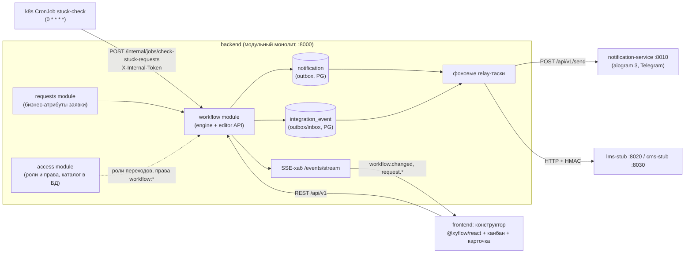
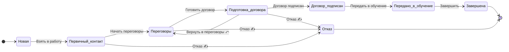
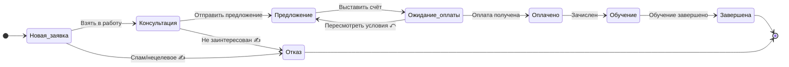

# Workflow Engine — проектная спецификация

> Кор-функционал №1 (решения кейсодержателя, Q&A 16.09.2026). Документ самодостаточен: по нему пишется код
> модуля `backend/app/modules/workflow/` без дополнительных вопросов. Разделы сверены с
> реализацией: пакетный перенос заявок (§6.3–6.4, §6.8), блокировки и ограниченное
> ожидание (§6.5), права на конструктор и роли переходов из каталога БД (§6.9), файлы в
> статусах и комментарий на любом переходе (§9, §9.1), порог этапа до 365 дней (§4.2, §8.1).
> Как 14 шагов базового процесса ТЗ ложатся на этапы и механизмы движка — `tz-14-steps.md`.
>
> Источники правды: **схема БД — `data-model.md` §5–6** (таблицы `workflow`, `workflow_stage`,
> `workflow_transition`, `workflow_change_request`, `deal`, `deal_stage_history`);
> **REST-контракты — `api-contract.md` §4–5, §11** (ресурс `/requests`, изменения схемы —
> `/workflows/{id}/changes`); **права — `api-contract.md` §12** (каталог прав, область
> B2B/B2C). Этот документ описывает семантику и алгоритмы движка.
>
> Терминологический мост (зафиксирован в OVERVIEW.md): таблица БД — `deal`, API-ресурс —
> `Request` (`/requests`), в UI — «заявка»; `workflow_stage` в API сериализуется как `status`,
> колонка `sort_order` — как `position`, флаг `is_return` — как `kind: "return"`.
>
> Стек: Python 3.12, FastAPI, SQLAlchemy 2 (async), Alembic, Pydantic v2, PostgreSQL 16.
> Проверка «зависших» заявок — k8s CronJob `stuck-check` (ежечасно), дергающий внутренний
> endpoint бэкенда.

## 0. Трассировка на решения кейсодержателя (Q&A 16.09.2026)

| Решение кейсодержателя | Где покрыто |
|---|---|
| Два workflow: B2B (вузы) и B2C (физлица + юрлица), отдельные процессы | §4, §5; область ролей по процессам — §6.9 |
| В B2C — возможность добавлять новые варианты взаимодействия | §5.2 (конструктор добавляет этапы/ветки без кода + справочник `interaction_type`) |
| Workflow един для всех внутри типа, **версионирование запрещено** | §2.1 (одна живая схема, мутация in-place) |
| Изменения применяются сразу для всех | §6.4 (approve = атомарное применение одной транзакцией) |
| Ветвления — да | §3.3 (несколько исходящих переходов; `condition` — подсказка ветвления) |
| Возвраты на предыдущие шаги — да (бюрократия) | §3.4 (`is_return`, обязательный комментарий-причина — CHECK в БД) |
| При изменении «на лету» заявки сопоставляются на новую схему, работа не встаёт | §6.3–6.5, §6.8 (пакетный перенос одним оператором на этап; переходы ждут только окно применения — 10 000 заявок ≈ 0,6 с; ожидание ограничено, `409 workflow_busy`) |
| Переименование/удаление статуса — только с апрувом администратора («защита от дурака») | §6.2, §6.6 (пакет операций → pending → approve с правом `workflow:approve`, по умолчанию оно только у admin; `confirm_name` посимвольно) |
| При удалении статуса заявки переносятся на соседний (лучше предыдущий) статус | §6.3 (`migrate_to_status_id`, дефолт = предыдущий сосед по `sort_order`) |
| Один вуз: договор один, продуктов несколько; параллельных взаимодействий ≤ 2; не переусложнять | §4.1 (продукты — атрибут заявки, не ветки графа; ≥3-я активная заявка на вуз — warning в UI, не запрет) |
| «Зависшие» заявки: настраиваемый порог 1–2 недели, эскалация ответственному и вышестоящей роли | §8 (каскад порогов в днях, двухступенчатая эскалация через `manager_id`, k8s CronJob) |
| События → Notification Service (Telegram-бот) и интеграции | §7 (outbox-таблицы `notification` и `integration_event`, SSE для UI) |

---

## 1. Место модуля в системе



Workflow-модуль владеет таблицами схем и переходов и является **единственной точкой смены
этапа заявки** (`transition_deal`, `reopen_deal`, пакетный перенос при применении схемы).
Модуль requests хранит бизнес-атрибуты, но менять `deal.stage_id` напрямую запрещено
(инвариант I-4, §10). Модуль access хранит роли и их права; движок читает из него, какие роли
могут выполнять переходы в процессе (§6.9).

---

## 2. Ключевые принципы

### 2.1. Без версионирования — одна живая схема

По прямому решению кейсодержателя версионирование **запрещено**. Следствия:

- В БД ровно одна строка `workflow` на тип (`b2b`, `b2c`) и один актуальный набор
  этапов/переходов. Никаких `version`, `valid_from`, снапшотов схем.
- Изменение схемы — **мутация in-place** внутри одной транзакции (§6.4). Мягкое удаление
  (`deleted_at` у этапов/переходов) — не версионирование, а сохранение ссылочной целостности
  `deal_stage_history` (решение data-model.md §5.1).
- История фиксируется журналами: `audit_log` (кто и что менял в схеме, диф в JSON) и
  `deal_stage_history` (полная история движения каждой заявки со снапшотами имён этапов, §3.5).

### 2.2. Стабильные идентификаторы этапов

Этап идентифицируется UUID, который **не меняется при переименовании** — поэтому переименование
не требует миграции заявок: `deal.stage_id` продолжает указывать на тот же UUID. Миграция нужна
только при удалении этапа. `code` (slug) — человекочитаемый ключ для интеграций и seed-данных,
уникален внутри workflow среди неудалённых (partial unique в data-model.md §5.1).

### 2.3. Переходы — явные рёбра, а не «любой → любой»

Сменить этап можно только по существующему ребру `workflow_transition` (инвариант I-4).
Ветвления и возвраты — свойства схемы, редактируемые в конструкторе, а не ad-hoc действия.
Единственное журналируемое исключение — `POST /requests/{id}/reopen` (право
`requests:reopen`, по умолчанию только у admin, §3.1).

---

## 3. Модель графа

DDL — **только** в data-model.md §5 (двойного определения нет). Семантика полей:

| Таблица.поле | Семантика в движке |
|---|---|
| `workflow_stage.is_initial` | Ровно один на workflow (partial unique). Новые заявки создаются здесь; входящие рёбра разрешены (возвраты «в начало») |
| `workflow_stage.is_terminal` + `terminal_outcome` | Конец процесса (`won`/`lost`). Исходящих рёбер нет (V-6); вход проставляет `deal.status = terminal_outcome`, выход возвратом — обратно `open` |
| `workflow_stage.stuck_threshold_days` | Порог зависания этапа в днях; NULL → порог workflow (§8) |
| `workflow_stage.triggers_lms_handover` | Вход в этап порождает `crm.request.handed_over` в LMS (api-contract.md §13.2) |
| `workflow_stage.sort_order` / `ui_position` / `color` | Порядок колонок канбана (API `position`), координаты узла React Flow, цвет |
| `workflow_transition.is_return` | Возврат назад (API `kind: "return"`); CHECK: `is_return → requires_comment` |
| `workflow_transition.requires_comment` | Комментарий обязателен (возвраты — всегда; «Отказ» — по seed) |
| `workflow_transition.allowed_roles` | RBAC ребра: коды ролей из каталога `app_role` (системные и свои). `[]` — достаточно права на переход по заявке; иначе хотя бы одна роль пользователя, **способная выполнять переходы в процессе заявки** (§6.9), должна быть в списке |
| `workflow_transition.condition` | Подсказка ветвления (JSON-DSL, §3.3) — **не форсируется** при POST |

### 3.1. Терминальные этапы и reopen

Заявка в терминальном этапе закрыта: доступных переходов нет, SLA-таймер не считается.
Переоткрытие — осознанно НЕ ребро графа: `POST /api/v1/requests/{id}/reopen` переводит заявку
в указанный нетерминальный этап, `comment` обязателен, история — `kind='manual'`,
`reason='reopen'`. Это единственное исключение из «только по рёбрам»: требует права
`requests:reopen` в процессе заявки (из системных ролей оно только у admin), журналируется
(data-model.md §6.1) и берёт те же локи, что переход (§6.5).

### 3.2. Ветвления и guard-условия (§3.3 по нумерации ссылок)

Ветвление = несколько исходящих рёбер из одного этапа. Выбор ветки **ручной** (пользователь
нажимает действие в карточке/тащит карточку на канбане), набор доступных действий фильтруется:

1. RBAC — **форсируется** (403):
   - право `requests:transition` в процессе заявки; для чужой заявки — ещё
     `requests:write_any` (у роли с областью «только свои» чужих заявок нет вовсе — они 404);
   - `allowed_roles` ребра: пустой список — достаточно предыдущего пункта; иначе пересечение
     `user.access.transition_roles(pipeline)` (роли пользователя, способные переводить заявки
     в этом процессе) со списком ребра;
2. `requires_comment` — **форсируется** (400, если пусто);
3. `condition` — декларативная **подсказка**: `GET /requests/{id}/transitions` вычисляет её на
   бэке и аннотирует каждый переход (`available: true/false` + причина, UI подсвечивает
   подходящую ветку), но `POST /requests/{id}/transitions` по ней **не отказывает** — решение
   всегда за человеком (зафиксировано: data-model.md «condition — подсказка, не форсируется»).

Формат `condition` — минимальный JSON-DSL (вычисляется в `workflow/conditions.py`, никакого eval):

```json
{
  "all": [
    {"field": "client_kind", "op": "eq", "value": "company"},
    {"any": [
      {"field": "amount", "op": "gte", "value": 100000},
      {"field": "interaction_type_code", "op": "eq", "value": "corporate_training"}
    ]}
  ]
}
```

Операторы v1: `eq, neq, gt, gte, lt, lte, in, not_in, is_set`. `field` — точечный путь по
Pydantic-модели `RequestContext` (`workflow_type`, `client_kind`, `university_id`, `amount`,
`interaction_type_code`, `responsible_user_id`). Неизвестное поле / несравнимые типы →
условие ложно + warning в лог. Конструктор генерирует JSON формой «поле-оператор-значение».

### 3.4. Возвраты назад

`is_return = true` — легальное ребро графа (кейсодержатель: «возвраты — да, бюрократия»):

- `requires_comment = true` всегда (CHECK в БД): причина возврата обязательна, попадает в
  `deal_stage_history.comment` и в события;
- в UI рисуется красным пунктиром, в списке действий — отдельная группа «↩ Вернуть на…»;
- при возврате `stage_entered_at = now()` — SLA-таймер стартует заново (этап снова «в работе»);
- выход возвратом из терминального этапа невозможен (у терминала нет исходящих рёбер, V-6).

Циклы `A → B → A` из-за возвратов — норма; ацикличность **не** требуется (требуется только
достижимость терминала, V-4).

### 3.5. История

Каждая смена этапа пишет строку в `deal_stage_history` со **снимками имён** этапов
(`from_stage_name`, `to_stage_name`) — история читаема после переименований и удалений.
`kind`: `manual` (переход/​reopen), `system_migration` (миграция при изменении схемы),
`integration`, `import`. API `GET /requests/{id}/history` сериализует: `system_migration` →
`kind: "migrated"`, первая запись (from NULL) → `"created"`, остальное → `"transition"`;
события `assign`/`field_change` в тот же таймлайн подмешиваются из `audit_log`.

---

## 4. Предустановленный workflow B2B (вузы)

### 4.1. Смысловая модель

Путь КАМа с вузом: лид → контакт → переговоры → договор → передача в обучение → завершение.
Решения кейсодержателя, зашитые в модель:

- **Договор один, продуктов несколько** → продукты/программы — атрибуты заявки и договора
  (`deal.product_id/program_id`, `contract_product` M:N), а НЕ параллельные ветки графа.
  Расширение продуктового набора = добавление строк `contract_product` (data-model.md §4.6).
- **Параллельных взаимодействий ≤ 2** → НЕ ограничение графа: допускается ≥1 заявки на
  `university_id`; при создании 3-й активной — warning в UI («у вуза уже 2 активных
  взаимодействия»), не запрет.
- Отказ возможен на «продажной» части воронки; всегда с комментарием (`requires_comment`).

### 4.2. Диаграмма (канонический seed — api-contract.md §5.1, файл `seeds/b2b.json`)



(⤺ — возврат `is_return`, ✍ — `requires_comment`; «Передано в обучение» несёт
`triggers_lms_handover=true` → событие `crm.request.handed_over` в LMS; переход «Договор
подписан» ограничен `allowed_roles: [head_kam, admin]` — RBAC на ребре; остальные рёбра
seed-графов несут `[kam, head_kam, admin]`.)

Демо-роли «КАМ B2B» (`kam_b2b`) и «КАМ B2C» (`kam_b2c`) засевает `tools/seed.py`
(`seed_demo_roles`): права системной роли kam, один процесс. Сид идемпотентно добавляет их коды
в `allowed_roles` переходов своего процесса, где уже есть `kam`, и сбрасывает кэш схем.

Пороги seed: `new` — 7 дней, промежуточные — 14, `in_learning` — 120 (обучение длится
месяцами: с порогом 14 этап ложно «зависал» бы), терминальные — NULL (не проверяются).
Порог этапа — 1–365 дней (миграция 0006), порог процесса — 1–60. Договорённость: **«порог
выключен» на нетерминальном этапе моделируется большим значением (до 365)**, NULL значит ровно
одно — «взять порог workflow». Цвета этапов сида — палитра с контрастом текста не ниже 4,5:1;
сид при повторном запуске обновляет цвета и пороги этапов.

## 5. Предустановленный workflow B2C (физлица + юрлица)

### 5.1. Диаграмма (канонический seed — api-contract.md §5.1, файл `seeds/b2c.json`)



Тип клиента (физлицо/юрлицо) — `counterparty.kind`; тип взаимодействия — редактируемый
справочник `interaction_type` (`deal.interaction_type_id`). Ребро «Выставить счёт» в seed несёт
`condition`-подсказку по `client_kind` — демонстрация ветвления. Этап «Завершена» — точка
интеграции с Talent Pool: доменный хук на переходе двигает связанного студента в `graduate`.

### 5.2. «Возможность добавлять новые варианты взаимодействия»

Это требование к **редактируемости**: новые варианты (например, «Корпоративное обучение»,
«Вебинар-воронка») добавляются двумя штатными средствами без кода:

1. новая запись справочника `interaction_type` (админка) — атрибут заявки, фильтры, отчёты;
2. новые этапы/ветки в конструкторе (пакет операций `add_status`/`add_transition` + при желании
   `condition`-подсказка по `interaction_type_code`) — безопасные операции: автор с правом
   `workflow:approve` применяет их сразу, остальные авторы отправляют на согласование.

Сценарий удобно показывать именно на B2C.

---

## 6. Редактирование схемы «на лету»

### 6.1. Механика: пакет операций → (для опасных) approve → атомарное применение

Канонический контракт — api-contract.md §5.2–5.4. Черновик конструктора — **клиентский**
(zustand + localStorage): фронт свободно правит копию графа, а при отправке формирует **пакет
операций** относительно живой схемы: `add_status`, `update_status`, `rename_status`,
`delete_status`, `add_transition`, `update_transition`, `delete_transition`.
Пакет сохраняется в `workflow_change_request` (data-model.md §5.2).

| Класс | Операции | Поведение |
|---|---|---|
| безопасные | `add_status`, `add_transition`, `update_status` (цвет/порог/позиция), `update_transition`, `delete_transition` | автор с правом `workflow:approve` в процессе воронки — применяются сразу (`applied` + `audit_log`); автор только с `workflow:change` — `pending` на согласование |
| **опасные** | `rename_status`, `delete_status` | всегда `pending`, даже от автора с `workflow:approve` (двухшаговое подтверждение); несут `confirm_name` |

Перед отправкой конструктор зовёт `POST /workflows/{id}/impact-preview` (тот же массив
операций) и показывает «будет перенесено N заявок». Права на конструктор и их уровни — §6.9.

### 6.2. Защита от дурака — два рубежа

1. **При формировании пакета** (автор): red-диалог с дифом («Будет удалён этап „Запуск“,
   в нём **7 заявок** — будут перенесены в „Подготовка договора“») + **посимвольный ввод
   текущего названия этапа** → уходит в операцию полем `confirm_name`, backend сверяет строку
   с актуальным `name` этапа (несовпадение → `422 unprocessable`; фронтовой проверке не доверяем).
2. **При апруве** (право `workflow:approve` в процессе воронки; из системных ролей — admin):
   `POST /workflows/changes/{id}/approve` — отдельное действие с повторным показом дифа и
   счётчиков. `confirm_name` сверяется ещё раз уже под эксклюзивным локом воронки: если за время
   ревью этап переименовали, применение откатывается с 422, пакет — `failed`. Автор с правом
   согласования может одобрить свой пакет: approve и есть второй шаг (решение зафиксировано;
   аудит-след полный).

### 6.3. Правила сопоставления заявок (миграция)

Реализуют решение кейсодержателя буквально:

1. **Сохранившийся этап** (тот же UUID, пусть и переименованный) — заявки остаются на месте.
2. **Новый этап** — рождается пустым.
3. **Удалённый этап** — все его открытые заявки переносятся на `migrate_to_status_id` операции.
   Требования к цели: существует, не удаляется этим же пакетом, **не терминальна**,
   **сосед** удаляемого (связана с ним ребром в старом графе). Дефолт в UI — **предыдущий**
   сосед (максимальный `sort_order` меньше удаляемого) — «лучше предыдущий».
4. Перенос пишет каждой заявке строку истории: `kind='system_migration'`, `reason='stage_deleted'`,
   `actor_user_id=NULL`, `comment='Статус «X» удалён администратором, заявка перенесена в «Y»'`.
   Уведомления — **сводные**: каждый получатель узнаёт о переносе одним сообщением, а не
   сообщением на каждую заявку (§7). Все открытые доски получают SSE `workflow.changed`
   (в данных — `migrated_requests`) и перечитываются.
5. **`stage_entered_at` при миграции сохраняется** — административная перестройка схемы не
   «омолаживает» заявку и не маскирует зависание от эскалаций (решение data-model.md §5.3;
   тест `test_stuck_clock_preserved`).
6. Начальный этап удалить нельзя; последний терминальный — нельзя (V-2).

**Как устроен перенос.** Один SQL-оператор на удаляемый этап (`migration.MIGRATE_STAGE_SQL`):
CTE `UPDATE … RETURNING` сразу кормит `INSERT INTO deal_stage_history … SELECT`, наружу
возвращаются только агрегаты по ответственным (десятки строк). Python не держит N ORM-объектов,
число обращений к БД не зависит от числа заявок.

```sql
WITH moved AS (
    UPDATE deal AS d
       SET stage_id = :to_id, last_activity_at = now(), updated_at = now()
     WHERE d.workflow_id = :wf AND d.stage_id = :from_id AND d.status = 'open'
    RETURNING d.id, d.title, d.responsible_user_id
), hist AS (
    INSERT INTO deal_stage_history (deal_id, from_stage_id, to_stage_id, from_stage_name,
                                    to_stage_name, kind, reason, comment, actor_user_id,
                                    is_return)
    SELECT m.id, :from_id, :to_id, :from_name, :to_name,
           'system_migration', 'stage_deleted', :comment, NULL, false
      FROM moved AS m
    RETURNING 1
)
SELECT m.responsible_user_id,
       count(*) AS cnt,
       (array_agg(m.id ORDER BY m.title, m.id))[1:20] AS sample_ids,
       (array_agg(m.title ORDER BY m.title, m.id))[1:3] AS sample_titles,
       (SELECT count(*) FROM hist) AS history_rows
  FROM moved AS m
 GROUP BY m.responsible_user_id
 ORDER BY m.responsible_user_id
```

- Предикат `workflow_id = :wf` — запрос целиком покрывается частичным индексом `ix_deal_board`
  `(workflow_id, stage_id) WHERE status = 'open'`; тем же предикатом считает заявки
  `_open_deal_counts` (impact-preview и V-8).
- Сверка `sum(cnt) == history_rows` — инвариант I-9 прямо в операторе: расхождение →
  `RuntimeError`, транзакция откатывается целиком (тест `test_invariant_violation_rolls_back`).
- Вызов идёт через атрибут модуля `migration.migrate_deleted_stages`: инструмент замера
  (`app/tools/bench_migration.py`) подменяет его дословной копией прежнего поштучного цикла,
  поэтому «до» и «после» меряются одним и тем же `apply_change` (§6.8).
- Сессия применения не загружает `Deal` этой воронки: bulk UPDATE не обновил бы объекты в
  identity map ORM.

### 6.4. Атомарное применение: `apply_change`

Реализация — `workflow/service.py` (`apply_change` → `_execute_plan`), всё тело — ОДНА
транзакция; право `workflow:approve` в процессе воронки проверяет обработчик запроса.

```python
async def apply_change(session, *, change_id, approver) -> tuple[WorkflowChangeRequest, dict]:
    wcr = await session.get(WorkflowChangeRequest, change_id, with_for_update=True)  # 1. строка пакета
    require(wcr is not None, 404, "Пакет изменений не найден")
    require(wcr.status == "pending", 409, "Пакет уже обработан")  # второй approve — сюда

    t0 = perf_counter()
    try:
        # 2. EXCLUSIVE advisory-лок воронки: ждём хвост переходов, новые встают в очередь.
        #    SET LOCAL lock_timeout = APPLY_LOCK_TIMEOUT_MS (30 с); 55P03 → 409 workflow_busy
        async with lock_timeout_as_busy(APPLY_BUSY_MESSAGE):
            await acquire_exclusive_workflow_lock(session, wcr.workflow_id)
    except ApiError:
        await session.rollback()
        raise                                     # пакет остаётся pending: он не виноват
    t_locked = perf_counter()
    try:
        async with lock_timeout_as_busy(APPLY_BUSY_MESSAGE):
            live = await load_graph(session, wcr.workflow_id)    # живая схема — уже под локом
            report = await _execute_plan(session, wcr, approver, live,
                                         parse_operations(wcr.operations))
            _store_timings(wcr, report, started=t0, locked=t_locked)  # lock_wait_ms, apply_ms
            await session.commit()                # COMMIT — всё или ничего
    except ApiError as exc:
        await session.rollback()
        if exc.code != "workflow_busy":
            await _mark_change_failed(session, change_id, approver_id, exc.message)  # отд. транзакция
        raise
    except Exception:                             # сбой БД / нарушенный инвариант
        await session.rollback()
        await _mark_change_failed(session, change_id, approver_id, INTERNAL_APPLY_ERROR)
        raise
    report["timings"]["lock_held_ms"] = ms(perf_counter() - t_locked)   # только в ответе
    logger.info("workflow.apply change=%s migrated=%d digests=%d lock_wait_ms=%d lock_held_ms=%d", …)
    await _after_apply_effects(wcr.workflow_id, wcr.id,     # после COMMIT: DEL wf:{id},
                               migrated_requests=report["migrated_requests"])  # SSE workflow.changed
    return wcr, report


async def _execute_plan(session, wcr, actor, live, operations) -> dict:
    verify_confirm_names(live, operations)                 # рубеж 2: 422 при несовпадении
    target, plan = apply_operations(live, operations)      # целевой граф в памяти
    counts = await _open_deal_counts(session, wcr.workflow_id, deleted_stage_ids)
    # роли переходов — свежим SELECT уже ПОД локом воронки, а не из кэша каталога (§6.9)
    errors = check_operation_roles(operations, await transition_capable_roles(session, wf.code),
                                   live=live)                              # строгий V-7
    errors += validate_graph(target, known_roles=await known_role_codes(session))  # V-1..V-7
    require(not errors, 400, "workflow_invalid_schema", details=errors)
    require(not validate_migration(live, plan, counts), 422)               # V-8

    # мутация in-place: INSERT новых этапов/рёбер, UPDATE правок и переименований,
    # deleted_at удаляемым рёбрам; flush
    outcome = await migration.migrate_deleted_stages(session, workflow_id=wcr.workflow_id,
                                                     plan=plan, stage_rows=stage_rows)  # §6.3, CTE
    for item in plan.deleted_stages:                       # сначала перенос, потом deleted_at (I-2)
        soft_delete(item.deleted_transition_ids); soft_delete(item.stage_id)
    digests = await migration.emit_migration_digests(session, outcome=outcome,
                                                     workflow=workflow, change_id=wcr.id)  # §7
    wcr.status, wcr.decided_by, wcr.decided_at, wcr.applied_at = "applied", actor.id, now(), now()
    report = {"migrated_requests": outcome.migrated_total, "by_status": outcome.by_status,
              "digest_notifications": digests, "timings": {"migrate_ms": …}}
    wcr.impact = {**(wcr.impact or {}), "migration_report": report}   # переприсваивание JSONB
    await write_audit(session, action="workflow.change_applied", …,   # одна запись на пакет
                      after={"change_request_id", "operations", "migrated_requests",
                             "by_status", "digest_notifications"})
    return report
```

Свойства:
- (а) применение атомарно: упавшая валидация или сбой посреди переноса откатывают и мутацию
  схемы, и переносы, и строки истории, и сводки в outbox, и аудит (тесты
  `test_forced_failure_mid_migration_rolls_back_everything`,
  `test_failure_after_digests_rolls_back_notifications`);
- (б) «работа не встаёт»: лок держится только на фазе применения — 10 000 заявок ≈ 0,6 с,
  50 000 ≈ 2,9 с (§6.8);
- (в) переход, начавшийся до лока, корректно завершится до применения (shared→exclusive
  очередь advisory-локов PostgreSQL, §6.5);
- (г) `DEL crm:v1:wf:{id}` и SSE — строго после COMMIT (data-model.md §10);
- (д) отчёт о применении сохраняется в пакете (`impact.migration_report`) и отдаётся в
  карточке пакета (`ChangeRequestOut.migration_report`) — строка «перенесено заявок: N» в
  согласованиях больше не пустая; повторный approve того же пакета — `409 conflict` без
  побочных эффектов (`test_reapply_same_package_is_safe`).

Отчёт и замеры (api-contract.md §5.4), форма ответа approve:

```json
{
  "migration_report": {
    "migrated_requests": 10000,
    "by_status": [{"from": "Первичный контакт", "to": "Новая", "count": 10000}],
    "digest_notifications": 20,
    "timings": {"lock_wait_ms": "…", "apply_ms": "…", "migrate_ms": "…", "lock_held_ms": "…"}
  }
}
```

`lock_wait_ms` — ожидание эксклюзивного лока, `apply_ms` — от захвата лока до COMMIT,
`migrate_ms` — из них пакетный перенос, `lock_held_ms` — лок удерживался (до конца COMMIT,
только в ответе approve; в сохранённом отчёте его нет). Все значения — целые миллисекунды.
Для этого пакета в первом прогоне замера (§6.8) было: `lock_wait_ms` 1, `migrate_ms` 536,
`lock_held_ms` 576.

Безопасный пакет автора с `workflow:approve` (`create_change`, ветка `apply_now`) проходит тот
же `_execute_plan` под тем же эксклюзивным локом и с тем же `APPLY_LOCK_TIMEOUT_MS`; при
`workflow_busy` транзакция откатывается и пакет не создаётся вовсе — повтор запроса безопасен.

### 6.5. Конкурентность: advisory-локи и ограниченное ожидание

Ключ лока воронки — `hashtextextended('wf:' || workflow_id, 0)` (bigint, считается на стороне
PostgreSQL; у каждой воронки свой — правка B2B не задевает B2C). Локи транзакционные
(`_xact_`): освобождаются на COMMIT/ROLLBACK. Реализация — `workflow/locks.py`.

| Операция | Локи по порядку | Ожидание |
|---|---|---|
| `transition_deal`, `reopen_deal` | `SELECT deal.workflow_id` (без лока) → `pg_advisory_xact_lock_shared` воронки → `SELECT … FOR UPDATE` строки заявки | `TRANSITION_LOCK_TIMEOUT_MS` = 10 с до конца транзакции → `409 workflow_busy` |
| `apply_change` | `workflow_change_request … FOR UPDATE` → `pg_advisory_xact_lock` воронки (exclusive) → строки заявок в `UPDATE` пакетного переноса | `APPLY_LOCK_TIMEOUT_MS` = 30 с → `409 workflow_busy`, пакет остаётся `pending` |
| `create_change` (безопасный пакет автора с `workflow:approve`) | `pg_advisory_xact_lock` воронки (exclusive) | 30 с → `409 workflow_busy`, пакет не создан |
| `delete_role` (модуль access) | `pg_advisory_xact_lock(hashtextextended('rbac', 0))` → exclusive b2b → exclusive b2c | 30 с на локи воронок → `409 workflow_busy`, роль не удалена |
| прочие изменения ролей и назначений | только RBAC-лок | — |
| `check_stuck_requests` | без лока воронки; `FOR UPDATE OF deal SKIP LOCKED` | не ждёт |

- **Почему нет deadlock.** Порядок един для всех путей: сначала advisory-лок воронки, потом
  строка. Раньше переход брал строку заявки до shared-лока — это давало ABBA-deadlock с
  применением (T1 держит строку и ждёт shared, T2 держит exclusive и ждёт ту же строку);
  порядок исправлен и закреплён тестом `test_no_deadlock_under_mixed_load`. Удаление роли
  берёт RBAC-лок, затем локи воронок в фиксированном порядке b2b → b2c; применение пакета
  RBAC-лок не берёт.
- **Shared-локи совместимы** между собой (переходы не мешают друг другу), эксклюзивный ждёт
  всех и не пускает новых. PostgreSQL не пускает новый shared впереди ждущего exclusive, поэтому
  применение не голодает. Это ровно семантика «применить сразу для всех, не останавливая работу».
- **Ограниченное ожидание.** Перед захватом выполняется `SELECT set_config('lock_timeout',
  '<N>ms', true)` — это `SET LOCAL`: он действует до конца транзакции и заодно ограничивает
  `FOR UPDATE` строки заявки. По истечении PostgreSQL отдаёт SQLSTATE `55P03`, а
  `lock_timeout_as_busy()` превращает его в `409 workflow_busy` с заголовком `Retry-After: 2`
  («Схема процесса сейчас обновляется — повторите действие через несколько секунд»). Операция
  при этом не выполнилась — повтор безопасен. Соединения пула не копятся за долгим применением.
- **Что видят пользователи.**
  - Чтение (доски, карточки, отчёты) не блокируется никогда — MVCC: до COMMIT применения все
    видят старую схему, после — новую.
  - КАМ, двигающий карточку в момент применения, ждёт доли секунды; затем переход проходит
    либо возвращается 409 («заявка изменена» / «переход не разрешён» — заявку уже перенесли),
    доска откатывает оптимистичный шаг и перечитывается.
  - На `409 workflow_busy` клиент сам ждёт по `Retry-After` (пауза 0,5–5 с) и повторяет
    запрос с тем же `Idempotency-Key`, суммарно не дольше 10 с (`shared/api/idempotency.ts`).
    Диалог согласования показывает, что идёт ожидание; не дождались — пакет остаётся на
    согласовании, повтор из того же диалога.

Что закреплено тестами с настоящими COMMIT на отдельных соединениях
(`tests/db/test_workflow_migration_concurrency.py`, 2 000 заявок, advisory-локи видны в
`pg_locks`):

| Тест | Что проверяет |
|---|---|
| `test_parallel_transition_waits_then_succeeds` | переход во время применения ждёт эксклюзивный лок и затем проходит |
| `test_transition_of_migrating_deal_no_lost_update` | КАМ открыл карточку до approve, заявку перенесли: его переход получает `stale_version` или `workflow_invalid_transition`, в истории ровно одна запись `system_migration` |
| `test_no_deadlock_under_mixed_load` | 20 параллельных переходов во время применения: только 200/409, без deadlock и потерь; «ранние» переходы, уже державшие shared-лок, применение дожидается |
| `test_transition_lock_timeout_gives_workflow_busy` | переход при занятом exclusive-локе получает `workflow_busy` |
| `test_apply_lock_timeout_keeps_pending` | применение при висящем shared-локе получает `workflow_busy`, пакет остаётся `pending` |
| `test_concurrent_double_approve` | два одновременных approve: один применяет, второй — `409 conflict` |

### 6.6. Одновременное редактирование

Серверного черновика нет, поэтому конфликт «двое правят схему» разрешается на применении:
approve пересчитывает операции против **актуальной** схемы; если упомянутый в операции этап уже
изменён/удалён — `409 conflict`, автор пересоздаёт пакет (api-contract.md §5.4 п.1).
`GET /workflows/{id}/changes?status=pending` (право `workflow:history`) показывает бейдж «есть
пакет на согласовании» в конструкторе — второй автор видит это до начала правок, отправка
второго пакета блокируется до решения по первому.

### 6.7. Валидации графа

Прогоняются при создании пакета/impact-preview (мгновенная обратная связь конструктору, все
ошибки списком) и **повторно** внутри транзакции применения, уже под эксклюзивным локом
воронки. Ошибка API — `400 workflow_invalid_schema` с `details[]` из кодов (V-8 —
`422 unprocessable`):

| № | Правило | code в details |
|---|---|---|
| V-1 | Ровно один этап `is_initial` | `E_INITIAL_COUNT` |
| V-2 | Есть хотя бы один терминальный этап | `E_NO_TERMINAL` |
| V-3 | Связность: каждый этап достижим из initial по рёбрам (BFS) | `E_UNREACHABLE_STAGE` |
| V-4 | Из каждого нетерминального этапа достижим хотя бы один терминал (обратный BFS; циклы-ловушки запрещены) | `E_NO_PATH_TO_TERMINAL` |
| V-5 | Нет петель (`from == to`) и дублей рёбер (уникальность пары from/to) | `E_BAD_TRANSITION` |
| V-6 | У терминальных этапов нет исходящих рёбер | `E_TERMINAL_OUTGOING` |
| V-7 | Уникальность `code`/`name` этапов; `condition` синтаксически валиден (Pydantic-схема DSL); роли в `allowed_roles` — из каталога (строгий и мягкий вариант, §6.9) | `E_STAGE_DUP` / `E_BAD_CONDITION` / `E_UNKNOWN_ROLE` |
| V-8 | Миграция: для каждого удаляемого этапа с заявками задан `migrate_to_status_id`; цель существует, не терминальна, была соседом в старом графе; `confirm_name` совпал | `E_MAPPING_REQUIRED` / `E_MAPPING_INVALID` / `E_CONFIRM_MISMATCH` |

Конструктор подсвечивает проблемные узлы прямо на канве React Flow.

### 6.8. Масштаб: массовый перенос

Замер — `python -m app.tools.bench_migration` (или `make bench-migration`) на одноразовой БД
`crm_bench`. Инструмент очищает таблицы домена, поэтому работает только на базах `crm_test*`,
`*_test`, `*_bench` (иначе нужен явный `--force`) и только на head Alembic. Сценарий: 20 КАМов, воронка B2B из сида, N открытых
заявок на «Первичном контакте», правило `request.transitioned → responsible → telegram`; пакет
«ребро "Новая" → "Переговоры"» + «удалить "Первичный контакт" с переносом в "Новая"». Применение
идёт через настоящий `service.apply_change`; через 5 мс после захвата эксклюзивного лока
параллельно запускается переход пробной заявки. Режим «поштучный (до)» подменяет
`migration.migrate_deleted_stages` дословной копией прежнего цикла по заявкам — сравнение в
одной среде.

Среда: Apple M2 Pro, PostgreSQL 16.15 в Docker с настройками по умолчанию, Python 3.12.7,
SQLAlchemy 2.0.54, asyncpg 0.31.0. Пакетный режим — медиана трёх прогонов, поштучный — один
прогон.

| N | Режим | Лок удерживался | Ожидание параллельного перехода | Строк истории | Уведомлений | WAL |
|---:|---|---:|---:|---:|---:|---:|
| 1 000 | пакетный | **106 мс** | 90 мс | 1 000 | 20 | 1,7 МБ |
| 1 000 | поштучный (до) | 2 580 мс | 2 575 мс | 1 000 | 1 000 | 2,5 МБ |
| 10 000 | пакетный | **591 мс** | 594 мс | 10 000 | 20 | 16,3 МБ |
| 10 000 | поштучный (до) | 25 134 мс | 25 136 мс | 10 000 | 10 000 | 25,0 МБ |
| 50 000 | пакетный | **2 909 мс** | 2 908 мс | 50 000 | 20 | 80,6 МБ |
| 50 000 | поштучный (до) | 130 388 мс | 130 393 мс | 50 000 | 50 000 | 139,8 МБ |

- Удержание лока сократилось в 24 раза (1 000), в 43 раза (10 000) и в 45 раз (50 000).
  При 50 000 заявок лок держится 2,9 с — меньше `TRANSITION_LOCK_TIMEOUT_MS` (10 с), поэтому
  параллельный переход дождался и прошёл во всех прогонах.
- Уведомлений 20 — по одной сводке на КАМа — вместо N строк outbox. Для сравнения: relay
  отправляет 50 уведомлений раз в 5 с (`RELAY_BATCH_SIZE`, `RELAY_INTERVAL_SECONDS`), так что
  10 000 поштучных строк разбирались бы около 17 минут и всё это время задерживали бы остальные
  уведомления.
- Время под локом включает не только перенос (`migrate_ms`), но и загрузку графа, валидацию
  V-1..V-8, сборку сводок с получателями по правилам и COMMIT.
- Разброс пакетного режима между прогонами — 5–20 % (Docker на macOS); медиана устойчива.

Предел без двухфазной схемы: рост около 58 мс под локом на 1 000 заявок, поэтому ожидание
параллельного перехода упрётся в его `lock_timeout` 10 с примерно на 170 тыс. открытых заявок
одного удаляемого этапа. `APPLY_LOCK_TIMEOUT_MS` ограничивает только ожидание захвата
эксклюзивного лока (хвост переходов), а не длительность самого переноса. Для объёмов больше —
дорожная карта: двухфазный фоновый перенос с этапом в состоянии «выводится» (вход в него
запрещён), отказавшись от одной транзакции на пакет. Для реальных объёмов (тысячи заявок)
текущей схемы с запасом достаточно.

Полный протокол замера, команды и сырые числа — `docs/evidence/migration-benchmark.md`.
Корректность при N = 10 000 закреплена тестами `tests/db/test_workflow_bulk_migration.py`:
перенос всех открытых заявок, по сводке на КАМа, эквивалентность получателей прежнему
поштучному пути (`test_digest_equivalent_to_legacy`), повторный approve, полный откат при сбое.

### 6.9. Права: уровни конструктора и роли переходов

Роли и их права хранятся в БД Альмы (`app_role`, `app_role_permission`; назначения —
`app_user.roles`), права определяет код (`core/rbac_catalog.py`). Права движка — «с областью»:
действуют только в процессах роли (`workflow_types ⊆ {b2b, b2c}`). Если у пользователя
несколько ролей, права объединяются по процессу.

**Уровни конструктора.** Четыре права `workflow:*` в редакторе роли сведены в один
переключатель уровня и флажок «История изменений»:

| Уровень | Права | Что даёт |
|---|---|---|
| Нет доступа | — | конструктор скрыт из меню |
| Просмотр | `workflow:read` (+ `workflow:history` по флажку) | схема процесса без правок; с флажком — пакеты и их история |
| Правка с согласованием | `workflow:read`, `workflow:history`, `workflow:change` | черновик, impact-preview, отправка пакета на согласование |
| Правка и публикация | + `workflow:approve` | безопасный пакет применяется сразу; согласование и отклонение пакетов других авторов |

Зависимости: `workflow:history` требует `workflow:read`, `workflow:change` — `workflow:history`,
`workflow:approve` — `workflow:change`. Системные наборы: observer и kam — «Просмотр»
(observer — с историей), head_kam — «Правка с согласованием», admin — «Правка и публикация».
Схема процесса видна и без `workflow:read` — при `requests:read` в процессе (доска и карточка
строят колонки и переходы из неё).

**Роли в `allowed_roles`.** Это коды ролей каталога, а не фиксированный список. Роль «способна
выполнять переходы в процессе P», если у неё есть `requests:transition` и P входит в её
`workflow_types`. V-7 проверяет роли в двух вариантах:
- **строгий** — для ролей, которые **добавляет** пакет (`add_transition` целиком,
  `update_transition` — только новые коды): роль обязана существовать и быть способной выполнять
  переходы в процессе воронки, иначе `E_UNKNOWN_ROLE` «Переход «…»: роль «…» не может выполнять
  переходы в этом процессе». Для системных ролей это сохраняет запрет на `observer`;
- **мягкий** — для всех переходов целевой схемы (`validate_graph(known_roles=…)`): роль просто
  должна существовать. Иначе снятие права у роли блокировало бы любую правку конструктора.

При применении наборы ролей (`transition_capable_roles`, `known_role_codes`) читаются свежим
SELECT уже под эксклюзивным локом воронки, а не из кэша каталога процесса (TTL 5 с). Удаление
роли (`access.service.delete_role`) берёт те же локи воронок, поэтому гонки «пакет добавил роль,
которую в этот момент удалили» нет: роль, удалённая до захвата лока, даёт `E_UNKNOWN_ROLE`;
после COMMIT применения удаление увидит её в переходах и вернёт `409 role_in_use`. Удалить роль,
указанную в переходах или назначенную пользователям, нельзя.

Конструктор показывает плашку «Ваш уровень: …», а в панели перехода — бейдж «не может выполнять
переходы в B2B/B2C» у роли из `allowed_roles`, потерявшей право. Редактор роли предупреждает о
покрытии: «В процессе B2B роль указана в N из M переходов с ограничением по ролям».

---

## 7. События движка

Два транзакционных outbox'а в PG (никакой отдельной шины событий движок не заводит):

1. **`notification`** (data-model.md §9.4) — переходы, зависания, изменения схемы. Backend
   вычисляет получателей по `notification_rule` и пишет записи в той же транзакции; relay
   доставляет в notification-service (`POST :8010/api/v1/send`, идемпотентность по
   `notification_id`). События: `request.created`, `request.transitioned` (включая reopen и
   сводки миграции — с пометками в payload), `request.assigned`, `request.stuck`,
   `workflow.change_requested`, `workflow.changed`. Получатели правила `role` — активные
   пользователи с ролью, у которых есть `requests:read` в процессе события
   (`outbox.role_rule_members`): «КАМ B2C» не получает уведомлений о заявках B2B.
2. **`integration_event`** (data-model.md §9.3) — конверт IntegrationEvent для LMS/CMS
   (api-contract.md §13). Триггеры движка: вход в этап с `triggers_lms_handover` →
   `crm.request.handed_over`. Транспорт — только HTTP + HMAC (`core/integration_transport.py`).

**Сводки миграции** (`migration.emit_migration_digests`). Тип события прежний —
`request.transitioned`, поэтому работают те же правила (сидовое и созданные админами) и те же
личные настройки («Переход заявки по этапу», «только мои»). Получатели считаются по группам
«целевой этап × ответственный», а не по заявкам:
- каждый получатель `(пользователь | прямой адрес, канал)`, который раньше получил бы хотя бы
  одно уведомление, получает **ровно одно** сводное; `payload.count` — сколько заявок он увидел
  бы раньше; заявка, достигнутая двумя правилами, не считается дважды;
- `dedup_key = 'wfmig:{change_id}:{user_id|address}:{channel}'`, `entity_type =
  'workflow_change_request'` — повторная запись сводки невозможна;
- текст: тема «Заявки перенесены»; «Схема «…» изменена администратором»; строки «этап «X»
  удалён — N заявок перенесено в «Y»» (до 5 строк, остальное одной строкой); «Например: «A»,
  «B», «C» и ещё N»; «Срок нахождения на этапе сохранён — счётчик «зависания» не сброшен»;
- payload: `digest: true`, `migrated: true`, `count`, `by_status`, `request_ids` (до 20),
  `url` — доска с фильтром процесса (`/board?wf=…`); у получателя с настройкой «только мои» —
  ещё `kam=<его id>`, при одной целевой колонке — `status=<id этапа>`.

Эквивалентность получателей прежнему поштучному пути проверяет
`test_digest_equivalent_to_legacy`; юнит-матрица правил и настроек — `tests/test_migration_digest.py`.

UI-realtime — SSE `GET /api/v1/events/stream` (топики `workflow.changed` с полем
`migrated_requests`, `request.transitioned`, `request.comment_added`; fan-out между репликами —
KeyDB pub/sub `crm:v1:events`). Публикация SSE — after_commit. При переносе SSE
`request.transitioned` и `integration_event` **не** публикуются: административная перестройка
не запускает передачу в LMS, доскам достаточно одного `workflow.changed`.

---

## 8. «Зависшие» заявки и эскалация

### 8.1. Параметры (единица — дни)

- Порог: каскад `notification_rule.params.threshold_days` → `workflow_stage.stuck_threshold_days`
  → `workflow.stuck_threshold_days` (дефолт 14) → `app_setting['stuck_threshold_days_default']`
  (14). Диапазоны: этап — 1–365 (долгие этапы обучения и сопровождения, миграция 0006),
  процесс и общая настройка — 1–60. «1–2 недели» кейсодержателя = дефолт 14, редактируется в
  конструкторе (на этапе) и в админке (на workflow/глобально).
- Эскалация двухступенчатая: **ступень 1** (порог) — ответственному; **ступень 2**
  (порог × 1.5, округление вверх до дней) — руководителю (`app_user.manager_id`).
- Повторные напоминания — не чаще `repeat_every_days` (дефолт 3): уникальный
  `notification.dedup_key = 'stuck:{deal_id}:{stage_id}:{level}:{bucket}'`,
  `bucket = floor(days_on_stage / repeat_every_days)` — дубли отбрасываются на любом числе
  параллельных вызовов. Отдельных колонок-маркеров на `deal` нет: состояние дедупликации живёт
  в `notification.dedup_key` (истина) + KeyDB-guard `crm:v1:stuck:guard:{deal_id}` (быстрый путь).
- Терминальные этапы и закрытые заявки не проверяются; любой переход начинает отсчёт заново
  (`stage_entered_at = now()`); перенос при удалении этапа отсчёт не сбрасывает (§6.3 п.5).

### 8.2. Механика: k8s CronJob → internal endpoint

CronJob `deploy/k8s/base/cronjobs/stuck-check-cronjob.yaml` (расписание `0 * * * *`) выполняет
`curl -fsS -X POST http://backend:8000/api/v1/internal/jobs/check-stuck-requests -H "X-Internal-Token: $TOKEN"`.
Токен — из k8s Secret `crm-internal`, endpoint не публикуется через ingress. Паритет для
docker-compose — Makefile-таргет `make stuck-check` (тот же curl на localhost:8000).
Endpoint идемпотентен и безопасен к параллельному запуску (`SKIP LOCKED` + dedup_key) — двойной
запуск не дублирует уведомления. Advisory-лок воронки проверка не берёт: она не меняет этап.
Ответ — api-contract.md §11.1.

```python
async def check_stuck_requests() -> StuckReport:
    report = StuckReport()
    async with db.begin():
        rows = await db.execute(text("""
            SELECT d.id FROM deal d
            JOIN workflow_stage s ON s.id = d.stage_id
            JOIN workflow w ON w.id = d.workflow_id
            WHERE d.status = 'open' AND NOT s.is_terminal
              AND now() - d.stage_entered_at > make_interval(
                    days => COALESCE(s.stuck_threshold_days, w.stuck_threshold_days))
            FOR UPDATE OF d SKIP LOCKED
        """))                                   # ix_deal_stuck делает выборку дешёвой
        for deal in await load(rows):
            days = days_since(deal.stage_entered_at)
            threshold = effective_threshold(deal)                  # каскад §8.1
            emit_stuck(deal, level="responsible", days=days)       # dedup_key гасит повторы
            report.notified += 1
            if days >= ceil(threshold * 1.5):
                emit_stuck(deal, level="manager", days=days,
                           recipient=manager_of(deal.responsible_user_id))
                report.escalated += 1
    return report   # 200 {"checked": N, "stuck_found": M, ...} — виден в логах CronJob
```

---

## 9. REST API модуля

Канонические контракты — api-contract.md (§4.1, §4.3, §5.2–5.4, §11.1); права — §12. Здесь —
сводка. Права с областью проверяются в процессе воронки или заявки: объект вне области роли —
404, коллекция с явным процессом вне области — 403.

| Метод и путь | Право (системные роли по умолчанию) | Назначение |
|---|---|---|
| `GET /workflows` | `workflow:read` или `requests:read` (все) | Список workflow (type, name, счётчики) — только процессы из области роли |
| `GET /workflows/{id}` | `workflow:read` или `requests:read` (все) | Полный граф: statuses[] + transitions[] — источник для React Flow и канбана |
| `POST /workflows/{id}/impact-preview` | `workflow:change` (admin, head_kam) | Предпросмотр влияния пакета операций |
| `POST /workflows/{id}/changes` | `workflow:change` (admin, head_kam) | Пакет операций; безопасный от автора с `workflow:approve` — применяется сразу; `409 workflow_busy` |
| `GET /workflows/{id}/changes`, `GET /workflows/changes/{id}` | `workflow:history` (admin, head_kam, observer) | Списки/карточка изменений; у применённого — `migration_report` |
| `POST /workflows/changes/{id}/approve` / `.../reject` | `workflow:approve` (admin) | Атомарное применение §6.4 / отклонение с причиной; approve — `409 workflow_busy` (пакет остаётся `pending`), `409 conflict` «Пакет уже обработан», `400 workflow_invalid_schema`, `422 unprocessable` |
| `GET /requests/{id}/transitions` | `requests:read` (все) | Рёбра из текущего этапа: RBAC-фильтр + аннотация `condition`; элементы `{transition_id, to_status_id, name, kind, requires_comment, available, unavailable_reason}` — карточка и канбан рисуют действия строго из этого списка |
| `POST /requests/{id}/transitions` | `requests:transition` (admin, head_kam, kam) | `{to_status_id, comment?, version, file_ids?}`: комментарий до 4000 символов на любом переходе (обязателен для возвратов и `requires_comment`), до 10 файлов заявки, загруженных с `pending_transition=true` (право `requests:files`) — привязываются к строке истории перехода в той же транзакции; 409 `workflow_invalid_transition` (ребра нет / заявка уже не в from-этапе — фронт перечитывает), 400 `validation_error` (нет обязательного comment; `file_ids` — чужие, удалённые или уже привязанные файлы), 403, 409 `stale_version`, 409 `workflow_busy` + `Retry-After: 2` |
| `POST /requests/{id}/reopen` | `requests:reopen` (admin) | Переоткрытие из терминала (§3.1); 409 `workflow_busy` |
| `POST /internal/jobs/check-stuck-requests` | X-Internal-Token | §8.2 |

### 9.1. `transition_deal` — псевдокод

```python
async def transition_deal(session, *, deal_id, to_status_id, actor, comment, version,
                          files=()) -> Deal:
    # files — вложения перехода, уже проверенные роутером (`file_ids`: свои, не удалены,
    # не привязаны, право requests:files); комментарий ≤ 4000 символов — схема запроса
    # порядок локов строго «advisory → row», как в apply_change (§6.5)
    workflow_id = await scalar(select(Deal.workflow_id).where(Deal.id == deal_id))
    require(workflow_id is not None, 404)
    async with lock_timeout_as_busy():                         # 55P03 → 409 workflow_busy
        await acquire_shared_workflow_lock(session, workflow_id)   # SET LOCAL lock_timeout 10 с
        deal = await session.get(Deal, deal_id, with_for_update=True)  # row-lock
    require(deal is not None and deal.status != "archived", 404)
    require(deal.xmin == version, 409, "stale_version")
    # ВАЖНО: после захвата локов перечитать ребро из ЖИВОЙ схемы —
    # она могла измениться, пока пользователь смотрел на карточку
    tr = await find_transition(deal.workflow_id, from_=deal.stage_id, to=to_status_id)
    require(tr is not None, 409, "workflow_invalid_transition")   # + список допустимых в details
    access = actor.access
    require(access.has("requests:transition", deal.pipeline), 403)
    require(access.can_act_on_deal("requests:transition", pipeline=deal.pipeline,
                                   responsible_user_id=deal.responsible_user_id,
                                   user_id=actor.id), 403)      # своя или requests:write_any
    require(transition_role_allowed(access.transition_roles(deal.pipeline),
                                    tr.allowed_roles), 403)     # [] — всем, иначе пересечение
    require(not tr.requires_comment or (comment and comment.strip()), 400, "validation_error")

    from_stage, to_stage = deal.stage, await session.get(WorkflowStage, tr.to_stage_id)
    deal.stage_id = to_stage.id
    deal.stage_entered_at = now(); deal.last_activity_at = now()
    if to_stage.is_terminal: deal.status = to_stage.terminal_outcome  # won | lost
    elif deal.status != "open": deal.status = "open"                  # возврат из терминала
    history = add_history(deal, from_=from_stage, to=to_stage, transition=tr,
                          kind="manual", is_return=tr.is_return, actor=actor, comment=comment)
    for f in files:                                   # «файлы в статусах» (0006)
        f.stage_history_id = history.id                # в той же транзакции, что переход
    if files: audit("request.files_attached", deal, file_ids=[f.id for f in files])
    emit_notification("request.transitioned", deal, actor, comment)   # outbox
    if to_stage.triggers_lms_handover:
        emit_integration("crm.request.handed_over", deal)             # outbox
    await session.commit()
    publish_sse_after_commit("request.transitioned", deal)
    return deal
```

---

## 10. Инварианты и их защита

| № | Инвариант | Чем защищён |
|---|---|---|
| I-1 | В каждом workflow ровно один initial и ≥1 терминал; все этапы достижимы; из любого нетерминального достижим терминал | V-1..V-4 на пакете **и** повторно в транзакции применения; seed-графы проходят тот же `validate_graph` в тестах; partial unique `uq_stage_single_initial` |
| I-2 | Нет осиротевших заявок: `deal.stage_id` всегда указывает на неудалённый этап своего workflow | FK без каскада; порядок операций §6.4 (сначала перенос, потом `deleted_at`); V-8 |
| I-3 | Схема одна, версий нет | Нет версионных полей в DDL; UNIQUE `workflow.code`; мутация только через `apply_change` / `create_change` |
| I-4 | Этап меняется только по существующему ребру живой схемы (искл.: reopen, миграция схемы — оба журналируются с отдельным `reason`) | `transition_deal` перечитывает ребро после захвата локов; 409 `workflow_invalid_transition`; прямой UPDATE `stage_id` вне модуля запрещён код-ревью, другого API нет |
| I-5 | Применение схемы атомарно: либо новая схема + все переносы + история + сводки + аудит, либо ничего; отчёт о применении хранится в пакете | Одна транзакция §6.4; оба outbox'а в той же транзакции; `impact.migration_report`; тесты полного отката при сбое посреди переноса и после записи сводок |
| I-6 | Переход и применение схемы не гоняются; ожидание ограничено | Advisory-локи shared/exclusive в едином порядке «advisory → row» (§6.5); `lock_timeout` 10 с / 30 с → `409 workflow_busy`; тест `test_no_deadlock_under_mixed_load` |
| I-7 | Деструктивное изменение невозможно без права `workflow:approve` и посимвольного `confirm_name` | Классификация §6.1 (опасные — всегда pending); сверка `confirm_name` на бэке при создании и повторно при применении под локом (V-8) |
| I-8 | Возврат назад всегда содержит причину | CHECK `ck_transition_return_comment` в DDL + 400 на POST |
| I-9 | Каждая смена этапа оставляет строку истории со снимком имён; уведомления о ручном переходе — набор на переход, о миграции — одна сводка на получателя | `add_history` / CTE переноса с проверкой `history_rows == перенесено`; `emit_*` только внутри трёх точек (transition/reopen/migration), в их транзакциях; `dedup_key` сводок; идемпотентность потребителей по `notification_id`/`event_id` |
| I-10 | Заявка не «зависает» незамеченной; напоминание каждой ступени — не чаще `repeat_every_days` | CronJob + идемпотентный endpoint (§8.2); уникальный `notification.dedup_key`; частичный индекс `ix_deal_stuck` |
| I-11 | История заявки читаема вечно, даже если этапы удалены/переименованы | Снимки имён в `deal_stage_history` (§3.5); этапы удаляются только мягко |
| I-12 | В `allowed_roles` — только существующие роли; добавленная пакетом роль может выполнять переходы в процессе | Строгий и мягкий V-7 под локом воронки (§6.9); `delete_role` берёт те же локи и отказывает (`409 role_in_use`), пока роль указана в переходах |

---

## 11. Сценарий демонстрации (3 минуты)

1. Канбан B2B: тащим заявку «Новая → Первичный контакт» — Telegram-уведомление приходит
   ответственному; возврат «Подготовка договора → Переговоры» требует комментарий.
2. Конструктор (React Flow): под head_kam плашка «Ваш уровень: Правка с согласованием»; в B2C
   добавляем ветку «Корпоративное обучение» (новый этап + переходы) — пакет уходит на
   согласование.
3. Под админом: `/admin/approvals` — диф; удаляем этап с заявками — red-диалог «7 заявок →
   предыдущий этап», вводим название этапа руками (`confirm_name`). Approve — тост «Перенесено
   заявок: N за X мс. Сводных уведомлений: K — по одному на получателя».
4. Канбан обновился у всех по SSE, заявки переехали, в истории каждой — запись о миграции;
   каждому ответственному — одно сводное сообщение в Telegram вместо сообщения на каждую заявку.
5. k8s: `kubectl get cronjob` → `kubectl create job stuck-demo --from=cronjob/stuck-check` →
   в Telegram прилетает «🔥 заявка висит 15 дней» и эскалация руководителю КАМа.

## 12. Файловая раскладка модуля

```
backend/app/models/workflow.py   # SQLAlchemy: Workflow, WorkflowStage, WorkflowTransition,
                                 #   WorkflowChangeRequest (DDL — data-model.md §5)

backend/app/modules/workflow/
├── serializers.py     # схема в формат API: stage → status, sort_order → position (§5.1)
├── schemas.py         # Pydantic v2: GraphOut, StatusIn/Out, TransitionIn/Out, OperationIn
│                      #   (discriminated union по "op"), ChangeRequestOut (+ migration_report),
│                      #   MigrationReport, MigrationTimings, ConditionDSL;
│                      #   MAX_STAGE_STUCK_DAYS = 365 (порог этапа)
├── graph.py           # validate_graph (V-1..V-7, мягкий V-7), check_operation_roles
│                      #   (строгий V-7), apply_operations, достижимость (BFS), V-8
├── conditions.py      # evaluate_condition(DSL, RequestContext) — аннотация переходов
├── migration.py       # пакетный перенос (CTE на этап) и сводные уведомления миграции
├── locks.py           # shared/exclusive advisory-локи воронки, lock_timeout,
│                      #   lock_timeout_as_busy → 409 workflow_busy
├── service.py         # apply_change/_execute_plan, create_change, transition_deal,
│                      #   reopen_deal, check_stuck_requests, transition_capable_roles
├── router.py          # эндпоинты §9 (require_permission + проверка права в процессе воронки)
└── seeds/{b2b,b2c}.json   # канонические seed-графы (= api-contract.md §5.1)

backend/app/tools/bench_migration.py   # замер переноса «пакетный / поштучный» (§6.8)

backend/tests/
├── test_workflow_graph.py, test_transition_guards.py, test_conditions.py
├── test_workflow_locks.py             # 55P03 → workflow_busy, порядок SET LOCAL → лок
├── test_migration_digest.py           # чистые функции сводок: правила, настройки, текст
├── test_bench_migration.py
└── db/
    ├── test_workflow_bulk_migration.py        # перенос, сводки, эквивалентность, откаты
    ├── test_workflow_migration_concurrency.py # гонки на настоящих COMMIT (§6.5)
    ├── test_workflow_rbac_db.py               # роли в переходах, уровни конструктора
    ├── test_kam_activity_stage_entry_db.py    # вход в этап: перевод схемы и LMS не обнуляют дни
    └── test_request_files_portfolio_db.py     # файлы в статусах, передача портфеля
```

Общие для монолита: `app/core/outbox.py` (emit + relay-таски notification/integration,
`role_rule_members`), `app/core/sse.py` (SSE-хаб + KeyDB pub/sub `crm:v1:events`),
`app/core/events.py` (константы реестра событий — data-model.md §9.4), `app/core/access.py` и
`app/core/rbac_catalog.py` (эффективные права и каталог), `app/modules/access/` (роли и
назначения).
